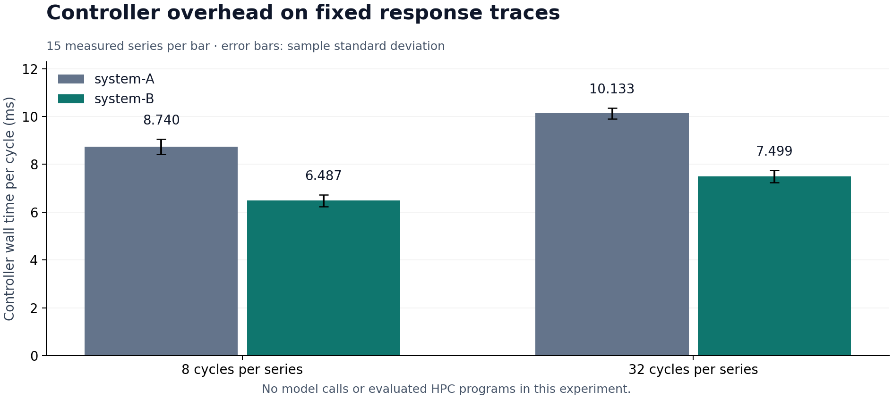
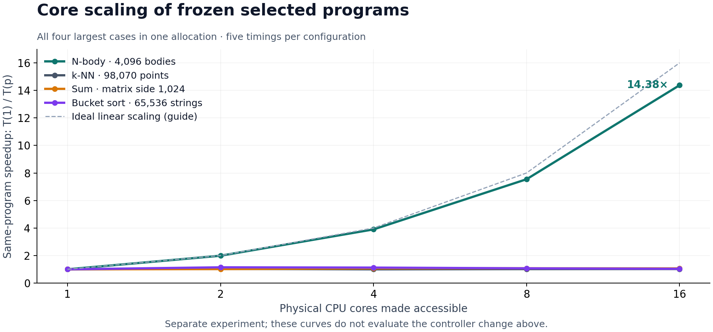

# HPC Forest · Evidence & Evaluation

_A public protocol and evidence record for evaluating program optimization._

[](https://github.com/Gotman08/hpc-forest-evidence/actions/workflows/verify.yml)
[](LICENSE)

[Français](README.fr.md) · [Protocol](docs/PROTOCOL.md) · [Results](docs/RESULTS.md) · [Reproduce the calculations](docs/REPRODUCIBILITY.md)

## Received evidence and article · 19 October 2026

The current r5 [research article](docs/article/ARTICLE.pdf) and [technical appendices](docs/article/ANNEXES-TECHNIQUES.pdf) integrate the received R2 observations into the abstract, section 3.9 and Appendix L, with three new R1/R2 figures. Read the [article in HTML](docs/article/ARTICLE.html), the [appendices in HTML](docs/article/ANNEXES-TECHNIQUES.html), and the [numeric comparison](docs/article/donnees-r1-r2/comparison.json) at the 19 October 2026, 11:40:35.931 UTC source cutoff. It covers 60 historical R1 cells and one R2 cell with source-confirmed final timings; 59 R2 cells lack scientific measurements. There are **zero scientifically admitted R2 gains and zero admitted R1/R2 pairs**. The timing and cost comparisons are descriptive: the searches differ, and the audit pause consumed the existing wall-clock budget.

The exact earlier [r4 article (19 pages)](docs/article/history/r4/ARTICLE.pdf), [r4 appendices (308 pages)](docs/article/history/r4/ANNEXES-TECHNIQUES.pdf), their sources and all 275 original figures remain available at the 08:40 UTC technical cutoff. The [historical inventory](evidence/received-2026-10-19/README.md) retains the complete admitted historical measurements, confirmations, search records and reconciled cost projections. Its scientific cutoff remains 18 October 2026 at 05:03:23.898140 UTC.

The separate [r4 inventory and provenance](evidence/received-2026-10-19-r4/README.md) records the received operational state and [sixty-cell matrix](evidence/received-2026-10-19-r4/matrix15.csv): fifteen subjects × four models at MAX, seed 23. Eleven measured R1 zero gains retain the reference program (speedup 1); all R2 results remain `NA`, with zero R1/R2 pairs. Failed transports and local validation add no scientific result; A4 is preparation only at this cutoff.

Sol MAX's frozen primes pair was remeasured in a separate allocation: 43.8546 ms reference versus 4.9124 ms candidate (8.9273×), over twelve certified inputs and five timing pairs. This is a finite benchmark result, using the same evaluator implementation, rather than an independent implementation or a model ranking. The supplement retains unsuccessful attempts and unknown costs. See the [updated observations and campaign scope](docs/RECEIVED-2026-10-19.md).

The subsequent [zero-model baseline qualification](evidence/qualification-2026-10-19/README.md) has also completed: all fifteen references, 75 confirmation timings, received and checked from one 65-second ARM allocation. These are baseline measurements; no native R2 model result or speedup is claimed by this qualification.

The separate [first native R2 batch](evidence/native-first-batch-2026-10-19/README.md), at the 11:11:41.348 UTC cutoff, records Luna MAX on 2020-quicksort: three initial search timings, a contemporary reference, two delivered calls and 32,765 exact tokens. Private CLI audit and ARM release acceptance are received. This dated initial observation contains no final confirmation or scientifically admitted gain. Its bytes and the earlier r4 snapshot remain unchanged; the current article separately adds the later source-confirmed five-plus-five timings without promoting them to independent performance proof.

HPC Forest studies a practical question: **can a system produce correct programs that run faster under a fixed search budget?** The evaluation uses frozen starting programs, external correctness checks, raw timings and a separate final confirmation. Another system can follow the same contract without disclosing its internal implementation.

This repository publishes the evaluation method, selected audited observations and the tools needed to recalculate them. It is the **public evidence repository**; the internal optimization engine and protected evaluation inputs are not distributed here.

## What is measured so far

| Observation | Result | What it measures |
| --- | --- | --- |
| Controller variants, eight cycles per series | 8.740 → 6.487 ms/cycle; **25.78% less time** | Controller overhead on fixed synthetic response traces |
| Controller variants, 32 cycles per series | 10.133 → 7.499 ms/cycle; **25.99% less time** | The same finite overhead experiment |
| Frozen N-body program, 4,096 bodies | **14.38×** from one to 16 accessible physical CPU cores | Core scaling of one already selected executable |
| Other three largest CPU cases | 1.02×–1.06× from one to 16 cores | Near-flat scaling in the same allocation |

Sources: [raw controller records](evidence/controller/timings.jsonl), [raw CPU records](evidence/cpu-scaling/timings.json), [recalculated results](evidence/results.json).

The controller and CPU observations are **separate experiments**. The CPU curves predate the controller comparison and cannot establish its benefit. The controller experiment contains no model calls and does not measure the quality of programs produced by a model. No weight-learning improvement is established in this release.





## Verify in under a minute

Python **3.11 or later** is sufficient. The verification tools and tests use the standard library, work offline and do not call models, compile candidates or execute evaluated binaries.

```bash
git clone https://github.com/Gotman08/hpc-forest-evidence.git
cd hpc-forest-evidence
python -m tools.verify
python -m unittest discover -s tests -v
```

The verifier checks file hashes, local documentation links, design completeness and the published arithmetic: **144 controller series, 2,400 measured cycles, and 200 CPU timings across 40 configurations**, plus the current comparison's **60 cells and 26 timing samples**. It does not certify the original execution environment or independently reproduce program correctness. [Reproduction scope](docs/REPRODUCIBILITY.md) explains the distinction.

## The evaluation idea

The following diagram describes the **external evaluation contract**, not the internal engine.

```mermaid
flowchart LR
    accTitle: External program evaluation contract
    accDescr: A fresh system receives a frozen task and budget, returns candidate programs, and an external evaluator checks correctness before final timing and evidence publication.
    frozen_task["Frozen task and budget"] --> system["System under evaluation"]
    system --> candidates["Candidate programs"]
    candidates --> checks["External correctness checks"]
    checks --> confirmation["Independent final confirmation"]
    confirmation --> record["Raw records and conclusions"]
```



The main comparison profile uses 1,800 seconds and a declared 1.5 million-token ceiling per search, four ARM64 CPU cores and 16 GiB for candidate evaluation, three search timings and five interleaved final timings. A gain requires correct outputs and at least 3% lower mean runtime in final confirmation. These are protocol parameters, not a claim that every configured call or token was realized.

Read the [full protocol](docs/PROTOCOL.md), [limitations](docs/LIMITATIONS.md), and [guide to comparing your own system](docs/COMPARING.md) before drawing conclusions.

## Find your way around

| Path | Contents |
| --- | --- |
| [docs/RESULTS.md](docs/RESULTS.md) | Observations, formulas and interpretation |
| [docs/PROTOCOL.md](docs/PROTOCOL.md) | External experimental contract |
| [docs/PROTOCOLE.fr.md](docs/PROTOCOLE.fr.md) | Protocole en français |
| [docs/REPRODUCIBILITY.md](docs/REPRODUCIBILITY.md) | Verification, figure rendering and provenance |
| [docs/COMPARING.md](docs/COMPARING.md) | Use the protocol with another system |
| [docs/LIMITATIONS.md](docs/LIMITATIONS.md) | What remains unproven |
| [evidence/](evidence/README.md) | Raw observations, provenance and computed results |
| [templates/](templates/README.md) | Blank plans, environment and timing sheets |
| [tools/](tools/recompute.py) | Read-only arithmetic and integrity checks |
| [tests/](tests/test_evidence.py) | Rejection tests for incomplete or inconsistent evidence |

## Project status and citation

The first release is **0.1.0**, dated 16 October 2026; the current checkout also includes the received evidence update and article r5 of 19 October. Cite the exact commit for that update. The native campaign plan covers fifteen subjects and four models, all at MAX, after the completed primes pilot and baseline qualification. The current article distinguishes one source-confirmed R2 cell from 59 cells without measurements and from scientifically admitted comparisons, whose count remains zero. Weight-learning experiments remain future work. See the [roadmap](docs/ROADMAP.md) and [changelog](CHANGELOG.md).

Authors: **Nicolas Marano and Romain Despoullain**. Use [CITATION.cff](CITATION.cff) and include the exact commit or release when citing a result. Code, original documentation and the published timing projection are provided under the [MIT license](LICENSE). Third-party benchmark statements and programs are not redistributed.

Contributions should preserve the boundary between observed, recalculated and proposed claims. See [CONTRIBUTING.md](CONTRIBUTING.md).
