# HPC-Forest — Annexes techniques et données vérifiables

**Nicolas Marano · Romain Despoullain**

Complément de l’article de recherche du 19 octobre 2026. Arrêté des résultats scientifiques admis : 18/10/2026 à 05 h 03 UTC.

Les résultats ci-dessous sont des observations documentaires. Aucun programme, oracle ou protocole expérimental n’a été modifié pour cette édition. Les exports complets accompagnent le document ; ils ne sont jamais réinjectés dans les recherches.

## A. Sources, domaines et qualifications de conformité

La comparaison porte sur la cible expérimentale ARM64 préparée. Le passage des contrôles exacts ne certifie pas le domaine universel, les algorithmes exigés ou le paquet d’un concours. Le registre suivant sépare les exclusions de préparation des résultats des modèles.

| Sujet / famille | Statut et limite |
|---|---|
| 2020 tropical | Admis R1 ; contrôles CPU limités aux vrais contrats Luna MAX reçus. Graphes simples connexes finis de la revue ; optimalité vérifiée indépendamment sur ces cas. |
| 2020 permutations | Admis ; entrées reçues à symboles distincts. Les essais synthétiques avec répétitions ne certifient pas le candidat sur tous les multiensembles. |
| 2020 quicksort | Gain observable confirmé ; fidélité algorithmique stricte non certifiée. Candidat introsort hybride : insertion sous 24 éléments, repli heapsort. Aucun lot CPU admis pour ce sujet. |
| 2020 Jacobi | Exclu : observabilité insuffisante du calcul à certifier. |
| 2021 Johnson | Exclu : contrôle checksum non certifié. |
| 2021 graph / metrics / Sokoban / Jacobi | Admis dans les contrats préparés ; les noms Jacobi 2020 et 2021 ne sont pas interchangeables. |
| 2022 k-NN / sum / bucket sort | Contrats et formats reçus ; contrôle exact dans le domaine fini préparé. |
| 2022 N-body | Compteur entier d’en-tête du programme officiel conservé, puis six float32 par particule ; divergence de présentation entre prose et source. |
| 2023 count / sum / npbonacci | Admis dans R1 ; les grands jeux supplémentaires count ont un oracle de référence canonique dans les diagnostics CPU. |
| 2023 path | Exclu : initialisation non certifiée sous GCC. |
| 2023 primes / supplément R2 | Retenu avant tout modèle R2 : les fragments décimaux indépendants ne certifient pas l’origine première. Prévol mécanique insuffisant. |
| MPI / SIMD / threads | MPI 2023 conditionnel, au plus quatre processus dans les règles examinées ; aucune obligation établie de douze nœuds. Option OpenMP ou trace SIMD statique : aucune preuve isolée de threads/instructions utiles. |
| 2024 / 2025 | Aucun sujet exploitable publié dans les pages examinées ; aucune donnée de problème inventée. |

### A.1. Archives officielles consultées

Les copies locales du catalogue conservent l’URL, la taille et l’empreinte intégrale. Les noms ci-dessous désignent les fichiers d’origine ; les contrats adaptés sont exportés par campagne en annexe G.

| Édition / fichier | SHA-256 |
|---|---|
| 2020 / problemset.pdf | f5db3a682c5d3530e0edebbefbbf79ce7309b6a00940f0a35f8abb9d5ad78a3c |
| 2020 / tropical.zip | 05b5931c533b13b99dc45a0695223984708d0098936e6cc64afbae60b30d9789 |
| 2020 / quicksort.zip | 4cacb28888f79b51c64eff7706a458f163316eb7adc7b56a210fd5d9ab1e07d0 |
| 2020 / jacobi.zip | a48528dacec7f1f8a7d7d8bffce1d5625bb65e6e83c25652272febf50427f37d |
| 2020 / permutations.zip | f5c15f590e7208c72d133adf57a729ce32af8e38e8fb3595114617970bfaa198 |
| 2020 / primes.zip | 978f299d25c398d5513127f1228c3cbb57b4047d0a21919db8cbfdc9fb195d54 |
| 2020 / graph.zip | 60900b051ace902719d8a8c0fc3dca67ea01da4338656250fa796a4e7cb6991d |
| 2021 / problemset.pdf | 5f6967b423162f31a5eead1e570bb2798b320376bab1c872a0d46bb34cba8ca6 |
| 2021 / graph.zip | 1f1499f10047f10a19d94747df2cbc6a24d634e895e3cf978e85fe182804f54e |
| 2021 / metrics.zip | eced664cb50ec6c5e49b4049a66e79b583cca299ffe0159fadc4f6ee4cc75667 |
| 2021 / sokoban.zip | a70d130d3e51d25a8b3cd313eec50c0079701111b7dbe4ed5256d951bac65b50 |
| 2021 / johnson.zip | d344bb50f10dbe896da445da8128a47cb644ad3bbdc0a4026b571619f7153f94 |
| 2021 / jacobi.zip | 57959bd70e13c9263e5756f9c7164997b3e4606166b85078d3c4708c5776177e |
| 2022 / problemset.pdf | a89c32d1d11ab953d936edc54fb3a1a01735a8286cdc083694be986a5f243da7 |
| 2022 / knn.zip | 768d2cc0115e7ba3679089ecd8271327b786e40de69c9a589dcf7bfc7c230131 |
| 2022 / sum.zip | 2dc1fd6d840fda1c94276a6cb6edccfb1e4c435f632363f4fc018bb6dc04de1d |
| 2022 / nbody.zip | 79d76b34522f5e4c77218fcb187c95a79a0ce951d8b302b3392956c02ed90365 |
| 2022 / bucketsort.zip | d04bf6326b84ac2d18c687e91915b91091e23cca1f5c861e3e0cee02bd99b811 |
| 2023 / problemset.pdf | c1d785297d32aed6ed8b439387e312ae7c1659f229e9b0de4849a75394966de4 |
| 2023 / sum.zip | ef174e2f141ff83f1b8942471a9aa9df0d55ee460f15e82c89aeb82f8f664157 |
| 2023 / path.zip | a9383fc93646df993dbeaaea30375faa265a8d12fa7486092e50f4ab38717c29 |
| 2023 / npbonacci.zip | cacdaf91ffc4bec00f8ee7b704e984cd7c3d19da9186109464d991ac99e15565 |
| 2023 / count.zip | 9b4fd228e8a9169ca1fb9aa3d33af3a0519f5c160ac8f6ead1f2c29a34ef4bb3 |

### A.2. Revue complémentaire de quicksort

La revue indépendante vérifie sept vrais cas et douze sorties capturées, avec onze tests du lecteur. Son transport mécanique ARM64 est reçu et audité : le préfixe d’un million de valeurs concorde entre C et Python ; une simplification algébrique modifierait 4 351 valeurs binaires64. Le MD5 est actif. Le job 748578 garde son échec d’archivage après réussite des contrôles ; la livraison corrective 748579 archive les mêmes fichiers sans rejouer les contrôles. L’archive 68d4b6a45528cbf65a8b25bdb3a521e1520be5ff69859474ccff6f72bcfaa5e3 et les inventaires lient 37 fichiers restaurés et 775 fichiers de la campagne Luna inchangés. Aucun candidat n’a été compilé ou exécuté par cette revue et aucun modèle n’a été appelé. La fidélité stricte de l’hybride Luna et son admission CPU restent retenues ; le cas à dix millions et le repli ne sont pas couverts. Cette preuve mécanique ne certifie ni l’algorithme Luna ni automatiquement le programme Astra.

## B. Vingt cellules count 2023

Une recherche/graine 23 par ligne. Moyennes et écarts-types de confirmation en secondes ; cinq temps par programme. Le pourcentage décrit la réduction par rapport à la référence de la même cellule, sans fusion d’allocations.

| Modèle / effort | T₀ ± s₀ (s) | T ± s (s) | g (%) | Appels / inconnus | Jetons connus |
|---|---|---|---|---|---|
| GPT 6-luna / max | 0,080360 ± 0,000068 | 0,008053 ± 0,000099 | 89,9794 | 10 / 0 | 242 614 |
| GPT 6-luna / xhigh | 0,080373 ± 0,000355 | 0,008214 ± 0,000149 | 89,7798 | 10 / 0 | 213 522 |
| GPT 6-luna / high | 0,080967 ± 0,000460 | 0,034380 ± 0,000698 | 57,5382 | 10 / 0 | 167 224 |
| GPT 6-luna / medium | 0,079937 ± 0,000286 | 0,079937 ± 0,000286 | 0,0000 | 15 / 0 | 217 062 |
| GPT 6-luna / low | 0,079822 ± 0,000161 | 0,048066 ± 0,000131 | 39,7840 | 16 / 0 | 228 813 |
| GPT 6-astra / max | 0,080437 ± 0,000544 | 0,007500 ± 0,000223 | 90,6762 | 5 / 1 | 84 489 |
| GPT 6-astra / xhigh | 0,079250 ± 0,000417 | 0,008066 ± 0,000131 | 89,8220 | 10 / 1 | 173 597 |
| GPT 6-astra / high | 0,079131 ± 0,000367 | 0,008553 ± 0,000106 | 89,1910 | 10 / 0 | 165 497 |
| GPT 6-astra / medium | 0,079247 ± 0,000326 | 0,010114 ± 0,000142 | 87,2378 | 10 / 0 | 154 900 |
| GPT 6-astra / low | 0,079567 ± 0,000294 | 0,010284 ± 0,000189 | 87,0750 | 10 / 0 | 151 224 |
| GPT 5.6-terra / max | 0,078930 ± 0,000122 | 0,022780 ± 0,000249 | 71,1387 | 4 / 2 | 37 514 |
| GPT 5.6-terra / xhigh | 0,080500 ± 0,000189 | 0,022262 ± 0,000207 | 72,3451 | 7 / 1 | 112 256 |
| GPT 5.6-terra / high | 0,081124 ± 0,000482 | 0,021473 ± 0,000354 | 73,5310 | 10 / 0 | 171 687 |
| GPT 5.6-terra / medium | 0,079642 ± 0,000826 | 0,023399 ± 0,000366 | 70,6193 | 14 / 0 | 219 977 |
| GPT 5.6-terra / low | 0,080793 ± 0,000201 | 0,022662 ± 0,000745 | 71,9506 | 13 / 0 | 200 117 |
| GPT 6.1-sol / max | 0,080508 ± 0,000472 | 0,008158 ± 0,000282 | 89,8664 | 8 / 1 | 146 680 |
| GPT 6.1-sol / xhigh | 0,080330 ± 0,000135 | 0,013948 ± 0,000133 | 82,6365 | 7 / 1 | 104 274 |
| GPT 6.1-sol / high | 0,080519 ± 0,000347 | 0,009005 ± 0,000268 | 88,8160 | 11 / 0 | 204 466 |
| GPT 6.1-sol / medium | 0,080587 ± 0,000218 | 0,012634 ± 0,000294 | 84,3220 | 10 / 0 | 152 522 |
| GPT 6.1-sol / low | 0,080573 ± 0,000271 | 0,010290 ± 0,000239 | 87,2290 | 11 / 0 | 163 126 |

Les cinq mesures brutes de chaque référence et de chaque gagnant sont exportées dans registres-recalcules.json. La comparabilité des vingt contrats est documentée séparément dans comparabilite-max-xhigh-high-medium-low.json. Les références conservées, les doublons et les appels interrompus restent identifiés.

## C. Couvertures R1 et cohortes source-only

Chaque modèle fournit quatorze recherches supplémentaires, une par sujet, en plus de count. Luna, Astra et Sol conservent les références tropical et Sokoban ; Terra conserve cinq références. Les quatorze contrats sont comparables après exclusion du seul temps de calibration propre à chaque allocation ; comparabilite-couvertures-luna-astra-terra-sol-max.json conserve les empreintes. Les temps ne sont pas fusionnés et aucune variabilité entre graines n’est estimée.

### C.1. Luna MAX

| Sujet | T₀ ± s₀ (s) | T ± s (s) | g (%) | Appels / inconnus | Jetons connus |
|---|---|---|---|---|---|
| 2020-tropical | 0,005372 ± 0,000218 | 0,005372 ± 0,000218 | 0,0000 | 11 / 0 | 308 915 |
| 2020-quicksort | 0,068879 ± 0,000160 | 0,028421 ± 0,000145 | 58,7369 | 10 / 0 | 261 707 |
| 2020-permutations | 0,132171 ± 0,001047 | 0,006378 ± 0,000239 | 95,1746 | 10 / 0 | 228 276 |
| 2020-graph | 0,011715 ± 0,000172 | 0,005325 ± 0,000168 | 54,5491 | 14 / 0 | 385 849 |
| 2021-graph | 0,008383 ± 0,000153 | 0,006145 ± 0,000059 | 26,6976 | 10 / 0 | 247 037 |
| 2021-metrics | 0,009361 ± 0,000137 | 0,005213 ± 0,000085 | 44,3167 | 13 / 0 | 346 977 |
| 2021-sokoban | 0,005023 ± 0,000186 | 0,005023 ± 0,000186 | 0,0000 | 12 / 0 | 341 064 |
| 2021-jacobi | 0,065288 ± 0,000266 | 0,043194 ± 0,000260 | 33,8410 | 12 / 0 | 269 047 |
| 2022-knn | 2,049009 ± 0,047583 | 0,026727 ± 0,000179 | 98,6956 | 10 / 0 | 255 877 |
| 2022-sum | 0,128303 ± 0,005332 | 0,054575 ± 0,000911 | 57,4637 | 11 / 0 | 244 436 |
| 2022-nbody | 0,660446 ± 0,000339 | 0,169751 ± 0,000117 | 74,2975 | 11 / 0 | 225 077 |
| 2022-bucketsort | 0,414219 ± 0,000231 | 0,010936 ± 0,000365 | 97,3599 | 10 / 0 | 248 648 |
| 2023-sum | 0,248381 ± 0,000318 | 0,023679 ± 0,000282 | 90,4668 | 10 / 0 | 199 617 |
| 2023-npbonacci | 0,019696 ± 0,000276 | 0,005153 ± 0,000131 | 73,8377 | 10 / 0 | 211 951 |

| Sujet | Statuts de programmes | Sommets | Réparations autonomes réussies |
|---|---|---|---|
| 2020-tropical | {"valid": 8} | 8 | 1 |
| 2020-quicksort | {"valid": 8} | 8 | 0 |
| 2020-permutations | {"valid": 8} | 8 | 0 |
| 2020-graph | {"valid": 8} | 8 | 3 |
| 2021-graph | {"valid": 8} | 8 | 0 |
| 2021-metrics | {"valid": 8} | 8 | 2 |
| 2021-sokoban | {"valid": 7, "duplicate": 1} | 7 | 1 |
| 2021-jacobi | {"valid": 7, "incorrect": 1} | 8 | 0 |
| 2022-knn | {"valid": 8} | 8 | 0 |
| 2022-sum | {"valid": 8} | 8 | 1 |
| 2022-nbody | {"valid": 8} | 8 | 1 |
| 2022-bucketsort | {"valid": 8} | 8 | 0 |
| 2023-sum | {"valid": 8} | 8 | 0 |
| 2023-npbonacci | {"valid": 7, "duplicate": 1} | 7 | 0 |

### C.2. Astra MAX

| Sujet | T₀ ± s₀ (s) | T ± s (s) | g (%) | Appels / inconnus | Jetons connus |
|---|---|---|---|---|---|
| 2020-tropical | 0,005362 ± 0,000124 | 0,005362 ± 0,000124 | 0,0000 | 5 / 0 | 123 595 |
| 2020-quicksort | 0,069192 ± 0,000132 | 0,017399 ± 0,000112 | 74,8535 | 4 / 2 | 41 760 |
| 2020-permutations | 0,132323 ± 0,003000 | 0,006123 ± 0,000201 | 95,3725 | 5 / 2 | 61 147 |
| 2020-graph | 0,012854 ± 0,000847 | 0,006558 ± 0,000781 | 48,9859 | 6 / 1 | 105 864 |
| 2021-graph | 0,008256 ± 0,000107 | 0,005172 ± 0,000098 | 37,3532 | 4 / 1 | 62 262 |
| 2021-metrics | 0,009408 ± 0,000297 | 0,005353 ± 0,000092 | 43,1061 | 5 / 1 | 91 771 |
| 2021-sokoban | 0,004820 ± 0,000098 | 0,004820 ± 0,000098 | 0,0000 | 4 / 1 | 76 738 |
| 2021-jacobi | 0,066286 ± 0,000740 | 0,041743 ± 0,000277 | 37,0261 | 6 / 1 | 99 425 |
| 2022-knn | 2,047488 ± 0,046642 | 0,024006 ± 0,000126 | 98,8275 | 5 / 2 | 63 946 |
| 2022-sum | 0,125696 ± 0,001195 | 0,008913 ± 0,000391 | 92,9089 | 6 / 2 | 73 641 |
| 2022-nbody | 0,660817 ± 0,000238 | 0,169645 ± 0,000101 | 74,3281 | 6 / 1 | 94 471 |
| 2022-bucketsort | 0,415667 ± 0,001431 | 0,010956 ± 0,000154 | 97,3643 | 4 / 1 | 68 020 |
| 2023-sum | 0,248166 ± 0,001100 | 0,071822 ± 0,000250 | 71,0588 | 6 / 1 | 91 466 |
| 2023-npbonacci | 0,019616 ± 0,000138 | 0,005201 ± 0,000077 | 73,4863 | 5 / 1 | 90 098 |

| Sujet | Statuts de programmes | Sommets | Réparations autonomes réussies |
|---|---|---|---|
| 2020-tropical | {"valid": 4, "infrastructure_error": 1} | 4 | 0 |
| 2020-quicksort | {"valid": 1, "infrastructure_error": 3} | 1 | 0 |
| 2020-permutations | {"valid": 2, "infrastructure_error": 3} | 2 | 0 |
| 2020-graph | {"valid": 4, "infrastructure_error": 1} | 4 | 0 |
| 2021-graph | {"valid": 2, "infrastructure_error": 1} | 2 | 0 |
| 2021-metrics | {"valid": 3, "infrastructure_error": 2} | 3 | 0 |
| 2021-sokoban | {"valid": 2, "infrastructure_error": 1} | 2 | 0 |
| 2021-jacobi | {"valid": 4, "infrastructure_error": 2} | 4 | 0 |
| 2022-knn | {"valid": 2, "infrastructure_error": 3} | 2 | 0 |
| 2022-sum | {"valid": 3, "infrastructure_error": 2} | 3 | 0 |
| 2022-nbody | {"valid": 4, "infrastructure_error": 2} | 4 | 0 |
| 2022-bucketsort | {"valid": 2, "infrastructure_error": 2} | 2 | 0 |
| 2023-sum | {"valid": 4, "infrastructure_error": 2} | 4 | 0 |
| 2023-npbonacci | {"valid": 3, "infrastructure_error": 2} | 3 | 0 |

### C.3. Terra MAX

| Sujet | T₀ ± s₀ (s) | T ± s (s) | g (%) | Appels / inconnus | Jetons connus |
|---|---|---|---|---|---|
| 2020-tropical | 0,005848 ± 0,000313 | 0,005848 ± 0,000313 | 0,0000 | 4 / 2 | 62 952 |
| 2020-quicksort | 0,070826 ± 0,001313 | 0,016393 ± 0,000445 | 76,8546 | 4 / 2 | 57 019 |
| 2020-permutations | 0,133895 ± 0,001307 | 0,006232 ± 0,000121 | 95,3456 | 4 / 1 | 94 335 |
| 2020-graph | 0,012172 ± 0,000223 | 0,005684 ± 0,000219 | 53,3030 | 4 / 2 | 78 522 |
| 2021-graph | 0,008480 ± 0,000239 | 0,005309 ± 0,000192 | 37,3848 | 4 / 0 | 119 138 |
| 2021-metrics | 0,010017 ± 0,000183 | 0,010017 ± 0,000183 | 0,0000 | 3 / 1 | 71 868 |
| 2021-sokoban | 0,005186 ± 0,000169 | 0,005186 ± 0,000169 | 0,0000 | 4 / 2 | 54 261 |
| 2021-jacobi | 0,067177 ± 0,000637 | 0,046161 ± 0,000359 | 31,2849 | 4 / 1 | 72 462 |
| 2022-knn | 2,039423 ± 0,029611 | 0,024480 ± 0,000253 | 98,7997 | 4 / 2 | 63 993 |
| 2022-sum | 0,125469 ± 0,000735 | 0,009893 ± 0,000159 | 92,1149 | 7 / 2 | 138 827 |
| 2022-nbody | 0,661494 ± 0,001514 | 0,169750 ± 0,000173 | 74,3383 | 5 / 2 | 53 478 |
| 2022-bucketsort | 0,418769 ± 0,002185 | 0,012826 ± 0,000718 | 96,9373 | 4 / 2 | 72 558 |
| 2023-sum | 0,252135 ± 0,000773 | 0,252135 ± 0,000773 | 0,0000 | 4 / 3 | 21 393 |
| 2023-npbonacci | 0,022110 ± 0,000567 | 0,022110 ± 0,000567 | 0,0000 | 3 / 2 | 20 165 |

| Sujet | Statuts de programmes | Sommets | Réparations autonomes réussies |
|---|---|---|---|
| 2020-tropical | {"infrastructure_error": 2, "valid": 1} | 1 | non agrégé dans ce reçu |
| 2020-quicksort | {"infrastructure_error": 2, "valid": 1} | 1 | non agrégé dans ce reçu |
| 2020-permutations | {"valid": 2, "infrastructure_error": 1} | 2 | non agrégé dans ce reçu |
| 2020-graph | {"infrastructure_error": 2, "valid": 1} | 1 | non agrégé dans ce reçu |
| 2021-graph | {"valid": 2, "incorrect": 1, "infrastructure_error": 1} | 3 | non agrégé dans ce reçu |
| 2021-metrics | {"infrastructure_error": 3} | 0 | non agrégé dans ce reçu |
| 2021-sokoban | {"valid": 2, "infrastructure_error": 2} | 2 | non agrégé dans ce reçu |
| 2021-jacobi | {"valid": 2, "infrastructure_error": 1} | 2 | non agrégé dans ce reçu |
| 2022-knn | {"valid": 1, "infrastructure_error": 2} | 1 | non agrégé dans ce reçu |
| 2022-sum | {"valid": 2, "infrastructure_error": 2} | 2 | non agrégé dans ce reçu |
| 2022-nbody | {"valid": 2, "infrastructure_error": 2} | 2 | non agrégé dans ce reçu |
| 2022-bucketsort | {"infrastructure_error": 3, "valid": 1} | 1 | non agrégé dans ce reçu |
| 2023-sum | {"infrastructure_error": 3} | 0 | non agrégé dans ce reçu |
| 2023-npbonacci | {"infrastructure_error": 3} | 0 | non agrégé dans ce reçu |

### C.4. Sol MAX

| Sujet | T₀ ± s₀ (s) | T ± s (s) | g (%) | Appels / inconnus | Jetons connus |
|---|---|---|---|---|---|
| 2020-tropical | 0,006059 ± 0,000097 | 0,006059 ± 0,000097 | 0,0000 | 7 / 1 | 149 374 |
| 2020-quicksort | 0,069852 ± 0,000553 | 0,015355 ± 0,000152 | 78,0170 | 6 / 0 | 157 441 |
| 2020-permutations | 0,149057 ± 0,002206 | 0,009475 ± 0,001603 | 93,6435 | 7 / 1 | 145 289 |
| 2020-graph | 0,013568 ± 0,001026 | 0,006681 ± 0,000996 | 50,7598 | 5 / 1 | 88 890 |
| 2021-graph | 0,010737 ± 0,001202 | 0,007273 ± 0,000767 | 32,2613 | 7 / 0 | 176 957 |
| 2021-metrics | 0,009711 ± 0,000159 | 0,005566 ± 0,000205 | 42,6904 | 7 / 1 | 169 233 |
| 2021-sokoban | 0,007715 ± 0,000199 | 0,007715 ± 0,000199 | 0,0000 | 10 / 0 | 262 585 |
| 2021-jacobi | 0,065560 ± 0,000219 | 0,041574 ± 0,000371 | 36,5862 | 10 / 0 | 255 924 |
| 2022-knn | 2,036605 ± 0,042157 | 0,022175 ± 0,000258 | 98,9112 | 8 / 1 | 169 536 |
| 2022-sum | 0,127503 ± 0,005047 | 0,008937 ± 0,000335 | 92,9904 | 10 / 1 | 222 593 |
| 2022-nbody | 0,662161 ± 0,000510 | 0,089620 ± 0,000575 | 86,4655 | 10 / 0 | 226 134 |
| 2022-bucketsort | 0,436027 ± 0,013934 | 0,017376 ± 0,001359 | 96,0148 | 7 / 1 | 150 357 |
| 2023-sum | 0,247469 ± 0,000676 | 0,029781 ± 0,000362 | 87,9658 | 10 / 0 | 194 239 |
| 2023-npbonacci | 0,019928 ± 0,000282 | 0,005382 ± 0,000164 | 72,9940 | 6 / 1 | 133 778 |

| Sujet | Statuts de programmes | Sommets | Réparations autonomes réussies |
|---|---|---|---|
| 2020-tropical | {"valid": 5, "infrastructure_error": 1} | 5 | 0 |
| 2020-quicksort | {"valid": 4, "infrastructure_error": 1} | 4 | 0 |
| 2020-permutations | {"valid": 5, "infrastructure_error": 1} | 5 | 0 |
| 2020-graph | {"valid": 2, "infrastructure_error": 2} | 2 | 0 |
| 2021-graph | {"valid": 6, "infrastructure_error": 1} | 6 | 0 |
| 2021-metrics | {"valid": 5, "infrastructure_error": 1} | 5 | 0 |
| 2021-sokoban | {"valid": 8} | 8 | 0 |
| 2021-jacobi | {"valid": 8} | 8 | 0 |
| 2022-knn | {"valid": 6, "infrastructure_error": 1} | 6 | 0 |
| 2022-sum | {"valid": 7, "infrastructure_error": 1} | 7 | 0 |
| 2022-nbody | {"valid": 8} | 8 | 0 |
| 2022-bucketsort | {"valid": 5, "infrastructure_error": 1} | 5 | 0 |
| 2023-sum | {"valid": 8} | 8 | 0 |
| 2023-npbonacci | {"valid": 4, "infrastructure_error": 1} | 4 | 0 |

Terra MAX : archive bc0db2c61712a9fc09ee950a957ae1e4d2b98bb9fc8eeaa48e6cd42a111f56df ; 4 178 fichiers restaurés inchangés avant/après audit, manifeste inclus. Neuf programmes modifiés sont confirmés ; tropical, metrics 2021, Sokoban, somme 2023 et npbonacci gardent la référence. Les 47 missions comptent 17 programmes valides, un incorrect et 29 interruptions d’infrastructure ; 18 sommets sont mesurés. La réconciliation distingue 63 requêtes publiées, 62 livraisons, 58 invocations observées, 980 971 jetons exacts connus et 24 invocations non mesurées. Une requête expirée sans réponse n’a pas de preuve d’invocation ni de consommation connue. Elle n’est pas ajoutée artificiellement aux 58 appels, ni comptée comme une consommation nulle. La réponse tardive 98718e2212264ce18607f60d15f40b9c est retransmise à l’identique sans nouvelle génération ; les premiers refus de réception et la panne de transfert sont conservés. couts-terra.json déduplique session/nonce et attribue les appels à leurs sujets et rôles enregistrés. Aucune mesure CPU postérieure Terra n’est admise par cette mise à jour ; la revue algorithmique Luna ne certifie pas Terra.

Sol MAX : archive fbd141c36a7b9f56da683abbeb007227dee456ec9339b573d698e48758cf2434 ; 9 268 fichiers restaurés inchangés, manifeste inclus, et 90 sources R1 vérifiées. Douze programmes modifiés sont confirmés ; tropical et Sokoban gardent leur référence. Les 92 missions comptent 81 valides et onze infrastructure_error, pour 81 sommets notés. Les 113 requêtes sont livrées et réconciliées : 110 invocations, 2 502 330 jetons exacts connus, huit invocations non mesurées et trois expirations prouvées avant invocation. Les parents, sources, sorties et cinq confirmations sont revérifiés indépendamment. Aucun résultat négatif n’est rejoué et aucun résultat CPU postérieur Sol n’est ajouté. La conformité algorithmique quicksort doit être qualifiée séparément pour ce modèle.

Astra MAX : archive 25b9767378516f1066c3ba4989b1d98dbacc3698ff6204baaf4a29512d5795e6 ; 6 155 fichiers revérifiés avant/après audit, 71 appels dont 17 sans mesure exacte finale, 1 144 204 jetons exacts connus. Les 67 missions enregistrées comprennent 40 programmes valides et 27 interruptions d’infrastructure ; 40 sommets sont notés, de profondeur maximale un et deux fils au plus. Les 14 requêtes de mère publiées et l’absence de réparation réussie diffèrent des réalisations Luna. Les plafonds n’ont pas garanti huit programmes par cellule ; ces écarts et les compteurs manquants limitent la comparaison. Aucun candidat n’est relancé ou réparé par l’opérateur.

### C.5. Première cohorte source-only : Luna MAX

Quinze racines fraîches sont reçues et auditées sous 749843, avec la session bb7a58941e74486ba24267f2f526de8f et la source 9a68a83fde4acb6bd247d79e00490e7d36f0c4c59c6c881152101e4c499387eb. Quatorze programmes modifiés sont confirmés et Sokoban conserve la référence. Le harnais interne est désactivé ; la mère, les arbres A/B/C, les intégrations G et l’évaluation externe restent présents. Ce bras n’est pas l’agent Codex à outils. L’archive 4ed34c905e42c51f318538d7d09cf60a9f627d1588cf5607ff860235be13d672 est restaurée deux fois avec les sources officielles ; 7 433 fichiers restent identiques avant et après les audits natifs. Les quinze contrats correspondent aux références R1 après exclusion du seul benchmark.reference_seconds ; les temps des allocations ne sont pas fusionnés.

*Tableau C.5 — Source-only Luna MAX : quinze racines fraîches, moyenne ± écart-type de cinq confirmations. Une seule graine ; références propres à cette allocation.*

| Sujet | Référence (s) | Retenu (s) | Réduction (%) |
|---|---|---|---|
| 2020-tropical | 0,01023 ± 0,00042 | 0,00970 ± 0,00040 | 5,13 |
| 2020-quicksort | 0,06885 ± 0,00024 | 0,01722 ± 0,00037 | 74,99 |
| 2020-permutations | 0,13273 ± 0,00128 | 0,00637 ± 0,00011 | 95,20 |
| 2020-graph | 0,01184 ± 0,00030 | 0,00559 ± 0,00022 | 52,76 |
| 2021-graph | 0,00836 ± 0,00014 | 0,00609 ± 0,00026 | 27,11 |
| 2021-metrics | 0,00965 ± 0,00015 | 0,00655 ± 0,00021 | 32,15 |
| 2021-sokoban | 0,00465 ± 0,00021 | 0,00465 ± 0,00021 | 0,00 |
| 2021-jacobi | 0,06591 ± 0,00060 | 0,04396 ± 0,00017 | 33,30 |
| 2022-knn | 2,05154 ± 0,06945 | 0,02703 ± 0,00028 | 98,68 |
| 2022-sum | 0,12642 ± 0,00152 | 0,05560 ± 0,00076 | 56,02 |
| 2022-nbody | 0,66675 ± 0,00051 | 0,17541 ± 0,00062 | 73,69 |
| 2022-bucketsort | 0,42101 ± 0,00225 | 0,01242 ± 0,00031 | 97,05 |
| 2023-sum | 0,25144 ± 0,00050 | 0,02146 ± 0,00058 | 91,46 |
| 2023-npbonacci | 0,02202 ± 0,00017 | 0,00897 ± 0,00034 | 59,26 |
| 2023-count | 0,08111 ± 0,00035 | 0,02292 ± 0,00054 | 71,74 |

Les 120 missions comprennent 112 valides, cinq build_failed, deux incorrectes et un doublon. Les 119 sommets notés incluent les compilations et sorties rejetées : ils ne représentent pas 119 programmes chronométrés. Chaque recherche possède la graine 23, au plus huit programmes et deux épisodes de mère, 1800 secondes et 1,5 million de jetons ; trois mesures de recherche et cinq confirmations sont vérifiées. Les 150 requêtes sont livrées et réconciliées, avec 3 564 823 jetons exacts et aucun compteur manquant dans ce groupe. L’allocation de quatre CPU ARM64, 16 GiB et zéro GPU dure 3 h 48 min 1 s ; 241,2 secondes CPU et 229,9 MiB RSS sont les compteurs du job, sans CPU d’inférence ni nombre exact de threads. Les journaux, parents, sources, finalistes et sorties sont liés dans le reçu indépendant et les exports. Une seule graine, l’ordre temporel et R1 partiellement historique empêchent un avantage causal général du harnais. Aucune conformité algorithmique stricte de quicksort ni nouvelle mesure CPU postérieure n’est admise.

### C.6. Couverture Luna xhigh : quatorze autres sujets

749940 est reçu, audité et réconcilié. Treize programmes modifiés sont confirmés ; tropical conserve sa référence. Les 112 missions comptent 108 valides et quatre incorrectes, avec 112 sommets notés. Le harnais R1 reste activé. Les 158 requêtes sont livrées et réconciliées : 158 invocations, 3 434 224 jetons exacts pour cette cohorte, zéro compteur manquant et aucune expiration avant invocation. La source R1, les identités xhigh/Luna, parents, sources d’intégration, finalistes et cinq confirmations sont vérifiés. Les quatorze contrats correspondent aux quatre couvertures MAX après exclusion du seul benchmark.reference_seconds ; les temps restent propres à chaque allocation. Une seule graine et l’ordre temporel ne prouvent pas un classement causal des efforts.

*Tableau C.6 — Luna xhigh, cinq confirmations par référence et programme retenu ; une recherche par cellule.*

| Sujet | T₀ ± s₀ (s) | T ± s (s) | g (%) | Appels | Jetons exacts |
|---|---|---|---|---|---|
| 2020-tropical | 0,005504 ± 0,000133 | 0,005504 ± 0,000133 | 0,0000 | 10 | 269 089 |
| 2020-quicksort | 0,069104 ± 0,000228 | 0,027152 ± 0,000195 | 60,7077 | 10 | 241 335 |
| 2020-permutations | 0,135238 ± 0,000874 | 0,006260 ± 0,000205 | 95,3709 | 10 | 189 106 |
| 2020-graph | 0,011591 ± 0,000048 | 0,005494 ± 0,000065 | 52,5987 | 15 | 357 392 |
| 2021-graph | 0,008298 ± 0,000107 | 0,006203 ± 0,000094 | 25,2420 | 10 | 204 174 |
| 2021-metrics | 0,009645 ± 0,000204 | 0,005442 ± 0,000044 | 43,5830 | 10 | 247 058 |
| 2021-sokoban | 0,006750 ± 0,000236 | 0,006459 ± 0,000316 | 4,3121 | 12 | 293 196 |
| 2021-jacobi | 0,072395 ± 0,001178 | 0,045375 ± 0,000606 | 37,3234 | 17 | 350 637 |
| 2022-knn | 2,039643 ± 0,022505 | 0,029358 ± 0,000251 | 98,5606 | 10 | 230 616 |
| 2022-sum | 0,131858 ± 0,005587 | 0,034485 ± 0,000694 | 73,8468 | 12 | 226 931 |
| 2022-nbody | 0,665615 ± 0,000432 | 0,172002 ± 0,000552 | 74,1590 | 10 | 179 705 |
| 2022-bucketsort | 0,418888 ± 0,001569 | 0,011585 ± 0,000333 | 97,2344 | 12 | 265 772 |
| 2023-sum | 0,251170 ± 0,000663 | 0,024622 ± 0,000478 | 90,1972 | 10 | 178 509 |
| 2023-npbonacci | 0,021919 ± 0,000432 | 0,007409 ± 0,000193 | 66,1989 | 10 | 200 704 |

Archive 5b0af17e376c3e98fd88e25c4be7e55c690c9c4d62a2a90c49f21e14cf7f8859 : 12 427 fichiers restaurés inchangés, manifeste inclus, 90 sources R1 identiques. Allocation de 3 h 15 min 53 s, quatre CPU ARM64 / 16 GiB / zéro GPU ; 302,8 secondes CPU et 287,8 MiB RSS sont les compteurs du job, sans mesure du CPU d’inférence ni preuve de threads effectifs. Budgets : 1800 secondes et 1,5 million de jetons par cellule, huit programmes et deux épisodes de mère maximum, trois mesures de recherche et cinq confirmations, seuil 3 %. Les erreurs de correction sont conservées sans rejeu. Aucun nouveau diagnostic CPU postérieur ni qualification algorithmique stricte quicksort n’est ajouté.

### C.7. Source-only Astra MAX : quinze recherches fraîches

750122 est clos, reçu et audité. Quatorze programmes modifiés confirmés, tropical conservé ; le cumul historique lors de cette réception était 30/300 issues prévues, sans préalable humain actuel. Les 85 missions comprennent 66 valides, seize infrastructure_error, une generation_failed, une build_failed et une runtime_failed. Les 68 sommets notés ne sont pas 68 programmes valides chronométrés. Les quinze contrats correspondent à R1 après exclusion du seul benchmark.reference_seconds ; temps non fusionnés. Une graine, ordre temporel et R1 historique empêchent un avantage causal général. Le harnais interne est désactivé, mère/TreeQuest/A-B-C/G et évaluation externe conservés ; ce bras n’est pas l’agent Codex à outils.

*Tableau C.7 — Source-only Astra MAX : cinq confirmations par référence et programme retenu, compteurs incomplets explicites.*

| Sujet | T₀ ± s₀ (s) | T ± s (s) | g (%) | Appels / inconnus | Jetons connus |
|---|---|---|---|---|---|
| 2020-tropical | 0,006781 ± 0,000091 | 0,006781 ± 0,000091 | 0,0000 | 7 / 1 | 152 839 |
| 2020-quicksort | 0,070818 ± 0,000174 | 0,019552 ± 0,000279 | 72,3918 | 6 / 1 | 127 164 |
| 2020-permutations | 0,133428 ± 0,001711 | 0,007197 ± 0,000616 | 94,6063 | 7 / 1 | 140 077 |
| 2020-graph | 0,011629 ± 0,000085 | 0,005546 ± 0,000318 | 52,3131 | 7 / 1 | 128 985 |
| 2021-graph | 0,008325 ± 0,000149 | 0,005856 ± 0,000108 | 29,6539 | 6 / 1 | 115 464 |
| 2021-metrics | 0,009402 ± 0,000155 | 0,006916 ± 0,000143 | 26,4427 | 6 / 1 | 112 632 |
| 2021-sokoban | 0,007317 ± 0,000217 | 0,006971 ± 0,000376 | 4,7341 | 6 / 1 | 118 297 |
| 2021-jacobi | 0,067243 ± 0,001533 | 0,046295 ± 0,001271 | 31,1522 | 6 / 0 | 119 369 |
| 2022-knn | 2,035748 ± 0,033853 | 0,027876 ± 0,001300 | 98,6307 | 6 / 0 | 125 143 |
| 2022-sum | 0,129224 ± 0,001370 | 0,012440 ± 0,000448 | 90,3730 | 7 / 1 | 123 713 |
| 2022-nbody | 0,662431 ± 0,000402 | 0,170524 ± 0,000211 | 74,2578 | 6 / 1 | 106 095 |
| 2022-bucketsort | 0,416119 ± 0,000814 | 0,011981 ± 0,000497 | 97,1209 | 6 / 1 | 114 178 |
| 2023-sum | 0,249118 ± 0,000242 | 0,021032 ± 0,000333 | 91,5575 | 10 / 1 | 165 062 |
| 2023-npbonacci | 0,019880 ± 0,000189 | 0,005420 ± 0,000122 | 72,7368 | 5 / 1 | 91 380 |
| 2023-count | 0,078540 ± 0,000317 | 0,011253 ± 0,000206 | 85,6730 | 7 / 1 | 115 894 |

Archive bbae4d61c374a740ceadceb27aca4ec1354cc8c2bf6fea86ad3d1619cc449be2, SHA annoncé/distants/local identiques ; deux restaurations de 5 633 fichiers inchangés. Identité gpt-6-astra/MAX, session aa970cf8bf5d4c1aaa0fdabb21d73a72, sources 9a68a83fde4acb6bd247d79e00490e7d36f0c4c59c6c881152101e4c499387eb, 94 fichiers figés et 609 fichiers officiels reçus avant relais. Les 101 requêtes sont livrées/réconciliées : 98 invocations, 1 856 292 jetons exacts connus, treize invocations non mesurées et trois expirations établies avant invocation. Cache et raisonnement déjà inclus ; aucun total exact de consommation. Allocation COMPLETED 0:0 de 7 h 1 min 47 s, quatre CPU ARM64 / 16 Gio / zéro GPU ; 185 secondes CPU et 186,4 Mio RSS du job, sans mesure du CPU d’inférence ou preuve de threads. Budgets par cellule : 1800 secondes, 1,5 million de jetons, huit programmes et deux épisodes de mère au plus ; trois mesures et cinq confirmations, seuil 3 %. Tous les négatifs restent conservés. Le reçu indépendant signale l’ancien arrêt récursif après audit/réconciliation : violation de la consigne, aucune terminaison étrangère établie. Le coordinateur historique est conservé et interdit de redémarrage ; la réception suivante exige un arrêt individuel identifié.

### C.8. R1 Astra xhigh : quatorze autres sujets

750205 est clos, reçu, audité et réconcilié. Douze programmes modifiés confirmés ; tropical et Sokoban conservent leur référence. Les 95 missions comprennent 80 valides, quatorze infrastructure_error et une generation_failed, pour 80 sommets notés. Le harnais R1 est activé. Les quatorze contrats correspondent aux couvertures MAX Luna/Astra/Terra/Sol après exclusion du seul benchmark.reference_seconds ; les temps restent propres aux allocations.

*Tableau C.8 — R1 Astra xhigh : cinq confirmations, références propres et invocations non mesurées séparées.*

| Sujet | T₀ ± s₀ (s) | T ± s (s) | g (%) | Appels / inconnus | Jetons connus |
|---|---|---|---|---|---|
| 2020-tropical | 0,005173 ± 0,000067 | 0,005173 ± 0,000067 | 0,0000 | 9 / 1 | 191 554 |
| 2020-quicksort | 0,068975 ± 0,000215 | 0,017308 ± 0,000125 | 74,9066 | 9 / 1 | 173 985 |
| 2020-permutations | 0,133418 ± 0,002271 | 0,006103 ± 0,000148 | 95,4256 | 8 / 1 | 147 059 |
| 2020-graph | 0,011741 ± 0,000175 | 0,005555 ± 0,000137 | 52,6872 | 10 / 1 | 188 502 |
| 2021-graph | 0,008475 ± 0,000312 | 0,005934 ± 0,000325 | 29,9881 | 7 / 1 | 114 818 |
| 2021-metrics | 0,009291 ± 0,000252 | 0,005128 ± 0,000188 | 44,8050 | 7 / 1 | 131 322 |
| 2021-sokoban | 0,006925 ± 0,000046 | 0,006925 ± 0,000046 | 0,0000 | 7 / 0 | 149 538 |
| 2021-jacobi | 0,066468 ± 0,001432 | 0,044157 ± 0,000199 | 33,5664 | 9 / 2 | 132 303 |
| 2022-knn | 2,039975 ± 0,021698 | 0,024475 ± 0,000472 | 98,8002 | 9 / 1 | 157 819 |
| 2022-sum | 0,125778 ± 0,001416 | 0,054473 ± 0,001215 | 56,6908 | 10 / 0 | 195 812 |
| 2022-nbody | 0,663958 ± 0,000203 | 0,085779 ± 0,000189 | 87,0806 | 10 / 1 | 170 514 |
| 2022-bucketsort | 0,419195 ± 0,001964 | 0,009328 ± 0,000077 | 97,7747 | 7 / 1 | 123 982 |
| 2023-sum | 0,249977 ± 0,000486 | 0,028377 ± 0,000305 | 88,6480 | 10 / 0 | 177 906 |
| 2023-npbonacci | 0,020289 ± 0,000268 | 0,005825 ± 0,000134 | 71,2899 | 3 / 1 | 36 731 |

Archive ba96c38473243aeaf6a08da1255bb5af59605f3f21401db371970c6fc7d8d097, trois SHA concordants ; 9 281 fichiers restaurés inchangés, 90 sources R1 identiques. Identité gpt-6-astra/xhigh, session 2bd8b683b45b41c8b48ec38708f46bab. Les 118 requêtes sont livrées/réconciliées : 115 invocations, 2 091 845 jetons exacts connus, douze invocations non mesurées et trois expirations avant invocation. Aucun total exact de consommation ; cache et raisonnement déjà inclus. Allocation COMPLETED 0:0 de 6 h 23 min 22 s, quatre CPU ARM64 / 16 Gio / zéro GPU ; 233,4 secondes CPU et 153,2 Mio RSS concernent le job. Mêmes plafonds R1 de 1800 secondes / 1,5 million de jetons par cellule, huit programmes et deux épisodes de mère, trois mesures et cinq confirmations, seuil 3 %. La coupure initiale de livraison et la disparition ultérieure des interfaces restent des facteurs de confusion, sans causalité bas niveau établie. Le claim 5580db355fa248d2852a5635835e3c7c interrompu sans réponse est réconcilié par l’erreur d’interface prévue, sans nouvelle génération ; le lecteur isolé lie cette seule interruption aux octets de journal et claim préservés. Sept tests neutres et premiers refus conservés. Sept identités du relais sont arrêtées individuellement après audit et réconciliation, sans récursion. Aucun nouveau diagnostic CPU ni qualification algorithmique stricte de quicksort ; une seule graine et l’ordre temporel n’autorisent pas de classement causal d’efforts ou de modèles.

### C.9. R1 Terra xhigh : réception, confirmations et inconnus

R1 Terra xhigh reçoit 14 recherches et confirme 11 programmes modifiés ; 3 références sont conservées. Les 87 missions comprennent 68 valides, pour 69 sommets notés. Les 113 requêtes sont toutes réconciliées ; 110 réponses sont livrées. Les 104 invocations ont 1 966 540 jetons exacts connus et 7 invocations sans mesure finale. La consommation reste inconnue pour 9 requêtes, sans convertir l’absence de réponse en appel nul. Les cinq confirmations et les négatifs sont détaillés en annexe C.9. Les contrats finis et les temps propres aux allocations sont conservés, sans rejeu ni classement causal.

*Tableau C.9 — R1 Terra xhigh : cinq confirmations ; références propres et invocations non mesurées séparées.*

| Sujet | T₀ ± s₀ (s) | T ± s (s) | g (%) | Inv. / non mes. | Jetons connus |
|---|---|---|---|---|---|
| 2020-tropical | 0,005490 ± 0,000215 | 0,005490 ± 0,000215 | 0,0000 | 7 / 1 | 141 816 |
| 2020-quicksort | 0,072361 ± 0,000182 | 0,017637 ± 0,000306 | 75,6263 | 9 / 0 | 191 964 |
| 2020-permutations | 0,136047 ± 0,002178 | 0,006353 ± 0,000137 | 95,3300 | 10 / 0 | 208 584 |
| 2020-graph | 0,012110 ± 0,000224 | 0,005688 ± 0,000110 | 53,0354 | 5 / 0 | 104 205 |
| 2021-graph | 0,008924 ± 0,000166 | 0,008924 ± 0,000166 | 0,0000 | 0 / 0 | 0 |
| 2021-metrics | 0,009644 ± 0,000272 | 0,005561 ± 0,000264 | 42,3404 | 6 / 1 | 103 638 |
| 2021-sokoban | 0,005162 ± 0,000194 | 0,005162 ± 0,000194 | 0,0000 | 6 / 1 | 109 650 |
| 2021-jacobi | 0,067212 ± 0,000315 | 0,043898 ± 0,000303 | 34,6862 | 8 / 1 | 118 835 |
| 2022-knn | 2,070692 ± 0,039828 | 0,024484 ± 0,000155 | 98,8176 | 9 / 1 | 181 200 |
| 2022-sum | 0,130156 ± 0,004906 | 0,009487 ± 0,000117 | 92,7111 | 14 / 1 | 241 483 |
| 2022-nbody | 0,670718 ± 0,000255 | 0,172704 ± 0,000135 | 74,2509 | 10 / 0 | 174 007 |
| 2022-bucketsort | 0,422147 ± 0,001986 | 0,006425 ± 0,000278 | 98,4781 | 7 / 0 | 149 123 |
| 2023-sum | 0,252740 ± 0,001148 | 0,020697 ± 0,000219 | 91,8108 | 10 / 0 | 211 018 |
| 2023-npbonacci | 0,019969 ± 0,000143 | 0,005399 ± 0,000201 | 72,9629 | 3 / 1 | 31 017 |

Archive 45b610516852197aa9e11dbad27babdbca1f6029e2e01c1a856a60cd8d58209c, trois SHA concordants. Identité gpt-5.6-terra, effort et session liés au reçu. Les sources officielles, parents et sources G sont contrôlés ; les rejets sont conservés. Le harnais interne est activé pour R1 et désactivé pour source-only, sans renommer ce dernier en agent Codex. 7 expirations avant invocation sont prouvées, 1 claim(s) interrompu(s) gardent une consommation inconnue, et 2 requête(s) expirée(s) sans cache ne prouvent pas l’absence d’invocation. Les claims déjà comptés comme invocations non mesurées ne sont pas additionnés une seconde fois. L’absence des interfaces possédées est reçue après audit/réconciliation ; aucun nouvel arrêt n’est revendiqué. Ces deux cohortes ont utilisé exclusivement codex-cli 0.162.0-alpha.17.2. La version 0.163 installée ensuite ne leur est pas attribuée. Les disparitions d’interfaces et l’ordre temporel limitent la comparaison sans cause basse couche établie. Budget cellule : 1800 s / 1,5 million de jetons, huit programmes et deux épisodes de mère au plus ; trois mesures, cinq confirmations, seuil 3 %. Ressources demandées : quatre CPU ARM64, 16 Gio, zéro GPU. Aucun nouveau diagnostic de montée en cœurs ou de conformité algorithmique stricte n’est ajouté.

### C.10. Source-only Terra MAX : réception, confirmations et inconnus

Source-only Terra MAX reçoit 15 recherches et confirme 9 programmes modifiés ; 6 références sont conservées. Les 49 missions comprennent 14 valides, pour 14 sommets notés. Les 64 requêtes sont toutes réconciliées ; 59 réponses sont livrées. Les 59 invocations ont 823 583 jetons exacts connus et 31 invocations sans mesure finale. La consommation reste inconnue pour 35 requêtes, sans convertir l’absence de réponse en appel nul. Les cinq confirmations et les négatifs sont détaillés en annexe C.10. Les contrats finis et les temps propres aux allocations sont conservés, sans rejeu ni classement causal.

*Tableau C.10 — Source-only Terra MAX : cinq confirmations ; références propres et invocations non mesurées séparées.*

| Sujet | T₀ ± s₀ (s) | T ± s (s) | g (%) | Inv. / non mes. | Jetons connus |
|---|---|---|---|---|---|
| 2020-tropical | 0,005915 ± 0,000117 | 0,005915 ± 0,000117 | 0,0000 | 3 / 2 | 20 662 |
| 2020-quicksort | 0,069046 ± 0,000175 | 0,069046 ± 0,000175 | 0,0000 | 4 / 3 | 18 168 |
| 2020-permutations | 0,131893 ± 0,001497 | 0,006645 ± 0,000035 | 94,9618 | 5 / 2 | 98 336 |
| 2020-graph | 0,012090 ± 0,000137 | 0,005517 ± 0,000144 | 54,3653 | 4 / 2 | 76 720 |
| 2021-graph | 0,008634 ± 0,000169 | 0,007088 ± 0,000200 | 17,9086 | 4 / 2 | 42 094 |
| 2021-metrics | 0,009763 ± 0,000228 | 0,009763 ± 0,000228 | 0,0000 | 4 / 3 | 17 277 |
| 2021-sokoban | 0,005156 ± 0,000159 | 0,005156 ± 0,000159 | 0,0000 | 4 / 3 | 25 071 |
| 2021-jacobi | 0,067122 ± 0,000687 | 0,046209 ± 0,000436 | 31,1565 | 5 / 3 | 33 779 |
| 2022-knn | 2,037256 ± 0,031432 | 0,027501 ± 0,000237 | 98,6501 | 4 / 2 | 65 585 |
| 2022-sum | 0,126433 ± 0,002069 | 0,009411 ± 0,000095 | 92,5567 | 4 / 2 | 81 736 |
| 2022-nbody | 0,662658 ± 0,000232 | 0,154845 ± 0,000080 | 76,6327 | 6 / 1 | 159 567 |
| 2022-bucketsort | 0,418602 ± 0,002013 | 0,418602 ± 0,002013 | 0,0000 | 4 / 3 | 18 135 |
| 2023-sum | 0,249083 ± 0,000325 | 0,021259 ± 0,000190 | 91,4652 | 4 / 2 | 62 431 |
| 2023-npbonacci | 0,019668 ± 0,000319 | 0,005453 ± 0,000192 | 72,2773 | 4 / 1 | 104 022 |
| 2023-count | 0,078271 ± 0,000212 | 0,078271 ± 0,000212 | 0,0000 | 0 / 0 | 0 |

Archive 83265ee01e92d9ca5b917816a9a417721fbbe38b90e1138e4e57ee66e57e4c13, trois SHA concordants. Identité gpt-5.6-terra, effort et session liés au reçu. Les sources officielles, parents et sources G sont contrôlés ; les rejets sont conservés. Le harnais interne est activé pour R1 et désactivé pour source-only, sans renommer ce dernier en agent Codex. 1 expirations avant invocation sont prouvées, 1 claim(s) interrompu(s) gardent une consommation inconnue, et 4 requête(s) expirée(s) sans cache ne prouvent pas l’absence d’invocation. Les claims déjà comptés comme invocations non mesurées ne sont pas additionnés une seconde fois. L’absence des interfaces possédées est reçue après audit/réconciliation ; aucun nouvel arrêt n’est revendiqué. Ces deux cohortes ont utilisé exclusivement codex-cli 0.162.0-alpha.17.2. La version 0.163 installée ensuite ne leur est pas attribuée. Les disparitions d’interfaces et l’ordre temporel limitent la comparaison sans cause basse couche établie. Budget cellule : 1800 s / 1,5 million de jetons, huit programmes et deux épisodes de mère au plus ; trois mesures, cinq confirmations, seuil 3 %. Ressources demandées : quatre CPU ARM64, 16 Gio, zéro GPU. Aucun nouveau diagnostic de montée en cœurs ou de conformité algorithmique stricte n’est ajouté.

### C.11. Source-only Sol MAX : quinze sujets reçus et audités

Le quatrième groupe source-only, Sol MAX, reçoit quinze recherches et confirme quatorze programmes modifiés ; tropical conserve sa référence. Les 104 missions comprennent 90 valides, huit erreurs d’infrastructure, cinq générations échouées et une compilation échouée, pour 91 sommets notés. Les 124 requêtes sont réconciliées : 121 invocations CLI observées, 111 usages finaux mesurés, dix invocations de consommation inconnue et trois expirations prouvées avant invocation. Les 2 676 472 jetons exacts connus ne forment pas un total exact global. Une réponse tardive, absente de l’archive originale, est reçue séparément avec son marqueur ready et les mêmes octets. Les cinq confirmations et leurs dispersions figurent en annexe C.11 ; aucun temps n’est fusionné entre allocations. L’identité modèle/MAX demandée et les invocations CLI sont contrôlées ; le backend hébergé n’est pas attesté indépendamment.

*Tableau C.11 — Sol source-only : cinq confirmations, références propres et inconnus distincts.*

| Sujet | T₀ ± s₀ (s) | T ± s (s) | g (%) | Inv. / non mes. | Jetons connus |
|---|---|---|---|---|---|
| 2023-count | 0,077209 ± 0,000085 | 0,008197 ± 0,000248 | 89,3838 | 10 / 1 | 186 586 |
| 2020-tropical | 0,005119 ± 0,000076 | 0,005119 ± 0,000076 | 0,0000 | 7 / 1 | 154 539 |
| 2020-quicksort | 0,071107 ± 0,000410 | 0,017648 ± 0,000313 | 75,1812 | 6 / 0 | 153 284 |
| 2020-permutations | 0,134614 ± 0,001173 | 0,008983 ± 0,000929 | 93,3272 | 7 / 1 | 150 126 |
| 2020-graph | 0,011484 ± 0,000127 | 0,005123 ± 0,000153 | 55,3889 | 7 / 1 | 156 589 |
| 2021-graph | 0,009916 ± 0,000244 | 0,006961 ± 0,000188 | 29,7995 | 8 / 1 | 177 689 |
| 2021-metrics | 0,009114 ± 0,000119 | 0,004954 ± 0,000080 | 45,6455 | 8 / 1 | 184 672 |
| 2021-sokoban | 0,004975 ± 0,000499 | 0,004777 ± 0,000334 | 3,9716 | 8 / 1 | 188 691 |
| 2021-jacobi | 0,064556 ± 0,000194 | 0,041856 ± 0,000353 | 35,1633 | 10 / 0 | 236 956 |
| 2022-knn | 2,001138 ± 0,013973 | 0,023401 ± 0,000145 | 98,8306 | 8 / 1 | 168 704 |
| 2022-sum | 0,125045 ± 0,001320 | 0,054042 ± 0,001225 | 56,7816 | 10 / 0 | 226 496 |
| 2022-nbody | 0,671595 ± 0,003602 | 0,088831 ± 0,000367 | 86,7731 | 10 / 0 | 230 278 |
| 2022-bucketsort | 0,416808 ± 0,001892 | 0,014009 ± 0,000526 | 96,6391 | 5 / 1 | 110 336 |
| 2023-sum | 0,247158 ± 0,000411 | 0,020797 ± 0,000732 | 91,5855 | 10 / 0 | 204 784 |
| 2023-npbonacci | 0,019477 ± 0,000241 | 0,005120 ± 0,000126 | 73,7111 | 7 / 1 | 146 742 |

Archive ddbf1cee532bf87cbd842d7c3d0d565f75f7d890b03841e1d9f9f2d7cf9b1af5 ; trois SHA concordants. 6 510 fichiers restaurés, dont le manifeste ajouté, restent identiques ; 94 sources figées. Session 665743a02b824021a697b6a4884a667c, allocation 751592 COMPLETED 0:0, 6 h 55 min 08 s, quatre CPU ARM64 / 16 Gio / zéro GPU. Les sources, parents, sorties et confirmations enregistrées sont vérifiés en lecture froide sans exécution nouvelle. Les quinze contrats sont égaux aux quatre R1 MAX après exclusion du seul benchmark.reference_seconds. Le CLI copié 0.163.0-alpha.10.2 est lié à son SHA f6dbf48cb70f62649c645f26c87dc9bf84cc36986202dfad8e12fb5b8ca70312 ; les protocoles antérieurs en 0.162 ne sont pas réétiquetés. Les 14 missions négatives et les 13 réponses négatives sont des compteurs distincts. La livraison tardive ne modifie pas l’archive et ne rejoue aucun appel ; son usage reste inconnu. La réconciliation ne constitue ni l’admission du véritable agent Codex, ni un NORMAL R3/R4, ni une exécution indépendante des performances. La clôture scientifique est acquise ; la sortie naturelle du relais local reste attendue dans sa borne initiale, vers 06:21 UTC. Aucun reçu d’arrêt ou d’absence globale n’est inventé et R5 reste non admis.

## D. Six bras GPT : confirmation, incidents et coûts

Les trois paires possèdent les mêmes empreintes d’entrées. La source de recherche figée est bca04e1e52f8287c4ce547e6692c98e8928874debd1d2080db620e1bc514e030. L’archive reçue est 276fc2879fed70fc240185394ce330ebd3c0a1ffdeb9fbc365bf265c771ebcde ; 8 328 fichiers ont été revérifiés avant et après audit.

| Sujet / bras | T₀ ± s₀ (s) | T ± s (s) | g (%) | Appels / inconnus | Jetons connus |
|---|---|---|---|---|---|
| knn / sans | 2,042508 ± 0,040740 | 0,016605 ± 0,000873 | 99,1870 | 21 / 1 | 579 742 |
| knn / avec | 2,057432 ± 0,049333 | 0,018084 ± 0,001030 | 99,1210 | 21 / 1 | 594 227 |
| sum / avec | 0,131200 ± 0,006678 | 0,008258 ± 0,001096 | 93,7055 | 14 / 1 | 360 803 |
| sum / sans | 0,126207 ± 0,000986 | 0,008046 ± 0,001302 | 93,6245 | 22 / 3 | 480 097 |
| nbody / sans | 0,662113 ± 0,000161 | 0,154622 ± 0,000278 | 76,6472 | 24 / 0 | 623 994 |
| nbody / avec | 0,662426 ± 0,000197 | 0,082819 ± 0,000236 | 87,4976 | 23 / 2 | 579 657 |

La panne de transfert a expiré trois intégrations G de somme avec harnais ; l’une n’a pas déclenché d’appel natif et une autre ne possède pas de compteur exact. Le candidat déjà produit d94576ad89f34d258d56a7dd9e37e3c0, 37 924 jetons exacts, a été livré depuis le cache sans réinjection tardive ni régénération. Une récupération ultérieure de la réponse 45b27… a également conservé ses 25 294 jetons exacts. Les expirations du témoin somme sont conservées comme telles. Le relais possédé a été arrêté après réconciliation des 126 requêtes et vérification complète de l’identité CIM. Les preuves d’incident restent dans harnais-r2/incidents/20261016-transfert-r1 et dans l’audit de comparaison. Aucun gain causal général n’est établi.

### D.1. GPT96 reçu : planning borné et résultats propres

Le job 748383 est reçu, restauré neuf et audité avec le lecteur natif attendu pour trois sujets. L’archive 165995d287d70f2e3f929c504fd5ff9bd69a03f22d527805bec5e108909fa874 possède les mêmes empreintes annoncée, distante et locale ; les 7 365 fichiers restaurés et les 548 sources figées sont inchangés. Les trois pipelines ont achevé leurs confirmations, mais chaque recherche a atteint son budget avant de compléter les 96 créneaux prévus. Le code retour Slurm FAILED 1:0 est conservé : le lanceur figé renvoie 1 lorsque le planning est incomplet. Il n’invalide pas les confirmations reçues et ne déclenche aucun rejeu.

*Tableau D.1 — GPT96 : cinq confirmations par référence et programme retenu ; aucune fusion avec les autres allocations.*

| Sujet | T₀ ± s₀ (s) | T ± s (s) | g (%) | Essais / notés | Appels / inconnus | Jetons connus |
|---|---|---|---|---|---|---|
| knn | 2,020260 ± 0,013346 | 0,014312 ± 0,000159 | 99,2916 | 54 / 43 | 52 / 9 | 1 395 929 |
| sum | 0,126069 ± 0,001152 | 0,007741 ± 0,000878 | 93,8597 | 54 / 45 | 53 / 4 | 1 529 473 |
| nbody | 0,662318 ± 0,000159 | 0,061713 ± 0,000333 | 90,6823 | 75 / 67 | 72 / 4 | 2 201 516 |

Les 183 missions comprennent 153 valides, 23 erreurs d’infrastructure, quatre échecs de génération, deux échecs de compilation et une annulation au budget. Les 155 sommets notés incluent les deux échecs de compilation ; ils ne sont donc pas tous des programmes chronométrés. La profondeur maximale observée est trois. Les 179 requêtes sont livrées et réconciliées : 177 invocations natives, 5 126 918 jetons exacts connus, 17 invocations sans compteur, et deux expirations établies avant toute invocation native. Ces deux dernières ont une consommation native nulle prouvée ; les 17 inconnues ne l’ont pas. Les rôles réalisés A/B/C/G sont 14/14/14/12 sur k-NN et somme, puis 19/19/19/18 sur N-body. Aucun épisode de mère modèle ni assistance interne n’est activé. Les incidents de transfert et retransmissions identiques sont conservés. Le relais possédé est arrêté après audit et réconciliation. Le contexte 65 536 et la réservation 196 608 par mission diffèrent des DeepSeek ; ce résultat n’est ni une ablation identique, ni une cellule du nouveau bras source-only.

## E. Deux campagnes DeepSeek locales

Les deux jeux de poids locaux restent distincts des identités natives. L’inférence réserve deux GPU ; les candidats s’exécutent sur quatre cœurs CPU sans GPU. Les consommations ci-dessous sont exactes selon Ollama ; elles ne sont pas ajoutées aux jetons natifs pour produire un coût universel.

*Tableau E.1 — DeepSeek, moyenne ± écart-type empirique, cinq temps par programme. La référence est conservée pour k-NN 0731.*

| Version / sujet | Référence (s) | Retenu (s) | Réduction (%) |
|---|---|---|---|
| V4-Flash · knn | 2,06309 ± 0,02231 | 0,02745 ± 0,00042 | 98,67 |
| V4-Flash · sum | 0,13176 ± 0,00098 | 0,01348 ± 0,00025 | 89,77 |
| V4-Flash · nbody | 0,67562 ± 0,00024 | 0,16350 ± 0,00028 | 75,80 |
| V4-Flash-0731 · knn | 2,09660 ± 0,04391 | 2,09660 ± 0,04391 | 0,00 |
| V4-Flash-0731 · sum | 0,13189 ± 0,00142 | 0,01051 ± 0,00029 | 92,03 |
| V4-Flash-0731 · nbody | 0,67117 ± 0,00044 | 0,15434 ± 0,00031 | 77,00 |

| Job / identité | Appels locaux | Jetons exacts | Fichiers revérifiés | Archive SHA-256 |
|---|---|---|---|---|
| 747504 / hpcforest-deepseek-v4flash:mxfp4 | 288 | 5 057 148 | 10209 | 6aa9d6f1c443f450896033a923c9916b29dc5f77c464b506a4e0d3b21861b115 |
| 747505 / hpcforest-deepseek-v4flash0731:mxfp4 | 288 | 6 359 673 | 10390 | ff8790ba6e936087a68d26818da11a0078a0f595eb4592b1cef95da632510d8b |

### E.1. Finalistes rejetés et correction de l’auditeur

Le premier lecteur 0731 supposait à tort que tous les finalistes étaient corrects. Son échec reste dans audits-747505. Le lecteur indépendant R2 et ses neuf tests imposent une exclusion des rejets, un score nul sans temps et cinq mesures pour tout finaliste valide. Le tableau suivant provient directement des registres immuables.

| Campagne | Programme | Statut | Score | Temps conservés | Cause enregistrée |
|---|---|---|---|---|---|
| 749940/2022-sum | eaa1dd3b074a4735 | incorrect | 0.0 | 0 | Protected correctness checks failed |
| 747505/knn | b29cec62b6a945b9 | incorrect | 0.0 | 0 | Protected correctness checks failed |
| 747505/knn | c2445fbe50614c7a | incorrect | 0.0 | 0 | Protected correctness checks failed |

## F. Coûts par appel, rôle et provenance

Un compteur absent est inconnu. Une réponse expirée peut être imputée au budget sans consommation exacte connue. Les jetons de cache sont un sous-ensemble de l’entrée et ceux de raisonnement un sous-ensemble de la sortie. Les identifiants session/nonce assurent la déduplication des copies locales et archivées.

*Tableau F.1 — Consommations natives connues. Les bornes budgétaires ne complètent pas les compteurs manquants.*

| Ensemble natif clos | Appels | Jetons exacts connus | Appels non mesurés |
|---|---|---|---|
| Count : vingt cellules | 201 | 3 311 561 | 7 |
| Luna : quatorze sujets | 154 | 3 774 478 | 0 |
| Astra : quatorze sujets | 71 | 1 144 204 | 17 |
| Terra : quatorze sujets | 58 | 980 971 | 24 |
| Sol : quatorze sujets | 110 | 2 502 330 | 8 |
| GPT : six bras | 125 | 3 218 520 | 8 |
| GPT96 : trois sujets | 177 | 5 126 918 | 17 |
| Source-only Luna MAX : quinze sujets | 150 | 3 564 823 | 0 |
| R1 Luna xhigh : quatorze sujets | 158 | 3 434 224 | 0 |
| Source-only Astra MAX : quinze sujets | 98 | 1 856 292 | 13 |
| R1 Astra xhigh : quatorze sujets | 115 | 2 091 845 | 12 |
| R1 Terra xhigh : quatorze sujets | 104 | 1 966 540 | 7 |
| Source-only Terra MAX : quinze sujets | 59 | 823 583 | 31 |
| Source-only Sol MAX : quinze sujets | 121 | 2 676 472 | 10 |
| Total des ensembles ci-dessus | 1 701 | 36 472 761 | 154 |

L’inventaire natif global du 2026-10-16T14:11:26.009977+00:00 contient 639 appels uniques : 592 avec mesure exacte, 45 sans compteur final et 2 en cours. Il comprend les pilotes, sondes et recherches en cours ; ses 13 536 355 jetons exacts connus ne sont pas tous ceux des cohortes finales. Le fichier couts-natifs.json conserve chaque appel, son rôle, son état et ses empreintes de requête/réponse.

Cet inventaire global est un instantané historique antérieur aux réceptions Terra, GPT96 et Sol ; ses états en cours ne décrivent pas l’état actuel. Le tableau F.1 et la figure 7 utilisent leurs reçus clos, via couts-terra.json, couts-gpt96.json et couts-sol.json, en remplacement de leurs entrées historiques. Les inventaires ne sont jamais additionnés : leurs clés session/nonce se recouvrent. Les 24 invocations Terra et les 17 GPT96 sans compteur restent inconnues ; la requête Terra sans réponse et les deux expirations GPT96 établies avant invocation restent distinctes.

*Tableau F.2 — Appels Terra reçus, dédupliqués par session/nonce ; la requête sans réponse est exclue du nombre d’invocations observées.*

| Rôle Terra | Invocations observées | Sans compteur | Jetons exacts connus |
|---|---|---|---|
| Enfants | 44 | 23 | 729 477 |
| Intégrations G | 0 | 0 | 0 |
| Mère modèle | 14 | 1 | 251 494 |

*Tableau F.3 — GPT96 reçu : deux expirations avant invocation sont exclues des 177 appels observés.*

| Rôle GPT96 | Invocations observées | Sans compteur | Jetons exacts connus |
|---|---|---|---|
| Enfants A/B/C | 135 | 11 | 3 650 255 |
| Intégrations G | 42 | 6 | 1 476 663 |
| Mère modèle | 0 | 0 | 0 |

*Tableau F.4 — Sol MAX reçu : trois expirations établies avant invocation sont exclues des 110 invocations ; huit invocations conservent leur consommation inconnue.*

| Rôle Sol MAX | Invocations observées | Sans compteur | Jetons exacts connus |
|---|---|---|---|
| Enfants A/B/C | 80 | 6 | 1 844 269 |
| Intégrations G | 10 | 1 | 264 782 |
| Mère modèle | 20 | 1 | 393 279 |

*Tableau F.5 — Première cohorte source-only : les 150 invocations ont toutes un compteur ; cache et raisonnement sont déjà inclus.*

| Rôle source-only Luna MAX | Invocations observées | Sans compteur | Jetons exacts |
|---|---|---|---|
| Enfants A/B/C | 90 | 0 | 1 962 126 |
| Intégrations G | 30 | 0 | 945 083 |
| Mère modèle | 30 | 0 | 657 614 |

*Tableau F.6 — Luna xhigh reçu : 158 invocations et 3 434 224 jetons exacts ; cache et raisonnement déjà inclus.*

| Rôle R1 Luna xhigh | Invocations observées | Sans compteur | Jetons exacts |
|---|---|---|---|
| Enfants A/B/C | 101 | 0 | 1 992 554 |
| Intégrations G | 29 | 0 | 872 733 |
| Mère modèle | 28 | 0 | 568 937 |

*Tableau F.7 — 98 invocations, treize sans compteur ; trois expirations avant invocation exclues des appels.*

| Rôle Source-only Astra MAX | Invocations | Sans compteur | Jetons exacts connus |
|---|---|---|---|
| mère | 16 | 0 | 304 620 |
| enfant | 80 | 12 | 1 531 436 |
| intégration | 2 | 1 | 20 236 |

*Tableau F.8 — 115 invocations, douze sans compteur ; trois expirations avant invocation exclues des appels.*

| Rôle R1 Astra xhigh | Invocations | Sans compteur | Jetons exacts connus |
|---|---|---|---|
| mère | 23 | 2 | 403 968 |
| enfant | 80 | 4 | 1 529 825 |
| intégration | 12 | 6 | 158 052 |

*Tableau F.9 — R1 Terra xhigh : requêtes, réponses livrées, invocations prouvées et inconnus distincts.*

| Rôle R1 Terra xhigh | Demandes | Livrées | Inv. | Inv. non mes. | Req. inconnues | Jetons connus |
|---|---|---|---|---|---|---|
| mère | 22 | 22 | 19 | 0 | 0 | 319 964 |
| enfant | 80 | 77 | 75 | 5 | 7 | 1 437 688 |
| intégration | 11 | 11 | 10 | 2 | 2 | 208 888 |

Une invocation interrompue sans réponse figure déjà dans les invocations non mesurées. Une requête sans preuve locale d’invocation n’est pas une invocation nulle. Les jetons connus sont une somme partielle, cache et raisonnement déjà inclus ; aucun total exact global n’est calculé.

*Tableau F.10 — Source-only Terra MAX : requêtes, réponses livrées, invocations prouvées et inconnus distincts.*

| Rôle Source-only Terra MAX | Demandes | Livrées | Inv. | Inv. non mes. | Req. inconnues | Jetons connus |
|---|---|---|---|---|---|---|
| mère | 15 | 14 | 14 | 0 | 1 | 266 423 |
| enfant | 49 | 45 | 45 | 31 | 34 | 557 160 |
| intégration | 0 | 0 | 0 | 0 | 0 | 0 |

Une invocation interrompue sans réponse figure déjà dans les invocations non mesurées. Une requête sans preuve locale d’invocation n’est pas une invocation nulle. Les jetons connus sont une somme partielle, cache et raisonnement déjà inclus ; aucun total exact global n’est calculé.

*Tableau F.11 — Sol source-only : 121 invocations, 111 usages finaux ; les trois zéros avant invocation sont séparés.*

| Rôle Sol source-only | Requêtes | Inv. CLI | Inv. non mes. | Préinvoc. 0 | Jetons connus |
|---|---|---|---|---|---|
| mère | 25 | 24 | 4 | 1 | 404 305 |
| enfant | 89 | 87 | 5 | 2 | 2 005 991 |
| intégration | 10 | 10 | 1 | 0 | 266 176 |

La mère comprend préparation et synthèse :25 requêtes / 24 invocations / 404 305 jetons connus / 4 inconnus. A/B/C :89 requêtes / 87 invocations / 2 005 991 connus / 5 inconnus ; G :10 / 10 / 266 176 / 1. 114 requêtes possèdent une valeur exacte, dont trois zéros sans invocation ; elles ne sont pas 114 invocations mesurées. Les dix consommations inconnues restent null. La borne 1 966 080 n’est pas une consommation. Cache et raisonnement sont déjà inclus dans entrée+sortie et ne sont pas ajoutés à nouveau ; aucun total exact global.

| Campagne / effort | Appels exacts / inconnus / en cours | Entrée | Sortie | Mère | G | Enfants |
|---|---|---|---|---|---|---|
| grille-r1/screen-gpt-5.6-terra-high / high | 10 / 0 / 0 | 142098 | 29589 | 32137 | 49119 | 90431 |
| grille-r1/screen-gpt-5.6-terra-low / low | 13 / 0 / 0 | 175019 | 25098 | 30720 | 47232 | 122165 |
| grille-r1/coverage-gpt-5.6-terra-max / max | 0 / 0 / 1 | 0 | 0 | 0 | 0 | 0 |
| grille-r1/screen-gpt-5.6-terra-max / max | 2 / 2 / 0 | 19830 | 17684 | 15758 | 0 | 21756 |
| grille-r1/screen-gpt-5.6-terra-medium / medium | 14 / 0 / 0 | 182957 | 37020 | 27910 | 44913 | 147154 |
| grille-r1/screen-gpt-5.6-terra-xhigh / xhigh | 6 / 1 / 0 | 65179 | 47077 | 14216 | 0 | 98040 |
| grille-r1/screen-gpt-6-astra-high / high | 10 / 0 / 0 | 144143 | 21354 | 32094 | 50212 | 83191 |
| grille-r1/screen-gpt-6-astra-low / low | 10 / 0 / 0 | 140007 | 11217 | 30065 | 45537 | 75622 |
| grille-r1/coverage-gpt-6-astra-max / max | 54 / 17 / 0 | 668303 | 475901 | 255184 | 0 | 889020 |
| grille-r1/screen-gpt-6-astra-max / max | 4 / 1 / 0 | 43097 | 41392 | 17058 | 0 | 67431 |
| grille-r1/screen-gpt-6-astra-medium / medium | 10 / 0 / 0 | 141738 | 13162 | 30696 | 47072 | 77132 |
| grille-r1/screen-gpt-6-astra-xhigh / xhigh | 9 / 1 / 0 | 123069 | 50528 | 38290 | 24097 | 111210 |
| grille-r1/screen-gpt-6-luna-high / high | 10 / 0 / 0 | 145402 | 21822 | 33978 | 48450 | 84796 |
| grille-r1/screen-gpt-6-luna-low / low | 16 / 0 / 0 | 222059 | 6754 | 26425 | 92409 | 109979 |
| grille-r1/coverage-gpt-6-luna-max / max | 154 / 0 / 0 | 2459662 | 1314816 | 637481 | 920573 | 2216424 |
| grille-r1/screen-gpt-6-luna-max / max | 10 / 0 / 0 | 145805 | 96809 | 43093 | 67268 | 132253 |
| grille-r1/screen-gpt-6-luna-medium / medium | 15 / 0 / 0 | 201672 | 15390 | 27699 | 60215 | 129148 |
| grille-r1/screen-gpt-6-luna-xhigh / xhigh | 10 / 0 / 0 | 144817 | 68705 | 38594 | 61524 | 113404 |
| grille-r1/screen-gpt-6.1-sol-high / high | 11 / 0 / 0 | 165978 | 38488 | 35346 | 56534 | 112586 |
| grille-r1/screen-gpt-6.1-sol-low / low | 11 / 0 / 0 | 151228 | 11898 | 29563 | 45061 | 88502 |
| grille-r1/screen-gpt-6.1-sol-max / max | 7 / 1 / 0 | 79162 | 67518 | 15772 | 0 | 130908 |
| harnais-r1 / max | 4 / 0 / 0 | 46551 | 40174 | 0 | 0 | 86725 |
| harnais-r1/payload / max | 2 / 0 / 0 | 11973 | 790 | 0 | 0 | 12763 |
| harnais-r2 / max | 117 / 8 / 0 | 1760705 | 1457815 | 0 | 683020 | 2535500 |
| pilote-r1 / max | 17 / 3 / 0 | 253961 | 235131 | 0 | 118803 | 370289 |
| pilote-r1/interface-smoke-1 / max | 0 / 1 / 0 | 0 | 0 | 0 | 0 | 0 |
| pilote-r1/interface-smoke-2 / max | 1 / 0 / 0 | 8187 | 36 | 0 | 0 | 8223 |
| pilote-r1/interface-smoke-3 / max | 1 / 0 / 0 | 5649 | 37 | 0 | 0 | 5686 |
| reference96-r2 / max | 47 / 9 / 1 | 795926 | 683196 | 0 | 386163 | 1092959 |
| reference96-r2/payload / max | 1 / 0 / 0 | 5768 | 213 | 0 | 0 | 5981 |
| grille-r1/screen-gpt-6.1-sol-medium / medium | 10 / 0 / 0 | 138628 | 13894 | 30115 | 44363 | 78044 |
| grille-r1/screen-gpt-6.1-sol-xhigh / xhigh | 6 / 1 / 0 | 67898 | 36376 | 13914 | 0 | 90360 |

## G. Fiches des campagnes et vrais arbres

Chaque fiche documente l’identité, le contrat, les plafonds, le programme retenu et les vrais parents/sources. Les racines structurelles sont distinctes des programmes notés. Les programmes sans score ne sont pas ajoutés artificiellement au MCTS ; leur nombre et leur statut restent visibles. Les hypothèses et transformations textuelles complètes sont dans l’export registres-recalcules.json et les archives sources. Les traits pleins représentent les parents MCTS ; les pointillés des petits arbres représentent les sources G. Dans les grandes forêts, la liste complète des sources G reste dans figures-sources.json pour garder la figure lisible. Les labels A1/B1/etc. sont des identifiants de lecture, associés aux identifiants complets dans ce même fichier ; ils ne remplacent pas les ordinaux de mission archivés. Le code déclaré, ses identifiants, ses temps, les diagnostics et les entrées permettent l’inspection ; aucune pensée interne n’est inférée.

### G.1. C01 — 2023-count · GPT 6-luna · max

Racine complète : `HPC-Forest-Etude-2020-2024-r1/runs/screen-gpt-6-luna-max/preuves/results-747952/2023-count`. Registre SHA-256 : `3870f6e2fbc2f2186a6319115891f1ae3088a30ffd70276a3f273ddb9dd359de`.

| C01 · champ | Valeur enregistrée |
|---|---|
| Programme confirmé | 36e61dc364844be3 ; commit d641a22d33dd4957c8e42169d3d3f83eb586c861 |
| Résultat | Programme modifié confirmé ; g = 89,9794 % ; S = 9,9794 |
| T₀ / T (s) | 0,0803600 / 0,0080526 |
| Cinq temps T₀ (s) | 0,0804134; 0,0802578; 0,0804250; 0,0803714; 0,0803324 |
| Cinq temps T (s) | 0,0081130; 0,0081251; 0,0079435; 0,0079445; 0,0081366 |
| Statuts des missions | {"valid": 8} |
| Plafonds | wall=1800 s ; jetons=1500000 ; profondeur=6 ; mission=600 s |
| Planning | {"cycles": 1, "integrations_per_cycle": 2, "trials_per_role_per_cycle": 2} |
| Harnais | {"call_token_ceiling": 196608, "enabled": true, "max_attempts": 3, "research": {"allowed_hosts": ["gcc.gnu.org", "www.openmp.org", "raw.githubusercontent.com"], "corpus": null, "corpus_sha256": null, "enabled": true}} |
| Mesures de recherche / confirmation | 3 / 5 ; chauffe=1 ; graine=23 |
| Machine / cible | aarch64 ; romeo:romeo-a057:slurm-747952:archive-matrix-cpu4 |
| Compilateur | {"flavor": "gcc-compatible", "path": "/usr/bin/gcc", "sha256": "f7e1e7952e6aa5f31a79366a8dcdd751a150ed65e949429d527e933b5e7cc028"} |
| Environnement | {"CUDA_VISIBLE_DEVICES": "", "OMP_DYNAMIC": "FALSE", "OMP_NUM_THREADS": "4", "OMP_PROC_BIND": "TRUE"} |

Contrat **K01** — Première présentation. Les empreintes et les champs de format sont communs seulement aux fiches qui renvoient explicitement à cette clé ; les chronométrages ne sont pas mutualisés.

| Contrat | Valeur |
|---|---|
| Langage / fichiers | c++ / ['solution.cpp'] |
| Options | -O3 -std=c++17 -fopenmp -Werror=uninitialized -Werror=maybe-uninitialized -lm |
| Comparaison | {"mode": "bytes", "abs_tol": 0, "rel_tol": 0, "binary_format": "", "basis_quote": ""} |

| Cas | Entrée (empreinte du contrat) | Octets stdin | Sortie attendue SHA-256 |
|---|---|---|---|
| search-0 | e1129d3dc8dcf56d95047c2c09309bb27ea23ac4d564843014781e4d68ed350c | 20 | 9a271f2a916b0b6ee6cecb2426f0b3206ef074578be55d9bc94f6f3fe3ab86aa |
| search-1 | a310ec3728bbf2de101762ec817bec7c99cc26c733c342bf99ae83cb423bca07 | 152 | ce5777ad0628786396178dafb30df1a14bd401816d98c563d3ed490c42ac954f |
| search-2 | 72778dd364575eecd767662564696a19470c1dd773077f119a2d83220723be53 | 684 | e21d0003d63c2127447dc8237e516359c6b878b7188246c114c8657e84b66e7a |
| confirmation-0 | 7708d27d5d134f8a0d0a87cf06586f337cc1c6b2bc305a9dab6f2f7441de987d | 36 | 9a271f2a916b0b6ee6cecb2426f0b3206ef074578be55d9bc94f6f3fe3ab86aa |
| confirmation-1 | 8a9538e69455b6684f45057e0d87e3d215c2bac2ff8f5a1df19acbf84868fcbb | 182 | c477db7348699a2eb90321ac10870a64fa3bb1c4d24da3326e064b6495b36744 |
| confirmation-2 | 85f0903629fbc4c167dbb030cef3f6957abdff3cef178f04f6dbbbcfa00f194e | 702 | 892b2ade3891579c1fad34a4853f936fb8c89f3bbe981cae49dea1f2169ea8cd |
| benchmark | ff1efe05100e6a5099a1126a4f2fe561767e280e070ec67841a073211faa5977 | 77456 | 7ca11c0218a5fcd6f6c296ec210530eb166f9188284176aca09ecfe42e523649 |

### G.2. C02 — 2023-count · GPT 6-luna · xhigh

Racine complète : `HPC-Forest-Etude-2020-2024-r1/runs/screen-gpt-6-luna-xhigh/preuves/results-748034/2023-count`. Registre SHA-256 : `88bdb10b1d0a5fb53c30baac7798ee83b0e8847ca69c7853805eb656efd7b494`.

| C02 · champ | Valeur enregistrée |
|---|---|
| Programme confirmé | cc89b91269e643f5 ; commit e88539652f9b6fe26def01dc29639b6705ec5dae |
| Résultat | Programme modifié confirmé ; g = 89,7798 % ; S = 9,7845 |
| T₀ / T (s) | 0,0803734 / 0,0082143 |
| Cinq temps T₀ (s) | 0,0802320; 0,0803366; 0,0802722; 0,0800470; 0,0809791 |
| Cinq temps T (s) | 0,0083466; 0,0082855; 0,0080301; 0,0083325; 0,0080771 |
| Statuts des missions | {"valid": 8} |
| Plafonds | wall=1800 s ; jetons=1500000 ; profondeur=6 ; mission=600 s |
| Planning | {"cycles": 1, "integrations_per_cycle": 2, "trials_per_role_per_cycle": 2} |
| Harnais | {"call_token_ceiling": 196608, "enabled": true, "max_attempts": 3, "research": {"allowed_hosts": ["gcc.gnu.org", "www.openmp.org", "raw.githubusercontent.com"], "corpus": null, "corpus_sha256": null, "enabled": true}} |
| Mesures de recherche / confirmation | 3 / 5 ; chauffe=1 ; graine=23 |
| Machine / cible | aarch64 ; romeo:romeo-a057:slurm-748034:archive-matrix-cpu4 |
| Compilateur | {"flavor": "gcc-compatible", "path": "/usr/bin/gcc", "sha256": "f7e1e7952e6aa5f31a79366a8dcdd751a150ed65e949429d527e933b5e7cc028"} |
| Environnement | {"CUDA_VISIBLE_DEVICES": "", "OMP_DYNAMIC": "FALSE", "OMP_NUM_THREADS": "4", "OMP_PROC_BIND": "TRUE"} |

Contrat partagé **K01** : champs hors chronométrages identiques à ceux présentés en **G.1**. Les temps et paramètres propres à cette campagne restent distincts ; sa version intégrale est conservée dans le registre exporté.

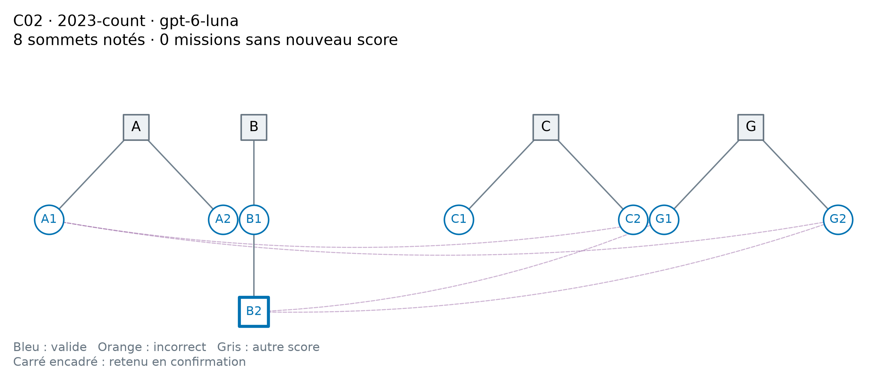

### G.3. C03 — 2023-count · GPT 6-luna · high

Racine complète : `HPC-Forest-Etude-2020-2024-r1/runs/screen-gpt-6-luna-high/preuves/results-748175/2023-count`. Registre SHA-256 : `da298ab47e9fe4c519c3bbd21450d6bd2c83f8b5886caf6a1c2ef5268b3e392b`.

| C03 · champ | Valeur enregistrée |
|---|---|
| Programme confirmé | 884757c49c764018 ; commit 3305c8166db369443527efec49ed56711786ce73 |
| Résultat | Programme modifié confirmé ; g = 57,5382 % ; S = 2,3551 |
| T₀ / T (s) | 0,0809667 / 0,0343799 |
| Cinq temps T₀ (s) | 0,0809606; 0,0806944; 0,0804686; 0,0810211; 0,0816886 |
| Cinq temps T (s) | 0,0349488; 0,0334687; 0,0337883; 0,0349165; 0,0347772 |
| Statuts des missions | {"valid": 7, "duplicate": 1} |
| Plafonds | wall=1800 s ; jetons=1500000 ; profondeur=6 ; mission=600 s |
| Planning | {"cycles": 1, "integrations_per_cycle": 2, "trials_per_role_per_cycle": 2} |
| Harnais | {"call_token_ceiling": 196608, "enabled": true, "max_attempts": 3, "research": {"allowed_hosts": ["gcc.gnu.org", "www.openmp.org", "raw.githubusercontent.com"], "corpus": null, "corpus_sha256": null, "enabled": true}} |
| Mesures de recherche / confirmation | 3 / 5 ; chauffe=1 ; graine=23 |
| Machine / cible | aarch64 ; romeo:romeo-a057:slurm-748175:archive-matrix-cpu4 |
| Compilateur | {"flavor": "gcc-compatible", "path": "/usr/bin/gcc", "sha256": "f7e1e7952e6aa5f31a79366a8dcdd751a150ed65e949429d527e933b5e7cc028"} |
| Environnement | {"CUDA_VISIBLE_DEVICES": "", "OMP_DYNAMIC": "FALSE", "OMP_NUM_THREADS": "4", "OMP_PROC_BIND": "TRUE"} |

Contrat partagé **K01** : champs hors chronométrages identiques à ceux présentés en **G.1**. Les temps et paramètres propres à cette campagne restent distincts ; sa version intégrale est conservée dans le registre exporté.

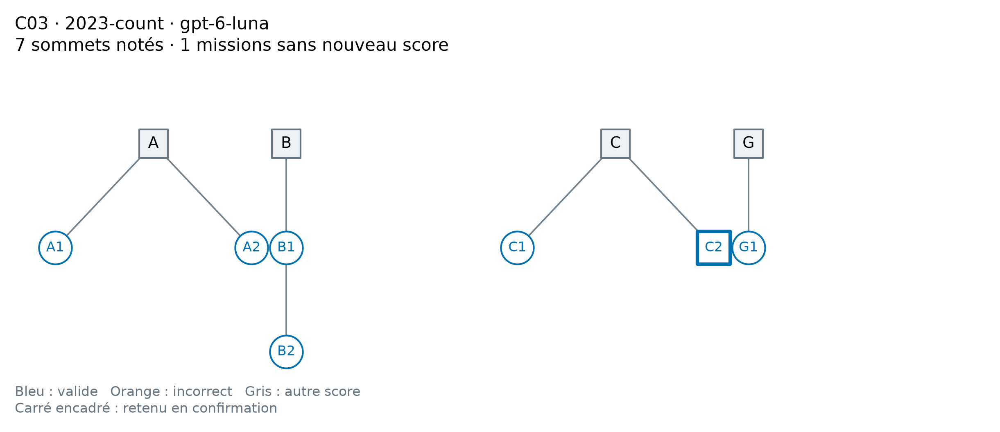

### G.4. C04 — 2023-count · GPT 6-luna · medium

Racine complète : `HPC-Forest-Etude-2020-2024-r1/runs/screen-gpt-6-luna-medium/preuves/results-748202/2023-count`. Registre SHA-256 : `c6d6316c38180050eec8b1cb3bd54dd23411603753e73b57b7592a3fdd3040e5`.

| C04 · champ | Valeur enregistrée |
|---|---|
| Programme confirmé | baseline-e1 ; commit c59f5fde2e10a3ec5b15f3dfaac433e8df954bc7 |
| Résultat | Référence conservée ; g = 0,0000 % ; S = 1,0000 |
| T₀ / T (s) | 0,0799372 / 0,0799372 |
| Cinq temps T₀ (s) | 0,0798586; 0,0802977; 0,0797119; 0,0796449; 0,0801729 |
| Cinq temps T (s) | 0,0798586; 0,0802977; 0,0797119; 0,0796449; 0,0801729 |
| Statuts des missions | {"valid": 5, "duplicate": 2, "incorrect": 1} |
| Plafonds | wall=1800 s ; jetons=1500000 ; profondeur=6 ; mission=600 s |
| Planning | {"cycles": 1, "integrations_per_cycle": 2, "trials_per_role_per_cycle": 2} |
| Harnais | {"call_token_ceiling": 196608, "enabled": true, "max_attempts": 3, "research": {"allowed_hosts": ["gcc.gnu.org", "www.openmp.org", "raw.githubusercontent.com"], "corpus": null, "corpus_sha256": null, "enabled": true}} |
| Mesures de recherche / confirmation | 3 / 5 ; chauffe=1 ; graine=23 |
| Machine / cible | aarch64 ; romeo:romeo-a057:slurm-748202:archive-matrix-cpu4 |
| Compilateur | {"flavor": "gcc-compatible", "path": "/usr/bin/gcc", "sha256": "f7e1e7952e6aa5f31a79366a8dcdd751a150ed65e949429d527e933b5e7cc028"} |
| Environnement | {"CUDA_VISIBLE_DEVICES": "", "OMP_DYNAMIC": "FALSE", "OMP_NUM_THREADS": "4", "OMP_PROC_BIND": "TRUE"} |

Contrat partagé **K01** : champs hors chronométrages identiques à ceux présentés en **G.1**. Les temps et paramètres propres à cette campagne restent distincts ; sa version intégrale est conservée dans le registre exporté.

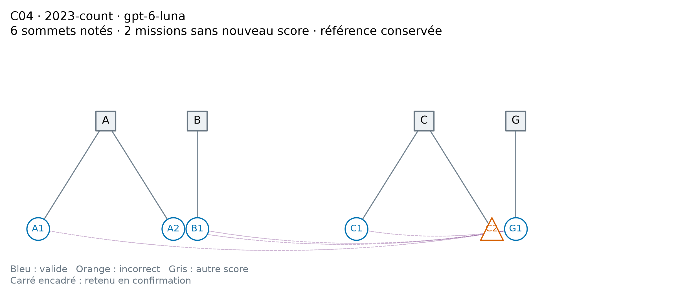

### G.5. C05 — 2023-count · GPT 6-luna · low

Racine complète : `HPC-Forest-Etude-2020-2024-r1/runs/screen-gpt-6-luna-low/preuves/results-748244/2023-count`. Registre SHA-256 : `6fdd93e3a9c6b4d6d04f41fa98673eae37e7fa26e077207d96c636eafa7eec34`.

| C05 · champ | Valeur enregistrée |
|---|---|
| Programme confirmé | a9f1de68044342f3 ; commit 2425decf37d2d25c2cc59a8ab73bba38eb4ecf65 |
| Résultat | Programme modifié confirmé ; g = 39,7840 % ; S = 1,6607 |
| T₀ / T (s) | 0,0798220 / 0,0480656 |
| Cinq temps T₀ (s) | 0,0797251; 0,0797020; 0,0799457; 0,0800413; 0,0796959 |
| Cinq temps T (s) | 0,0479609; 0,0482618; 0,0480496; 0,0479372; 0,0481183 |
| Statuts des missions | {"valid": 6, "duplicate": 1, "generation_failed": 1} |
| Plafonds | wall=1800 s ; jetons=1500000 ; profondeur=6 ; mission=600 s |
| Planning | {"cycles": 1, "integrations_per_cycle": 2, "trials_per_role_per_cycle": 2} |
| Harnais | {"call_token_ceiling": 196608, "enabled": true, "max_attempts": 3, "research": {"allowed_hosts": ["gcc.gnu.org", "www.openmp.org", "raw.githubusercontent.com"], "corpus": null, "corpus_sha256": null, "enabled": true}} |
| Mesures de recherche / confirmation | 3 / 5 ; chauffe=1 ; graine=23 |
| Machine / cible | aarch64 ; romeo:romeo-a057:slurm-748244:archive-matrix-cpu4 |
| Compilateur | {"flavor": "gcc-compatible", "path": "/usr/bin/gcc", "sha256": "f7e1e7952e6aa5f31a79366a8dcdd751a150ed65e949429d527e933b5e7cc028"} |
| Environnement | {"CUDA_VISIBLE_DEVICES": "", "OMP_DYNAMIC": "FALSE", "OMP_NUM_THREADS": "4", "OMP_PROC_BIND": "TRUE"} |

Contrat partagé **K01** : champs hors chronométrages identiques à ceux présentés en **G.1**. Les temps et paramètres propres à cette campagne restent distincts ; sa version intégrale est conservée dans le registre exporté.

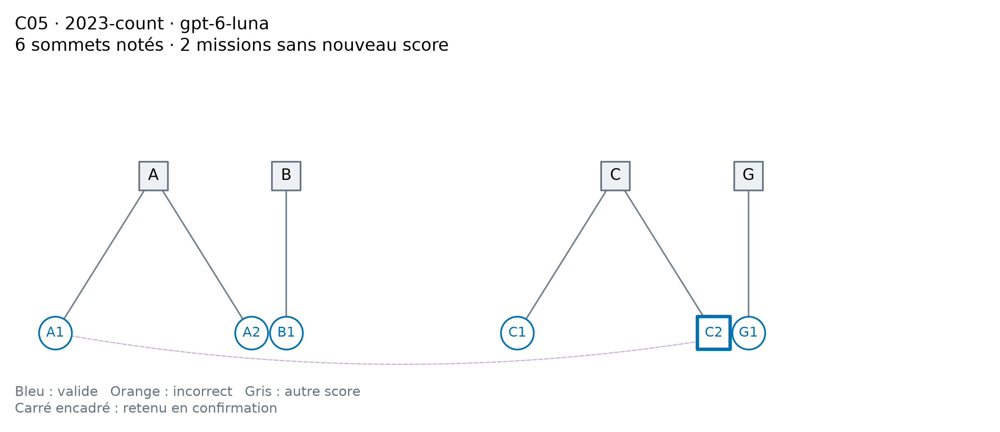

### G.6. C06 — 2023-count · GPT 6-astra · max

Racine complète : `HPC-Forest-Etude-2020-2024-r1/runs/screen-gpt-6-astra-max/preuves/results-747967/2023-count`. Registre SHA-256 : `2140309a8b39dd4db1a4fc4225f41bb84b04fef89c3d15abee6a712ceed61cea`.

| C06 · champ | Valeur enregistrée |
|---|---|
| Programme confirmé | 1cc9316c6952410c ; commit 9303fbd6082cc57d43fbe74b8ab776f7748072ce |
| Résultat | Programme modifié confirmé ; g = 90,6762 % ; S = 10,7252 |
| T₀ / T (s) | 0,0804374 / 0,0074999 |
| Cinq temps T₀ (s) | 0,0802905; 0,0813982; 0,0801915; 0,0800626; 0,0802443 |
| Cinq temps T (s) | 0,0078380; 0,0075162; 0,0072155; 0,0074500; 0,0074796 |
| Statuts des missions | {"valid": 3, "infrastructure_error": 1} |
| Plafonds | wall=1800 s ; jetons=1500000 ; profondeur=6 ; mission=600 s |
| Planning | {"cycles": 1, "integrations_per_cycle": 2, "trials_per_role_per_cycle": 2} |
| Harnais | {"call_token_ceiling": 196608, "enabled": true, "max_attempts": 3, "research": {"allowed_hosts": ["gcc.gnu.org", "www.openmp.org", "raw.githubusercontent.com"], "corpus": null, "corpus_sha256": null, "enabled": true}} |
| Mesures de recherche / confirmation | 3 / 5 ; chauffe=1 ; graine=23 |
| Machine / cible | aarch64 ; romeo:romeo-a057:slurm-747967:archive-matrix-cpu4 |
| Compilateur | {"flavor": "gcc-compatible", "path": "/usr/bin/gcc", "sha256": "f7e1e7952e6aa5f31a79366a8dcdd751a150ed65e949429d527e933b5e7cc028"} |
| Environnement | {"CUDA_VISIBLE_DEVICES": "", "OMP_DYNAMIC": "FALSE", "OMP_NUM_THREADS": "4", "OMP_PROC_BIND": "TRUE"} |

Contrat partagé **K01** : champs hors chronométrages identiques à ceux présentés en **G.1**. Les temps et paramètres propres à cette campagne restent distincts ; sa version intégrale est conservée dans le registre exporté.

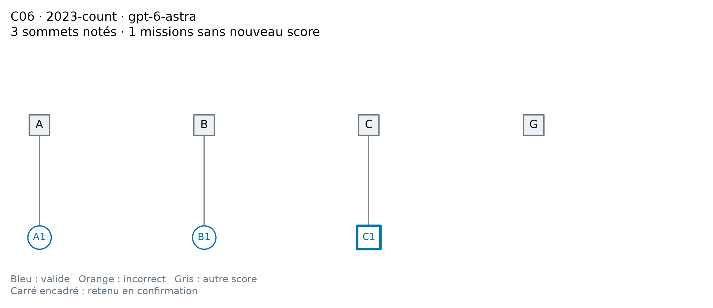

### G.7. C07 — 2023-count · GPT 6-astra · xhigh

Racine complète : `HPC-Forest-Etude-2020-2024-r1/runs/screen-gpt-6-astra-xhigh/preuves/results-748038/2023-count`. Registre SHA-256 : `018407e468a1701acbee559794e9f0fa83365190d5e0f4e9e0366debf1bc3960`.

| C07 · champ | Valeur enregistrée |
|---|---|
| Programme confirmé | 7f653a50682d4e45 ; commit 309244ec26f80718f11e0ac9d25b83f3ac1b8f4f |
| Résultat | Programme modifié confirmé ; g = 89,8220 % ; S = 9,8251 |
| T₀ / T (s) | 0,0792500 / 0,0080661 |
| Cinq temps T₀ (s) | 0,0787538; 0,0789694; 0,0791998; 0,0795521; 0,0797747 |
| Cinq temps T (s) | 0,0080698; 0,0080908; 0,0078466; 0,0081328; 0,0081905 |
| Statuts des missions | {"valid": 7, "infrastructure_error": 1} |
| Plafonds | wall=1800 s ; jetons=1500000 ; profondeur=6 ; mission=600 s |
| Planning | {"cycles": 1, "integrations_per_cycle": 2, "trials_per_role_per_cycle": 2} |
| Harnais | {"call_token_ceiling": 196608, "enabled": true, "max_attempts": 3, "research": {"allowed_hosts": ["gcc.gnu.org", "www.openmp.org", "raw.githubusercontent.com"], "corpus": null, "corpus_sha256": null, "enabled": true}} |
| Mesures de recherche / confirmation | 3 / 5 ; chauffe=1 ; graine=23 |
| Machine / cible | aarch64 ; romeo:romeo-a057:slurm-748038:archive-matrix-cpu4 |
| Compilateur | {"flavor": "gcc-compatible", "path": "/usr/bin/gcc", "sha256": "f7e1e7952e6aa5f31a79366a8dcdd751a150ed65e949429d527e933b5e7cc028"} |
| Environnement | {"CUDA_VISIBLE_DEVICES": "", "OMP_DYNAMIC": "FALSE", "OMP_NUM_THREADS": "4", "OMP_PROC_BIND": "TRUE"} |

Contrat partagé **K01** : champs hors chronométrages identiques à ceux présentés en **G.1**. Les temps et paramètres propres à cette campagne restent distincts ; sa version intégrale est conservée dans le registre exporté.

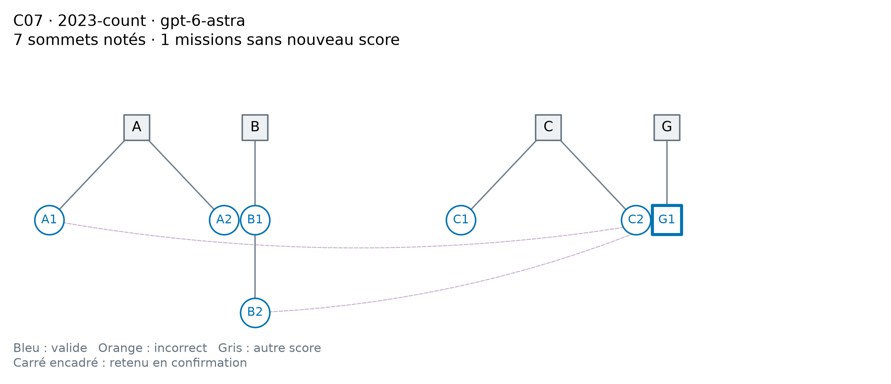

### G.8. C08 — 2023-count · GPT 6-astra · high

Racine complète : `HPC-Forest-Etude-2020-2024-r1/runs/screen-gpt-6-astra-high/preuves/results-748181/2023-count`. Registre SHA-256 : `5daaa5feef4104385933a7c69576f60c4c17c5413906bd21929b7430307c439e`.

| C08 · champ | Valeur enregistrée |
|---|---|
| Programme confirmé | bba86bbf80a4496d ; commit b4f818981f03062946ea0caf7739aad849a221bd |
| Résultat | Programme modifié confirmé ; g = 89,1910 % ; S = 9,2515 |
| T₀ / T (s) | 0,0791307 / 0,0085533 |
| Cinq temps T₀ (s) | 0,0792569; 0,0786915; 0,0790599; 0,0796766; 0,0789685 |
| Cinq temps T (s) | 0,0086926; 0,0084711; 0,0085921; 0,0084249; 0,0085857 |
| Statuts des missions | {"valid": 8} |
| Plafonds | wall=1800 s ; jetons=1500000 ; profondeur=6 ; mission=600 s |
| Planning | {"cycles": 1, "integrations_per_cycle": 2, "trials_per_role_per_cycle": 2} |
| Harnais | {"call_token_ceiling": 196608, "enabled": true, "max_attempts": 3, "research": {"allowed_hosts": ["gcc.gnu.org", "www.openmp.org", "raw.githubusercontent.com"], "corpus": null, "corpus_sha256": null, "enabled": true}} |
| Mesures de recherche / confirmation | 3 / 5 ; chauffe=1 ; graine=23 |
| Machine / cible | aarch64 ; romeo:romeo-a057:slurm-748181:archive-matrix-cpu4 |
| Compilateur | {"flavor": "gcc-compatible", "path": "/usr/bin/gcc", "sha256": "f7e1e7952e6aa5f31a79366a8dcdd751a150ed65e949429d527e933b5e7cc028"} |
| Environnement | {"CUDA_VISIBLE_DEVICES": "", "OMP_DYNAMIC": "FALSE", "OMP_NUM_THREADS": "4", "OMP_PROC_BIND": "TRUE"} |

Contrat partagé **K01** : champs hors chronométrages identiques à ceux présentés en **G.1**. Les temps et paramètres propres à cette campagne restent distincts ; sa version intégrale est conservée dans le registre exporté.

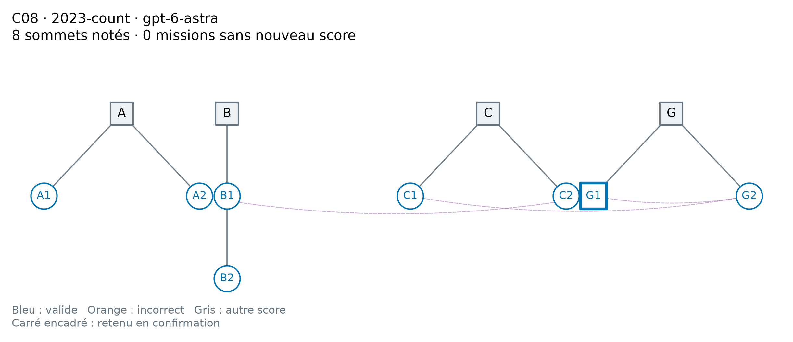

### G.9. C09 — 2023-count · GPT 6-astra · medium

Racine complète : `HPC-Forest-Etude-2020-2024-r1/runs/screen-gpt-6-astra-medium/preuves/results-748211/2023-count`. Registre SHA-256 : `96ad4d1f6c7d826c32e28395751006a54d0d378bcf582fa7b0a642f08765e454`.

| C09 · champ | Valeur enregistrée |
|---|---|
| Programme confirmé | 112f3ee710f84644 ; commit f178add33d16e74115c40d2a8e587c3e1604d0f8 |
| Résultat | Programme modifié confirmé ; g = 87,2378 % ; S = 7,8357 |
| T₀ / T (s) | 0,0792471 / 0,0101137 |
| Cinq temps T₀ (s) | 0,0789673; 0,0790554; 0,0796209; 0,0790084; 0,0795835 |
| Cinq temps T (s) | 0,0102941; 0,0101950; 0,0099347; 0,0100160; 0,0101286 |
| Statuts des missions | {"valid": 8} |
| Plafonds | wall=1800 s ; jetons=1500000 ; profondeur=6 ; mission=600 s |
| Planning | {"cycles": 1, "integrations_per_cycle": 2, "trials_per_role_per_cycle": 2} |
| Harnais | {"call_token_ceiling": 196608, "enabled": true, "max_attempts": 3, "research": {"allowed_hosts": ["gcc.gnu.org", "www.openmp.org", "raw.githubusercontent.com"], "corpus": null, "corpus_sha256": null, "enabled": true}} |
| Mesures de recherche / confirmation | 3 / 5 ; chauffe=1 ; graine=23 |
| Machine / cible | aarch64 ; romeo:romeo-a057:slurm-748211:archive-matrix-cpu4 |
| Compilateur | {"flavor": "gcc-compatible", "path": "/usr/bin/gcc", "sha256": "f7e1e7952e6aa5f31a79366a8dcdd751a150ed65e949429d527e933b5e7cc028"} |
| Environnement | {"CUDA_VISIBLE_DEVICES": "", "OMP_DYNAMIC": "FALSE", "OMP_NUM_THREADS": "4", "OMP_PROC_BIND": "TRUE"} |

Contrat partagé **K01** : champs hors chronométrages identiques à ceux présentés en **G.1**. Les temps et paramètres propres à cette campagne restent distincts ; sa version intégrale est conservée dans le registre exporté.

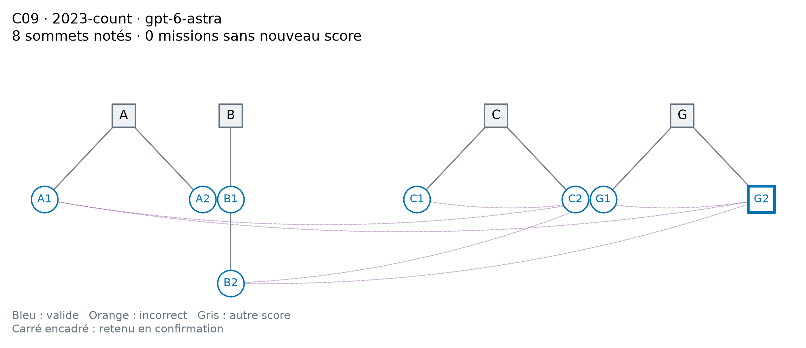

### G.10. C10 — 2023-count · GPT 6-astra · low

Racine complète : `HPC-Forest-Etude-2020-2024-r1/runs/screen-gpt-6-astra-low/preuves/results-748249/2023-count`. Registre SHA-256 : `5b0c6a47dbfa3a351c48bbe13da9508e781b8292211ce7d96c23dda479ab6fb2`.

| C10 · champ | Valeur enregistrée |
|---|---|
| Programme confirmé | e704f9d8d2ed4151 ; commit f96a64acaa6932ebc9e5fd3e32f6a67e426e70a8 |
| Résultat | Programme modifié confirmé ; g = 87,0750 % ; S = 7,7370 |
| T₀ / T (s) | 0,0795671 / 0,0102840 |
| Cinq temps T₀ (s) | 0,0797027; 0,0797498; 0,0794119; 0,0791275; 0,0798435 |
| Cinq temps T (s) | 0,0102509; 0,0104839; 0,0101419; 0,0100697; 0,0104737 |
| Statuts des missions | {"valid": 8} |
| Plafonds | wall=1800 s ; jetons=1500000 ; profondeur=6 ; mission=600 s |
| Planning | {"cycles": 1, "integrations_per_cycle": 2, "trials_per_role_per_cycle": 2} |
| Harnais | {"call_token_ceiling": 196608, "enabled": true, "max_attempts": 3, "research": {"allowed_hosts": ["gcc.gnu.org", "www.openmp.org", "raw.githubusercontent.com"], "corpus": null, "corpus_sha256": null, "enabled": true}} |
| Mesures de recherche / confirmation | 3 / 5 ; chauffe=1 ; graine=23 |
| Machine / cible | aarch64 ; romeo:romeo-a057:slurm-748249:archive-matrix-cpu4 |
| Compilateur | {"flavor": "gcc-compatible", "path": "/usr/bin/gcc", "sha256": "f7e1e7952e6aa5f31a79366a8dcdd751a150ed65e949429d527e933b5e7cc028"} |
| Environnement | {"CUDA_VISIBLE_DEVICES": "", "OMP_DYNAMIC": "FALSE", "OMP_NUM_THREADS": "4", "OMP_PROC_BIND": "TRUE"} |

Contrat partagé **K01** : champs hors chronométrages identiques à ceux présentés en **G.1**. Les temps et paramètres propres à cette campagne restent distincts ; sa version intégrale est conservée dans le registre exporté.

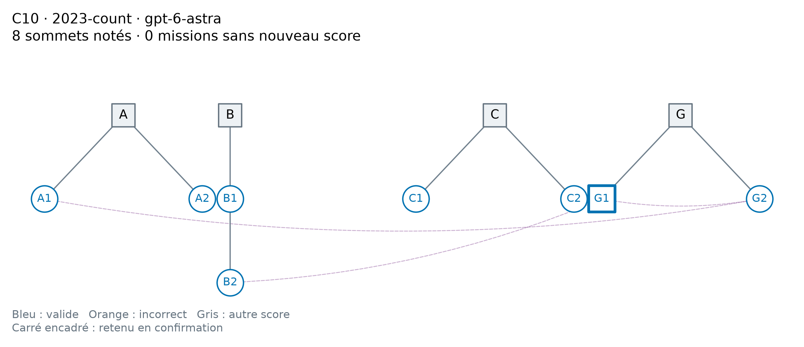

### G.11. C11 — 2023-count · GPT 5.6-terra · max

Racine complète : `HPC-Forest-Etude-2020-2024-r1/runs/screen-gpt-5.6-terra-max/preuves/results-747988/2023-count`. Registre SHA-256 : `efdd85762a45f24b4381da891a59c79868b84280011332e77741a3f7f411373a`.

| C11 · champ | Valeur enregistrée |
|---|---|
| Programme confirmé | 1f498b4132af4d06 ; commit 4a300c74f6f2e420ee9eaa4592933b044be43901 |
| Résultat | Programme modifié confirmé ; g = 71,1387 % ; S = 3,4648 |
| T₀ / T (s) | 0,0789302 / 0,0227803 |
| Cinq temps T₀ (s) | 0,0790740; 0,0787946; 0,0789975; 0,0788126; 0,0789722 |
| Cinq temps T (s) | 0,0231100; 0,0225751; 0,0229857; 0,0226382; 0,0225926 |
| Statuts des missions | {"valid": 1, "infrastructure_error": 2} |
| Plafonds | wall=1800 s ; jetons=1500000 ; profondeur=6 ; mission=600 s |
| Planning | {"cycles": 1, "integrations_per_cycle": 2, "trials_per_role_per_cycle": 2} |
| Harnais | {"call_token_ceiling": 196608, "enabled": true, "max_attempts": 3, "research": {"allowed_hosts": ["gcc.gnu.org", "www.openmp.org", "raw.githubusercontent.com"], "corpus": null, "corpus_sha256": null, "enabled": true}} |
| Mesures de recherche / confirmation | 3 / 5 ; chauffe=1 ; graine=23 |
| Machine / cible | aarch64 ; romeo:romeo-a057:slurm-747988:archive-matrix-cpu4 |
| Compilateur | {"flavor": "gcc-compatible", "path": "/usr/bin/gcc", "sha256": "f7e1e7952e6aa5f31a79366a8dcdd751a150ed65e949429d527e933b5e7cc028"} |
| Environnement | {"CUDA_VISIBLE_DEVICES": "", "OMP_DYNAMIC": "FALSE", "OMP_NUM_THREADS": "4", "OMP_PROC_BIND": "TRUE"} |

Contrat partagé **K01** : champs hors chronométrages identiques à ceux présentés en **G.1**. Les temps et paramètres propres à cette campagne restent distincts ; sa version intégrale est conservée dans le registre exporté.

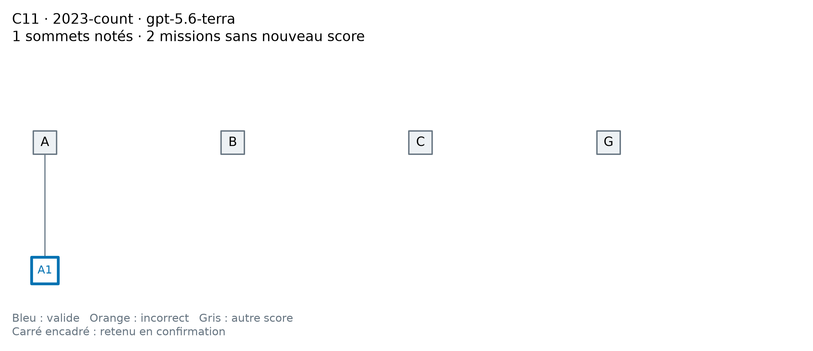

### G.12. C12 — 2023-count · GPT 5.6-terra · xhigh

Racine complète : `HPC-Forest-Etude-2020-2024-r1/runs/screen-gpt-5.6-terra-xhigh/preuves/results-748063/2023-count`. Registre SHA-256 : `7b3b694ab417635e95a91c2a0c927023c2b5eb6c8f4bfa86f62e8643e0a5e8e1`.

| C12 · champ | Valeur enregistrée |
|---|---|
| Programme confirmé | 3f27e343c8b04263 ; commit cfed126e45055e58c3d6f1aa6ee6aafb758b271e |
| Résultat | Programme modifié confirmé ; g = 72,3451 % ; S = 3,6160 |
| T₀ / T (s) | 0,0804999 / 0,0222621 |
| Cinq temps T₀ (s) | 0,0804864; 0,0803613; 0,0807609; 0,0802888; 0,0806022 |
| Cinq temps T (s) | 0,0224403; 0,0221903; 0,0225161; 0,0220308; 0,0221332 |
| Statuts des missions | {"valid": 5, "infrastructure_error": 1} |
| Plafonds | wall=1800 s ; jetons=1500000 ; profondeur=6 ; mission=600 s |
| Planning | {"cycles": 1, "integrations_per_cycle": 2, "trials_per_role_per_cycle": 2} |
| Harnais | {"call_token_ceiling": 196608, "enabled": true, "max_attempts": 3, "research": {"allowed_hosts": ["gcc.gnu.org", "www.openmp.org", "raw.githubusercontent.com"], "corpus": null, "corpus_sha256": null, "enabled": true}} |
| Mesures de recherche / confirmation | 3 / 5 ; chauffe=1 ; graine=23 |
| Machine / cible | aarch64 ; romeo:romeo-a057:slurm-748063:archive-matrix-cpu4 |
| Compilateur | {"flavor": "gcc-compatible", "path": "/usr/bin/gcc", "sha256": "f7e1e7952e6aa5f31a79366a8dcdd751a150ed65e949429d527e933b5e7cc028"} |
| Environnement | {"CUDA_VISIBLE_DEVICES": "", "OMP_DYNAMIC": "FALSE", "OMP_NUM_THREADS": "4", "OMP_PROC_BIND": "TRUE"} |

Contrat partagé **K01** : champs hors chronométrages identiques à ceux présentés en **G.1**. Les temps et paramètres propres à cette campagne restent distincts ; sa version intégrale est conservée dans le registre exporté.

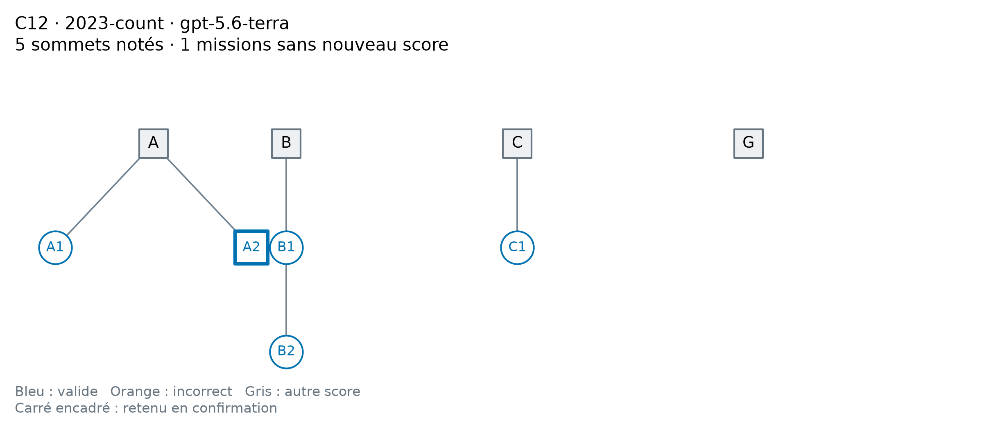

### G.13. C13 — 2023-count · GPT 5.6-terra · high

Racine complète : `HPC-Forest-Etude-2020-2024-r1/runs/screen-gpt-5.6-terra-high/preuves/results-748186/2023-count`. Registre SHA-256 : `b52041952045e12b6a3ef67352da70c9d7c0eb56653d04d0f5ef45b81db9e28f`.

| C13 · champ | Valeur enregistrée |
|---|---|
| Programme confirmé | cc14602d64fb4deb ; commit 9434e1f11453a835448eb59ebd907f7a8e91884c |
| Résultat | Programme modifié confirmé ; g = 73,5310 % ; S = 3,7780 |
| T₀ / T (s) | 0,0811244 / 0,0214728 |
| Cinq temps T₀ (s) | 0,0809416; 0,0811040; 0,0806844; 0,0819443; 0,0809475 |
| Cinq temps T (s) | 0,0215372; 0,0211067; 0,0212492; 0,0220304; 0,0214404 |
| Statuts des missions | {"valid": 8} |
| Plafonds | wall=1800 s ; jetons=1500000 ; profondeur=6 ; mission=600 s |
| Planning | {"cycles": 1, "integrations_per_cycle": 2, "trials_per_role_per_cycle": 2} |
| Harnais | {"call_token_ceiling": 196608, "enabled": true, "max_attempts": 3, "research": {"allowed_hosts": ["gcc.gnu.org", "www.openmp.org", "raw.githubusercontent.com"], "corpus": null, "corpus_sha256": null, "enabled": true}} |
| Mesures de recherche / confirmation | 3 / 5 ; chauffe=1 ; graine=23 |
| Machine / cible | aarch64 ; romeo:romeo-a057:slurm-748186:archive-matrix-cpu4 |
| Compilateur | {"flavor": "gcc-compatible", "path": "/usr/bin/gcc", "sha256": "f7e1e7952e6aa5f31a79366a8dcdd751a150ed65e949429d527e933b5e7cc028"} |
| Environnement | {"CUDA_VISIBLE_DEVICES": "", "OMP_DYNAMIC": "FALSE", "OMP_NUM_THREADS": "4", "OMP_PROC_BIND": "TRUE"} |

Contrat partagé **K01** : champs hors chronométrages identiques à ceux présentés en **G.1**. Les temps et paramètres propres à cette campagne restent distincts ; sa version intégrale est conservée dans le registre exporté.

### G.14. C14 — 2023-count · GPT 5.6-terra · medium

Racine complète : `HPC-Forest-Etude-2020-2024-r1/runs/screen-gpt-5.6-terra-medium/preuves/results-748222/2023-count`. Registre SHA-256 : `d258160d5c60a6826db25514c431606ffcc5e016c9925a0b64861391142cc0ef`.

| C14 · champ | Valeur enregistrée |
|---|---|
| Programme confirmé | 8e05a4e147e34181 ; commit 3525e8c81e5d973aafe86e8b148ef24457cbbbe2 |
| Résultat | Programme modifié confirmé ; g = 70,6193 % ; S = 3,4036 |
| T₀ / T (s) | 0,0796421 / 0,0233994 |
| Cinq temps T₀ (s) | 0,0793769; 0,0810984; 0,0792951; 0,0790466; 0,0793933 |
| Cinq temps T (s) | 0,0230173; 0,0232675; 0,0231979; 0,0239522; 0,0235620 |
| Statuts des missions | {"valid": 7, "incorrect": 1} |
| Plafonds | wall=1800 s ; jetons=1500000 ; profondeur=6 ; mission=600 s |
| Planning | {"cycles": 1, "integrations_per_cycle": 2, "trials_per_role_per_cycle": 2} |
| Harnais | {"call_token_ceiling": 196608, "enabled": true, "max_attempts": 3, "research": {"allowed_hosts": ["gcc.gnu.org", "www.openmp.org", "raw.githubusercontent.com"], "corpus": null, "corpus_sha256": null, "enabled": true}} |
| Mesures de recherche / confirmation | 3 / 5 ; chauffe=1 ; graine=23 |
| Machine / cible | aarch64 ; romeo:romeo-a057:slurm-748222:archive-matrix-cpu4 |
| Compilateur | {"flavor": "gcc-compatible", "path": "/usr/bin/gcc", "sha256": "f7e1e7952e6aa5f31a79366a8dcdd751a150ed65e949429d527e933b5e7cc028"} |
| Environnement | {"CUDA_VISIBLE_DEVICES": "", "OMP_DYNAMIC": "FALSE", "OMP_NUM_THREADS": "4", "OMP_PROC_BIND": "TRUE"} |

Contrat partagé **K01** : champs hors chronométrages identiques à ceux présentés en **G.1**. Les temps et paramètres propres à cette campagne restent distincts ; sa version intégrale est conservée dans le registre exporté.

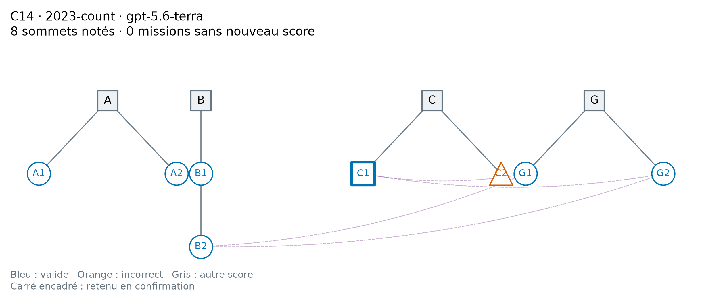

### G.15. C15 — 2023-count · GPT 5.6-terra · low

Racine complète : `HPC-Forest-Etude-2020-2024-r1/runs/screen-gpt-5.6-terra-low/preuves/results-748252/2023-count`. Registre SHA-256 : `e154809566c56a1e49df444cfb8db6ab42e270b34d272af3d4fba510044eff6a`.

| C15 · champ | Valeur enregistrée |
|---|---|
| Programme confirmé | 583a951e221b489e ; commit 6d28bdba34abef33fd465138afa5f0d6f54fd943 |
| Résultat | Programme modifié confirmé ; g = 71,9506 % ; S = 3,5651 |
| T₀ / T (s) | 0,0807930 / 0,0226619 |
| Cinq temps T₀ (s) | 0,0811519; 0,0806913; 0,0807216; 0,0806931; 0,0807069 |
| Cinq temps T (s) | 0,0222297; 0,0215920; 0,0232729; 0,0228638; 0,0233512 |
| Statuts des missions | {"valid": 8} |
| Plafonds | wall=1800 s ; jetons=1500000 ; profondeur=6 ; mission=600 s |
| Planning | {"cycles": 1, "integrations_per_cycle": 2, "trials_per_role_per_cycle": 2} |
| Harnais | {"call_token_ceiling": 196608, "enabled": true, "max_attempts": 3, "research": {"allowed_hosts": ["gcc.gnu.org", "www.openmp.org", "raw.githubusercontent.com"], "corpus": null, "corpus_sha256": null, "enabled": true}} |
| Mesures de recherche / confirmation | 3 / 5 ; chauffe=1 ; graine=23 |
| Machine / cible | aarch64 ; romeo:romeo-a057:slurm-748252:archive-matrix-cpu4 |
| Compilateur | {"flavor": "gcc-compatible", "path": "/usr/bin/gcc", "sha256": "f7e1e7952e6aa5f31a79366a8dcdd751a150ed65e949429d527e933b5e7cc028"} |
| Environnement | {"CUDA_VISIBLE_DEVICES": "", "OMP_DYNAMIC": "FALSE", "OMP_NUM_THREADS": "4", "OMP_PROC_BIND": "TRUE"} |

Contrat partagé **K01** : champs hors chronométrages identiques à ceux présentés en **G.1**. Les temps et paramètres propres à cette campagne restent distincts ; sa version intégrale est conservée dans le registre exporté.

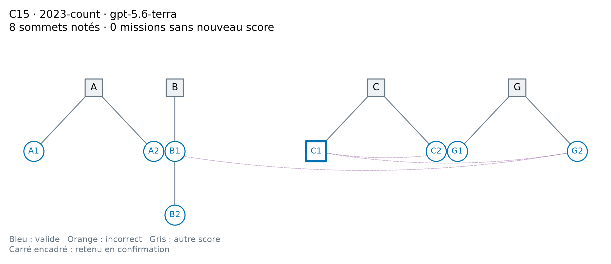

### G.16. C16 — 2023-count · GPT 6.1-sol · max

Racine complète : `HPC-Forest-Etude-2020-2024-r1/runs/screen-gpt-6.1-sol-max/preuves/results-748008/2023-count`. Registre SHA-256 : `66c8b5dc3ec37066c7bfa751385fbb0adc78b037d8808a8d5d44e704f21b9f1e`.

| C16 · champ | Valeur enregistrée |
|---|---|
| Programme confirmé | 7e4160a764964291 ; commit d0a9bb28c0768935634cc52aa4da4e11bea70970 |
| Résultat | Programme modifié confirmé ; g = 89,8664 % ; S = 9,8682 |
| T₀ / T (s) | 0,0805079 / 0,0081584 |
| Cinq temps T₀ (s) | 0,0802616; 0,0802317; 0,0813210; 0,0802052; 0,0805198 |
| Cinq temps T (s) | 0,0086100; 0,0080800; 0,0078642; 0,0082135; 0,0080240 |
| Statuts des missions | {"valid": 6, "generation_failed": 1} |
| Plafonds | wall=1800 s ; jetons=1500000 ; profondeur=6 ; mission=600 s |
| Planning | {"cycles": 1, "integrations_per_cycle": 2, "trials_per_role_per_cycle": 2} |
| Harnais | {"call_token_ceiling": 196608, "enabled": true, "max_attempts": 3, "research": {"allowed_hosts": ["gcc.gnu.org", "www.openmp.org", "raw.githubusercontent.com"], "corpus": null, "corpus_sha256": null, "enabled": true}} |
| Mesures de recherche / confirmation | 3 / 5 ; chauffe=1 ; graine=23 |
| Machine / cible | aarch64 ; romeo:romeo-a057:slurm-748008:archive-matrix-cpu4 |
| Compilateur | {"flavor": "gcc-compatible", "path": "/usr/bin/gcc", "sha256": "f7e1e7952e6aa5f31a79366a8dcdd751a150ed65e949429d527e933b5e7cc028"} |
| Environnement | {"CUDA_VISIBLE_DEVICES": "", "OMP_DYNAMIC": "FALSE", "OMP_NUM_THREADS": "4", "OMP_PROC_BIND": "TRUE"} |

Contrat partagé **K01** : champs hors chronométrages identiques à ceux présentés en **G.1**. Les temps et paramètres propres à cette campagne restent distincts ; sa version intégrale est conservée dans le registre exporté.

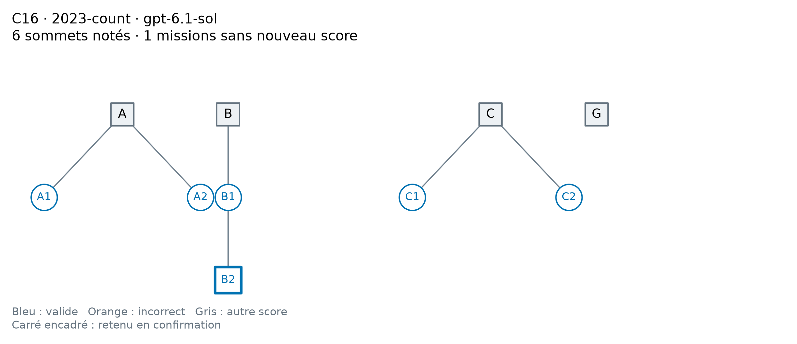

### G.17. C17 — 2023-count · GPT 6.1-sol · xhigh

Racine complète : `HPC-Forest-Etude-2020-2024-r1/runs/screen-gpt-6.1-sol-xhigh/preuves/results-748159/2023-count`. Registre SHA-256 : `2c188d0db249e28fe61f6654ba297fc38dddcc59d465d51e6c40e5281f53801c`.

| C17 · champ | Valeur enregistrée |
|---|---|
| Programme confirmé | 268d4576d9ee4f25 ; commit abe3d4e4b3e02b12413360ecfc2d0e0ee7f41229 |
| Résultat | Programme modifié confirmé ; g = 82,6365 % ; S = 5,7592 |
| T₀ / T (s) | 0,0803301 / 0,0139482 |
| Cinq temps T₀ (s) | 0,0804283; 0,0803223; 0,0801496; 0,0804912; 0,0802593 |
| Cinq temps T (s) | 0,0140228; 0,0138411; 0,0141102; 0,0139815; 0,0137852 |
| Statuts des missions | {"valid": 5, "infrastructure_error": 1, "generation_failed": 1} |
| Plafonds | wall=1800 s ; jetons=1500000 ; profondeur=6 ; mission=600 s |
| Planning | {"cycles": 1, "integrations_per_cycle": 2, "trials_per_role_per_cycle": 2} |
| Harnais | {"call_token_ceiling": 196608, "enabled": true, "max_attempts": 3, "research": {"allowed_hosts": ["gcc.gnu.org", "www.openmp.org", "raw.githubusercontent.com"], "corpus": null, "corpus_sha256": null, "enabled": true}} |
| Mesures de recherche / confirmation | 3 / 5 ; chauffe=1 ; graine=23 |
| Machine / cible | aarch64 ; romeo:romeo-a057:slurm-748159:archive-matrix-cpu4 |
| Compilateur | {"flavor": "gcc-compatible", "path": "/usr/bin/gcc", "sha256": "f7e1e7952e6aa5f31a79366a8dcdd751a150ed65e949429d527e933b5e7cc028"} |
| Environnement | {"CUDA_VISIBLE_DEVICES": "", "OMP_DYNAMIC": "FALSE", "OMP_NUM_THREADS": "4", "OMP_PROC_BIND": "TRUE"} |

Contrat partagé **K01** : champs hors chronométrages identiques à ceux présentés en **G.1**. Les temps et paramètres propres à cette campagne restent distincts ; sa version intégrale est conservée dans le registre exporté.

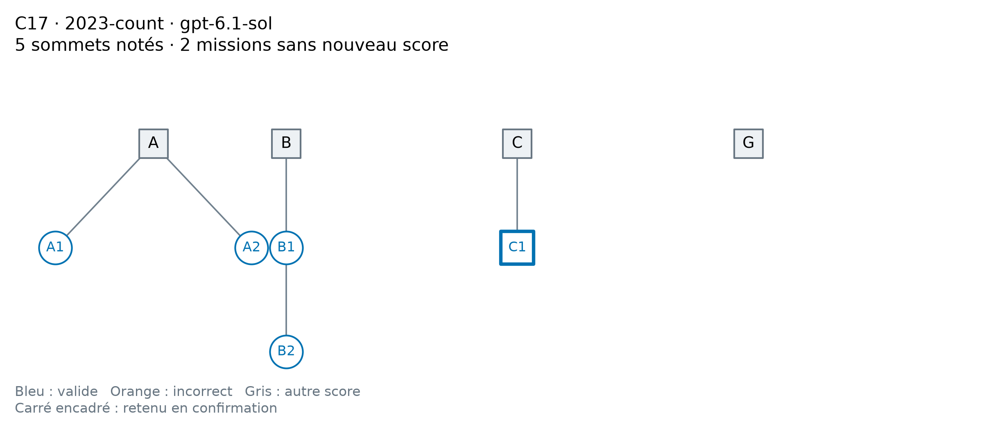

### G.18. C18 — 2023-count · GPT 6.1-sol · high

Racine complète : `HPC-Forest-Etude-2020-2024-r1/runs/screen-gpt-6.1-sol-high/preuves/results-748191/2023-count`. Registre SHA-256 : `1ef4387bd63ba2afc73d3488c6a94d77a5108795a509e172ee5437c3576eaa97`.

| C18 · champ | Valeur enregistrée |
|---|---|
| Programme confirmé | 74f27c88a7c44a4d ; commit 15f88ac1072c67d8bd4011d9b6d10d15dd6562bc |
| Résultat | Programme modifié confirmé ; g = 88,8160 % ; S = 8,9413 |
| T₀ / T (s) | 0,0805185 / 0,0090052 |
| Cinq temps T₀ (s) | 0,0802551; 0,0807548; 0,0801554; 0,0804422; 0,0809851 |
| Cinq temps T (s) | 0,0094369; 0,0087235; 0,0089399; 0,0090459; 0,0088798 |
| Statuts des missions | {"valid": 8} |
| Plafonds | wall=1800 s ; jetons=1500000 ; profondeur=6 ; mission=600 s |
| Planning | {"cycles": 1, "integrations_per_cycle": 2, "trials_per_role_per_cycle": 2} |
| Harnais | {"call_token_ceiling": 196608, "enabled": true, "max_attempts": 3, "research": {"allowed_hosts": ["gcc.gnu.org", "www.openmp.org", "raw.githubusercontent.com"], "corpus": null, "corpus_sha256": null, "enabled": true}} |
| Mesures de recherche / confirmation | 3 / 5 ; chauffe=1 ; graine=23 |
| Machine / cible | aarch64 ; romeo:romeo-a057:slurm-748191:archive-matrix-cpu4 |
| Compilateur | {"flavor": "gcc-compatible", "path": "/usr/bin/gcc", "sha256": "f7e1e7952e6aa5f31a79366a8dcdd751a150ed65e949429d527e933b5e7cc028"} |
| Environnement | {"CUDA_VISIBLE_DEVICES": "", "OMP_DYNAMIC": "FALSE", "OMP_NUM_THREADS": "4", "OMP_PROC_BIND": "TRUE"} |

Contrat partagé **K01** : champs hors chronométrages identiques à ceux présentés en **G.1**. Les temps et paramètres propres à cette campagne restent distincts ; sa version intégrale est conservée dans le registre exporté.

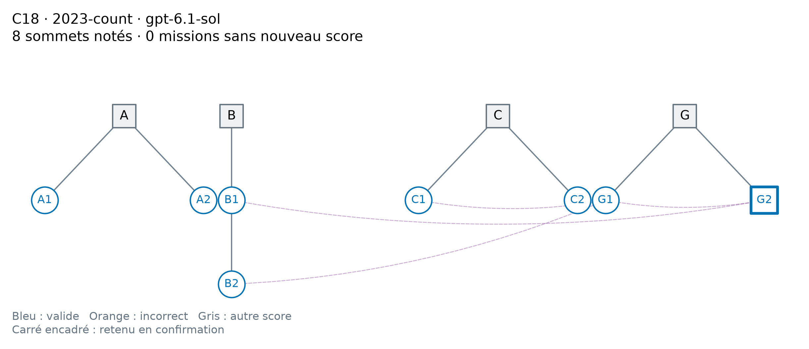

### G.19. C19 — 2023-count · GPT 6.1-sol · medium

Racine complète : `HPC-Forest-Etude-2020-2024-r1/runs/screen-gpt-6.1-sol-medium/preuves/results-748239/2023-count`. Registre SHA-256 : `89fda63b11a2df2a2d1881f965496f3a6027344387da7be81e5592a34504bac3`.

| C19 · champ | Valeur enregistrée |
|---|---|
| Programme confirmé | 0d36db7591ae425e ; commit 0687c9b51aa066d47de2197d0de9363107826e0d |
| Résultat | Programme modifié confirmé ; g = 84,3220 % ; S = 6,3784 |
| T₀ / T (s) | 0,0805866 / 0,0126344 |
| Cinq temps T₀ (s) | 0,0808604; 0,0805528; 0,0805943; 0,0806661; 0,0802591 |
| Cinq temps T (s) | 0,0127938; 0,0126329; 0,0130373; 0,0123421; 0,0123659 |
| Statuts des missions | {"valid": 8} |
| Plafonds | wall=1800 s ; jetons=1500000 ; profondeur=6 ; mission=600 s |
| Planning | {"cycles": 1, "integrations_per_cycle": 2, "trials_per_role_per_cycle": 2} |
| Harnais | {"call_token_ceiling": 196608, "enabled": true, "max_attempts": 3, "research": {"allowed_hosts": ["gcc.gnu.org", "www.openmp.org", "raw.githubusercontent.com"], "corpus": null, "corpus_sha256": null, "enabled": true}} |
| Mesures de recherche / confirmation | 3 / 5 ; chauffe=1 ; graine=23 |
| Machine / cible | aarch64 ; romeo:romeo-a057:slurm-748239:archive-matrix-cpu4 |
| Compilateur | {"flavor": "gcc-compatible", "path": "/usr/bin/gcc", "sha256": "f7e1e7952e6aa5f31a79366a8dcdd751a150ed65e949429d527e933b5e7cc028"} |
| Environnement | {"CUDA_VISIBLE_DEVICES": "", "OMP_DYNAMIC": "FALSE", "OMP_NUM_THREADS": "4", "OMP_PROC_BIND": "TRUE"} |

Contrat partagé **K01** : champs hors chronométrages identiques à ceux présentés en **G.1**. Les temps et paramètres propres à cette campagne restent distincts ; sa version intégrale est conservée dans le registre exporté.

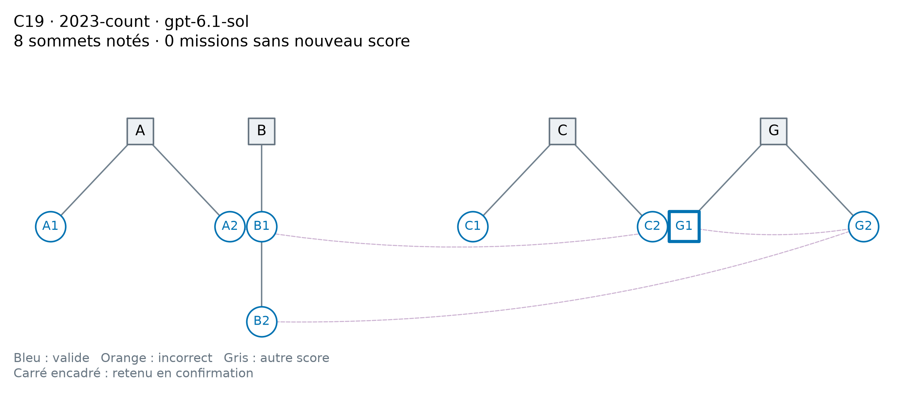

### G.20. C20 — 2023-count · GPT 6.1-sol · low

Racine complète : `HPC-Forest-Etude-2020-2024-r1/runs/screen-gpt-6.1-sol-low/preuves/results-748258/2023-count`. Registre SHA-256 : `d9a44c4b2714e327b763cbde48a24b8357c36a7a8d8503bbf5b6910fcd2b2703`.

| C20 · champ | Valeur enregistrée |
|---|---|
| Programme confirmé | d8e2c275fa0746ad ; commit 70f1f9d8fe1d2806dbb6bd213ac3bc36ccd23738 |
| Résultat | Programme modifié confirmé ; g = 87,2290 % ; S = 7,8303 |
| T₀ / T (s) | 0,0805726 / 0,0102899 |
| Cinq temps T₀ (s) | 0,0808721; 0,0805921; 0,0806546; 0,0806142; 0,0801302 |
| Cinq temps T (s) | 0,0105554; 0,0104919; 0,0101074; 0,0102938; 0,0100011 |
| Statuts des missions | {"valid": 8} |
| Plafonds | wall=1800 s ; jetons=1500000 ; profondeur=6 ; mission=600 s |
| Planning | {"cycles": 1, "integrations_per_cycle": 2, "trials_per_role_per_cycle": 2} |
| Harnais | {"call_token_ceiling": 196608, "enabled": true, "max_attempts": 3, "research": {"allowed_hosts": ["gcc.gnu.org", "www.openmp.org", "raw.githubusercontent.com"], "corpus": null, "corpus_sha256": null, "enabled": true}} |
| Mesures de recherche / confirmation | 3 / 5 ; chauffe=1 ; graine=23 |
| Machine / cible | aarch64 ; romeo:romeo-a057:slurm-748258:archive-matrix-cpu4 |
| Compilateur | {"flavor": "gcc-compatible", "path": "/usr/bin/gcc", "sha256": "f7e1e7952e6aa5f31a79366a8dcdd751a150ed65e949429d527e933b5e7cc028"} |
| Environnement | {"CUDA_VISIBLE_DEVICES": "", "OMP_DYNAMIC": "FALSE", "OMP_NUM_THREADS": "4", "OMP_PROC_BIND": "TRUE"} |

Contrat partagé **K01** : champs hors chronométrages identiques à ceux présentés en **G.1**. Les temps et paramètres propres à cette campagne restent distincts ; sa version intégrale est conservée dans le registre exporté.

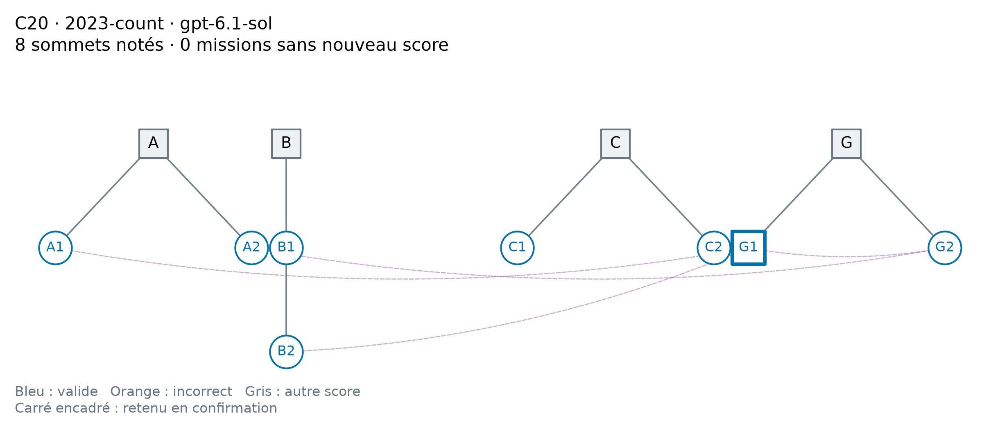

### G.21. C21 — 2020-tropical · GPT 6-luna · max

Racine complète : `HPC-Forest-Etude-2020-2024-r1/runs/coverage-gpt-6-luna-max/preuves/results-748259/2020-tropical`. Registre SHA-256 : `b3555241175f2ada6f491202def8c19c7c73701fcfdbb953762c496d285678c2`.

| C21 · champ | Valeur enregistrée |
|---|---|
| Programme confirmé | baseline-e1 ; commit 6e260c453f702b379843873d0bc150cf6becca52 |
| Résultat | Référence conservée ; g = 0,0000 % ; S = 1,0000 |
| T₀ / T (s) | 0,0053718 / 0,0053718 |
| Cinq temps T₀ (s) | 0,0057031; 0,0052194; 0,0053607; 0,0051420; 0,0054338 |
| Cinq temps T (s) | 0,0057031; 0,0052194; 0,0053607; 0,0051420; 0,0054338 |
| Statuts des missions | {"valid": 8} |
| Plafonds | wall=1800 s ; jetons=1500000 ; profondeur=6 ; mission=600 s |
| Planning | {"cycles": 1, "integrations_per_cycle": 2, "trials_per_role_per_cycle": 2} |
| Harnais | {"call_token_ceiling": 196608, "enabled": true, "max_attempts": 3, "research": {"allowed_hosts": ["gcc.gnu.org", "www.openmp.org", "raw.githubusercontent.com"], "corpus": null, "corpus_sha256": null, "enabled": true}} |
| Mesures de recherche / confirmation | 3 / 5 ; chauffe=1 ; graine=23 |
| Machine / cible | aarch64 ; romeo:romeo-a041:slurm-748259:archive-matrix-cpu4 |
| Compilateur | {"flavor": "gcc-compatible", "path": "/usr/bin/gcc", "sha256": "f7e1e7952e6aa5f31a79366a8dcdd751a150ed65e949429d527e933b5e7cc028"} |
| Environnement | {"CUDA_VISIBLE_DEVICES": "", "OMP_DYNAMIC": "FALSE", "OMP_NUM_THREADS": "4", "OMP_PROC_BIND": "TRUE"} |

Contrat **K02** — Première présentation. Les empreintes et les champs de format sont communs seulement aux fiches qui renvoient explicitement à cette clé ; les chronométrages ne sont pas mutualisés.

| Contrat | Valeur |
|---|---|
| Langage / fichiers | c++ / ['tropical.cpp'] |
| Options | -O3 -std=c++17 -fopenmp -Werror=uninitialized -Werror=maybe-uninitialized -lm |
| Comparaison | {"mode": "bytes", "abs_tol": 0, "rel_tol": 0, "binary_format": "", "basis_quote": ""} |

| Cas | Entrée (empreinte du contrat) | Octets stdin | Sortie attendue SHA-256 |
|---|---|---|---|
| search-0 | c3ba5c400735f3a23bf5348c8709ab78c3f29d2bb5865482b7f495c2c7c0a7dd | 20 | ad910f51121ca4eeeedb0ac25f920a0a810ac123b17ce99b41bfc915d8651c0e |
| search-1 | ec752a2032d86094ee098e954f6ba691055e9ecd74c3fcb7dd6c120951c46fcf | 30 | ad910f51121ca4eeeedb0ac25f920a0a810ac123b17ce99b41bfc915d8651c0e |
| search-2 | d66be7b928999194460c019e38beca5888694b6fb5969dfaeebd090bc0226771 | 48 | ad910f51121ca4eeeedb0ac25f920a0a810ac123b17ce99b41bfc915d8651c0e |
| confirmation-0 | ed3907d5547fb063ff49913c05d7a27267838a38776ab8fb0cb5ef01e5cc4fb2 | 34 | 7fef6b64ea942b992a98ee8f4dc20fa25609ebed0dbed868f0eb5bded37dc229 |
| confirmation-1 | 419ced76a833d1f1e1fa76bc0f8c514c78040b5ff229a71b13c68c90d26d9222 | 40 | ad910f51121ca4eeeedb0ac25f920a0a810ac123b17ce99b41bfc915d8651c0e |
| confirmation-2 | c0bfa60a1bbf71d18cb44ba40226e53a0914110e02de86a6bf57a849ee3c0d41 | 46 | 5b9d85e00a87fdb4cccd455a621e4c8e677b937c3360e18aaec6330c0b48fc19 |
| benchmark | afada4e2947f1217b1002ab87744a453218f2fc7e84fe71d07e6f8496e3b361b | 54 | 78001dfcd6db16b32c372890148cea737dd280255dfddb176a9d5629dfc0dd6b |

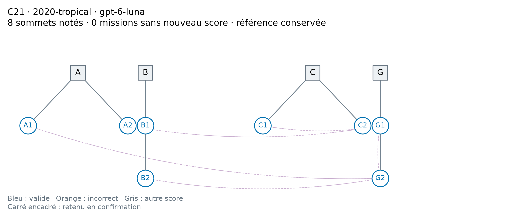

### G.22. C22 — 2020-quicksort · GPT 6-luna · max

Racine complète : `HPC-Forest-Etude-2020-2024-r1/runs/coverage-gpt-6-luna-max/preuves/results-748259/2020-quicksort`. Registre SHA-256 : `e084bb7cf8998d6c829ae29e76f0f64d223bbfc923f76337eda44fdf89c34e12`.

| C22 · champ | Valeur enregistrée |
|---|---|
| Programme confirmé | 45664f94e8d640e8 ; commit b0185454fad25dc8969be3b5c9a683a2c26db03b |
| Résultat | Programme modifié confirmé ; g = 58,7369 % ; S = 2,4235 |
| T₀ / T (s) | 0,0688787 / 0,0284215 |
| Cinq temps T₀ (s) | 0,0691087; 0,0689454; 0,0688127; 0,0688461; 0,0686804 |
| Cinq temps T (s) | 0,0286591; 0,0283207; 0,0282937; 0,0283910; 0,0284427 |
| Statuts des missions | {"valid": 8} |
| Plafonds | wall=1800 s ; jetons=1500000 ; profondeur=6 ; mission=600 s |
| Planning | {"cycles": 1, "integrations_per_cycle": 2, "trials_per_role_per_cycle": 2} |
| Harnais | {"call_token_ceiling": 196608, "enabled": true, "max_attempts": 3, "research": {"allowed_hosts": ["gcc.gnu.org", "www.openmp.org", "raw.githubusercontent.com"], "corpus": null, "corpus_sha256": null, "enabled": true}} |
| Mesures de recherche / confirmation | 3 / 5 ; chauffe=1 ; graine=23 |
| Machine / cible | aarch64 ; romeo:romeo-a041:slurm-748259:archive-matrix-cpu4 |
| Compilateur | {"flavor": "gcc-compatible", "path": "/usr/bin/gcc", "sha256": "f7e1e7952e6aa5f31a79366a8dcdd751a150ed65e949429d527e933b5e7cc028"} |
| Environnement | {"CUDA_VISIBLE_DEVICES": "", "OMP_DYNAMIC": "FALSE", "OMP_NUM_THREADS": "4", "OMP_PROC_BIND": "TRUE"} |

Contrat **K03** — Première présentation. Les empreintes et les champs de format sont communs seulement aux fiches qui renvoient explicitement à cette clé ; les chronométrages ne sont pas mutualisés.

| Contrat | Valeur |
|---|---|
| Langage / fichiers | c / ['quicksort.c'] |
| Options | -O3 -std=gnu11 -fopenmp -Werror=uninitialized -Werror=maybe-uninitialized -lm -DCOMPUTE_MD5_PROBLEM -lcrypto |
| Comparaison | {"mode": "bytes", "abs_tol": 0, "rel_tol": 0, "binary_format": "", "basis_quote": ""} |

| Cas | Entrée (empreinte du contrat) | Octets stdin | Sortie attendue SHA-256 |
|---|---|---|---|
| search-0 | 25db0df9bf0fc543c8801c540ebd87e2333e6131cd48820a9a8fa2e5fb0d6eda | 2 | 6331553459f4c0b0d785376b7d4dc28c33534c8443ad745ec781de14a40b3bb0 |
| search-1 | 2fea29c40c17e754c0bc93871e73d83c99ffb2170a500e49179401310262a608 | 3 | 3d45bfe997663375c6a9f16519395e4b87455565023b2e9e306c9478ab1f7e22 |
| search-2 | 49dbec65be783ea022b3351406e68b6930f6bb334af51fadf1b895a34b0ea407 | 5 | b46deeaae32b0f27bd3c4b15ab764ccf3af51acf8f323c5b92ecb48b0ed6230e |
| confirmation-0 | 036a114644d08fc14f6d194ee11e7d94d1ac5c2190268b43a44298f17830e9dc | 2 | 93807f75b3ac0cbbdd9865622a8c96e3be45b34da6e7caeee5a7b552b0b5782a |
| confirmation-1 | fedcf8441af29630cb8fc68e77d31105e2989f3f95c8b54f48790971679be149 | 3 | 813a27415d8d64301ccb8538823534a2a2881d0bc2ea8c7b879ba55346599199 |
| confirmation-2 | 8cc36f2b5cee28dc55dd2a8d2b4f17b8a26247fd5272e9865bb15f8578aed32c | 5 | 2f01f9f41bcc2e2cb7f5a71e92d04f16f69c2be4ffb47ae7d83852c5c8707d2d |
| benchmark | c0af3fea73b0bb5558efeeea33dc8715226dec94ada1ed364de6848cb59cbb24 | 8 | 199b2ff09fcde3477007f2b9f712ee229322cefaf75a0ab5a82d3851f0f01b0f |

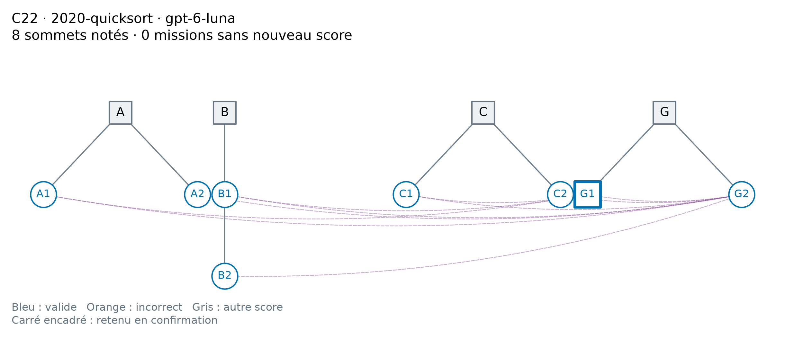

### G.23. C23 — 2020-permutations · GPT 6-luna · max

Racine complète : `HPC-Forest-Etude-2020-2024-r1/runs/coverage-gpt-6-luna-max/preuves/results-748259/2020-permutations`. Registre SHA-256 : `692357acf4ddbb5d662e3f6ec7f8ac3b7e5c769e1a6148c71cd0b006614b61af`.

| C23 · champ | Valeur enregistrée |
|---|---|
| Programme confirmé | af869c56130f4c40 ; commit 5e2a4e0daec978a78a22b2f75bf057ec32c7bbb5 |
| Résultat | Programme modifié confirmé ; g = 95,1746 % ; S = 20,7235 |
| T₀ / T (s) | 0,1321706 / 0,0063778 |
| Cinq temps T₀ (s) | 0,1330417; 0,1324308; 0,1331719; 0,1314814; 0,1307271 |
| Cinq temps T (s) | 0,0065001; 0,0064928; 0,0060832; 0,0066426; 0,0061704 |
| Statuts des missions | {"valid": 8} |
| Plafonds | wall=1800 s ; jetons=1500000 ; profondeur=6 ; mission=600 s |
| Planning | {"cycles": 1, "integrations_per_cycle": 2, "trials_per_role_per_cycle": 2} |
| Harnais | {"call_token_ceiling": 196608, "enabled": true, "max_attempts": 3, "research": {"allowed_hosts": ["gcc.gnu.org", "www.openmp.org", "raw.githubusercontent.com"], "corpus": null, "corpus_sha256": null, "enabled": true}} |
| Mesures de recherche / confirmation | 3 / 5 ; chauffe=1 ; graine=23 |
| Machine / cible | aarch64 ; romeo:romeo-a041:slurm-748259:archive-matrix-cpu4 |
| Compilateur | {"flavor": "gcc-compatible", "path": "/usr/bin/gcc", "sha256": "f7e1e7952e6aa5f31a79366a8dcdd751a150ed65e949429d527e933b5e7cc028"} |
| Environnement | {"CUDA_VISIBLE_DEVICES": "", "OMP_DYNAMIC": "FALSE", "OMP_NUM_THREADS": "4", "OMP_PROC_BIND": "TRUE"} |

Contrat **K04** — Première présentation. Les empreintes et les champs de format sont communs seulement aux fiches qui renvoient explicitement à cette clé ; les chronométrages ne sont pas mutualisés.

| Contrat | Valeur |
|---|---|
| Langage / fichiers | c++ / ['permutations.cc'] |
| Options | -O3 -std=c++17 -fopenmp -Werror=uninitialized -Werror=maybe-uninitialized -lm |
| Comparaison | {"mode": "bytes", "abs_tol": 0, "rel_tol": 0, "binary_format": "", "basis_quote": ""} |

| Cas | Entrée (empreinte du contrat) | Octets stdin | Sortie attendue SHA-256 |
|---|---|---|---|
| search-0 | 8a4a2f83e419e4ce36119d3a1fde40beeaed421a09263e8304f2b185334bdb20 | 4 | 9adfbf3ff671578dc2ca1ae359f8da7a5cf5e0cb9053ef829b9fb23a72457777 |
| search-1 | 11302c361dc7ae5891480f4460f31267d42bb7673f304b138a613fd781b94c7a | 5 | f2555a2c6423964be45c067c21ba1c92ec73a5eb25c615c813b788ea6451ef31 |
| search-2 | ff6dde007c08803713b763c3267b7ac1458148a5ceebb74e89c22a87bfcde4ee | 6 | e324dd9763a46743bd5f70abf5012de7747aaf00a5f1b623b75694ea8171f645 |
| confirmation-0 | 6354133d1992755eb4656f6dc1fee197a1e50680dc6ea16a5a8a958dfcb12952 | 5 | c2407db0cd8cc7133030d3348233c87a0b80ea9840c5630be00630dce086fdc1 |
| confirmation-1 | c9b67c4dcfbacb5a5ebe6d3b728a7393a033900d7ffbdc23521e8e2b54ca44a1 | 6 | 305a1cd056ecebb251d1cb5067bc598e6d9af03950977d8ac042c82c578b85a5 |
| confirmation-2 | 43319a22668c07d2a0b1d68209f70366a7f59919f3760fab458c7f4d7f77dc98 | 7 | 71dd692e24663e8c5a61e7c762a8b74414fdf7712f7f1283ac28b8017f7125b5 |
| benchmark | f93aebc259cc6d7a98a6750d7acdbb79fafb29e699d47d563b893599399d53a1 | 9 | 491ccc678ef0f3fa23b14570903c90fd147d242fcfa7573bff0cbe2a4d858264 |

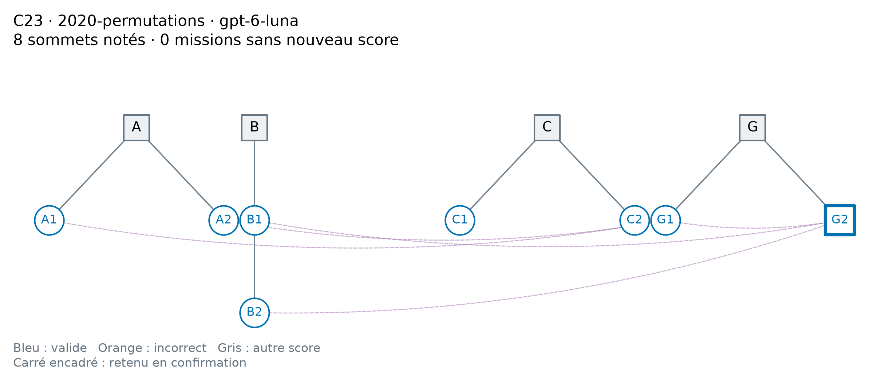

### G.24. C24 — 2020-graph · GPT 6-luna · max

Racine complète : `HPC-Forest-Etude-2020-2024-r1/runs/coverage-gpt-6-luna-max/preuves/results-748259/2020-graph`. Registre SHA-256 : `9c71ec1e201021903545228277333e6a7713fed35d9b98d044dff4458fc65e72`.

| C24 · champ | Valeur enregistrée |
|---|---|
| Programme confirmé | bbf84f6d35e84d84 ; commit b286a3967f4f9a934aa50177eff525bbbbddac76 |
| Résultat | Programme modifié confirmé ; g = 54,5491 % ; S = 2,2002 |
| T₀ / T (s) | 0,0117152 / 0,0053246 |
| Cinq temps T₀ (s) | 0,0118795; 0,0115744; 0,0119204; 0,0115627; 0,0116388 |
| Cinq temps T (s) | 0,0053166; 0,0054903; 0,0051146; 0,0052106; 0,0054910 |
| Statuts des missions | {"valid": 8} |
| Plafonds | wall=1800 s ; jetons=1500000 ; profondeur=6 ; mission=600 s |
| Planning | {"cycles": 1, "integrations_per_cycle": 2, "trials_per_role_per_cycle": 2} |
| Harnais | {"call_token_ceiling": 196608, "enabled": true, "max_attempts": 3, "research": {"allowed_hosts": ["gcc.gnu.org", "www.openmp.org", "raw.githubusercontent.com"], "corpus": null, "corpus_sha256": null, "enabled": true}} |
| Mesures de recherche / confirmation | 3 / 5 ; chauffe=1 ; graine=23 |
| Machine / cible | aarch64 ; romeo:romeo-a041:slurm-748259:archive-matrix-cpu4 |
| Compilateur | {"flavor": "gcc-compatible", "path": "/usr/bin/gcc", "sha256": "f7e1e7952e6aa5f31a79366a8dcdd751a150ed65e949429d527e933b5e7cc028"} |
| Environnement | {"CUDA_VISIBLE_DEVICES": "", "OMP_DYNAMIC": "FALSE", "OMP_NUM_THREADS": "4", "OMP_PROC_BIND": "TRUE"} |

Contrat **K05** — Première présentation. Les empreintes et les champs de format sont communs seulement aux fiches qui renvoient explicitement à cette clé ; les chronométrages ne sont pas mutualisés.

| Contrat | Valeur |
|---|---|
| Langage / fichiers | c / ['graph.c'] |
| Options | -O3 -std=gnu11 -fopenmp -Werror=uninitialized -Werror=maybe-uninitialized -lm |
| Comparaison | {"mode": "bytes", "abs_tol": 0, "rel_tol": 0, "binary_format": "", "basis_quote": ""} |

| Cas | Entrée (empreinte du contrat) | Octets stdin | Sortie attendue SHA-256 |
|---|---|---|---|
| search-0 | e87a423671cd904b7e87ff3f790cf0d0d572661fa87fbd4c50d25704328617f1 | 73 | 981455bb430df3234ef7077691bca768075aa51cc9db85ba11481c5142514926 |
| search-1 | 5fac1d6808a1bfb302c54084469601a2935b0ca803a12a7a97b14bff82af6fad | 174 | fc6c488ee8820941d4a96b146127cc2d92440dac31f42ded98ddfeae511c0bd0 |
| search-2 | 21c86a75184de9c5b9a9a5bc5e66eeea8c758a2abdfcebac663d93cb45c5c676 | 358 | 1f91ca2124054fc61d1d39acd66c71d0aae9e1f81608e96c76eb6c4800427634 |
| confirmation-0 | a8e6f4a79946273b76b9fd91177bbdc53235a0007b31472b9c94bf5ad753e334 | 82 | b77995a35b50e06b08ebbf1c3d4ab716a9746243395c58445cda57e1c8f173fa |
| confirmation-1 | 182103a4c1351e342b027c41eb47ad24e858f54feba3f719f583f11edb332613 | 188 | 768ba8238d5f2988315d2a9aee78e4a2802de5fbdcf0dbc3e4c451666060d9d5 |
| confirmation-2 | 340b4307dc15f024d0b62cc8d17974aa213fb4a6cc89711a1ff79350acae07a2 | 369 | eeaaf39834206b5a5b4596b00b4d56a41ce3a0dbb5d7886d36bf810906b342aa |
| benchmark | bb63ddc9dedd78d780f7d372177088402a2de00c79685dd92460e5804e1d27a6 | 68357 | 06f99e0e09a1c26be4b22322196a22b495324aca6a5fe00529af3efb832df09a |

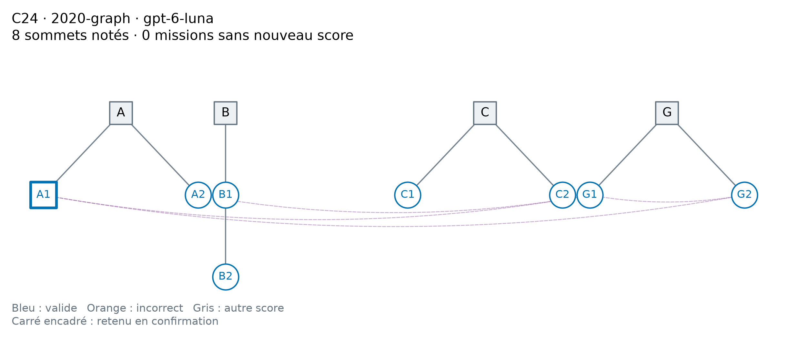

### G.25. C25 — 2021-graph · GPT 6-luna · max

Racine complète : `HPC-Forest-Etude-2020-2024-r1/runs/coverage-gpt-6-luna-max/preuves/results-748259/2021-graph`. Registre SHA-256 : `7d71e6deee9993e513f073f2c29d271251dc07b1ab0b7dc45faf9884c2ddcf57`.

| C25 · champ | Valeur enregistrée |
|---|---|
| Programme confirmé | f1bcac767c3c46e0 ; commit 14e1d50e13e9f2d8c146452890015c33243f764e |
| Résultat | Programme modifié confirmé ; g = 26,6976 % ; S = 1,3642 |
| T₀ / T (s) | 0,0083826 / 0,0061447 |
| Cinq temps T₀ (s) | 0,0085456; 0,0082612; 0,0084207; 0,0081876; 0,0084981 |
| Cinq temps T (s) | 0,0062338; 0,0060757; 0,0061131; 0,0061368; 0,0061639 |
| Statuts des missions | {"valid": 8} |
| Plafonds | wall=1800 s ; jetons=1500000 ; profondeur=6 ; mission=600 s |
| Planning | {"cycles": 1, "integrations_per_cycle": 2, "trials_per_role_per_cycle": 2} |
| Harnais | {"call_token_ceiling": 196608, "enabled": true, "max_attempts": 3, "research": {"allowed_hosts": ["gcc.gnu.org", "www.openmp.org", "raw.githubusercontent.com"], "corpus": null, "corpus_sha256": null, "enabled": true}} |
| Mesures de recherche / confirmation | 3 / 5 ; chauffe=1 ; graine=23 |
| Machine / cible | aarch64 ; romeo:romeo-a041:slurm-748259:archive-matrix-cpu4 |
| Compilateur | {"flavor": "gcc-compatible", "path": "/usr/bin/gcc", "sha256": "f7e1e7952e6aa5f31a79366a8dcdd751a150ed65e949429d527e933b5e7cc028"} |
| Environnement | {"CUDA_VISIBLE_DEVICES": "", "OMP_DYNAMIC": "FALSE", "OMP_NUM_THREADS": "4", "OMP_PROC_BIND": "TRUE"} |

Contrat **K06** — Première présentation. Les empreintes et les champs de format sont communs seulement aux fiches qui renvoient explicitement à cette clé ; les chronométrages ne sont pas mutualisés.

| Contrat | Valeur |
|---|---|
| Langage / fichiers | c++ / ['brute_isomorphism.cpp'] |
| Options | -O3 -std=c++17 -fopenmp -Werror=uninitialized -Werror=maybe-uninitialized -lm |
| Comparaison | {"mode": "bytes", "abs_tol": 0, "rel_tol": 0, "binary_format": "", "basis_quote": ""} |

| Cas | Entrée (empreinte du contrat) | Octets stdin | Sortie attendue SHA-256 |
|---|---|---|---|
| search-0 | 1c0c86b90becfa504e002a2eb9f53bc0cf711bfe2c426fddb839f1b855b0dfee | 40 | e47e30bee6bf180ee9d65c976a7f5bc3e33320247d52aeed4dc0941a49ebfa35 |
| search-1 | bba0ba996e5dee620533ad451f3efb9a3a2c8887eb2917315cd214ea8fc46ebc | 56 | b323eaf0e3a3e0be378350b79a2e6524249a8af81285ea86fff4173681890761 |
| search-2 | 5decbb7b8f15710abf147df157825a614d0b3ec041bf818fc2db1e0dedc6e118 | 68 | ccd27e930798e6b7e073697a1f5f2e586fcc20d16f5b06b4bdb7886be6b8afcf |
| confirmation-0 | 5d4d3775e50b5fa6db009780b266233dfdd4030cfd868be9e164a98ba462da8a | 40 | 67386edc3459804c3c5d3ed306a367d44fa1dddf8ddbc74c9dcbeefbb940b62a |
| confirmation-1 | 11cada3bcb3b70feba8163db1e5872147fa8ba6b1ffe8b65e4ebf99cdf89be21 | 52 | ccd27e930798e6b7e073697a1f5f2e586fcc20d16f5b06b4bdb7886be6b8afcf |
| confirmation-2 | 006ceaf069177b51c845e8d82f51792bc0e69e6bd0c35e5ab656a7c0df27bc4f | 80 | f2cd2b2aae1f2b0e6bcfdd7843fb49f2bcfb6013868d9b39cd4950b19f5abf5a |
| benchmark | 8205d84e1771c951fd3e6a660cdce6983110150985574cfbb45ffcbd196427e3 | 146 | 40ef494ba81d1b53c30086a53f935627d82ffeb90bbfcf9c820edb9ff6b9ea7a |

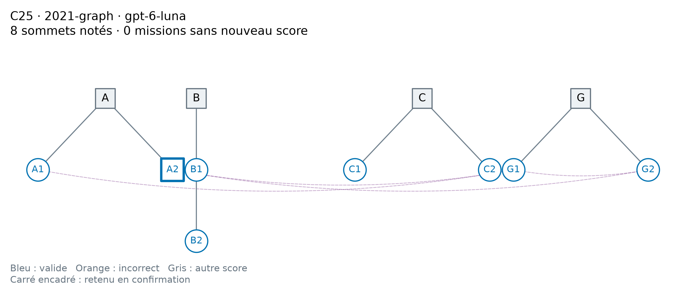

### G.26. C26 — 2021-metrics · GPT 6-luna · max

Racine complète : `HPC-Forest-Etude-2020-2024-r1/runs/coverage-gpt-6-luna-max/preuves/results-748259/2021-metrics`. Registre SHA-256 : `a6fee958b8430917e7e7dc4fae17415dce2a7431e5399f62514c21bad5ae7e0f`.

| C26 · champ | Valeur enregistrée |
|---|---|
| Programme confirmé | 6ec9072eec49462e ; commit b72f3d396374bf87ca90f4a8d4497f5ad0c53ddd |
| Résultat | Programme modifié confirmé ; g = 44,3167 % ; S = 1,7959 |
| T₀ / T (s) | 0,0093611 / 0,0052126 |
| Cinq temps T₀ (s) | 0,0094457; 0,0092227; 0,0092303; 0,0095377; 0,0093693 |
| Cinq temps T (s) | 0,0053479; 0,0051416; 0,0051399; 0,0052270; 0,0052066 |
| Statuts des missions | {"valid": 8} |
| Plafonds | wall=1800 s ; jetons=1500000 ; profondeur=6 ; mission=600 s |
| Planning | {"cycles": 1, "integrations_per_cycle": 2, "trials_per_role_per_cycle": 2} |
| Harnais | {"call_token_ceiling": 196608, "enabled": true, "max_attempts": 3, "research": {"allowed_hosts": ["gcc.gnu.org", "www.openmp.org", "raw.githubusercontent.com"], "corpus": null, "corpus_sha256": null, "enabled": true}} |
| Mesures de recherche / confirmation | 3 / 5 ; chauffe=1 ; graine=23 |
| Machine / cible | aarch64 ; romeo:romeo-a041:slurm-748259:archive-matrix-cpu4 |
| Compilateur | {"flavor": "gcc-compatible", "path": "/usr/bin/gcc", "sha256": "f7e1e7952e6aa5f31a79366a8dcdd751a150ed65e949429d527e933b5e7cc028"} |
| Environnement | {"CUDA_VISIBLE_DEVICES": "", "OMP_DYNAMIC": "FALSE", "OMP_NUM_THREADS": "4", "OMP_PROC_BIND": "TRUE"} |

Contrat **K07** — Première présentation. Les empreintes et les champs de format sont communs seulement aux fiches qui renvoient explicitement à cette clé ; les chronométrages ne sont pas mutualisés.

| Contrat | Valeur |
|---|---|
| Langage / fichiers | c / ['est_matriz_seq.c'] |
| Options | -O3 -std=gnu11 -fopenmp -Werror=uninitialized -Werror=maybe-uninitialized -lm |
| Comparaison | {"mode": "bytes", "abs_tol": 0, "rel_tol": 0, "binary_format": "", "basis_quote": ""} |

| Cas | Entrée (empreinte du contrat) | Octets stdin | Sortie attendue SHA-256 |
|---|---|---|---|
| search-0 | 4085df5178a523511fa5bc37d85f4413f955c04dab8dd483e321b9077dcbd193 | 51 | d20d54be41092a31451f3eed47ed82cc57669234d488b9929e443c75f18e858a |
| search-1 | 625704dea616502ba2c259824730b9b87f19273a4dda50105f8ccacba8fc8006 | 128 | ad033ff1f7fd70b756c2168908d00336d84fe5b7de7960ad3f91a8ac89adf798 |
| search-2 | 49b17e54e1cd8bdf0e569df965f6298c8d2ba25f4584ec5d757f17185b077624 | 358 | d982dae786dc59f6b5cce304e070cc573128b14d779e9c66957873edc730533c |
| confirmation-0 | 084345e6e9b45ce29408be52110670603555cde52934148cc6466d2b81bf5a3b | 60 | 20446f6c4c235b869b1ed054a17400cd5b37491dc1236cfdd0c88160032834b6 |
| confirmation-1 | ed291ca28a3ac8a01fc11edbbb3c0ddde24985ecb19701baefc677ab8ba27ab8 | 132 | d793ed07610199b853bdef7870185d00f2a67a54dfc616b3e198d16aecedb1b2 |
| confirmation-2 | b8cfe94f25b6ca4035e46be5dae6c8cf4b9f8b8b266074f8cd564c6f5868bc81 | 369 | 3f671982cd20e6bd469b019a3db6711b057c23bf578f3d7fdac4f3f624156278 |
| benchmark | 189120efef5a5dd83f0d9a301719ad40436417de0ab65784991054ff565b7376 | 11480 | dddf8b4949f9fbac572b092a38b828801af07be600117f0b04fbd19b31b142b3 |

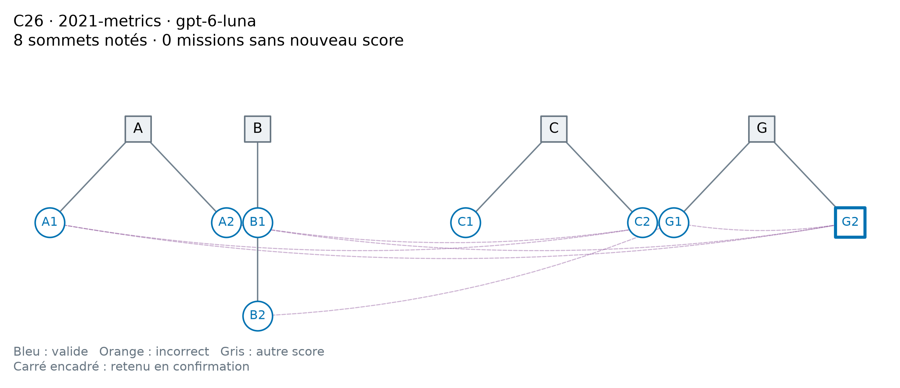

### G.27. C27 — 2021-sokoban · GPT 6-luna · max

Racine complète : `HPC-Forest-Etude-2020-2024-r1/runs/coverage-gpt-6-luna-max/preuves/results-748259/2021-sokoban`. Registre SHA-256 : `6c67030cdb56f6409d0f11fc52ab651d50946a5bac6694d6cbd7884ea5feca0b`.

| C27 · champ | Valeur enregistrée |
|---|---|
| Programme confirmé | baseline-e1 ; commit 086b51800b7b6ad6684929e45a3878768a60fd13 |
| Résultat | Référence conservée ; g = 0,0000 % ; S = 1,0000 |
| T₀ / T (s) | 0,0050226 / 0,0050226 |
| Cinq temps T₀ (s) | 0,0050718; 0,0049971; 0,0053149; 0,0048748; 0,0048543 |
| Cinq temps T (s) | 0,0050718; 0,0049971; 0,0053149; 0,0048748; 0,0048543 |
| Statuts des missions | {"valid": 7, "duplicate": 1} |
| Plafonds | wall=1800 s ; jetons=1500000 ; profondeur=6 ; mission=600 s |
| Planning | {"cycles": 1, "integrations_per_cycle": 2, "trials_per_role_per_cycle": 2} |
| Harnais | {"call_token_ceiling": 196608, "enabled": true, "max_attempts": 3, "research": {"allowed_hosts": ["gcc.gnu.org", "www.openmp.org", "raw.githubusercontent.com"], "corpus": null, "corpus_sha256": null, "enabled": true}} |
| Mesures de recherche / confirmation | 3 / 5 ; chauffe=1 ; graine=23 |
| Machine / cible | aarch64 ; romeo:romeo-a041:slurm-748259:archive-matrix-cpu4 |
| Compilateur | {"flavor": "gcc-compatible", "path": "/usr/bin/gcc", "sha256": "f7e1e7952e6aa5f31a79366a8dcdd751a150ed65e949429d527e933b5e7cc028"} |
| Environnement | {"CUDA_VISIBLE_DEVICES": "", "OMP_DYNAMIC": "FALSE", "OMP_NUM_THREADS": "4", "OMP_PROC_BIND": "TRUE"} |

Contrat **K08** — Première présentation. Les empreintes et les champs de format sont communs seulement aux fiches qui renvoient explicitement à cette clé ; les chronométrages ne sont pas mutualisés.

| Contrat | Valeur |
|---|---|
| Langage / fichiers | c / ['sokoban.c'] |
| Options | -O3 -std=gnu11 -fopenmp -Werror=uninitialized -Werror=maybe-uninitialized -lm |
| Comparaison | {"mode": "bytes", "abs_tol": 0, "rel_tol": 0, "binary_format": "", "basis_quote": ""} |

| Cas | Entrée (empreinte du contrat) | Octets stdin | Sortie attendue SHA-256 |
|---|---|---|---|
| search-0 | fc026ed9f19f477a1ad910fc3aee083e09abc69bccf53cc69c4507e7a74cfc3c | 56 | b16fd20e75ee4c40fd3825dd0cacee2596cca7a9a012145c9c44bc1f0e13b160 |
| search-1 | 56d81fc246560ff3e9738a416c4e4643091d3ddc3a08dc9d292dc32e2f31481a | 63 | 9f8156428498f7bed122af9ee4496d5fc4c8678bc59602db39175260469a437e |
| search-2 | 24fefd4fc62d1f04ccb6b88a03816eec0749a2ed0598fa2b2b0194e49a500ff8 | 56 | d1f3a38000067eedb62361943163e4f71609fbb88fe73ca4129198a9e7ed1b00 |
| confirmation-0 | c4559fbc4c9cc966286119612354d47037722d39c0cd965d1b137f6333c9349c | 72 | 5982cb936dbdf611b84493fa0f9e3990ec23cb781b69e8cefbd13cccc0a8160e |
| confirmation-1 | 684b74bc4eca535a7b5fd007f60d52c763c4a96cb8cd96da9dfc814cd04b0885 | 64 | d1f3a38000067eedb62361943163e4f71609fbb88fe73ca4129198a9e7ed1b00 |
| confirmation-2 | 781019d9a771dfda23cf1139e67d7dafce085131f4c4cd7411335e3683319f4a | 64 | 13a7fa03a53c9d22ae7f2126482b834d1f68577380abdfe85862b1bf80dc9fa8 |
| benchmark | 8f756142974b2bbb6e847c3646a83ee9246727a96804b5fe5f05b182a62574a5 | 48 | 13a7fa03a53c9d22ae7f2126482b834d1f68577380abdfe85862b1bf80dc9fa8 |

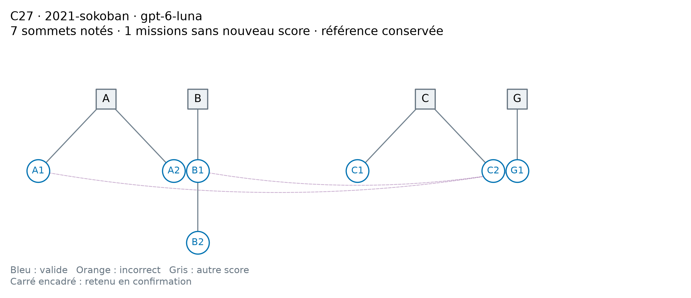

### G.28. C28 — 2021-jacobi · GPT 6-luna · max

Racine complète : `HPC-Forest-Etude-2020-2024-r1/runs/coverage-gpt-6-luna-max/preuves/results-748259/2021-jacobi`. Registre SHA-256 : `74474b94540df6e45b56a3d6804b83cb1a704ccc28f983f0b096fc3ed6cd8aa2`.

| C28 · champ | Valeur enregistrée |
|---|---|
| Programme confirmé | dce439fc40aa4642 ; commit bcee1165f870e4e9f6b1a6281c98c97529a9de5c |
| Résultat | Programme modifié confirmé ; g = 33,8410 % ; S = 1,5115 |
| T₀ / T (s) | 0,0652878 / 0,0431938 |
| Cinq temps T₀ (s) | 0,0655594; 0,0655343; 0,0652835; 0,0651246; 0,0649373 |
| Cinq temps T (s) | 0,0434470; 0,0432682; 0,0427723; 0,0433399; 0,0431414 |
| Statuts des missions | {"valid": 7, "incorrect": 1} |
| Plafonds | wall=1800 s ; jetons=1500000 ; profondeur=6 ; mission=600 s |
| Planning | {"cycles": 1, "integrations_per_cycle": 2, "trials_per_role_per_cycle": 2} |
| Harnais | {"call_token_ceiling": 196608, "enabled": true, "max_attempts": 3, "research": {"allowed_hosts": ["gcc.gnu.org", "www.openmp.org", "raw.githubusercontent.com"], "corpus": null, "corpus_sha256": null, "enabled": true}} |
| Mesures de recherche / confirmation | 3 / 5 ; chauffe=1 ; graine=23 |
| Machine / cible | aarch64 ; romeo:romeo-a041:slurm-748259:archive-matrix-cpu4 |
| Compilateur | {"flavor": "gcc-compatible", "path": "/usr/bin/gcc", "sha256": "f7e1e7952e6aa5f31a79366a8dcdd751a150ed65e949429d527e933b5e7cc028"} |
| Environnement | {"CUDA_VISIBLE_DEVICES": "", "OMP_DYNAMIC": "FALSE", "OMP_NUM_THREADS": "4", "OMP_PROC_BIND": "TRUE"} |

Contrat **K09** — Première présentation. Les empreintes et les champs de format sont communs seulement aux fiches qui renvoient explicitement à cette clé ; les chronométrages ne sont pas mutualisés.

| Contrat | Valeur |
|---|---|
| Langage / fichiers | c / ['laplace_seq.c'] |
| Options | -O3 -std=gnu11 -fopenmp -Werror=uninitialized -Werror=maybe-uninitialized -lm |
| Comparaison | {"mode": "bytes", "abs_tol": 0, "rel_tol": 0, "binary_format": "", "basis_quote": ""} |

| Cas | Entrée (empreinte du contrat) | Octets stdin | Sortie attendue SHA-256 |
|---|---|---|---|
| search-0 | 55a678ea9ae64da944e08632ba0898ccc420c5285b23eded97d6a669ffb33911 | 6 | f142819b9771a120a9a0ede4f44e78cbf68e021cbc380c6c8020d2a11885ac45 |
| search-1 | 948149437770b4679a7b449cacc7d1be0419925695017f32df0ec7dde73eead9 | 6 | e64d9a0b746060067aa4a0bb92982dae82922e4fef5e5bebab728dcfc545aba3 |
| search-2 | bbe0425cce4a506e2f1766da24698a65c168620448e9c8a98a263791cd6cc95a | 6 | 97fcf882ef0c73f43be76354258212b8dc57b15065764f8fb3590b739657e76b |
| confirmation-0 | 1d16ac12c99657b668833419a394f94b81b6c5c9ce72ec32fea52a2d9141e750 | 6 | a4876bf017fc839f8f317bb5d890e2252eaff835c2b8125785c827c2ff920146 |
| confirmation-1 | 96a148c03195354a5c5f62072f568f7881006b2335e4ea3c546df6edc7b09b28 | 6 | a2d6691c3db4ed5fcb7b5359ec6655c049837da69db11269d58d13183927d9cc |
| confirmation-2 | 9a2706770ad8dc377c1dc0a6287db78b897eb81784fe669b5cca54c4f4fb6fae | 6 | 84183ce59fcc307e1989a26b50795610389a9f858318d6f5d0a1188dbbafb5ed |
| benchmark | c7144c13cae632ce8a85d719fe5a2aa1f26be328ce4443abfca7a127b53e867b | 8 | c6d20971095e0fe97841d3859abcdb8a6dfc9a5c1f24432d47fcebb166d7e888 |

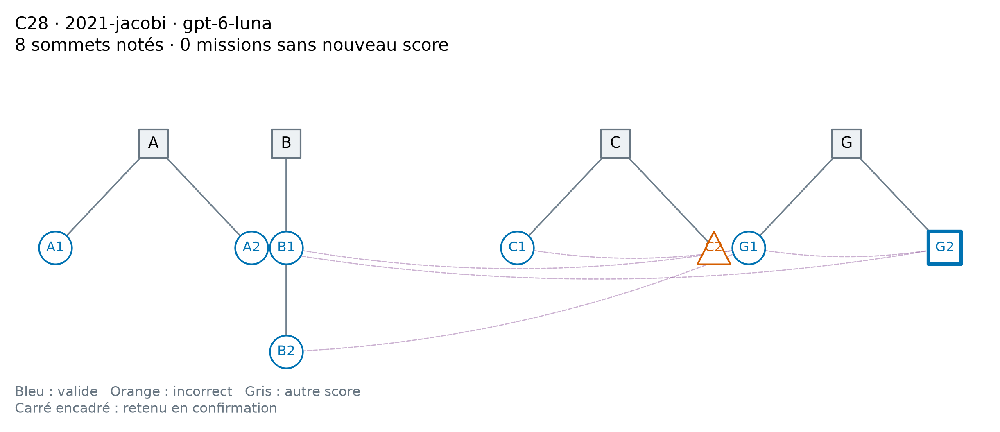

### G.29. C29 — 2022-knn · GPT 6-luna · max

Racine complète : `HPC-Forest-Etude-2020-2024-r1/runs/coverage-gpt-6-luna-max/preuves/results-748259/2022-knn`. Registre SHA-256 : `71bff2f885ff2799102ef1da02fe9762f45e86d0fcc26342c879c75f82383a7d`.

| C29 · champ | Valeur enregistrée |
|---|---|
| Programme confirmé | e499a157e6f74ad7 ; commit 0f8ec58c59378b1afbf1553bd7a79d36d10544f7 |
| Résultat | Programme modifié confirmé ; g = 98,6956 % ; S = 76,6648 |
| T₀ / T (s) | 2,0490095 / 0,0267269 |
| Cinq temps T₀ (s) | 2,0069162; 2,1212922; 2,0646163; 2,0065182; 2,0457044 |
| Cinq temps T (s) | 0,0266537; 0,0267399; 0,0266320; 0,0265782; 0,0270305 |
| Statuts des missions | {"valid": 8} |
| Plafonds | wall=1800 s ; jetons=1500000 ; profondeur=6 ; mission=600 s |
| Planning | {"cycles": 1, "integrations_per_cycle": 2, "trials_per_role_per_cycle": 2} |
| Harnais | {"call_token_ceiling": 196608, "enabled": true, "max_attempts": 3, "research": {"allowed_hosts": ["gcc.gnu.org", "www.openmp.org", "raw.githubusercontent.com"], "corpus": null, "corpus_sha256": null, "enabled": true}} |
| Mesures de recherche / confirmation | 3 / 5 ; chauffe=1 ; graine=23 |
| Machine / cible | aarch64 ; romeo:romeo-a041:slurm-748259:archive-matrix-cpu4 |
| Compilateur | {"flavor": "gcc-compatible", "path": "/usr/bin/gcc", "sha256": "f7e1e7952e6aa5f31a79366a8dcdd751a150ed65e949429d527e933b5e7cc028"} |
| Environnement | {"CUDA_VISIBLE_DEVICES": "", "OMP_DYNAMIC": "FALSE", "OMP_NUM_THREADS": "4", "OMP_PROC_BIND": "TRUE"} |

Contrat **K10** — Première présentation. Les empreintes et les champs de format sont communs seulement aux fiches qui renvoient explicitement à cette clé ; les chronométrages ne sont pas mutualisés.

| Contrat | Valeur |
|---|---|
| Langage / fichiers | c / ['knn.c'] |
| Options | -O3 -std=c11 -fopenmp -Werror=uninitialized -Werror=maybe-uninitialized -lm |
| Comparaison | {"mode": "bytes", "abs_tol": 0, "rel_tol": 0, "binary_format": "", "basis_quote": ""} |

| Cas | Entrée (empreinte du contrat) | Octets stdin | Sortie attendue SHA-256 |
|---|---|---|---|
| search-0 | 4b43535cff14c4253c46a6578ea483a57c56fd278872f83b9a6f9c811a1712ec | 3099 | 559aead08264d5795d3909718cdd05abd49572e84fe55590eef31a88a08fdffd |
| search-1 | e27ae6ec438f45f0b38636783e844d8d899a972241d0a533005196b16b3a3fa7 | 13507 | 559aead08264d5795d3909718cdd05abd49572e84fe55590eef31a88a08fdffd |
| search-2 | f645307b871a764177c9963f1bee7ecbbdc88e837552f64a51c1a9a8f086f0ca | 96399 | 559aead08264d5795d3909718cdd05abd49572e84fe55590eef31a88a08fdffd |
| confirmation-0 | 2eff87b72d101a5d337fd1d1cc96f279d4abc1d582bd6b00d92d2cc1e0680357 | 6075 | f67ab10ad4e4c53121b6a5fe4da9c10ddee905b978d3788d2723d7bfacbe28a9 |
| confirmation-1 | 5c5962e4b64fc6602311e93e2f996d8c1311e611b6ab93c575ae283f2ca3893e | 49202 | f67ab10ad4e4c53121b6a5fe4da9c10ddee905b978d3788d2723d7bfacbe28a9 |
| confirmation-2 | 794873037146f34e0566a68ca0eda0529e26df819b4bccc3ac863c0376c8b187 | 191744 | f67ab10ad4e4c53121b6a5fe4da9c10ddee905b978d3788d2723d7bfacbe28a9 |
| benchmark | 607c7ece431a39af54a862f3eddcbc07552b815d2a22e5d4883f043af6200a2d | 1452222 | 559aead08264d5795d3909718cdd05abd49572e84fe55590eef31a88a08fdffd |

### G.30. C30 — 2022-sum · GPT 6-luna · max

Racine complète : `HPC-Forest-Etude-2020-2024-r1/runs/coverage-gpt-6-luna-max/preuves/results-748259/2022-sum`. Registre SHA-256 : `7f7a9e04c4bf04cc720476891c0926e48366264e3a57887b20cd3f9501d6e557`.

| C30 · champ | Valeur enregistrée |
|---|---|
| Programme confirmé | 5d7be42b7d394a6a ; commit 194d0f5ea6de4fccc2194338a23b10beda1c88ab |
| Résultat | Programme modifié confirmé ; g = 57,4637 % ; S = 2,3509 |
| T₀ / T (s) | 0,1283034 / 0,0545755 |
| Cinq temps T₀ (s) | 0,1252564; 0,1376743; 0,1271883; 0,1247524; 0,1266455 |
| Cinq temps T (s) | 0,0549373; 0,0540096; 0,0537767; 0,0560072; 0,0541467 |
| Statuts des missions | {"valid": 8} |
| Plafonds | wall=1800 s ; jetons=1500000 ; profondeur=6 ; mission=600 s |
| Planning | {"cycles": 1, "integrations_per_cycle": 2, "trials_per_role_per_cycle": 2} |
| Harnais | {"call_token_ceiling": 196608, "enabled": true, "max_attempts": 3, "research": {"allowed_hosts": ["gcc.gnu.org", "www.openmp.org", "raw.githubusercontent.com"], "corpus": null, "corpus_sha256": null, "enabled": true}} |
| Mesures de recherche / confirmation | 3 / 5 ; chauffe=1 ; graine=23 |
| Machine / cible | aarch64 ; romeo:romeo-a041:slurm-748259:archive-matrix-cpu4 |
| Compilateur | {"flavor": "gcc-compatible", "path": "/usr/bin/gcc", "sha256": "f7e1e7952e6aa5f31a79366a8dcdd751a150ed65e949429d527e933b5e7cc028"} |
| Environnement | {"CUDA_VISIBLE_DEVICES": "", "OMP_DYNAMIC": "FALSE", "OMP_NUM_THREADS": "4", "OMP_PROC_BIND": "TRUE"} |

Contrat **K11** — Première présentation. Les empreintes et les champs de format sont communs seulement aux fiches qui renvoient explicitement à cette clé ; les chronométrages ne sont pas mutualisés.

| Contrat | Valeur |
|---|---|
| Langage / fichiers | c++ / ['solution.cpp'] |
| Options | -O3 -std=c++17 -fopenmp -Werror=uninitialized -Werror=maybe-uninitialized -lm |
| Comparaison | {"mode": "bytes", "abs_tol": 0, "rel_tol": 0, "binary_format": "", "basis_quote": ""} |

| Cas | Entrée (empreinte du contrat) | Octets stdin | Sortie attendue SHA-256 |
|---|---|---|---|
| search-0 | f2ef0d54d906b46d1e63042dd84b56130512667b38695b715456fe9ffc7ec59d | 1128 | 95cf32708a31caa478a0e9141103ac567d85e5186e697e7e0c81f75589999e31 |
| search-1 | a317a6541739a4b9c19331c8884cc06266169117531fc42f28f7d9285dfb2e0c | 8590 | 2e6d31a5983a91251bfae5aefa1c0a19d8ba3cf601d0e8a706b4cfa9661a6b8a |
| search-2 | 77cfc38bbc86e1c9967c2890e6840539ded6fe3f156c5865dd80dd182df45c14 | 8857 | a0209b3b9dc46126738559119a5f6add979ee2683f5f2b23fdb3c77cc42aa1da |
| confirmation-0 | dd45229ba126142b082615356b583ff4a7d1f25639a78ca742220d4400467e5f | 2025 | 2fcae9c346ff9530cd3b7303a6456e3a296ff1876b18b50c324343638ec2bdf3 |
| confirmation-1 | 0f86c71d369d73a83d2f19c9055f16f6da019461b4cf189a6f0b6b5a8b19a1a1 | 19716 | 66d09767d960a0d3d18108f3857cec3cc24ac47cb57a7a53d8c3fee51cdf7bf9 |
| confirmation-2 | 11450b60a6593e9a7cc0f3a2b519ef1b69677672d9afbc8d01293d4fbc4caa6e | 34276 | 2e6d31a5983a91251bfae5aefa1c0a19d8ba3cf601d0e8a706b4cfa9661a6b8a |
| benchmark | b0b636c38b9620ab9204d4bf91e397a146a140b26a0e3eda06a03606df003e23 | 2192672 | a05dcb57a8437360f59527b9012c122bdf6d47894492762927e0974f4e3fdfc3 |

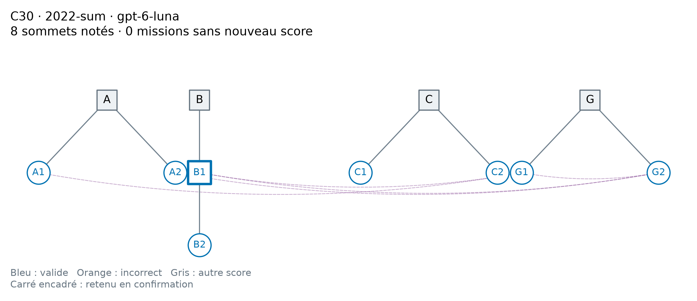

### G.31. C31 — 2022-nbody · GPT 6-luna · max

Racine complète : `HPC-Forest-Etude-2020-2024-r1/runs/coverage-gpt-6-luna-max/preuves/results-748259/2022-nbody`. Registre SHA-256 : `75442a622ba999a6fa1585b157f2e02d7be5e72aa444d674edd63eb85c5838fa`.

| C31 · champ | Valeur enregistrée |
|---|---|
| Programme confirmé | dc7f6acd76164315 ; commit 85a7f2c8e2717974d7e596872fde9a1e876083f3 |
| Résultat | Programme modifié confirmé ; g = 74,2975 % ; S = 3,8907 |
| T₀ / T (s) | 0,6604464 / 0,1697514 |
| Cinq temps T₀ (s) | 0,6603906; 0,6600447; 0,6603699; 0,6604421; 0,6609845 |
| Cinq temps T (s) | 0,1698405; 0,1697353; 0,1698784; 0,1695788; 0,1697242 |
| Statuts des missions | {"valid": 8} |
| Plafonds | wall=1800 s ; jetons=1500000 ; profondeur=6 ; mission=600 s |
| Planning | {"cycles": 1, "integrations_per_cycle": 2, "trials_per_role_per_cycle": 2} |
| Harnais | {"call_token_ceiling": 196608, "enabled": true, "max_attempts": 3, "research": {"allowed_hosts": ["gcc.gnu.org", "www.openmp.org", "raw.githubusercontent.com"], "corpus": null, "corpus_sha256": null, "enabled": true}} |
| Mesures de recherche / confirmation | 3 / 5 ; chauffe=1 ; graine=23 |
| Machine / cible | aarch64 ; romeo:romeo-a041:slurm-748259:archive-matrix-cpu4 |
| Compilateur | {"flavor": "gcc-compatible", "path": "/usr/bin/gcc", "sha256": "f7e1e7952e6aa5f31a79366a8dcdd751a150ed65e949429d527e933b5e7cc028"} |
| Environnement | {"CUDA_VISIBLE_DEVICES": "", "OMP_DYNAMIC": "FALSE", "OMP_NUM_THREADS": "4", "OMP_PROC_BIND": "TRUE"} |

Contrat **K12** — Première présentation. Les empreintes et les champs de format sont communs seulement aux fiches qui renvoient explicitement à cette clé ; les chronométrages ne sont pas mutualisés.

| Contrat | Valeur |
|---|---|
| Langage / fichiers | c / ['nbody.c'] |
| Options | -O3 -std=c11 -fopenmp -Werror=uninitialized -Werror=maybe-uninitialized -lm |
| Comparaison | {"mode": "bytes", "abs_tol": 0, "rel_tol": 0, "binary_format": "", "basis_quote": ""} |

| Cas | Entrée (empreinte du contrat) | Octets stdin | Sortie attendue SHA-256 |
|---|---|---|---|
| search-0 | 3e5f8f9a4489fb1865d7561f2d1b85409ac22c4ad505cb34c6777a14b2d22c05 | 412 | 719ea1001aee0a381ab23a8b15e2b7f73fc78b4e472ef4366bb01fd8612e03e9 |
| search-1 | da00ec9cda9bcf5ae2760b170e495b66c1c82d88acb88335764b8265d282a7de | 1540 | cff3e1ff9916fe2b692979739dc738e48c7d09dace837fd7f22e42622c7d6b12 |
| search-2 | 4b20182f182f2d26eed059184389491512f0c487c52bf9d6ccd32ad1d8dd9fd9 | 3052 | 64e425fc98259855491d9b854832ef1138ccba74861e9be90ed73a4047d62652 |
| confirmation-0 | ad7675deceea9256c20499242e0b83590d2f29ad330fac4f70cf2b3c0a222508 | 748 | 62f17c5f417a4bafcbeb5d029899c4029d5b35e32b78c9b9c7f9376899a8feb0 |
| confirmation-1 | c33943d24e54f056f2fa6490c19efaeb00b38d016b1eb8855e7bba9fcc172a57 | 2308 | fe55bffbcffde332ba2ab2581adb61a11180fb8f89006005d3d52ff880631857 |
| confirmation-2 | 3afd88bf3984965bdb43f075b05423734d6a67c7a71bcec2f7e07b646491edf1 | 3100 | eaeedcbae0c153672fc54770b577eb4686a13c0bee2d5d0e99b6daf22114c958 |
| benchmark | 28165cfcf3eec4fbdec8ca087b60fcef2dd5309008edd9d1a76c79d7930d489d | 98308 | 829916b9bb6d0c7c890d8d44a6fb98432e932bbf8e50bdb13acaa321da5bf4c3 |

### G.32. C32 — 2022-bucketsort · GPT 6-luna · max

Racine complète : `HPC-Forest-Etude-2020-2024-r1/runs/coverage-gpt-6-luna-max/preuves/results-748259/2022-bucketsort`. Registre SHA-256 : `168d8d72687f80f119e285c35f9c2ae185f5065a5cb59cef6142a2577dd0ad26`.

| C32 · champ | Valeur enregistrée |
|---|---|
| Programme confirmé | c059f0d171ad4ab2 ; commit d4f715347f9b3d99f9854333f0c1d57e90a40fd3 |
| Résultat | Programme modifié confirmé ; g = 97,3599 % ; S = 37,8780 |
| T₀ / T (s) | 0,4142192 / 0,0109356 |
| Cinq temps T₀ (s) | 0,4141636; 0,4143213; 0,4139421; 0,4145552; 0,4141138 |
| Cinq temps T (s) | 0,0106957; 0,0110502; 0,0107505; 0,0106558; 0,0115257 |
| Statuts des missions | {"valid": 8} |
| Plafonds | wall=1800 s ; jetons=1500000 ; profondeur=6 ; mission=600 s |
| Planning | {"cycles": 1, "integrations_per_cycle": 2, "trials_per_role_per_cycle": 2} |
| Harnais | {"call_token_ceiling": 196608, "enabled": true, "max_attempts": 3, "research": {"allowed_hosts": ["gcc.gnu.org", "www.openmp.org", "raw.githubusercontent.com"], "corpus": null, "corpus_sha256": null, "enabled": true}} |
| Mesures de recherche / confirmation | 3 / 5 ; chauffe=1 ; graine=23 |
| Machine / cible | aarch64 ; romeo:romeo-a041:slurm-748259:archive-matrix-cpu4 |
| Compilateur | {"flavor": "gcc-compatible", "path": "/usr/bin/gcc", "sha256": "f7e1e7952e6aa5f31a79366a8dcdd751a150ed65e949429d527e933b5e7cc028"} |
| Environnement | {"CUDA_VISIBLE_DEVICES": "", "OMP_DYNAMIC": "FALSE", "OMP_NUM_THREADS": "4", "OMP_PROC_BIND": "TRUE"} |

Contrat **K13** — Première présentation. Les empreintes et les champs de format sont communs seulement aux fiches qui renvoient explicitement à cette clé ; les chronométrages ne sont pas mutualisés.

| Contrat | Valeur |
|---|---|
| Langage / fichiers | c / ['bucketsort.c'] |
| Options | -O3 -std=c11 -fopenmp -Werror=uninitialized -Werror=maybe-uninitialized -lm |
| Comparaison | {"mode": "bytes", "abs_tol": 0, "rel_tol": 0, "binary_format": "", "basis_quote": ""} |

| Cas | Entrée (empreinte du contrat) | Octets stdin | Sortie attendue SHA-256 |
|---|---|---|---|
| search-0 | 7e9777434a17d9f034b9ac5ef76828d259087742ab6569e74adfff7de1e7f67b | 129 | 91e1d9a82008bb02821a010ded1e67a1691643f1f085f7fc065d97834323300e |
| search-1 | 35086a6139c052a2c989e75e6a28321039290bd02020ab6d821ee35ad8524c96 | 465 | b8e24ef07714300dc1db16399afa9bbe0d61e8646ffea5388eb4270ee7bcd78a |
| search-2 | 81058c6d906cbc0884d6b4b2083ed8e5500d93c1adaf5096ab5d4a7483f7655f | 1810 | c7b6a9919a1e0a824b7fc47b28bbf40d8a1ec63de0c9b29948120dcb3a80f176 |
| confirmation-0 | 0a35ca36c0291d77b324750ae2e47bd8c04a20b8531b0bf26ec736447c7f3f7b | 227 | fd04c5b6f8f4ac32baff01a160adaefd48691e393b73a7d30a592d2cfc1b8a3a |
| confirmation-1 | 1586a7c75c9a3302b0bd1d2099320042d2a06684f71d8ecfbf2c52aee73656d7 | 689 | c73a92df1ed601d59b74a47fb3c71f0b8171b8c3497572f4fee51fec175df509 |
| confirmation-2 | c6566cf0e6b474d87d9c5636f5c28e8d4eafc43ff53f0f50e0ee9a60ef5cefba | 3574 | c244d325f3a381a4ea9f69c80a278b17f70d06fd2dcc812ac5d7fd86304ad0fd |
| benchmark | af8e8c0bd17fc4b10ff39b6c1d4583b145007114ee67ae5a39555d2d5a574021 | 458765 | b1363bfc00b1d1f363364cbb04097a8fe3ab498ad3990696bbaaefb760fd42eb |

### G.33. C33 — 2023-sum · GPT 6-luna · max

Racine complète : `HPC-Forest-Etude-2020-2024-r1/runs/coverage-gpt-6-luna-max/preuves/results-748259/2023-sum`. Registre SHA-256 : `2231274c27e0f104a70b8558705fab2a885927334d607c5a31bd5df5e0cebd0c`.

| C33 · champ | Valeur enregistrée |
|---|---|
| Programme confirmé | 26f1ebe86c514c54 ; commit 040d55d8a9ef160399dedbb2682b219d8d6c6fd0 |
| Résultat | Programme modifié confirmé ; g = 90,4668 % ; S = 10,4897 |
| T₀ / T (s) | 0,2483813 / 0,0236786 |
| Cinq temps T₀ (s) | 0,2487651; 0,2480266; 0,2481906; 0,2482592; 0,2486651 |
| Cinq temps T (s) | 0,0240624; 0,0234846; 0,0233371; 0,0238067; 0,0237021 |
| Statuts des missions | {"valid": 8} |
| Plafonds | wall=1800 s ; jetons=1500000 ; profondeur=6 ; mission=600 s |
| Planning | {"cycles": 1, "integrations_per_cycle": 2, "trials_per_role_per_cycle": 2} |
| Harnais | {"call_token_ceiling": 196608, "enabled": true, "max_attempts": 3, "research": {"allowed_hosts": ["gcc.gnu.org", "www.openmp.org", "raw.githubusercontent.com"], "corpus": null, "corpus_sha256": null, "enabled": true}} |
| Mesures de recherche / confirmation | 3 / 5 ; chauffe=1 ; graine=23 |
| Machine / cible | aarch64 ; romeo:romeo-a041:slurm-748259:archive-matrix-cpu4 |
| Compilateur | {"flavor": "gcc-compatible", "path": "/usr/bin/gcc", "sha256": "f7e1e7952e6aa5f31a79366a8dcdd751a150ed65e949429d527e933b5e7cc028"} |
| Environnement | {"CUDA_VISIBLE_DEVICES": "", "OMP_DYNAMIC": "FALSE", "OMP_NUM_THREADS": "4", "OMP_PROC_BIND": "TRUE"} |

Contrat **K14** — Première présentation. Les empreintes et les champs de format sont communs seulement aux fiches qui renvoient explicitement à cette clé ; les chronométrages ne sont pas mutualisés.

| Contrat | Valeur |
|---|---|
| Langage / fichiers | c++ / ['main.cpp'] |
| Options | -O3 -std=c++17 -fopenmp -Werror=uninitialized -Werror=maybe-uninitialized -lm |
| Comparaison | {"mode": "bytes", "abs_tol": 0, "rel_tol": 0, "binary_format": "", "basis_quote": ""} |

| Cas | Entrée (empreinte du contrat) | Octets stdin | Sortie attendue SHA-256 |
|---|---|---|---|
| search-0 | 8dadb73b38f2f273e7a6aa727ff1939386b24e9639f519b2c72c233145687339 | 28 | 7de1555df0c2700329e815b93b32c571c3ea54dc967b89e81ab73b9972b72d1d |
| search-1 | 25e8e7216e5920ab86784d7ab2a0559155cd0fa4cf072bce44f7eaf4472955c2 | 117 | f14b4987904bcb5814e4459a057ed4d20f58a633152288a761214dcd28780b56 |
| search-2 | a3aae52684bd4d86cbed2d996737d23e655ad4ddedf7edbb021f9e5aa28f37e2 | 653 | 13bf8b0303fde3792881f560001cd88db2d12c8d9dd78c1413acf6846d686adc |
| confirmation-0 | 596b33ca41b679da7a3679958d65ae48da1092dbf094460fce2f0d700452654b | 46 | 7de1555df0c2700329e815b93b32c571c3ea54dc967b89e81ab73b9972b72d1d |
| confirmation-1 | 197245792e4be1a880cc5f1dc7bf395372cd9df667aebd2cb3fc97fe6394f14b | 142 | 5378796307535df3ec8d8b15a2e2dc5641419c3d3060cfe32238c0fa973f7aa3 |
| confirmation-2 | 2b174772b7a7f998f4c70486a755b9fa411608998ce11dfb844f8fb590a3f9b7 | 723 | fc84c5c02f6d755e1d1a88d551ad24e8396446b5e811f2360d89075d3a95a889 |
| benchmark | 838528636265aafac1ae99eb697e325fa99247a7af8ce9c4f9678d61db43c032 | 161179 | d4a148d15e503e7f3d60854270450405e8a9ebd2aca622f635ece26d99271af5 |

### G.34. C34 — 2023-npbonacci · GPT 6-luna · max

Racine complète : `HPC-Forest-Etude-2020-2024-r1/runs/coverage-gpt-6-luna-max/preuves/results-748259/2023-npbonacci`. Registre SHA-256 : `798fc384b342d2805f3938b2c1d53f1c745810c16e9b9dc65a5df67200f3def0`.

| C34 · champ | Valeur enregistrée |
|---|---|
| Programme confirmé | 394f215ebb03481e ; commit 35b0e45874ad3bee79e9b0a79b172d05f03e254c |
| Résultat | Programme modifié confirmé ; g = 73,8377 % ; S = 3,8223 |
| T₀ / T (s) | 0,0196962 / 0,0051530 |
| Cinq temps T₀ (s) | 0,0200782; 0,0194283; 0,0194249; 0,0197795; 0,0197702 |
| Cinq temps T (s) | 0,0052703; 0,0053143; 0,0050274; 0,0050478; 0,0051051 |
| Statuts des missions | {"valid": 7, "duplicate": 1} |
| Plafonds | wall=1800 s ; jetons=1500000 ; profondeur=6 ; mission=600 s |
| Planning | {"cycles": 1, "integrations_per_cycle": 2, "trials_per_role_per_cycle": 2} |
| Harnais | {"call_token_ceiling": 196608, "enabled": true, "max_attempts": 3, "research": {"allowed_hosts": ["gcc.gnu.org", "www.openmp.org", "raw.githubusercontent.com"], "corpus": null, "corpus_sha256": null, "enabled": true}} |
| Mesures de recherche / confirmation | 3 / 5 ; chauffe=1 ; graine=23 |
| Machine / cible | aarch64 ; romeo:romeo-a041:slurm-748259:archive-matrix-cpu4 |
| Compilateur | {"flavor": "gcc-compatible", "path": "/usr/bin/gcc", "sha256": "f7e1e7952e6aa5f31a79366a8dcdd751a150ed65e949429d527e933b5e7cc028"} |
| Environnement | {"CUDA_VISIBLE_DEVICES": "", "OMP_DYNAMIC": "FALSE", "OMP_NUM_THREADS": "4", "OMP_PROC_BIND": "TRUE"} |

Contrat **K15** — Première présentation. Les empreintes et les champs de format sont communs seulement aux fiches qui renvoient explicitement à cette clé ; les chronométrages ne sont pas mutualisés.

| Contrat | Valeur |
|---|---|
| Langage / fichiers | c++ / ['npbonacci.cpp'] |
| Options | -O3 -std=c++17 -fopenmp -Werror=uninitialized -Werror=maybe-uninitialized -lm |
| Comparaison | {"mode": "bytes", "abs_tol": 0, "rel_tol": 0, "binary_format": "", "basis_quote": ""} |

| Cas | Entrée (empreinte du contrat) | Octets stdin | Sortie attendue SHA-256 |
|---|---|---|---|
| search-0 | 287330270844876811ba0cb128053e846f4de193e3e347100da510fa72808dd0 | 15 | caa46ac56d3e65f3907f0c8d21c758709bc10fd2a125b432ab8169ca8c0cecad |
| search-1 | 257602778bc1eaf35a20be4e8a73fee5078c6793d71a615ae6c39a5765fc9e78 | 28 | b0d847519e8b781bdf9c0f2f2e6364b157f0473fd51b39bc6f5900be8cb3decf |
| search-2 | 1004c9bfc2d3e73fbd9c4e15342a3f2d9482c47bb7fa707cbc2311ecd7a98362 | 59 | fe6a54fca944e62592306b8c688b50e89e47e45a9bd0687c226ba0eda47b891c |
| confirmation-0 | cd137ad232d60ddc2baec57136b625cd7fd8d50f8e70c8781a6fd9d6d6d3951d | 19 | 12c60663fa3380e7f754d5dc9d6029c64a039992d2f782c1377621dcfd5f7957 |
| confirmation-1 | eb141128a0d11f536d928fee9c744a0ec4bc52a2ef315016fb16d90fc0606d17 | 32 | ff2abec86799cdc3eb2a768ec4408e3c9122445f102984eafc35731e766d6f9c |
| confirmation-2 | aa261fbe02903700abe7996c672a4d96d20bf6e62b7085a64f9c7cca829ee049 | 64 | 7425ff35a1a52580fb36b904cbb0031cfeb69f60a5d3761e0ecd401edfdd40a3 |
| benchmark | f322740eb2aee998860193b6f2d17db781855c076288dece5cb32f140215d595 | 463 | 1479ef2347ef31165317db4b7c403901d93d04ec07d041bd2eb02936ee497349 |

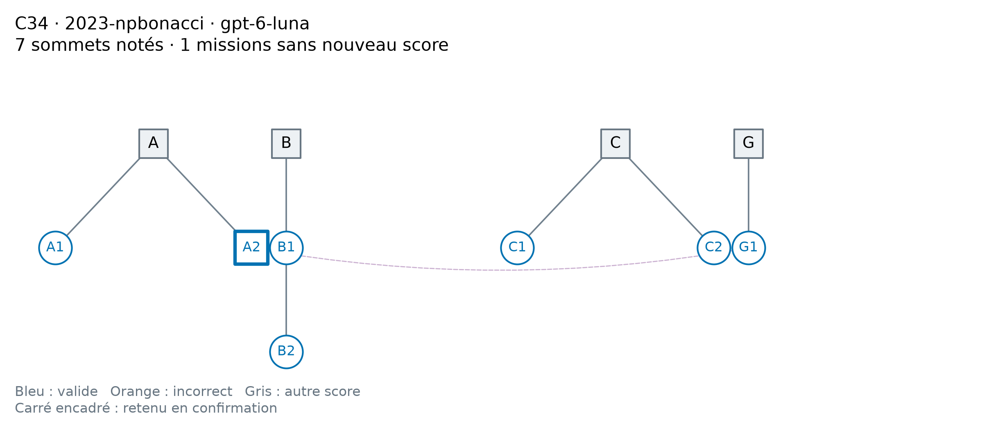

### G.35. C35 — 2020-tropical · GPT 6-astra · max

Racine complète : `HPC-Forest-Etude-2020-2024-r1/runs/coverage-gpt-6-astra-max/preuves/results-748355/2020-tropical`. Registre SHA-256 : `a0dac7b7c6dedc04893499b4b7ab1b831f50e108c434c76f8cf24ff44aa1d27c`.

| C35 · champ | Valeur enregistrée |
|---|---|
| Programme confirmé | baseline-e1 ; commit 9c369470ab3e9bd789a9d8c8e794200cf2094f00 |
| Résultat | Référence conservée ; g = 0,0000 % ; S = 1,0000 |
| T₀ / T (s) | 0,0053617 / 0,0053617 |
| Cinq temps T₀ (s) | 0,0053897; 0,0051819; 0,0053510; 0,0053574; 0,0055287 |
| Cinq temps T (s) | 0,0053897; 0,0051819; 0,0053510; 0,0053574; 0,0055287 |
| Statuts des missions | {"valid": 4, "infrastructure_error": 1} |
| Plafonds | wall=1800 s ; jetons=1500000 ; profondeur=6 ; mission=600 s |
| Planning | {"cycles": 1, "integrations_per_cycle": 2, "trials_per_role_per_cycle": 2} |
| Harnais | {"call_token_ceiling": 196608, "enabled": true, "max_attempts": 3, "research": {"allowed_hosts": ["gcc.gnu.org", "www.openmp.org", "raw.githubusercontent.com"], "corpus": null, "corpus_sha256": null, "enabled": true}} |
| Mesures de recherche / confirmation | 3 / 5 ; chauffe=1 ; graine=23 |
| Machine / cible | aarch64 ; romeo:romeo-a041:slurm-748355:archive-matrix-cpu4 |
| Compilateur | {"flavor": "gcc-compatible", "path": "/usr/bin/gcc", "sha256": "f7e1e7952e6aa5f31a79366a8dcdd751a150ed65e949429d527e933b5e7cc028"} |
| Environnement | {"CUDA_VISIBLE_DEVICES": "", "OMP_DYNAMIC": "FALSE", "OMP_NUM_THREADS": "4", "OMP_PROC_BIND": "TRUE"} |

Contrat partagé **K02** : champs hors chronométrages identiques à ceux présentés en **G.21**. Les temps et paramètres propres à cette campagne restent distincts ; sa version intégrale est conservée dans le registre exporté.

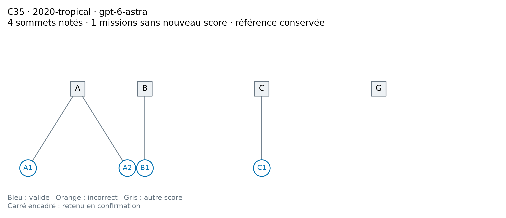

### G.36. C36 — 2020-quicksort · GPT 6-astra · max

Racine complète : `HPC-Forest-Etude-2020-2024-r1/runs/coverage-gpt-6-astra-max/preuves/results-748355/2020-quicksort`. Registre SHA-256 : `8e0694c226fae870da8d74395f1e9744b497750b3cf6f5798caf4bfe6398f4f0`.

| C36 · champ | Valeur enregistrée |
|---|---|
| Programme confirmé | edd6b95bc9854abb ; commit 1eace39b3dc5ad29b0fabe14ad11d27e5c8be317 |
| Résultat | Programme modifié confirmé ; g = 74,8535 % ; S = 3,9767 |
| T₀ / T (s) | 0,0691924 / 0,0173995 |
| Cinq temps T₀ (s) | 0,0693741; 0,0690878; 0,0691229; 0,0690855; 0,0692921 |
| Cinq temps T (s) | 0,0174546; 0,0172015; 0,0174242; 0,0174484; 0,0174686 |
| Statuts des missions | {"valid": 1, "infrastructure_error": 3} |
| Plafonds | wall=1800 s ; jetons=1500000 ; profondeur=6 ; mission=600 s |
| Planning | {"cycles": 1, "integrations_per_cycle": 2, "trials_per_role_per_cycle": 2} |
| Harnais | {"call_token_ceiling": 196608, "enabled": true, "max_attempts": 3, "research": {"allowed_hosts": ["gcc.gnu.org", "www.openmp.org", "raw.githubusercontent.com"], "corpus": null, "corpus_sha256": null, "enabled": true}} |
| Mesures de recherche / confirmation | 3 / 5 ; chauffe=1 ; graine=23 |
| Machine / cible | aarch64 ; romeo:romeo-a041:slurm-748355:archive-matrix-cpu4 |
| Compilateur | {"flavor": "gcc-compatible", "path": "/usr/bin/gcc", "sha256": "f7e1e7952e6aa5f31a79366a8dcdd751a150ed65e949429d527e933b5e7cc028"} |
| Environnement | {"CUDA_VISIBLE_DEVICES": "", "OMP_DYNAMIC": "FALSE", "OMP_NUM_THREADS": "4", "OMP_PROC_BIND": "TRUE"} |

Contrat partagé **K03** : champs hors chronométrages identiques à ceux présentés en **G.22**. Les temps et paramètres propres à cette campagne restent distincts ; sa version intégrale est conservée dans le registre exporté.

### G.37. C37 — 2020-permutations · GPT 6-astra · max

Racine complète : `HPC-Forest-Etude-2020-2024-r1/runs/coverage-gpt-6-astra-max/preuves/results-748355/2020-permutations`. Registre SHA-256 : `8292cd45a803536f897dd601b03c4cba55888b981997f12da5e63ff9c8ca0d21`.

| C37 · champ | Valeur enregistrée |
|---|---|
| Programme confirmé | 94d1b4e35d7b47e3 ; commit f25138d73abdbc120d479f8858722ae88bb82175 |
| Résultat | Programme modifié confirmé ; g = 95,3725 % ; S = 21,6099 |
| T₀ / T (s) | 0,1323233 / 0,0061233 |
| Cinq temps T₀ (s) | 0,1328715; 0,1349098; 0,1301307; 0,1284058; 0,1352986 |
| Cinq temps T (s) | 0,0062475; 0,0058757; 0,0060531; 0,0063957; 0,0060445 |
| Statuts des missions | {"valid": 2, "infrastructure_error": 3} |
| Plafonds | wall=1800 s ; jetons=1500000 ; profondeur=6 ; mission=600 s |
| Planning | {"cycles": 1, "integrations_per_cycle": 2, "trials_per_role_per_cycle": 2} |
| Harnais | {"call_token_ceiling": 196608, "enabled": true, "max_attempts": 3, "research": {"allowed_hosts": ["gcc.gnu.org", "www.openmp.org", "raw.githubusercontent.com"], "corpus": null, "corpus_sha256": null, "enabled": true}} |
| Mesures de recherche / confirmation | 3 / 5 ; chauffe=1 ; graine=23 |
| Machine / cible | aarch64 ; romeo:romeo-a041:slurm-748355:archive-matrix-cpu4 |
| Compilateur | {"flavor": "gcc-compatible", "path": "/usr/bin/gcc", "sha256": "f7e1e7952e6aa5f31a79366a8dcdd751a150ed65e949429d527e933b5e7cc028"} |
| Environnement | {"CUDA_VISIBLE_DEVICES": "", "OMP_DYNAMIC": "FALSE", "OMP_NUM_THREADS": "4", "OMP_PROC_BIND": "TRUE"} |

Contrat partagé **K04** : champs hors chronométrages identiques à ceux présentés en **G.23**. Les temps et paramètres propres à cette campagne restent distincts ; sa version intégrale est conservée dans le registre exporté.

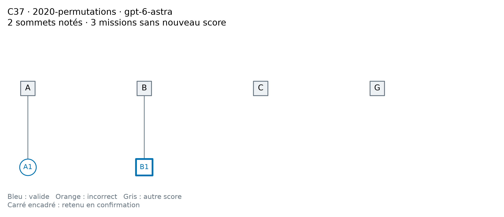

### G.38. C38 — 2020-graph · GPT 6-astra · max

Racine complète : `HPC-Forest-Etude-2020-2024-r1/runs/coverage-gpt-6-astra-max/preuves/results-748355/2020-graph`. Registre SHA-256 : `08aa1a05f921683179b26a96749acc9237f230c4654546021fbc99f8f5adc57a`.

| C38 · champ | Valeur enregistrée |
|---|---|
| Programme confirmé | a861b6271a3e4715 ; commit bed157a5c34f9470cffa5a8e956b6843e41908ea |
| Résultat | Programme modifié confirmé ; g = 48,9859 % ; S = 1,9602 |
| T₀ / T (s) | 0,0128545 / 0,0065576 |
| Cinq temps T₀ (s) | 0,0134578; 0,0131873; 0,0137202; 0,0120634; 0,0118437 |
| Cinq temps T (s) | 0,0074078; 0,0073290; 0,0062312; 0,0056129; 0,0062070 |
| Statuts des missions | {"valid": 4, "infrastructure_error": 1} |
| Plafonds | wall=1800 s ; jetons=1500000 ; profondeur=6 ; mission=600 s |
| Planning | {"cycles": 1, "integrations_per_cycle": 2, "trials_per_role_per_cycle": 2} |
| Harnais | {"call_token_ceiling": 196608, "enabled": true, "max_attempts": 3, "research": {"allowed_hosts": ["gcc.gnu.org", "www.openmp.org", "raw.githubusercontent.com"], "corpus": null, "corpus_sha256": null, "enabled": true}} |
| Mesures de recherche / confirmation | 3 / 5 ; chauffe=1 ; graine=23 |
| Machine / cible | aarch64 ; romeo:romeo-a041:slurm-748355:archive-matrix-cpu4 |
| Compilateur | {"flavor": "gcc-compatible", "path": "/usr/bin/gcc", "sha256": "f7e1e7952e6aa5f31a79366a8dcdd751a150ed65e949429d527e933b5e7cc028"} |
| Environnement | {"CUDA_VISIBLE_DEVICES": "", "OMP_DYNAMIC": "FALSE", "OMP_NUM_THREADS": "4", "OMP_PROC_BIND": "TRUE"} |

Contrat partagé **K05** : champs hors chronométrages identiques à ceux présentés en **G.24**. Les temps et paramètres propres à cette campagne restent distincts ; sa version intégrale est conservée dans le registre exporté.

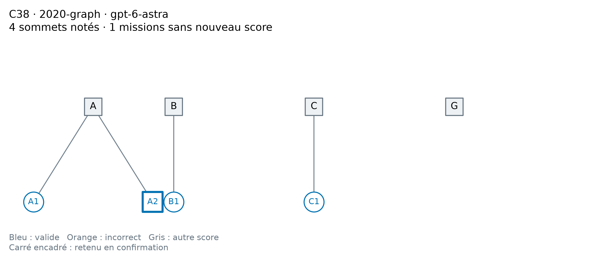

### G.39. C39 — 2021-graph · GPT 6-astra · max

Racine complète : `HPC-Forest-Etude-2020-2024-r1/runs/coverage-gpt-6-astra-max/preuves/results-748355/2021-graph`. Registre SHA-256 : `e570272013357ee75d6631b371f6793fdea36a98ba00ff9d7d317e8c9ee28d17`.

| C39 · champ | Valeur enregistrée |
|---|---|
| Programme confirmé | 2ebabc48bf874b51 ; commit 4871cd4dd808310b6368db4e541f292bd8a5e6a0 |
| Résultat | Programme modifié confirmé ; g = 37,3532 % ; S = 1,5963 |
| T₀ / T (s) | 0,0082558 / 0,0051720 |
| Cinq temps T₀ (s) | 0,0083108; 0,0082108; 0,0084151; 0,0081506; 0,0081918 |
| Cinq temps T (s) | 0,0051424; 0,0053434; 0,0051105; 0,0051115; 0,0051523 |
| Statuts des missions | {"valid": 2, "infrastructure_error": 1} |
| Plafonds | wall=1800 s ; jetons=1500000 ; profondeur=6 ; mission=600 s |
| Planning | {"cycles": 1, "integrations_per_cycle": 2, "trials_per_role_per_cycle": 2} |
| Harnais | {"call_token_ceiling": 196608, "enabled": true, "max_attempts": 3, "research": {"allowed_hosts": ["gcc.gnu.org", "www.openmp.org", "raw.githubusercontent.com"], "corpus": null, "corpus_sha256": null, "enabled": true}} |
| Mesures de recherche / confirmation | 3 / 5 ; chauffe=1 ; graine=23 |
| Machine / cible | aarch64 ; romeo:romeo-a041:slurm-748355:archive-matrix-cpu4 |
| Compilateur | {"flavor": "gcc-compatible", "path": "/usr/bin/gcc", "sha256": "f7e1e7952e6aa5f31a79366a8dcdd751a150ed65e949429d527e933b5e7cc028"} |
| Environnement | {"CUDA_VISIBLE_DEVICES": "", "OMP_DYNAMIC": "FALSE", "OMP_NUM_THREADS": "4", "OMP_PROC_BIND": "TRUE"} |

Contrat partagé **K06** : champs hors chronométrages identiques à ceux présentés en **G.25**. Les temps et paramètres propres à cette campagne restent distincts ; sa version intégrale est conservée dans le registre exporté.

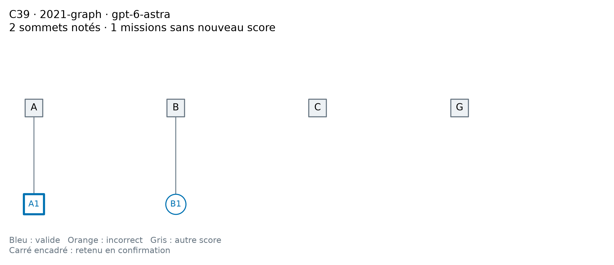

### G.40. C40 — 2021-metrics · GPT 6-astra · max

Racine complète : `HPC-Forest-Etude-2020-2024-r1/runs/coverage-gpt-6-astra-max/preuves/results-748355/2021-metrics`. Registre SHA-256 : `53508731993ad9812081a76bd3222bac3a1aaac088b3099eeba4f977ee110bd1`.

| C40 · champ | Valeur enregistrée |
|---|---|
| Programme confirmé | 2ec759468e814fe1 ; commit 9d4cfe5aba177156efe40a2102f4acb052074813 |
| Résultat | Programme modifié confirmé ; g = 43,1061 % ; S = 1,7577 |
| T₀ / T (s) | 0,0094079 / 0,0053525 |
| Cinq temps T₀ (s) | 0,0092948; 0,0092181; 0,0099322; 0,0092458; 0,0093487 |
| Cinq temps T (s) | 0,0052965; 0,0054465; 0,0052599; 0,0054558; 0,0053040 |
| Statuts des missions | {"valid": 3, "infrastructure_error": 2} |
| Plafonds | wall=1800 s ; jetons=1500000 ; profondeur=6 ; mission=600 s |
| Planning | {"cycles": 1, "integrations_per_cycle": 2, "trials_per_role_per_cycle": 2} |
| Harnais | {"call_token_ceiling": 196608, "enabled": true, "max_attempts": 3, "research": {"allowed_hosts": ["gcc.gnu.org", "www.openmp.org", "raw.githubusercontent.com"], "corpus": null, "corpus_sha256": null, "enabled": true}} |
| Mesures de recherche / confirmation | 3 / 5 ; chauffe=1 ; graine=23 |
| Machine / cible | aarch64 ; romeo:romeo-a041:slurm-748355:archive-matrix-cpu4 |
| Compilateur | {"flavor": "gcc-compatible", "path": "/usr/bin/gcc", "sha256": "f7e1e7952e6aa5f31a79366a8dcdd751a150ed65e949429d527e933b5e7cc028"} |
| Environnement | {"CUDA_VISIBLE_DEVICES": "", "OMP_DYNAMIC": "FALSE", "OMP_NUM_THREADS": "4", "OMP_PROC_BIND": "TRUE"} |

Contrat partagé **K07** : champs hors chronométrages identiques à ceux présentés en **G.26**. Les temps et paramètres propres à cette campagne restent distincts ; sa version intégrale est conservée dans le registre exporté.

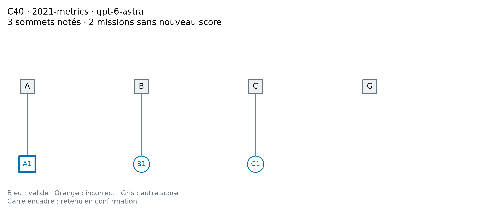

### G.41. C41 — 2021-sokoban · GPT 6-astra · max

Racine complète : `HPC-Forest-Etude-2020-2024-r1/runs/coverage-gpt-6-astra-max/preuves/results-748355/2021-sokoban`. Registre SHA-256 : `189837d1457717d723fd6200e6d11ea6d9dde4b0953d280e77a17a0302b43694`.

| C41 · champ | Valeur enregistrée |
|---|---|
| Programme confirmé | baseline-e1 ; commit b3c4121d2b10ab4e4ac7fb6993d969b59f5c7f8f |
| Résultat | Référence conservée ; g = 0,0000 % ; S = 1,0000 |
| T₀ / T (s) | 0,0048195 / 0,0048195 |
| Cinq temps T₀ (s) | 0,0049069; 0,0047313; 0,0048034; 0,0047219; 0,0049340 |
| Cinq temps T (s) | 0,0049069; 0,0047313; 0,0048034; 0,0047219; 0,0049340 |
| Statuts des missions | {"valid": 2, "infrastructure_error": 1} |
| Plafonds | wall=1800 s ; jetons=1500000 ; profondeur=6 ; mission=600 s |
| Planning | {"cycles": 1, "integrations_per_cycle": 2, "trials_per_role_per_cycle": 2} |
| Harnais | {"call_token_ceiling": 196608, "enabled": true, "max_attempts": 3, "research": {"allowed_hosts": ["gcc.gnu.org", "www.openmp.org", "raw.githubusercontent.com"], "corpus": null, "corpus_sha256": null, "enabled": true}} |
| Mesures de recherche / confirmation | 3 / 5 ; chauffe=1 ; graine=23 |
| Machine / cible | aarch64 ; romeo:romeo-a041:slurm-748355:archive-matrix-cpu4 |
| Compilateur | {"flavor": "gcc-compatible", "path": "/usr/bin/gcc", "sha256": "f7e1e7952e6aa5f31a79366a8dcdd751a150ed65e949429d527e933b5e7cc028"} |
| Environnement | {"CUDA_VISIBLE_DEVICES": "", "OMP_DYNAMIC": "FALSE", "OMP_NUM_THREADS": "4", "OMP_PROC_BIND": "TRUE"} |

Contrat partagé **K08** : champs hors chronométrages identiques à ceux présentés en **G.27**. Les temps et paramètres propres à cette campagne restent distincts ; sa version intégrale est conservée dans le registre exporté.

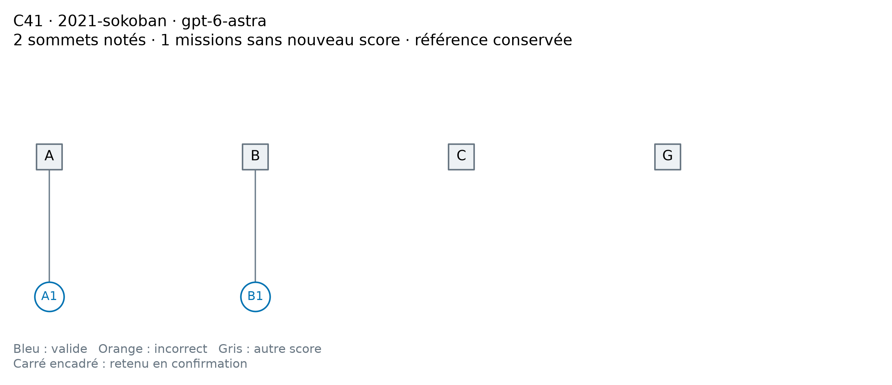

### G.42. C42 — 2021-jacobi · GPT 6-astra · max

Racine complète : `HPC-Forest-Etude-2020-2024-r1/runs/coverage-gpt-6-astra-max/preuves/results-748355/2021-jacobi`. Registre SHA-256 : `c3f14c8bcec8be0f45af59aff502d44d5eb2b4e38718958399a150df8eb3598d`.

| C42 · champ | Valeur enregistrée |
|---|---|
| Programme confirmé | 754b70215d2f4d8e ; commit 19ae0192ce9e489cc17d3b389ad696df50f2a963 |
| Résultat | Programme modifié confirmé ; g = 37,0261 % ; S = 1,5880 |
| T₀ / T (s) | 0,0662857 / 0,0417427 |
| Cinq temps T₀ (s) | 0,0674692; 0,0659024; 0,0665166; 0,0656038; 0,0659367 |
| Cinq temps T (s) | 0,0416533; 0,0417041; 0,0414441; 0,0421988; 0,0417134 |
| Statuts des missions | {"valid": 4, "infrastructure_error": 2} |
| Plafonds | wall=1800 s ; jetons=1500000 ; profondeur=6 ; mission=600 s |
| Planning | {"cycles": 1, "integrations_per_cycle": 2, "trials_per_role_per_cycle": 2} |
| Harnais | {"call_token_ceiling": 196608, "enabled": true, "max_attempts": 3, "research": {"allowed_hosts": ["gcc.gnu.org", "www.openmp.org", "raw.githubusercontent.com"], "corpus": null, "corpus_sha256": null, "enabled": true}} |
| Mesures de recherche / confirmation | 3 / 5 ; chauffe=1 ; graine=23 |
| Machine / cible | aarch64 ; romeo:romeo-a041:slurm-748355:archive-matrix-cpu4 |
| Compilateur | {"flavor": "gcc-compatible", "path": "/usr/bin/gcc", "sha256": "f7e1e7952e6aa5f31a79366a8dcdd751a150ed65e949429d527e933b5e7cc028"} |
| Environnement | {"CUDA_VISIBLE_DEVICES": "", "OMP_DYNAMIC": "FALSE", "OMP_NUM_THREADS": "4", "OMP_PROC_BIND": "TRUE"} |

Contrat partagé **K09** : champs hors chronométrages identiques à ceux présentés en **G.28**. Les temps et paramètres propres à cette campagne restent distincts ; sa version intégrale est conservée dans le registre exporté.

### G.43. C43 — 2022-knn · GPT 6-astra · max

Racine complète : `HPC-Forest-Etude-2020-2024-r1/runs/coverage-gpt-6-astra-max/preuves/results-748355/2022-knn`. Registre SHA-256 : `33edeb78154a5891cd2e86554cd5705a94b5f052aaa5c509a4b765345292b193`.

| C43 · champ | Valeur enregistrée |
|---|---|
| Programme confirmé | b34e9aa477b24b04 ; commit bd58d0abfa30fbb43a4c96c1684bf5722f61bafe |
| Résultat | Programme modifié confirmé ; g = 98,8275 % ; S = 85,2911 |
| T₀ / T (s) | 2,0474876 / 0,0240059 |
| Cinq temps T₀ (s) | 2,1165287; 2,0104845; 2,0752957; 2,0165631; 2,0185660 |
| Cinq temps T (s) | 0,0241963; 0,0240533; 0,0239684; 0,0238644; 0,0239470 |
| Statuts des missions | {"valid": 2, "infrastructure_error": 3} |
| Plafonds | wall=1800 s ; jetons=1500000 ; profondeur=6 ; mission=600 s |
| Planning | {"cycles": 1, "integrations_per_cycle": 2, "trials_per_role_per_cycle": 2} |
| Harnais | {"call_token_ceiling": 196608, "enabled": true, "max_attempts": 3, "research": {"allowed_hosts": ["gcc.gnu.org", "www.openmp.org", "raw.githubusercontent.com"], "corpus": null, "corpus_sha256": null, "enabled": true}} |
| Mesures de recherche / confirmation | 3 / 5 ; chauffe=1 ; graine=23 |
| Machine / cible | aarch64 ; romeo:romeo-a041:slurm-748355:archive-matrix-cpu4 |
| Compilateur | {"flavor": "gcc-compatible", "path": "/usr/bin/gcc", "sha256": "f7e1e7952e6aa5f31a79366a8dcdd751a150ed65e949429d527e933b5e7cc028"} |
| Environnement | {"CUDA_VISIBLE_DEVICES": "", "OMP_DYNAMIC": "FALSE", "OMP_NUM_THREADS": "4", "OMP_PROC_BIND": "TRUE"} |

Contrat partagé **K10** : champs hors chronométrages identiques à ceux présentés en **G.29**. Les temps et paramètres propres à cette campagne restent distincts ; sa version intégrale est conservée dans le registre exporté.

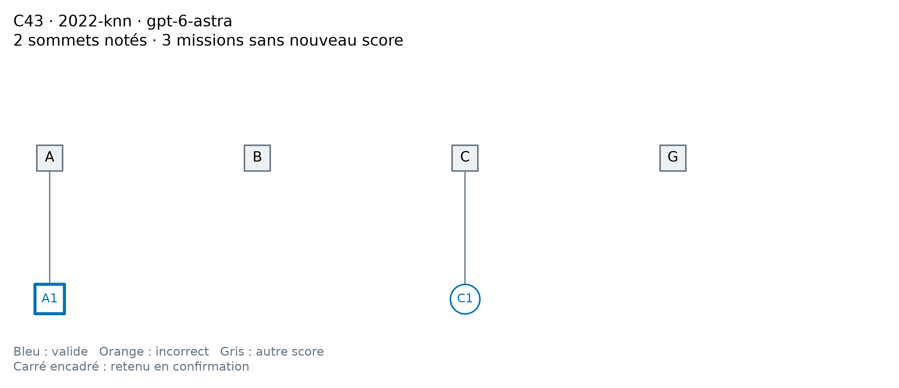

### G.44. C44 — 2022-sum · GPT 6-astra · max

Racine complète : `HPC-Forest-Etude-2020-2024-r1/runs/coverage-gpt-6-astra-max/preuves/results-748355/2022-sum`. Registre SHA-256 : `557250f01455c2651cb2b696e62ce1fa36d25bb8c1ad25fb20d3b90a25723ea2`.

| C44 · champ | Valeur enregistrée |
|---|---|
| Programme confirmé | 1e2b7a7e3781491a ; commit 1bdb370029cc709add074abef47ce396091dd024 |
| Résultat | Programme modifié confirmé ; g = 92,9089 % ; S = 14,1022 |
| T₀ / T (s) | 0,1256960 / 0,0089132 |
| Cinq temps T₀ (s) | 0,1275662; 0,1256751; 0,1248667; 0,1244772; 0,1258951 |
| Cinq temps T (s) | 0,0089213; 0,0095775; 0,0086495; 0,0086153; 0,0088027 |
| Statuts des missions | {"valid": 3, "infrastructure_error": 2} |
| Plafonds | wall=1800 s ; jetons=1500000 ; profondeur=6 ; mission=600 s |
| Planning | {"cycles": 1, "integrations_per_cycle": 2, "trials_per_role_per_cycle": 2} |
| Harnais | {"call_token_ceiling": 196608, "enabled": true, "max_attempts": 3, "research": {"allowed_hosts": ["gcc.gnu.org", "www.openmp.org", "raw.githubusercontent.com"], "corpus": null, "corpus_sha256": null, "enabled": true}} |
| Mesures de recherche / confirmation | 3 / 5 ; chauffe=1 ; graine=23 |
| Machine / cible | aarch64 ; romeo:romeo-a041:slurm-748355:archive-matrix-cpu4 |
| Compilateur | {"flavor": "gcc-compatible", "path": "/usr/bin/gcc", "sha256": "f7e1e7952e6aa5f31a79366a8dcdd751a150ed65e949429d527e933b5e7cc028"} |
| Environnement | {"CUDA_VISIBLE_DEVICES": "", "OMP_DYNAMIC": "FALSE", "OMP_NUM_THREADS": "4", "OMP_PROC_BIND": "TRUE"} |

Contrat partagé **K11** : champs hors chronométrages identiques à ceux présentés en **G.30**. Les temps et paramètres propres à cette campagne restent distincts ; sa version intégrale est conservée dans le registre exporté.

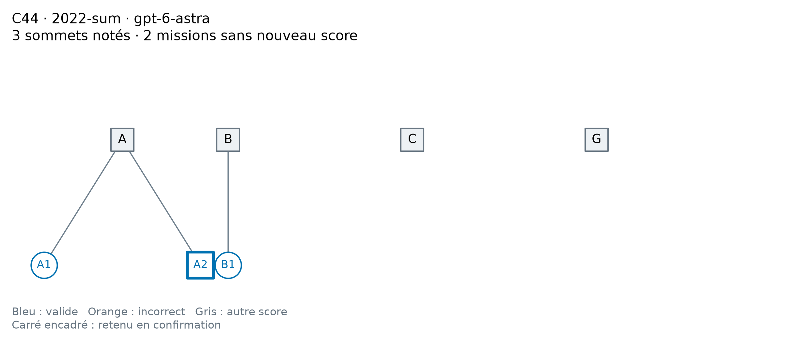

### G.45. C45 — 2022-nbody · GPT 6-astra · max

Racine complète : `HPC-Forest-Etude-2020-2024-r1/runs/coverage-gpt-6-astra-max/preuves/results-748355/2022-nbody`. Registre SHA-256 : `58f62c2591513f6aab857ee781a04ba24315bf7fca22edc40c45afc0d478911c`.

| C45 · champ | Valeur enregistrée |
|---|---|
| Programme confirmé | c9681433de044547 ; commit 817d9ca653c3895db9ac4d71324be8db314f750a |
| Résultat | Programme modifié confirmé ; g = 74,3281 % ; S = 3,8953 |
| T₀ / T (s) | 0,6608174 / 0,1696447 |
| Cinq temps T₀ (s) | 0,6608924; 0,6606283; 0,6607727; 0,6611895; 0,6606039 |
| Cinq temps T (s) | 0,1697165; 0,1697788; 0,1696019; 0,1695261; 0,1696000 |
| Statuts des missions | {"valid": 4, "infrastructure_error": 2} |
| Plafonds | wall=1800 s ; jetons=1500000 ; profondeur=6 ; mission=600 s |
| Planning | {"cycles": 1, "integrations_per_cycle": 2, "trials_per_role_per_cycle": 2} |
| Harnais | {"call_token_ceiling": 196608, "enabled": true, "max_attempts": 3, "research": {"allowed_hosts": ["gcc.gnu.org", "www.openmp.org", "raw.githubusercontent.com"], "corpus": null, "corpus_sha256": null, "enabled": true}} |
| Mesures de recherche / confirmation | 3 / 5 ; chauffe=1 ; graine=23 |
| Machine / cible | aarch64 ; romeo:romeo-a041:slurm-748355:archive-matrix-cpu4 |
| Compilateur | {"flavor": "gcc-compatible", "path": "/usr/bin/gcc", "sha256": "f7e1e7952e6aa5f31a79366a8dcdd751a150ed65e949429d527e933b5e7cc028"} |
| Environnement | {"CUDA_VISIBLE_DEVICES": "", "OMP_DYNAMIC": "FALSE", "OMP_NUM_THREADS": "4", "OMP_PROC_BIND": "TRUE"} |

Contrat partagé **K12** : champs hors chronométrages identiques à ceux présentés en **G.31**. Les temps et paramètres propres à cette campagne restent distincts ; sa version intégrale est conservée dans le registre exporté.

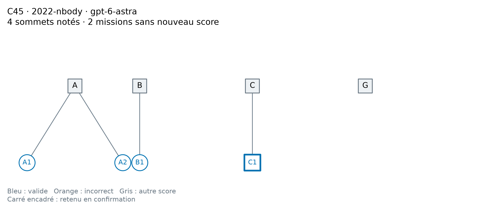

### G.46. C46 — 2022-bucketsort · GPT 6-astra · max

Racine complète : `HPC-Forest-Etude-2020-2024-r1/runs/coverage-gpt-6-astra-max/preuves/results-748355/2022-bucketsort`. Registre SHA-256 : `8f9b59d8d6e934c7090bf19620738ca637b4e463a9ea7af8b9ce4270fc9ff30f`.

| C46 · champ | Valeur enregistrée |
|---|---|
| Programme confirmé | 32fe3dd180b54ee6 ; commit 3ba9037f33d0b60037c6e742d4691b47d8eb17d5 |
| Résultat | Programme modifié confirmé ; g = 97,3643 % ; S = 37,9407 |
| T₀ / T (s) | 0,4156668 / 0,0109557 |
| Cinq temps T₀ (s) | 0,4153318; 0,4149059; 0,4155518; 0,4144344; 0,4181100 |
| Cinq temps T (s) | 0,0111266; 0,0108473; 0,0107634; 0,0109561; 0,0110851 |
| Statuts des missions | {"valid": 2, "infrastructure_error": 2} |
| Plafonds | wall=1800 s ; jetons=1500000 ; profondeur=6 ; mission=600 s |
| Planning | {"cycles": 1, "integrations_per_cycle": 2, "trials_per_role_per_cycle": 2} |
| Harnais | {"call_token_ceiling": 196608, "enabled": true, "max_attempts": 3, "research": {"allowed_hosts": ["gcc.gnu.org", "www.openmp.org", "raw.githubusercontent.com"], "corpus": null, "corpus_sha256": null, "enabled": true}} |
| Mesures de recherche / confirmation | 3 / 5 ; chauffe=1 ; graine=23 |
| Machine / cible | aarch64 ; romeo:romeo-a041:slurm-748355:archive-matrix-cpu4 |
| Compilateur | {"flavor": "gcc-compatible", "path": "/usr/bin/gcc", "sha256": "f7e1e7952e6aa5f31a79366a8dcdd751a150ed65e949429d527e933b5e7cc028"} |
| Environnement | {"CUDA_VISIBLE_DEVICES": "", "OMP_DYNAMIC": "FALSE", "OMP_NUM_THREADS": "4", "OMP_PROC_BIND": "TRUE"} |

Contrat partagé **K13** : champs hors chronométrages identiques à ceux présentés en **G.32**. Les temps et paramètres propres à cette campagne restent distincts ; sa version intégrale est conservée dans le registre exporté.

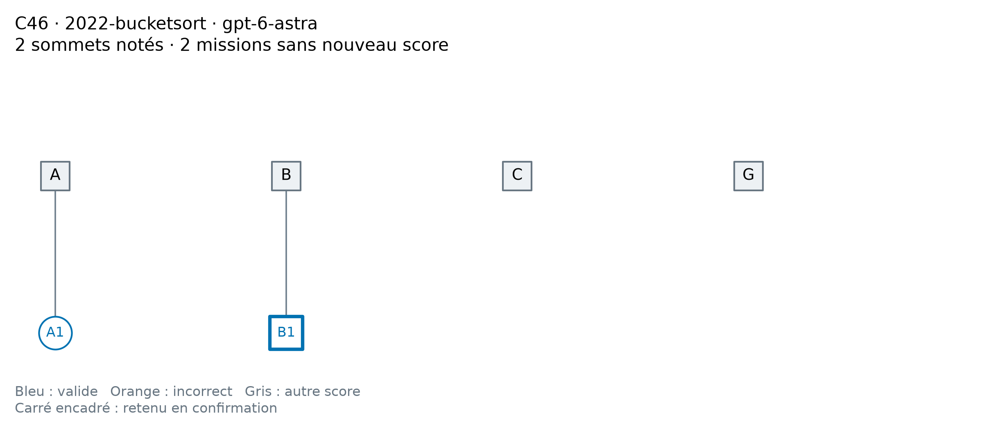

### G.47. C47 — 2023-sum · GPT 6-astra · max

Racine complète : `HPC-Forest-Etude-2020-2024-r1/runs/coverage-gpt-6-astra-max/preuves/results-748355/2023-sum`. Registre SHA-256 : `e56e8e9cede11bdfd6c02d7d918d50f417a9a2144b53ee9b0bcfc005666372d4`.

| C47 · champ | Valeur enregistrée |
|---|---|
| Programme confirmé | 97f4db11ef5e40c2 ; commit d7b6770f44cf713283850b8345cf6e16f45a65b6 |
| Résultat | Programme modifié confirmé ; g = 71,0588 % ; S = 3,4553 |
| T₀ / T (s) | 0,2481663 / 0,0718224 |
| Cinq temps T₀ (s) | 0,2476458; 0,2479682; 0,2500932; 0,2473579; 0,2477662 |
| Cinq temps T (s) | 0,0718576; 0,0720238; 0,0718081; 0,0714093; 0,0720132 |
| Statuts des missions | {"valid": 4, "infrastructure_error": 2} |
| Plafonds | wall=1800 s ; jetons=1500000 ; profondeur=6 ; mission=600 s |
| Planning | {"cycles": 1, "integrations_per_cycle": 2, "trials_per_role_per_cycle": 2} |
| Harnais | {"call_token_ceiling": 196608, "enabled": true, "max_attempts": 3, "research": {"allowed_hosts": ["gcc.gnu.org", "www.openmp.org", "raw.githubusercontent.com"], "corpus": null, "corpus_sha256": null, "enabled": true}} |
| Mesures de recherche / confirmation | 3 / 5 ; chauffe=1 ; graine=23 |
| Machine / cible | aarch64 ; romeo:romeo-a041:slurm-748355:archive-matrix-cpu4 |
| Compilateur | {"flavor": "gcc-compatible", "path": "/usr/bin/gcc", "sha256": "f7e1e7952e6aa5f31a79366a8dcdd751a150ed65e949429d527e933b5e7cc028"} |
| Environnement | {"CUDA_VISIBLE_DEVICES": "", "OMP_DYNAMIC": "FALSE", "OMP_NUM_THREADS": "4", "OMP_PROC_BIND": "TRUE"} |

Contrat partagé **K14** : champs hors chronométrages identiques à ceux présentés en **G.33**. Les temps et paramètres propres à cette campagne restent distincts ; sa version intégrale est conservée dans le registre exporté.

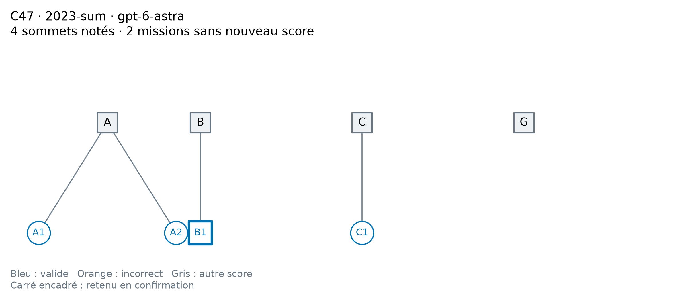

### G.48. C48 — 2023-npbonacci · GPT 6-astra · max

Racine complète : `HPC-Forest-Etude-2020-2024-r1/runs/coverage-gpt-6-astra-max/preuves/results-748355/2023-npbonacci`. Registre SHA-256 : `d0781fc749dd4ce420841485362f1e63a4feb91e8e7035f6b25b682fdfbfabd0`.

| C48 · champ | Valeur enregistrée |
|---|---|
| Programme confirmé | 6547363bad4f4e75 ; commit cd5d0487343ce944c6b615146567d045f271b997 |
| Résultat | Programme modifié confirmé ; g = 73,4863 % ; S = 3,7716 |
| T₀ / T (s) | 0,0196163 / 0,0052010 |
| Cinq temps T₀ (s) | 0,0197112; 0,0193846; 0,0195934; 0,0196778; 0,0197145 |
| Cinq temps T (s) | 0,0052840; 0,0052675; 0,0052073; 0,0051223; 0,0051239 |
| Statuts des missions | {"valid": 3, "infrastructure_error": 2} |
| Plafonds | wall=1800 s ; jetons=1500000 ; profondeur=6 ; mission=600 s |
| Planning | {"cycles": 1, "integrations_per_cycle": 2, "trials_per_role_per_cycle": 2} |
| Harnais | {"call_token_ceiling": 196608, "enabled": true, "max_attempts": 3, "research": {"allowed_hosts": ["gcc.gnu.org", "www.openmp.org", "raw.githubusercontent.com"], "corpus": null, "corpus_sha256": null, "enabled": true}} |
| Mesures de recherche / confirmation | 3 / 5 ; chauffe=1 ; graine=23 |
| Machine / cible | aarch64 ; romeo:romeo-a041:slurm-748355:archive-matrix-cpu4 |
| Compilateur | {"flavor": "gcc-compatible", "path": "/usr/bin/gcc", "sha256": "f7e1e7952e6aa5f31a79366a8dcdd751a150ed65e949429d527e933b5e7cc028"} |
| Environnement | {"CUDA_VISIBLE_DEVICES": "", "OMP_DYNAMIC": "FALSE", "OMP_NUM_THREADS": "4", "OMP_PROC_BIND": "TRUE"} |

Contrat partagé **K15** : champs hors chronométrages identiques à ceux présentés en **G.34**. Les temps et paramètres propres à cette campagne restent distincts ; sa version intégrale est conservée dans le registre exporté.

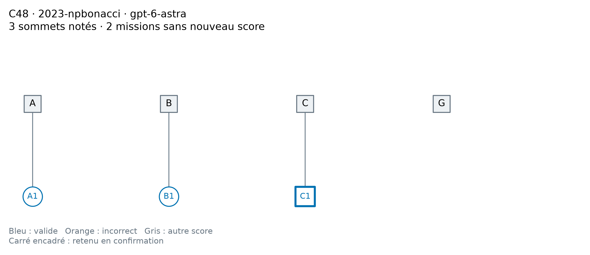

### G.49. C49 — 2020-tropical · GPT 5.6-terra · max

Racine complète : `HPC-Forest-Etude-2020-2024-r1/receptions/coverage-terra-max-748782/restauration-neuve/results-748782/2020-tropical`. Registre SHA-256 : `d96a5f60b1a1c229dea1a23b7ca249bc1f1521b35207ce14e1a57f2bd92048f4`.

| C49 · champ | Valeur enregistrée |
|---|---|
| Programme confirmé | baseline-e1 ; commit 6060902a87aca3e1c3686341603b55e976fab11f |
| Résultat | Référence conservée ; g = 0,0000 % ; S = 1,0000 |
| T₀ / T (s) | 0,0058478 / 0,0058478 |
| Cinq temps T₀ (s) | 0,0058193; 0,0057626; 0,0057020; 0,0063827; 0,0055727 |
| Cinq temps T (s) | 0,0058193; 0,0057626; 0,0057020; 0,0063827; 0,0055727 |
| Statuts des missions | {"infrastructure_error": 2, "valid": 1} |
| Plafonds | wall=1800 s ; jetons=1500000 ; profondeur=6 ; mission=600 s |
| Planning | {"cycles": 1, "integrations_per_cycle": 2, "trials_per_role_per_cycle": 2} |
| Harnais | {"call_token_ceiling": 196608, "enabled": true, "max_attempts": 3, "research": {"allowed_hosts": ["gcc.gnu.org", "www.openmp.org", "raw.githubusercontent.com"], "corpus": null, "corpus_sha256": null, "enabled": true}} |
| Mesures de recherche / confirmation | 3 / 5 ; chauffe=1 ; graine=23 |
| Machine / cible | aarch64 ; romeo:romeo-a041:slurm-748782:archive-matrix-cpu4 |
| Compilateur | {"flavor": "gcc-compatible", "path": "/usr/bin/gcc", "sha256": "f7e1e7952e6aa5f31a79366a8dcdd751a150ed65e949429d527e933b5e7cc028"} |
| Environnement | {"CUDA_VISIBLE_DEVICES": "", "OMP_DYNAMIC": "FALSE", "OMP_NUM_THREADS": "4", "OMP_PROC_BIND": "TRUE"} |

Contrat partagé **K02** : champs hors chronométrages identiques à ceux présentés en **G.21**. Les temps et paramètres propres à cette campagne restent distincts ; sa version intégrale est conservée dans le registre exporté.

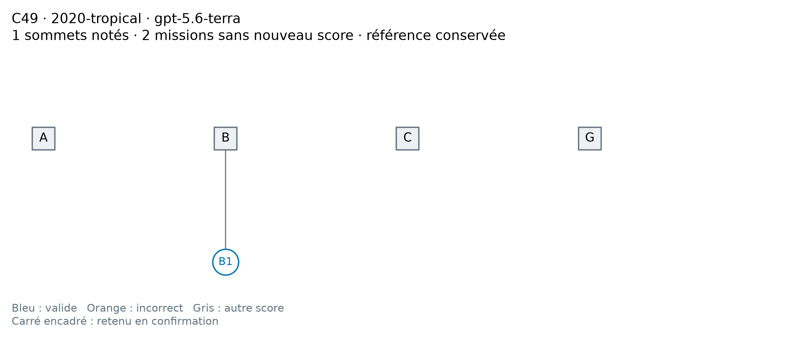

### G.50. C50 — 2020-quicksort · GPT 5.6-terra · max

Racine complète : `HPC-Forest-Etude-2020-2024-r1/receptions/coverage-terra-max-748782/restauration-neuve/results-748782/2020-quicksort`. Registre SHA-256 : `acc8d20f5b2b9012ad5cad8240fedf98b3827de4a62447dba334dd580831ef57`.

| C50 · champ | Valeur enregistrée |
|---|---|
| Programme confirmé | 7678ef3a06ba4cc9 ; commit 90b9a1c7cc429cf41797021924acabf0553c2083 |
| Résultat | Programme modifié confirmé ; g = 76,8546 % ; S = 4,3205 |
| T₀ / T (s) | 0,0708264 / 0,0163931 |
| Cinq temps T₀ (s) | 0,0730498; 0,0709371; 0,0699363; 0,0703343; 0,0698744 |
| Cinq temps T (s) | 0,0165824; 0,0167337; 0,0168204; 0,0159269; 0,0159019 |
| Statuts des missions | {"infrastructure_error": 2, "valid": 1} |
| Plafonds | wall=1800 s ; jetons=1500000 ; profondeur=6 ; mission=600 s |
| Planning | {"cycles": 1, "integrations_per_cycle": 2, "trials_per_role_per_cycle": 2} |
| Harnais | {"call_token_ceiling": 196608, "enabled": true, "max_attempts": 3, "research": {"allowed_hosts": ["gcc.gnu.org", "www.openmp.org", "raw.githubusercontent.com"], "corpus": null, "corpus_sha256": null, "enabled": true}} |
| Mesures de recherche / confirmation | 3 / 5 ; chauffe=1 ; graine=23 |
| Machine / cible | aarch64 ; romeo:romeo-a041:slurm-748782:archive-matrix-cpu4 |
| Compilateur | {"flavor": "gcc-compatible", "path": "/usr/bin/gcc", "sha256": "f7e1e7952e6aa5f31a79366a8dcdd751a150ed65e949429d527e933b5e7cc028"} |
| Environnement | {"CUDA_VISIBLE_DEVICES": "", "OMP_DYNAMIC": "FALSE", "OMP_NUM_THREADS": "4", "OMP_PROC_BIND": "TRUE"} |

Contrat partagé **K03** : champs hors chronométrages identiques à ceux présentés en **G.22**. Les temps et paramètres propres à cette campagne restent distincts ; sa version intégrale est conservée dans le registre exporté.

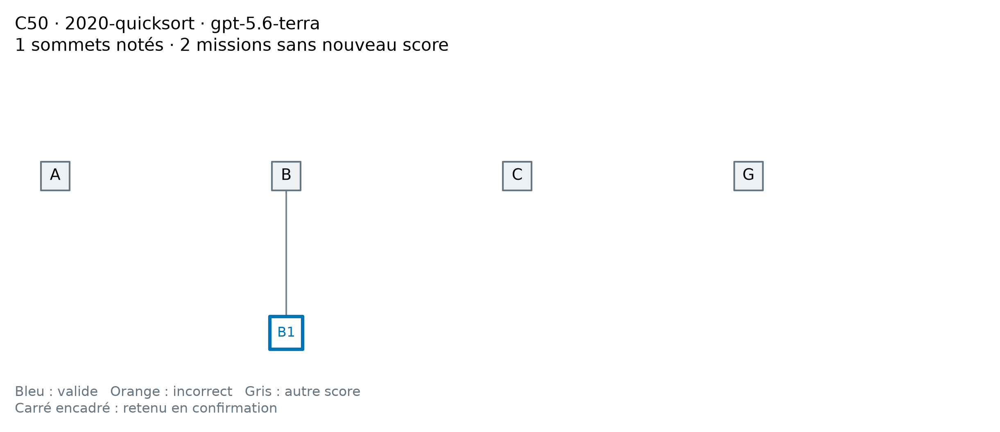

### G.51. C51 — 2020-permutations · GPT 5.6-terra · max

Racine complète : `HPC-Forest-Etude-2020-2024-r1/receptions/coverage-terra-max-748782/restauration-neuve/results-748782/2020-permutations`. Registre SHA-256 : `071d1959cbc0c3c6e287cf1deaf84e25c5a2991f9cd6e91f98255389a306fdce`.

| C51 · champ | Valeur enregistrée |
|---|---|
| Programme confirmé | fa18789ef512490e ; commit 4b87f8254549c8c2020d890bdbf9f75b41c3f80a |
| Résultat | Programme modifié confirmé ; g = 95,3456 % ; S = 21,4849 |
| T₀ / T (s) | 0,1338954 / 0,0062321 |
| Cinq temps T₀ (s) | 0,1335780; 0,1352846; 0,1326041; 0,1352524; 0,1327581 |
| Cinq temps T (s) | 0,0062635; 0,0063705; 0,0060374; 0,0062288; 0,0062602 |
| Statuts des missions | {"valid": 2, "infrastructure_error": 1} |
| Plafonds | wall=1800 s ; jetons=1500000 ; profondeur=6 ; mission=600 s |
| Planning | {"cycles": 1, "integrations_per_cycle": 2, "trials_per_role_per_cycle": 2} |
| Harnais | {"call_token_ceiling": 196608, "enabled": true, "max_attempts": 3, "research": {"allowed_hosts": ["gcc.gnu.org", "www.openmp.org", "raw.githubusercontent.com"], "corpus": null, "corpus_sha256": null, "enabled": true}} |
| Mesures de recherche / confirmation | 3 / 5 ; chauffe=1 ; graine=23 |
| Machine / cible | aarch64 ; romeo:romeo-a041:slurm-748782:archive-matrix-cpu4 |
| Compilateur | {"flavor": "gcc-compatible", "path": "/usr/bin/gcc", "sha256": "f7e1e7952e6aa5f31a79366a8dcdd751a150ed65e949429d527e933b5e7cc028"} |
| Environnement | {"CUDA_VISIBLE_DEVICES": "", "OMP_DYNAMIC": "FALSE", "OMP_NUM_THREADS": "4", "OMP_PROC_BIND": "TRUE"} |

Contrat partagé **K04** : champs hors chronométrages identiques à ceux présentés en **G.23**. Les temps et paramètres propres à cette campagne restent distincts ; sa version intégrale est conservée dans le registre exporté.

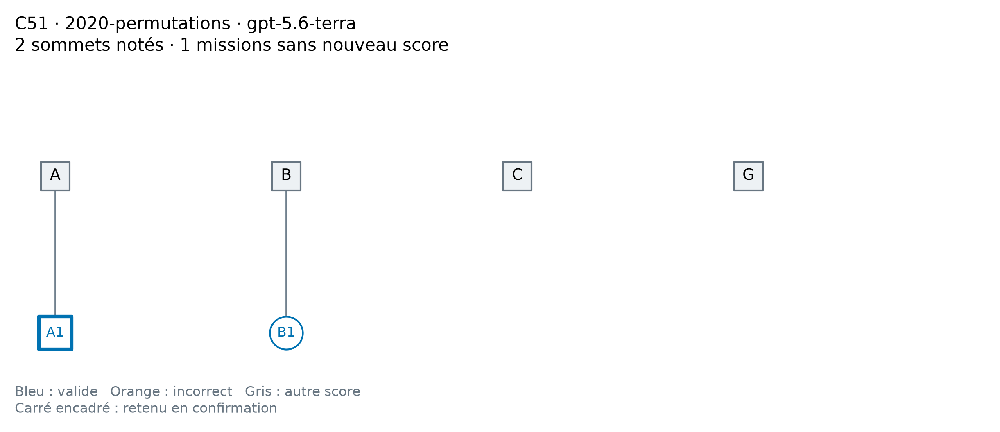

### G.52. C52 — 2020-graph · GPT 5.6-terra · max

Racine complète : `HPC-Forest-Etude-2020-2024-r1/receptions/coverage-terra-max-748782/restauration-neuve/results-748782/2020-graph`. Registre SHA-256 : `1a55f5c2e769e61b0db6a2ba4889c3c55262a213ccd194d25d36b01a5598b72a`.

| C52 · champ | Valeur enregistrée |
|---|---|
| Programme confirmé | 10b1942c13624eb3 ; commit 37fcf594a4e8ef276406a62e55e29410617f9ceb |
| Résultat | Programme modifié confirmé ; g = 53,3030 % ; S = 2,1415 |
| T₀ / T (s) | 0,0121725 / 0,0056842 |
| Cinq temps T₀ (s) | 0,0122859; 0,0122946; 0,0118629; 0,0120186; 0,0124004 |
| Cinq temps T (s) | 0,0055245; 0,0056886; 0,0055017; 0,0056589; 0,0060473 |
| Statuts des missions | {"infrastructure_error": 2, "valid": 1} |
| Plafonds | wall=1800 s ; jetons=1500000 ; profondeur=6 ; mission=600 s |
| Planning | {"cycles": 1, "integrations_per_cycle": 2, "trials_per_role_per_cycle": 2} |
| Harnais | {"call_token_ceiling": 196608, "enabled": true, "max_attempts": 3, "research": {"allowed_hosts": ["gcc.gnu.org", "www.openmp.org", "raw.githubusercontent.com"], "corpus": null, "corpus_sha256": null, "enabled": true}} |
| Mesures de recherche / confirmation | 3 / 5 ; chauffe=1 ; graine=23 |
| Machine / cible | aarch64 ; romeo:romeo-a041:slurm-748782:archive-matrix-cpu4 |
| Compilateur | {"flavor": "gcc-compatible", "path": "/usr/bin/gcc", "sha256": "f7e1e7952e6aa5f31a79366a8dcdd751a150ed65e949429d527e933b5e7cc028"} |
| Environnement | {"CUDA_VISIBLE_DEVICES": "", "OMP_DYNAMIC": "FALSE", "OMP_NUM_THREADS": "4", "OMP_PROC_BIND": "TRUE"} |

Contrat partagé **K05** : champs hors chronométrages identiques à ceux présentés en **G.24**. Les temps et paramètres propres à cette campagne restent distincts ; sa version intégrale est conservée dans le registre exporté.

### G.53. C53 — 2021-graph · GPT 5.6-terra · max

Racine complète : `HPC-Forest-Etude-2020-2024-r1/receptions/coverage-terra-max-748782/restauration-neuve/results-748782/2021-graph`. Registre SHA-256 : `a40c0bed8bc28974b8d545c085b230d660c34933ef85a089ac4dc8a9a7c25423`.

| C53 · champ | Valeur enregistrée |
|---|---|
| Programme confirmé | 7f573a426fd446e9 ; commit 74ee2e177091296ba5a56e065b9e94d7b9ee27bb |
| Résultat | Programme modifié confirmé ; g = 37,3848 % ; S = 1,5971 |
| T₀ / T (s) | 0,0084795 / 0,0053095 |
| Cinq temps T₀ (s) | 0,0086691; 0,0085258; 0,0084491; 0,0086675; 0,0080861 |
| Cinq temps T (s) | 0,0055503; 0,0052377; 0,0054752; 0,0051185; 0,0051657 |
| Statuts des missions | {"valid": 2, "incorrect": 1, "infrastructure_error": 1} |
| Plafonds | wall=1800 s ; jetons=1500000 ; profondeur=6 ; mission=600 s |
| Planning | {"cycles": 1, "integrations_per_cycle": 2, "trials_per_role_per_cycle": 2} |
| Harnais | {"call_token_ceiling": 196608, "enabled": true, "max_attempts": 3, "research": {"allowed_hosts": ["gcc.gnu.org", "www.openmp.org", "raw.githubusercontent.com"], "corpus": null, "corpus_sha256": null, "enabled": true}} |
| Mesures de recherche / confirmation | 3 / 5 ; chauffe=1 ; graine=23 |
| Machine / cible | aarch64 ; romeo:romeo-a041:slurm-748782:archive-matrix-cpu4 |
| Compilateur | {"flavor": "gcc-compatible", "path": "/usr/bin/gcc", "sha256": "f7e1e7952e6aa5f31a79366a8dcdd751a150ed65e949429d527e933b5e7cc028"} |
| Environnement | {"CUDA_VISIBLE_DEVICES": "", "OMP_DYNAMIC": "FALSE", "OMP_NUM_THREADS": "4", "OMP_PROC_BIND": "TRUE"} |

Contrat partagé **K06** : champs hors chronométrages identiques à ceux présentés en **G.25**. Les temps et paramètres propres à cette campagne restent distincts ; sa version intégrale est conservée dans le registre exporté.

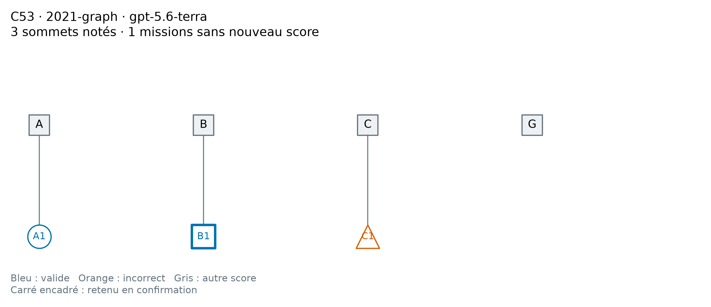

### G.54. C54 — 2021-metrics · GPT 5.6-terra · max

Racine complète : `HPC-Forest-Etude-2020-2024-r1/receptions/coverage-terra-max-748782/restauration-neuve/results-748782/2021-metrics`. Registre SHA-256 : `6e0c89b41e5ff388c06e2506570eab4910088a26c972c3410a0536c8c69d4e2f`.

| C54 · champ | Valeur enregistrée |
|---|---|
| Programme confirmé | baseline-e1 ; commit 5d3b9e1cb792ad18c3cd8490ba2bc70cc756471e |
| Résultat | Référence conservée ; g = 0,0000 % ; S = 1,0000 |
| T₀ / T (s) | 0,0100174 / 0,0100174 |
| Cinq temps T₀ (s) | 0,0103422; 0,0099704; 0,0099255; 0,0099322; 0,0099166 |
| Cinq temps T (s) | 0,0103422; 0,0099704; 0,0099255; 0,0099322; 0,0099166 |
| Statuts des missions | {"infrastructure_error": 3} |
| Plafonds | wall=1800 s ; jetons=1500000 ; profondeur=6 ; mission=600 s |
| Planning | {"cycles": 1, "integrations_per_cycle": 2, "trials_per_role_per_cycle": 2} |
| Harnais | {"call_token_ceiling": 196608, "enabled": true, "max_attempts": 3, "research": {"allowed_hosts": ["gcc.gnu.org", "www.openmp.org", "raw.githubusercontent.com"], "corpus": null, "corpus_sha256": null, "enabled": true}} |
| Mesures de recherche / confirmation | 3 / 5 ; chauffe=1 ; graine=23 |
| Machine / cible | aarch64 ; romeo:romeo-a041:slurm-748782:archive-matrix-cpu4 |
| Compilateur | {"flavor": "gcc-compatible", "path": "/usr/bin/gcc", "sha256": "f7e1e7952e6aa5f31a79366a8dcdd751a150ed65e949429d527e933b5e7cc028"} |
| Environnement | {"CUDA_VISIBLE_DEVICES": "", "OMP_DYNAMIC": "FALSE", "OMP_NUM_THREADS": "4", "OMP_PROC_BIND": "TRUE"} |

Contrat partagé **K07** : champs hors chronométrages identiques à ceux présentés en **G.26**. Les temps et paramètres propres à cette campagne restent distincts ; sa version intégrale est conservée dans le registre exporté.

### G.55. C55 — 2021-sokoban · GPT 5.6-terra · max

Racine complète : `HPC-Forest-Etude-2020-2024-r1/receptions/coverage-terra-max-748782/restauration-neuve/results-748782/2021-sokoban`. Registre SHA-256 : `1709328623cb8d1bd16bad815185bef1a556d0241dcc8af9adf9a3725bd75ee6`.

| C55 · champ | Valeur enregistrée |
|---|---|
| Programme confirmé | baseline-e1 ; commit a5e0672591c9e582669e8b1ad8463e52511a5cca |
| Résultat | Référence conservée ; g = 0,0000 % ; S = 1,0000 |
| T₀ / T (s) | 0,0051860 / 0,0051860 |
| Cinq temps T₀ (s) | 0,0053669; 0,0050995; 0,0052561; 0,0052713; 0,0049360 |
| Cinq temps T (s) | 0,0053669; 0,0050995; 0,0052561; 0,0052713; 0,0049360 |
| Statuts des missions | {"valid": 2, "infrastructure_error": 2} |
| Plafonds | wall=1800 s ; jetons=1500000 ; profondeur=6 ; mission=600 s |
| Planning | {"cycles": 1, "integrations_per_cycle": 2, "trials_per_role_per_cycle": 2} |
| Harnais | {"call_token_ceiling": 196608, "enabled": true, "max_attempts": 3, "research": {"allowed_hosts": ["gcc.gnu.org", "www.openmp.org", "raw.githubusercontent.com"], "corpus": null, "corpus_sha256": null, "enabled": true}} |
| Mesures de recherche / confirmation | 3 / 5 ; chauffe=1 ; graine=23 |
| Machine / cible | aarch64 ; romeo:romeo-a041:slurm-748782:archive-matrix-cpu4 |
| Compilateur | {"flavor": "gcc-compatible", "path": "/usr/bin/gcc", "sha256": "f7e1e7952e6aa5f31a79366a8dcdd751a150ed65e949429d527e933b5e7cc028"} |
| Environnement | {"CUDA_VISIBLE_DEVICES": "", "OMP_DYNAMIC": "FALSE", "OMP_NUM_THREADS": "4", "OMP_PROC_BIND": "TRUE"} |

Contrat partagé **K08** : champs hors chronométrages identiques à ceux présentés en **G.27**. Les temps et paramètres propres à cette campagne restent distincts ; sa version intégrale est conservée dans le registre exporté.

### G.56. C56 — 2021-jacobi · GPT 5.6-terra · max

Racine complète : `HPC-Forest-Etude-2020-2024-r1/receptions/coverage-terra-max-748782/restauration-neuve/results-748782/2021-jacobi`. Registre SHA-256 : `03fbcbf46c81be0713d723b0a57ea66785e59c1abe777f7d134791f144487498`.

| C56 · champ | Valeur enregistrée |
|---|---|
| Programme confirmé | 253c38e7b0bc43da ; commit 9fb5f2b58bc06325916ee4d3d1467a480115935a |
| Résultat | Programme modifié confirmé ; g = 31,2849 % ; S = 1,4553 |
| T₀ / T (s) | 0,0671772 / 0,0461609 |
| Cinq temps T₀ (s) | 0,0672404; 0,0677014; 0,0678798; 0,0666298; 0,0664345 |
| Cinq temps T (s) | 0,0457348; 0,0462899; 0,0466906; 0,0459783; 0,0461107 |
| Statuts des missions | {"valid": 2, "infrastructure_error": 1} |
| Plafonds | wall=1800 s ; jetons=1500000 ; profondeur=6 ; mission=600 s |
| Planning | {"cycles": 1, "integrations_per_cycle": 2, "trials_per_role_per_cycle": 2} |
| Harnais | {"call_token_ceiling": 196608, "enabled": true, "max_attempts": 3, "research": {"allowed_hosts": ["gcc.gnu.org", "www.openmp.org", "raw.githubusercontent.com"], "corpus": null, "corpus_sha256": null, "enabled": true}} |
| Mesures de recherche / confirmation | 3 / 5 ; chauffe=1 ; graine=23 |
| Machine / cible | aarch64 ; romeo:romeo-a041:slurm-748782:archive-matrix-cpu4 |
| Compilateur | {"flavor": "gcc-compatible", "path": "/usr/bin/gcc", "sha256": "f7e1e7952e6aa5f31a79366a8dcdd751a150ed65e949429d527e933b5e7cc028"} |
| Environnement | {"CUDA_VISIBLE_DEVICES": "", "OMP_DYNAMIC": "FALSE", "OMP_NUM_THREADS": "4", "OMP_PROC_BIND": "TRUE"} |

Contrat partagé **K09** : champs hors chronométrages identiques à ceux présentés en **G.28**. Les temps et paramètres propres à cette campagne restent distincts ; sa version intégrale est conservée dans le registre exporté.

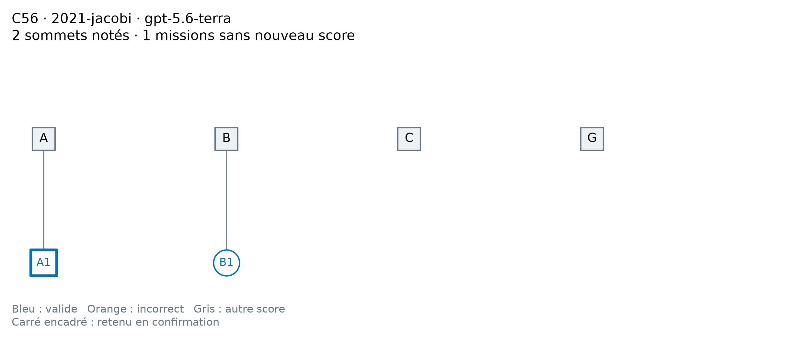

### G.57. C57 — 2022-knn · GPT 5.6-terra · max

Racine complète : `HPC-Forest-Etude-2020-2024-r1/receptions/coverage-terra-max-748782/restauration-neuve/results-748782/2022-knn`. Registre SHA-256 : `f42330493d0556933941825254fcb087cb39c7a132a7f42e962003a6a724c236`.

| C57 · champ | Valeur enregistrée |
|---|---|
| Programme confirmé | 21bd90106be44cbd ; commit db011fd1e1df7b2ff7ccc728b4db01a05403e0b5 |
| Résultat | Programme modifié confirmé ; g = 98,7997 % ; S = 83,3100 |
| T₀ / T (s) | 2,0394226 / 0,0244799 |
| Cinq temps T₀ (s) | 2,0506533; 2,0609214; 2,0067924; 2,0698214; 2,0089248 |
| Cinq temps T (s) | 0,0243353; 0,0249118; 0,0244782; 0,0242724; 0,0244020 |
| Statuts des missions | {"valid": 1, "infrastructure_error": 2} |
| Plafonds | wall=1800 s ; jetons=1500000 ; profondeur=6 ; mission=600 s |
| Planning | {"cycles": 1, "integrations_per_cycle": 2, "trials_per_role_per_cycle": 2} |
| Harnais | {"call_token_ceiling": 196608, "enabled": true, "max_attempts": 3, "research": {"allowed_hosts": ["gcc.gnu.org", "www.openmp.org", "raw.githubusercontent.com"], "corpus": null, "corpus_sha256": null, "enabled": true}} |
| Mesures de recherche / confirmation | 3 / 5 ; chauffe=1 ; graine=23 |
| Machine / cible | aarch64 ; romeo:romeo-a041:slurm-748782:archive-matrix-cpu4 |
| Compilateur | {"flavor": "gcc-compatible", "path": "/usr/bin/gcc", "sha256": "f7e1e7952e6aa5f31a79366a8dcdd751a150ed65e949429d527e933b5e7cc028"} |
| Environnement | {"CUDA_VISIBLE_DEVICES": "", "OMP_DYNAMIC": "FALSE", "OMP_NUM_THREADS": "4", "OMP_PROC_BIND": "TRUE"} |

Contrat partagé **K10** : champs hors chronométrages identiques à ceux présentés en **G.29**. Les temps et paramètres propres à cette campagne restent distincts ; sa version intégrale est conservée dans le registre exporté.

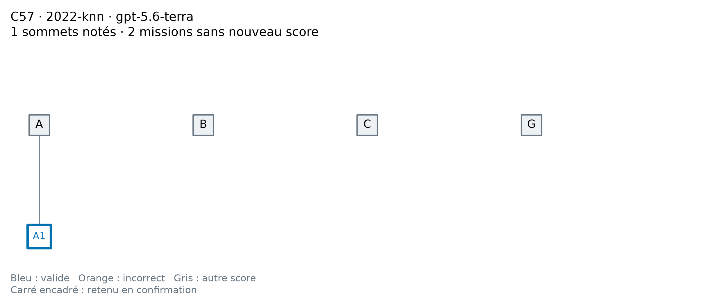

### G.58. C58 — 2022-sum · GPT 5.6-terra · max

Racine complète : `HPC-Forest-Etude-2020-2024-r1/receptions/coverage-terra-max-748782/restauration-neuve/results-748782/2022-sum`. Registre SHA-256 : `78deb3b77f323d870456fbbd5d15cf856ff4c1591e6d0c7f00e11c257b7bcc97`.

| C58 · champ | Valeur enregistrée |
|---|---|
| Programme confirmé | 33b4afa6a6884743 ; commit e48fd94b6a5843be35e88701e5b863c8a82f2f33 |
| Résultat | Programme modifié confirmé ; g = 92,1149 % ; S = 12,6821 |
| T₀ / T (s) | 0,1254690 / 0,0098934 |
| Cinq temps T₀ (s) | 0,1261423; 0,1259899; 0,1244569; 0,1249348; 0,1258213 |
| Cinq temps T (s) | 0,0100623; 0,0099926; 0,0098191; 0,0099354; 0,0096575 |
| Statuts des missions | {"valid": 2, "infrastructure_error": 2} |
| Plafonds | wall=1800 s ; jetons=1500000 ; profondeur=6 ; mission=600 s |
| Planning | {"cycles": 1, "integrations_per_cycle": 2, "trials_per_role_per_cycle": 2} |
| Harnais | {"call_token_ceiling": 196608, "enabled": true, "max_attempts": 3, "research": {"allowed_hosts": ["gcc.gnu.org", "www.openmp.org", "raw.githubusercontent.com"], "corpus": null, "corpus_sha256": null, "enabled": true}} |
| Mesures de recherche / confirmation | 3 / 5 ; chauffe=1 ; graine=23 |
| Machine / cible | aarch64 ; romeo:romeo-a041:slurm-748782:archive-matrix-cpu4 |
| Compilateur | {"flavor": "gcc-compatible", "path": "/usr/bin/gcc", "sha256": "f7e1e7952e6aa5f31a79366a8dcdd751a150ed65e949429d527e933b5e7cc028"} |
| Environnement | {"CUDA_VISIBLE_DEVICES": "", "OMP_DYNAMIC": "FALSE", "OMP_NUM_THREADS": "4", "OMP_PROC_BIND": "TRUE"} |

Contrat partagé **K11** : champs hors chronométrages identiques à ceux présentés en **G.30**. Les temps et paramètres propres à cette campagne restent distincts ; sa version intégrale est conservée dans le registre exporté.

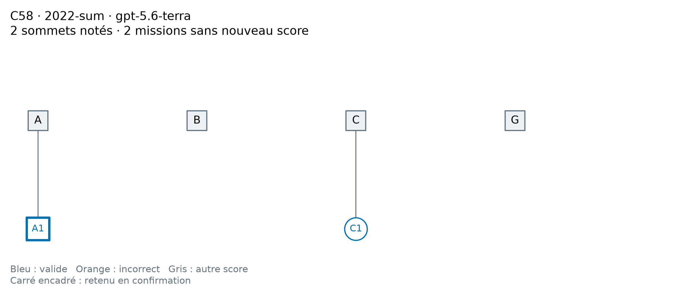

### G.59. C59 — 2022-nbody · GPT 5.6-terra · max

Racine complète : `HPC-Forest-Etude-2020-2024-r1/receptions/coverage-terra-max-748782/restauration-neuve/results-748782/2022-nbody`. Registre SHA-256 : `ee2c1cd3b7627aa9b2f75f7c1ea15f9cc615f5dd56d8f4b4d4bfe42fcba2d997`.

| C59 · champ | Valeur enregistrée |
|---|---|
| Programme confirmé | a240e571805c4a46 ; commit c4335847ba4a7eb8ac85c8345039c3ecdc9f5777 |
| Résultat | Programme modifié confirmé ; g = 74,3383 % ; S = 3,8969 |
| T₀ / T (s) | 0,6614940 / 0,1697505 |
| Cinq temps T₀ (s) | 0,6606740; 0,6608534; 0,6611736; 0,6605958; 0,6641732 |
| Cinq temps T (s) | 0,1698229; 0,1695727; 0,1696148; 0,1697382; 0,1700037 |
| Statuts des missions | {"valid": 2, "infrastructure_error": 2} |
| Plafonds | wall=1800 s ; jetons=1500000 ; profondeur=6 ; mission=600 s |
| Planning | {"cycles": 1, "integrations_per_cycle": 2, "trials_per_role_per_cycle": 2} |
| Harnais | {"call_token_ceiling": 196608, "enabled": true, "max_attempts": 3, "research": {"allowed_hosts": ["gcc.gnu.org", "www.openmp.org", "raw.githubusercontent.com"], "corpus": null, "corpus_sha256": null, "enabled": true}} |
| Mesures de recherche / confirmation | 3 / 5 ; chauffe=1 ; graine=23 |
| Machine / cible | aarch64 ; romeo:romeo-a041:slurm-748782:archive-matrix-cpu4 |
| Compilateur | {"flavor": "gcc-compatible", "path": "/usr/bin/gcc", "sha256": "f7e1e7952e6aa5f31a79366a8dcdd751a150ed65e949429d527e933b5e7cc028"} |
| Environnement | {"CUDA_VISIBLE_DEVICES": "", "OMP_DYNAMIC": "FALSE", "OMP_NUM_THREADS": "4", "OMP_PROC_BIND": "TRUE"} |

Contrat partagé **K12** : champs hors chronométrages identiques à ceux présentés en **G.31**. Les temps et paramètres propres à cette campagne restent distincts ; sa version intégrale est conservée dans le registre exporté.

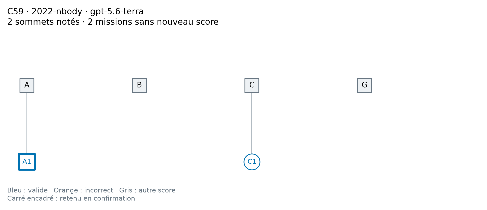

### G.60. C60 — 2022-bucketsort · GPT 5.6-terra · max

Racine complète : `HPC-Forest-Etude-2020-2024-r1/receptions/coverage-terra-max-748782/restauration-neuve/results-748782/2022-bucketsort`. Registre SHA-256 : `cdae4ae97b43d39113b2d105231cfc72e180abb47902490f7fd833375231de86`.

| C60 · champ | Valeur enregistrée |
|---|---|
| Programme confirmé | b557d16c4ffa4daa ; commit 10a8aff8542eea2d5728f5eb9eeab06bcfc84e49 |
| Résultat | Programme modifié confirmé ; g = 96,9373 % ; S = 32,6509 |
| T₀ / T (s) | 0,4187690 / 0,0128256 |
| Cinq temps T₀ (s) | 0,4176802; 0,4202630; 0,4195813; 0,4154876; 0,4208327 |
| Cinq temps T (s) | 0,0128981; 0,0126793; 0,0119178; 0,0127130; 0,0139200 |
| Statuts des missions | {"infrastructure_error": 3, "valid": 1} |
| Plafonds | wall=1800 s ; jetons=1500000 ; profondeur=6 ; mission=600 s |
| Planning | {"cycles": 1, "integrations_per_cycle": 2, "trials_per_role_per_cycle": 2} |
| Harnais | {"call_token_ceiling": 196608, "enabled": true, "max_attempts": 3, "research": {"allowed_hosts": ["gcc.gnu.org", "www.openmp.org", "raw.githubusercontent.com"], "corpus": null, "corpus_sha256": null, "enabled": true}} |
| Mesures de recherche / confirmation | 3 / 5 ; chauffe=1 ; graine=23 |
| Machine / cible | aarch64 ; romeo:romeo-a041:slurm-748782:archive-matrix-cpu4 |
| Compilateur | {"flavor": "gcc-compatible", "path": "/usr/bin/gcc", "sha256": "f7e1e7952e6aa5f31a79366a8dcdd751a150ed65e949429d527e933b5e7cc028"} |
| Environnement | {"CUDA_VISIBLE_DEVICES": "", "OMP_DYNAMIC": "FALSE", "OMP_NUM_THREADS": "4", "OMP_PROC_BIND": "TRUE"} |

Contrat partagé **K13** : champs hors chronométrages identiques à ceux présentés en **G.32**. Les temps et paramètres propres à cette campagne restent distincts ; sa version intégrale est conservée dans le registre exporté.

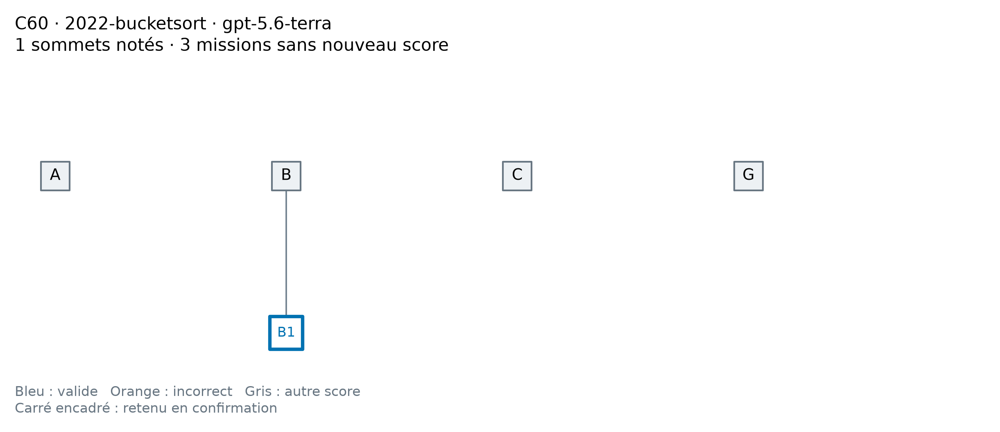

### G.61. C61 — 2023-sum · GPT 5.6-terra · max

Racine complète : `HPC-Forest-Etude-2020-2024-r1/receptions/coverage-terra-max-748782/restauration-neuve/results-748782/2023-sum`. Registre SHA-256 : `1bd25a584a09a1fc40d74b892a53fc3e1318aa2a4b2915347f5362eba783156d`.

| C61 · champ | Valeur enregistrée |
|---|---|
| Programme confirmé | baseline-e1 ; commit 52ed5a37624653ca504a890214c27361688bb486 |
| Résultat | Référence conservée ; g = 0,0000 % ; S = 1,0000 |
| T₀ / T (s) | 0,2521353 / 0,2521353 |
| Cinq temps T₀ (s) | 0,2521511; 0,2529928; 0,2508889; 0,2524447; 0,2521990 |
| Cinq temps T (s) | 0,2521511; 0,2529928; 0,2508889; 0,2524447; 0,2521990 |
| Statuts des missions | {"infrastructure_error": 3} |
| Plafonds | wall=1800 s ; jetons=1500000 ; profondeur=6 ; mission=600 s |
| Planning | {"cycles": 1, "integrations_per_cycle": 2, "trials_per_role_per_cycle": 2} |
| Harnais | {"call_token_ceiling": 196608, "enabled": true, "max_attempts": 3, "research": {"allowed_hosts": ["gcc.gnu.org", "www.openmp.org", "raw.githubusercontent.com"], "corpus": null, "corpus_sha256": null, "enabled": true}} |
| Mesures de recherche / confirmation | 3 / 5 ; chauffe=1 ; graine=23 |
| Machine / cible | aarch64 ; romeo:romeo-a041:slurm-748782:archive-matrix-cpu4 |
| Compilateur | {"flavor": "gcc-compatible", "path": "/usr/bin/gcc", "sha256": "f7e1e7952e6aa5f31a79366a8dcdd751a150ed65e949429d527e933b5e7cc028"} |
| Environnement | {"CUDA_VISIBLE_DEVICES": "", "OMP_DYNAMIC": "FALSE", "OMP_NUM_THREADS": "4", "OMP_PROC_BIND": "TRUE"} |

Contrat partagé **K14** : champs hors chronométrages identiques à ceux présentés en **G.33**. Les temps et paramètres propres à cette campagne restent distincts ; sa version intégrale est conservée dans le registre exporté.

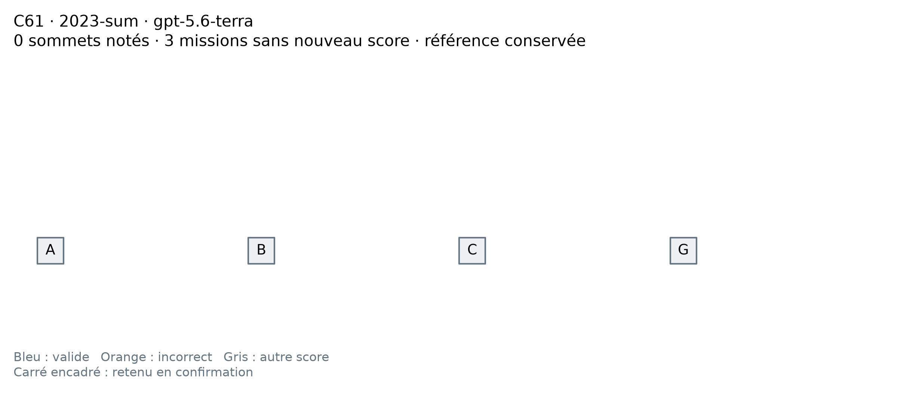

### G.62. C62 — 2023-npbonacci · GPT 5.6-terra · max

Racine complète : `HPC-Forest-Etude-2020-2024-r1/receptions/coverage-terra-max-748782/restauration-neuve/results-748782/2023-npbonacci`. Registre SHA-256 : `91637264146788045e0a7d9fbbda2afab31502aa9c44f3af64bfaea573fe5030`.

| C62 · champ | Valeur enregistrée |
|---|---|
| Programme confirmé | baseline-e1 ; commit 938b51156959d2867364fc8942b8765e52f6ee86 |
| Résultat | Référence conservée ; g = 0,0000 % ; S = 1,0000 |
| T₀ / T (s) | 0,0221098 / 0,0221098 |
| Cinq temps T₀ (s) | 0,0226220; 0,0228175; 0,0216760; 0,0215986; 0,0218349 |
| Cinq temps T (s) | 0,0226220; 0,0228175; 0,0216760; 0,0215986; 0,0218349 |
| Statuts des missions | {"infrastructure_error": 3} |
| Plafonds | wall=1800 s ; jetons=1500000 ; profondeur=6 ; mission=600 s |
| Planning | {"cycles": 1, "integrations_per_cycle": 2, "trials_per_role_per_cycle": 2} |
| Harnais | {"call_token_ceiling": 196608, "enabled": true, "max_attempts": 3, "research": {"allowed_hosts": ["gcc.gnu.org", "www.openmp.org", "raw.githubusercontent.com"], "corpus": null, "corpus_sha256": null, "enabled": true}} |
| Mesures de recherche / confirmation | 3 / 5 ; chauffe=1 ; graine=23 |
| Machine / cible | aarch64 ; romeo:romeo-a041:slurm-748782:archive-matrix-cpu4 |
| Compilateur | {"flavor": "gcc-compatible", "path": "/usr/bin/gcc", "sha256": "f7e1e7952e6aa5f31a79366a8dcdd751a150ed65e949429d527e933b5e7cc028"} |
| Environnement | {"CUDA_VISIBLE_DEVICES": "", "OMP_DYNAMIC": "FALSE", "OMP_NUM_THREADS": "4", "OMP_PROC_BIND": "TRUE"} |

Contrat partagé **K15** : champs hors chronométrages identiques à ceux présentés en **G.34**. Les temps et paramètres propres à cette campagne restent distincts ; sa version intégrale est conservée dans le registre exporté.

### G.63. C63 — 2020-tropical · GPT 6.1-sol · max

Racine complète : `HPC-Forest-Etude-2020-2024-r1/receptions/coverage-sol-max-749415/restauration-neuve/results-749415/2020-tropical`. Registre SHA-256 : `4c6687c67a874679aaa433a22f75a92048a83dc77549314903b1541c535e36bc`.

| C63 · champ | Valeur enregistrée |
|---|---|
| Programme confirmé | baseline-e1 ; commit b1947531a92f2aed36184dc0d9fdb26321775e54 |
| Résultat | Référence conservée ; g = 0,0000 % ; S = 1,0000 |
| T₀ / T (s) | 0,0060594 / 0,0060594 |
| Cinq temps T₀ (s) | 0,0061819; 0,0060568; 0,0059287; 0,0060124; 0,0061175 |
| Cinq temps T (s) | 0,0061819; 0,0060568; 0,0059287; 0,0060124; 0,0061175 |
| Statuts des missions | {"valid": 5, "infrastructure_error": 1} |
| Plafonds | wall=1800 s ; jetons=1500000 ; profondeur=6 ; mission=600 s |
| Planning | {"cycles": 1, "integrations_per_cycle": 2, "trials_per_role_per_cycle": 2} |
| Harnais | {"call_token_ceiling": 196608, "enabled": true, "max_attempts": 3, "research": {"allowed_hosts": ["gcc.gnu.org", "www.openmp.org", "raw.githubusercontent.com"], "corpus": null, "corpus_sha256": null, "enabled": true}} |
| Mesures de recherche / confirmation | 3 / 5 ; chauffe=1 ; graine=23 |
| Machine / cible | aarch64 ; romeo:romeo-a041:slurm-749415:archive-matrix-cpu4 |
| Compilateur | {"flavor": "gcc-compatible", "path": "/usr/bin/gcc", "sha256": "f7e1e7952e6aa5f31a79366a8dcdd751a150ed65e949429d527e933b5e7cc028"} |
| Environnement | {"CUDA_VISIBLE_DEVICES": "", "OMP_DYNAMIC": "FALSE", "OMP_NUM_THREADS": "4", "OMP_PROC_BIND": "TRUE"} |

Contrat partagé **K02** : champs hors chronométrages identiques à ceux présentés en **G.21**. Les temps et paramètres propres à cette campagne restent distincts ; sa version intégrale est conservée dans le registre exporté.

### G.64. C64 — 2020-quicksort · GPT 6.1-sol · max

Racine complète : `HPC-Forest-Etude-2020-2024-r1/receptions/coverage-sol-max-749415/restauration-neuve/results-749415/2020-quicksort`. Registre SHA-256 : `01f047afc6bd64f33ea670c8be87c5fe7cc33afb934e9601a4db089cecf45290`.

| C64 · champ | Valeur enregistrée |
|---|---|
| Programme confirmé | ed46fb1a793d4302 ; commit ddc8487d217c655819f6ee85d22782a4f4ef9229 |
| Résultat | Programme modifié confirmé ; g = 78,0170 % ; S = 4,5490 |
| T₀ / T (s) | 0,0698518 / 0,0153555 |
| Cinq temps T₀ (s) | 0,0698823; 0,0696344; 0,0695212; 0,0694282; 0,0707929 |
| Cinq temps T (s) | 0,0154315; 0,0152295; 0,0153983; 0,0151733; 0,0155448 |
| Statuts des missions | {"valid": 4, "infrastructure_error": 1} |
| Plafonds | wall=1800 s ; jetons=1500000 ; profondeur=6 ; mission=600 s |
| Planning | {"cycles": 1, "integrations_per_cycle": 2, "trials_per_role_per_cycle": 2} |
| Harnais | {"call_token_ceiling": 196608, "enabled": true, "max_attempts": 3, "research": {"allowed_hosts": ["gcc.gnu.org", "www.openmp.org", "raw.githubusercontent.com"], "corpus": null, "corpus_sha256": null, "enabled": true}} |
| Mesures de recherche / confirmation | 3 / 5 ; chauffe=1 ; graine=23 |
| Machine / cible | aarch64 ; romeo:romeo-a041:slurm-749415:archive-matrix-cpu4 |
| Compilateur | {"flavor": "gcc-compatible", "path": "/usr/bin/gcc", "sha256": "f7e1e7952e6aa5f31a79366a8dcdd751a150ed65e949429d527e933b5e7cc028"} |
| Environnement | {"CUDA_VISIBLE_DEVICES": "", "OMP_DYNAMIC": "FALSE", "OMP_NUM_THREADS": "4", "OMP_PROC_BIND": "TRUE"} |

Contrat partagé **K03** : champs hors chronométrages identiques à ceux présentés en **G.22**. Les temps et paramètres propres à cette campagne restent distincts ; sa version intégrale est conservée dans le registre exporté.

### G.65. C65 — 2020-permutations · GPT 6.1-sol · max

Racine complète : `HPC-Forest-Etude-2020-2024-r1/receptions/coverage-sol-max-749415/restauration-neuve/results-749415/2020-permutations`. Registre SHA-256 : `d684804708f2b4eff2148458466fa511add016192fc74f851676ee6845feb042`.

| C65 · champ | Valeur enregistrée |
|---|---|
| Programme confirmé | a758d641702e4af9 ; commit fe5876a2d61e0470ab8c455242ae1ba6d18f1e59 |
| Résultat | Programme modifié confirmé ; g = 93,6435 % ; S = 15,7319 |
| T₀ / T (s) | 0,1490575 / 0,0094749 |
| Cinq temps T₀ (s) | 0,1491714; 0,1459342; 0,1506076; 0,1515520; 0,1480221 |
| Cinq temps T (s) | 0,0078085; 0,0100544; 0,0088818; 0,0086716; 0,0119581 |
| Statuts des missions | {"valid": 5, "infrastructure_error": 1} |
| Plafonds | wall=1800 s ; jetons=1500000 ; profondeur=6 ; mission=600 s |
| Planning | {"cycles": 1, "integrations_per_cycle": 2, "trials_per_role_per_cycle": 2} |
| Harnais | {"call_token_ceiling": 196608, "enabled": true, "max_attempts": 3, "research": {"allowed_hosts": ["gcc.gnu.org", "www.openmp.org", "raw.githubusercontent.com"], "corpus": null, "corpus_sha256": null, "enabled": true}} |
| Mesures de recherche / confirmation | 3 / 5 ; chauffe=1 ; graine=23 |
| Machine / cible | aarch64 ; romeo:romeo-a041:slurm-749415:archive-matrix-cpu4 |
| Compilateur | {"flavor": "gcc-compatible", "path": "/usr/bin/gcc", "sha256": "f7e1e7952e6aa5f31a79366a8dcdd751a150ed65e949429d527e933b5e7cc028"} |
| Environnement | {"CUDA_VISIBLE_DEVICES": "", "OMP_DYNAMIC": "FALSE", "OMP_NUM_THREADS": "4", "OMP_PROC_BIND": "TRUE"} |

Contrat partagé **K04** : champs hors chronométrages identiques à ceux présentés en **G.23**. Les temps et paramètres propres à cette campagne restent distincts ; sa version intégrale est conservée dans le registre exporté.

### G.66. C66 — 2020-graph · GPT 6.1-sol · max

Racine complète : `HPC-Forest-Etude-2020-2024-r1/receptions/coverage-sol-max-749415/restauration-neuve/results-749415/2020-graph`. Registre SHA-256 : `ecbb931569c5823c8fff58df23235b71bd3e5031acd750d3866243bec3029ad9`.

| C66 · champ | Valeur enregistrée |
|---|---|
| Programme confirmé | cecd2621a69d4d72 ; commit 019f0573ea6f9073326cc5a84bf41d1181ccfa57 |
| Résultat | Programme modifié confirmé ; g = 50,7598 % ; S = 2,0309 |
| T₀ / T (s) | 0,0135684 / 0,0066811 |
| Cinq temps T₀ (s) | 0,0147216; 0,0133543; 0,0127107; 0,0125030; 0,0145522 |
| Cinq temps T (s) | 0,0068458; 0,0062544; 0,0060109; 0,0059484; 0,0083460 |
| Statuts des missions | {"valid": 2, "infrastructure_error": 2} |
| Plafonds | wall=1800 s ; jetons=1500000 ; profondeur=6 ; mission=600 s |
| Planning | {"cycles": 1, "integrations_per_cycle": 2, "trials_per_role_per_cycle": 2} |
| Harnais | {"call_token_ceiling": 196608, "enabled": true, "max_attempts": 3, "research": {"allowed_hosts": ["gcc.gnu.org", "www.openmp.org", "raw.githubusercontent.com"], "corpus": null, "corpus_sha256": null, "enabled": true}} |
| Mesures de recherche / confirmation | 3 / 5 ; chauffe=1 ; graine=23 |
| Machine / cible | aarch64 ; romeo:romeo-a041:slurm-749415:archive-matrix-cpu4 |
| Compilateur | {"flavor": "gcc-compatible", "path": "/usr/bin/gcc", "sha256": "f7e1e7952e6aa5f31a79366a8dcdd751a150ed65e949429d527e933b5e7cc028"} |
| Environnement | {"CUDA_VISIBLE_DEVICES": "", "OMP_DYNAMIC": "FALSE", "OMP_NUM_THREADS": "4", "OMP_PROC_BIND": "TRUE"} |

Contrat partagé **K05** : champs hors chronométrages identiques à ceux présentés en **G.24**. Les temps et paramètres propres à cette campagne restent distincts ; sa version intégrale est conservée dans le registre exporté.

### G.67. C67 — 2021-graph · GPT 6.1-sol · max

Racine complète : `HPC-Forest-Etude-2020-2024-r1/receptions/coverage-sol-max-749415/restauration-neuve/results-749415/2021-graph`. Registre SHA-256 : `5b44de8f5e8b446c617dcc987132080642355f211db449c3e453d24c1b52b00b`.

| C67 · champ | Valeur enregistrée |
|---|---|
| Programme confirmé | 0418d6eb25a94391 ; commit 69ea4fd4691af2bdd3a6a27b5472e607ff406942 |
| Résultat | Programme modifié confirmé ; g = 32,2613 % ; S = 1,4763 |
| T₀ / T (s) | 0,0107368 / 0,0072730 |
| Cinq temps T₀ (s) | 0,0117564; 0,0109995; 0,0119498; 0,0092788; 0,0096995 |
| Cinq temps T (s) | 0,0074283; 0,0066415; 0,0079894; 0,0079852; 0,0063205 |
| Statuts des missions | {"valid": 6, "infrastructure_error": 1} |
| Plafonds | wall=1800 s ; jetons=1500000 ; profondeur=6 ; mission=600 s |
| Planning | {"cycles": 1, "integrations_per_cycle": 2, "trials_per_role_per_cycle": 2} |
| Harnais | {"call_token_ceiling": 196608, "enabled": true, "max_attempts": 3, "research": {"allowed_hosts": ["gcc.gnu.org", "www.openmp.org", "raw.githubusercontent.com"], "corpus": null, "corpus_sha256": null, "enabled": true}} |
| Mesures de recherche / confirmation | 3 / 5 ; chauffe=1 ; graine=23 |
| Machine / cible | aarch64 ; romeo:romeo-a041:slurm-749415:archive-matrix-cpu4 |
| Compilateur | {"flavor": "gcc-compatible", "path": "/usr/bin/gcc", "sha256": "f7e1e7952e6aa5f31a79366a8dcdd751a150ed65e949429d527e933b5e7cc028"} |
| Environnement | {"CUDA_VISIBLE_DEVICES": "", "OMP_DYNAMIC": "FALSE", "OMP_NUM_THREADS": "4", "OMP_PROC_BIND": "TRUE"} |

Contrat partagé **K06** : champs hors chronométrages identiques à ceux présentés en **G.25**. Les temps et paramètres propres à cette campagne restent distincts ; sa version intégrale est conservée dans le registre exporté.

### G.68. C68 — 2021-metrics · GPT 6.1-sol · max

Racine complète : `HPC-Forest-Etude-2020-2024-r1/receptions/coverage-sol-max-749415/restauration-neuve/results-749415/2021-metrics`. Registre SHA-256 : `1aa3ad24d2c510077219a61b7ba8286db5e12a5323d13ab2a8ebc712898be42c`.

| C68 · champ | Valeur enregistrée |
|---|---|
| Programme confirmé | d418d4a8f03148df ; commit c1f74f148a6045aa00673b697547de69e96b1787 |
| Résultat | Programme modifié confirmé ; g = 42,6904 % ; S = 1,7449 |
| T₀ / T (s) | 0,0097115 / 0,0055656 |
| Cinq temps T₀ (s) | 0,0099410; 0,0096255; 0,0095170; 0,0097652; 0,0097087 |
| Cinq temps T (s) | 0,0058134; 0,0053649; 0,0054953; 0,0054016; 0,0057528 |
| Statuts des missions | {"valid": 5, "infrastructure_error": 1} |
| Plafonds | wall=1800 s ; jetons=1500000 ; profondeur=6 ; mission=600 s |
| Planning | {"cycles": 1, "integrations_per_cycle": 2, "trials_per_role_per_cycle": 2} |
| Harnais | {"call_token_ceiling": 196608, "enabled": true, "max_attempts": 3, "research": {"allowed_hosts": ["gcc.gnu.org", "www.openmp.org", "raw.githubusercontent.com"], "corpus": null, "corpus_sha256": null, "enabled": true}} |
| Mesures de recherche / confirmation | 3 / 5 ; chauffe=1 ; graine=23 |
| Machine / cible | aarch64 ; romeo:romeo-a041:slurm-749415:archive-matrix-cpu4 |
| Compilateur | {"flavor": "gcc-compatible", "path": "/usr/bin/gcc", "sha256": "f7e1e7952e6aa5f31a79366a8dcdd751a150ed65e949429d527e933b5e7cc028"} |
| Environnement | {"CUDA_VISIBLE_DEVICES": "", "OMP_DYNAMIC": "FALSE", "OMP_NUM_THREADS": "4", "OMP_PROC_BIND": "TRUE"} |

Contrat partagé **K07** : champs hors chronométrages identiques à ceux présentés en **G.26**. Les temps et paramètres propres à cette campagne restent distincts ; sa version intégrale est conservée dans le registre exporté.

### G.69. C69 — 2021-sokoban · GPT 6.1-sol · max

Racine complète : `HPC-Forest-Etude-2020-2024-r1/receptions/coverage-sol-max-749415/restauration-neuve/results-749415/2021-sokoban`. Registre SHA-256 : `3eba890b30f7a9ef3f24bfda45149a32936b21dc0121baa1ba196757e67d3748`.

| C69 · champ | Valeur enregistrée |
|---|---|
| Programme confirmé | baseline-e1 ; commit 398f431671002d458653cca461b305e832d9ee46 |
| Résultat | Référence conservée ; g = 0,0000 % ; S = 1,0000 |
| T₀ / T (s) | 0,0077149 / 0,0077149 |
| Cinq temps T₀ (s) | 0,0078464; 0,0079641; 0,0076648; 0,0074457; 0,0076535 |
| Cinq temps T (s) | 0,0078464; 0,0079641; 0,0076648; 0,0074457; 0,0076535 |
| Statuts des missions | {"valid": 8} |
| Plafonds | wall=1800 s ; jetons=1500000 ; profondeur=6 ; mission=600 s |
| Planning | {"cycles": 1, "integrations_per_cycle": 2, "trials_per_role_per_cycle": 2} |
| Harnais | {"call_token_ceiling": 196608, "enabled": true, "max_attempts": 3, "research": {"allowed_hosts": ["gcc.gnu.org", "www.openmp.org", "raw.githubusercontent.com"], "corpus": null, "corpus_sha256": null, "enabled": true}} |
| Mesures de recherche / confirmation | 3 / 5 ; chauffe=1 ; graine=23 |
| Machine / cible | aarch64 ; romeo:romeo-a041:slurm-749415:archive-matrix-cpu4 |
| Compilateur | {"flavor": "gcc-compatible", "path": "/usr/bin/gcc", "sha256": "f7e1e7952e6aa5f31a79366a8dcdd751a150ed65e949429d527e933b5e7cc028"} |
| Environnement | {"CUDA_VISIBLE_DEVICES": "", "OMP_DYNAMIC": "FALSE", "OMP_NUM_THREADS": "4", "OMP_PROC_BIND": "TRUE"} |

Contrat partagé **K08** : champs hors chronométrages identiques à ceux présentés en **G.27**. Les temps et paramètres propres à cette campagne restent distincts ; sa version intégrale est conservée dans le registre exporté.

### G.70. C70 — 2021-jacobi · GPT 6.1-sol · max

Racine complète : `HPC-Forest-Etude-2020-2024-r1/receptions/coverage-sol-max-749415/restauration-neuve/results-749415/2021-jacobi`. Registre SHA-256 : `05e755cd17f74510f5365c7a28d36100661241fb686df86453f9be2c44100843`.

| C70 · champ | Valeur enregistrée |
|---|---|
| Programme confirmé | b47544a48a6c4348 ; commit 538808aee280f52c79b7042c310f86861260f9c5 |
| Résultat | Programme modifié confirmé ; g = 36,5862 % ; S = 1,5769 |
| T₀ / T (s) | 0,0655604 / 0,0415744 |
| Cinq temps T₀ (s) | 0,0653294; 0,0654296; 0,0656526; 0,0658907; 0,0654998 |
| Cinq temps T (s) | 0,0415843; 0,0422013; 0,0412548; 0,0414640; 0,0413674 |
| Statuts des missions | {"valid": 8} |
| Plafonds | wall=1800 s ; jetons=1500000 ; profondeur=6 ; mission=600 s |
| Planning | {"cycles": 1, "integrations_per_cycle": 2, "trials_per_role_per_cycle": 2} |
| Harnais | {"call_token_ceiling": 196608, "enabled": true, "max_attempts": 3, "research": {"allowed_hosts": ["gcc.gnu.org", "www.openmp.org", "raw.githubusercontent.com"], "corpus": null, "corpus_sha256": null, "enabled": true}} |
| Mesures de recherche / confirmation | 3 / 5 ; chauffe=1 ; graine=23 |
| Machine / cible | aarch64 ; romeo:romeo-a041:slurm-749415:archive-matrix-cpu4 |
| Compilateur | {"flavor": "gcc-compatible", "path": "/usr/bin/gcc", "sha256": "f7e1e7952e6aa5f31a79366a8dcdd751a150ed65e949429d527e933b5e7cc028"} |
| Environnement | {"CUDA_VISIBLE_DEVICES": "", "OMP_DYNAMIC": "FALSE", "OMP_NUM_THREADS": "4", "OMP_PROC_BIND": "TRUE"} |

Contrat partagé **K09** : champs hors chronométrages identiques à ceux présentés en **G.28**. Les temps et paramètres propres à cette campagne restent distincts ; sa version intégrale est conservée dans le registre exporté.

### G.71. C71 — 2022-knn · GPT 6.1-sol · max

Racine complète : `HPC-Forest-Etude-2020-2024-r1/receptions/coverage-sol-max-749415/restauration-neuve/results-749415/2022-knn`. Registre SHA-256 : `08796b1089b518cc0d97aada8eb150ba875c795400cbdbf72e9f0977b66b14f1`.

| C71 · champ | Valeur enregistrée |
|---|---|
| Programme confirmé | e2673be1305b415b ; commit d1f9d71eaf792c151d4ac7bff1bd57e1de36cc9e |
| Résultat | Programme modifié confirmé ; g = 98,9112 % ; S = 91,8413 |
| T₀ / T (s) | 2,0366048 / 0,0221753 |
| Cinq temps T₀ (s) | 2,0635434; 2,0963468; 2,0220522; 2,0012672; 1,9998142 |
| Cinq temps T (s) | 0,0224217; 0,0218867; 0,0219248; 0,0224139; 0,0222292 |
| Statuts des missions | {"valid": 6, "infrastructure_error": 1} |
| Plafonds | wall=1800 s ; jetons=1500000 ; profondeur=6 ; mission=600 s |
| Planning | {"cycles": 1, "integrations_per_cycle": 2, "trials_per_role_per_cycle": 2} |
| Harnais | {"call_token_ceiling": 196608, "enabled": true, "max_attempts": 3, "research": {"allowed_hosts": ["gcc.gnu.org", "www.openmp.org", "raw.githubusercontent.com"], "corpus": null, "corpus_sha256": null, "enabled": true}} |
| Mesures de recherche / confirmation | 3 / 5 ; chauffe=1 ; graine=23 |
| Machine / cible | aarch64 ; romeo:romeo-a041:slurm-749415:archive-matrix-cpu4 |
| Compilateur | {"flavor": "gcc-compatible", "path": "/usr/bin/gcc", "sha256": "f7e1e7952e6aa5f31a79366a8dcdd751a150ed65e949429d527e933b5e7cc028"} |
| Environnement | {"CUDA_VISIBLE_DEVICES": "", "OMP_DYNAMIC": "FALSE", "OMP_NUM_THREADS": "4", "OMP_PROC_BIND": "TRUE"} |

Contrat partagé **K10** : champs hors chronométrages identiques à ceux présentés en **G.29**. Les temps et paramètres propres à cette campagne restent distincts ; sa version intégrale est conservée dans le registre exporté.

### G.72. C72 — 2022-sum · GPT 6.1-sol · max

Racine complète : `HPC-Forest-Etude-2020-2024-r1/receptions/coverage-sol-max-749415/restauration-neuve/results-749415/2022-sum`. Registre SHA-256 : `ec77b60d7e126bd4e464c9b7cb76558f955832680ee25f041b622b0bf0107f96`.

| C72 · champ | Valeur enregistrée |
|---|---|
| Programme confirmé | 65280f8d37d641fd ; commit 2433e509383b8b0cfe854b097912be3a44ccf287 |
| Résultat | Programme modifié confirmé ; g = 92,9904 % ; S = 14,2662 |
| T₀ / T (s) | 0,1275031 / 0,0089374 |
| Cinq temps T₀ (s) | 0,1282243; 0,1244710; 0,1360250; 0,1247527; 0,1240428 |
| Cinq temps T (s) | 0,0087258; 0,0090325; 0,0085660; 0,0094440; 0,0089188 |
| Statuts des missions | {"valid": 7, "infrastructure_error": 1} |
| Plafonds | wall=1800 s ; jetons=1500000 ; profondeur=6 ; mission=600 s |
| Planning | {"cycles": 1, "integrations_per_cycle": 2, "trials_per_role_per_cycle": 2} |
| Harnais | {"call_token_ceiling": 196608, "enabled": true, "max_attempts": 3, "research": {"allowed_hosts": ["gcc.gnu.org", "www.openmp.org", "raw.githubusercontent.com"], "corpus": null, "corpus_sha256": null, "enabled": true}} |
| Mesures de recherche / confirmation | 3 / 5 ; chauffe=1 ; graine=23 |
| Machine / cible | aarch64 ; romeo:romeo-a041:slurm-749415:archive-matrix-cpu4 |
| Compilateur | {"flavor": "gcc-compatible", "path": "/usr/bin/gcc", "sha256": "f7e1e7952e6aa5f31a79366a8dcdd751a150ed65e949429d527e933b5e7cc028"} |
| Environnement | {"CUDA_VISIBLE_DEVICES": "", "OMP_DYNAMIC": "FALSE", "OMP_NUM_THREADS": "4", "OMP_PROC_BIND": "TRUE"} |

Contrat partagé **K11** : champs hors chronométrages identiques à ceux présentés en **G.30**. Les temps et paramètres propres à cette campagne restent distincts ; sa version intégrale est conservée dans le registre exporté.

### G.73. C73 — 2022-nbody · GPT 6.1-sol · max

Racine complète : `HPC-Forest-Etude-2020-2024-r1/receptions/coverage-sol-max-749415/restauration-neuve/results-749415/2022-nbody`. Registre SHA-256 : `2df039e20a3fb34b91fc98b4a9bdf11aa0a3de47f5f25b761008c999c451771a`.

| C73 · champ | Valeur enregistrée |
|---|---|
| Programme confirmé | 4013b954ae864272 ; commit 56caff7585783d81f1dcacf3099af8ac0cb97ad9 |
| Résultat | Programme modifié confirmé ; g = 86,4655 % ; S = 7,3885 |
| T₀ / T (s) | 0,6621611 / 0,0896204 |
| Cinq temps T₀ (s) | 0,6626586; 0,6614739; 0,6617768; 0,6625109; 0,6623853 |
| Cinq temps T (s) | 0,0903187; 0,0891182; 0,0901628; 0,0893442; 0,0891581 |
| Statuts des missions | {"valid": 8} |
| Plafonds | wall=1800 s ; jetons=1500000 ; profondeur=6 ; mission=600 s |
| Planning | {"cycles": 1, "integrations_per_cycle": 2, "trials_per_role_per_cycle": 2} |
| Harnais | {"call_token_ceiling": 196608, "enabled": true, "max_attempts": 3, "research": {"allowed_hosts": ["gcc.gnu.org", "www.openmp.org", "raw.githubusercontent.com"], "corpus": null, "corpus_sha256": null, "enabled": true}} |
| Mesures de recherche / confirmation | 3 / 5 ; chauffe=1 ; graine=23 |
| Machine / cible | aarch64 ; romeo:romeo-a041:slurm-749415:archive-matrix-cpu4 |
| Compilateur | {"flavor": "gcc-compatible", "path": "/usr/bin/gcc", "sha256": "f7e1e7952e6aa5f31a79366a8dcdd751a150ed65e949429d527e933b5e7cc028"} |
| Environnement | {"CUDA_VISIBLE_DEVICES": "", "OMP_DYNAMIC": "FALSE", "OMP_NUM_THREADS": "4", "OMP_PROC_BIND": "TRUE"} |

Contrat partagé **K12** : champs hors chronométrages identiques à ceux présentés en **G.31**. Les temps et paramètres propres à cette campagne restent distincts ; sa version intégrale est conservée dans le registre exporté.

### G.74. C74 — 2022-bucketsort · GPT 6.1-sol · max

Racine complète : `HPC-Forest-Etude-2020-2024-r1/receptions/coverage-sol-max-749415/restauration-neuve/results-749415/2022-bucketsort`. Registre SHA-256 : `2e315703184c7b5497be8fe028f0e67c9ff51b626d1e937c2b92ab34ddefc36b`.

| C74 · champ | Valeur enregistrée |
|---|---|
| Programme confirmé | 7c1d7928379548b5 ; commit 04abbc2565b8a6af58303a60bf2bc28bf1bb163d |
| Résultat | Programme modifié confirmé ; g = 96,0148 % ; S = 25,0931 |
| T₀ / T (s) | 0,4360272 / 0,0173764 |
| Cinq temps T₀ (s) | 0,4603593; 0,4336049; 0,4252681; 0,4310565; 0,4298472 |
| Cinq temps T (s) | 0,0193547; 0,0177707; 0,0169506; 0,0156164; 0,0171895 |
| Statuts des missions | {"valid": 5, "infrastructure_error": 1} |
| Plafonds | wall=1800 s ; jetons=1500000 ; profondeur=6 ; mission=600 s |
| Planning | {"cycles": 1, "integrations_per_cycle": 2, "trials_per_role_per_cycle": 2} |
| Harnais | {"call_token_ceiling": 196608, "enabled": true, "max_attempts": 3, "research": {"allowed_hosts": ["gcc.gnu.org", "www.openmp.org", "raw.githubusercontent.com"], "corpus": null, "corpus_sha256": null, "enabled": true}} |
| Mesures de recherche / confirmation | 3 / 5 ; chauffe=1 ; graine=23 |
| Machine / cible | aarch64 ; romeo:romeo-a041:slurm-749415:archive-matrix-cpu4 |
| Compilateur | {"flavor": "gcc-compatible", "path": "/usr/bin/gcc", "sha256": "f7e1e7952e6aa5f31a79366a8dcdd751a150ed65e949429d527e933b5e7cc028"} |
| Environnement | {"CUDA_VISIBLE_DEVICES": "", "OMP_DYNAMIC": "FALSE", "OMP_NUM_THREADS": "4", "OMP_PROC_BIND": "TRUE"} |

Contrat partagé **K13** : champs hors chronométrages identiques à ceux présentés en **G.32**. Les temps et paramètres propres à cette campagne restent distincts ; sa version intégrale est conservée dans le registre exporté.

### G.75. C75 — 2023-sum · GPT 6.1-sol · max

Racine complète : `HPC-Forest-Etude-2020-2024-r1/receptions/coverage-sol-max-749415/restauration-neuve/results-749415/2023-sum`. Registre SHA-256 : `c1f560a92eb482e797a7d6ec41b8a19120c3bf003a6504b6859153638d3a89ab`.

| C75 · champ | Valeur enregistrée |
|---|---|
| Programme confirmé | 108a9901c8b14de2 ; commit b5042a064da41067867c6b3fe66158af4a966227 |
| Résultat | Programme modifié confirmé ; g = 87,9658 % ; S = 8,3097 |
| T₀ / T (s) | 0,2474693 / 0,0297809 |
| Cinq temps T₀ (s) | 0,2473410; 0,2471349; 0,2466477; 0,2477940; 0,2484289 |
| Cinq temps T (s) | 0,0295117; 0,0298146; 0,0293286; 0,0300555; 0,0301940 |
| Statuts des missions | {"valid": 8} |
| Plafonds | wall=1800 s ; jetons=1500000 ; profondeur=6 ; mission=600 s |
| Planning | {"cycles": 1, "integrations_per_cycle": 2, "trials_per_role_per_cycle": 2} |
| Harnais | {"call_token_ceiling": 196608, "enabled": true, "max_attempts": 3, "research": {"allowed_hosts": ["gcc.gnu.org", "www.openmp.org", "raw.githubusercontent.com"], "corpus": null, "corpus_sha256": null, "enabled": true}} |
| Mesures de recherche / confirmation | 3 / 5 ; chauffe=1 ; graine=23 |
| Machine / cible | aarch64 ; romeo:romeo-a041:slurm-749415:archive-matrix-cpu4 |
| Compilateur | {"flavor": "gcc-compatible", "path": "/usr/bin/gcc", "sha256": "f7e1e7952e6aa5f31a79366a8dcdd751a150ed65e949429d527e933b5e7cc028"} |
| Environnement | {"CUDA_VISIBLE_DEVICES": "", "OMP_DYNAMIC": "FALSE", "OMP_NUM_THREADS": "4", "OMP_PROC_BIND": "TRUE"} |

Contrat partagé **K14** : champs hors chronométrages identiques à ceux présentés en **G.33**. Les temps et paramètres propres à cette campagne restent distincts ; sa version intégrale est conservée dans le registre exporté.

### G.76. C76 — 2023-npbonacci · GPT 6.1-sol · max

Racine complète : `HPC-Forest-Etude-2020-2024-r1/receptions/coverage-sol-max-749415/restauration-neuve/results-749415/2023-npbonacci`. Registre SHA-256 : `e050e19206607e4b3952561cb828dd9ecc73df012a1a0a8a481f1e755a368bdb`.

| C76 · champ | Valeur enregistrée |
|---|---|
| Programme confirmé | 84a7a50c18284c91 ; commit ce617f3665c2734ddcbaafe28c16ccd4be80fa55 |
| Résultat | Programme modifié confirmé ; g = 72,9940 % ; S = 3,7029 |
| T₀ / T (s) | 0,0199279 / 0,0053817 |
| Cinq temps T₀ (s) | 0,0197274; 0,0203206; 0,0201198; 0,0198150; 0,0196570 |
| Cinq temps T (s) | 0,0055585; 0,0051920; 0,0054884; 0,0052255; 0,0054444 |
| Statuts des missions | {"valid": 4, "infrastructure_error": 1} |
| Plafonds | wall=1800 s ; jetons=1500000 ; profondeur=6 ; mission=600 s |
| Planning | {"cycles": 1, "integrations_per_cycle": 2, "trials_per_role_per_cycle": 2} |
| Harnais | {"call_token_ceiling": 196608, "enabled": true, "max_attempts": 3, "research": {"allowed_hosts": ["gcc.gnu.org", "www.openmp.org", "raw.githubusercontent.com"], "corpus": null, "corpus_sha256": null, "enabled": true}} |
| Mesures de recherche / confirmation | 3 / 5 ; chauffe=1 ; graine=23 |
| Machine / cible | aarch64 ; romeo:romeo-a041:slurm-749415:archive-matrix-cpu4 |
| Compilateur | {"flavor": "gcc-compatible", "path": "/usr/bin/gcc", "sha256": "f7e1e7952e6aa5f31a79366a8dcdd751a150ed65e949429d527e933b5e7cc028"} |
| Environnement | {"CUDA_VISIBLE_DEVICES": "", "OMP_DYNAMIC": "FALSE", "OMP_NUM_THREADS": "4", "OMP_PROC_BIND": "TRUE"} |

Contrat partagé **K15** : champs hors chronométrages identiques à ceux présentés en **G.34**. Les temps et paramètres propres à cette campagne restent distincts ; sa version intégrale est conservée dans le registre exporté.

### G.77. C77 — knn · GPT 6.1-sol · max

Racine complète : `Marathon22-GPT61Sol-MAX/harnais-r2/preuves-747885/results-747885/reference/knn`. Registre SHA-256 : `5f6e2ac4e9a75d12d02a25a5c7aa222aa6de3e3b007f5387004da9556c30e2f1`.

| C77 · champ | Valeur enregistrée |
|---|---|
| Programme confirmé | e3fdd208e1794cf4 ; commit 4a2faa2ff801affa598c80979ae99814d4ac6197 |
| Résultat | Programme modifié confirmé ; g = 99,1870 % ; S = 123,0042 |
| T₀ / T (s) | 2,0425078 / 0,0166052 |
| Cinq temps T₀ (s) | 2,0085925; 2,0411424; 2,0086589; 2,0458350; 2,1083100 |
| Cinq temps T (s) | 0,0163948; 0,0158311; 0,0161508; 0,0165624; 0,0180869 |
| Statuts des missions | {"valid": 19, "infrastructure_error": 2} |
| Plafonds | wall=7200 s ; jetons=1500000 ; profondeur=6 ; mission=600 s |
| Planning | {"cycles": 2, "integrations_per_cycle": 3, "trials_per_role_per_cycle": 3} |
| Harnais | {"call_token_ceiling": 16000, "enabled": false, "max_attempts": 2, "research": {"allowed_hosts": [], "corpus": null, "corpus_sha256": null, "enabled": false}} |
| Mesures de recherche / confirmation | 3 / 5 ; chauffe=1 ; graine=23 |
| Machine / cible | aarch64 ; romeo:romeo-a041:slurm-747885:cpu-marathon22 |
| Compilateur | {"flavor": "gcc-compatible", "path": "/usr/bin/gcc", "sha256": "f7e1e7952e6aa5f31a79366a8dcdd751a150ed65e949429d527e933b5e7cc028"} |
| Environnement | {"CUDA_VISIBLE_DEVICES": "", "OMP_DYNAMIC": "FALSE", "OMP_NUM_THREADS": "4", "OMP_PROC_BIND": "TRUE"} |

Contrat partagé **K10** : champs hors chronométrages identiques à ceux présentés en **G.29**. Les temps et paramètres propres à cette campagne restent distincts ; sa version intégrale est conservée dans le registre exporté.

### G.78. C78 — knn · GPT 6.1-sol · max

Racine complète : `Marathon22-GPT61Sol-MAX/harnais-r2/preuves-747885/results-747885/mixed-harness/knn`. Registre SHA-256 : `677fad0025f133525c5e559f06fd3032e4c04f6f35c63f4ef18f8c09c229b97f`.

| C78 · champ | Valeur enregistrée |
|---|---|
| Programme confirmé | 8936a8b48c3b4a37 ; commit 0fff8cb97bbb59e12e6c87063c5ffe951ffc25ce |
| Résultat | Programme modifié confirmé ; g = 99,1210 % ; S = 113,7684 |
| T₀ / T (s) | 2,0574324 / 0,0180844 |
| Cinq temps T₀ (s) | 2,0768658; 2,0162693; 2,0492577; 2,0125973; 2,1321720 |
| Cinq temps T (s) | 0,0187955; 0,0169325; 0,0170673; 0,0192107; 0,0184160 |
| Statuts des missions | {"valid": 20, "infrastructure_error": 1} |
| Plafonds | wall=7200 s ; jetons=1500000 ; profondeur=6 ; mission=600 s |
| Planning | {"cycles": 2, "integrations_per_cycle": 3, "trials_per_role_per_cycle": 3} |
| Harnais | {"call_token_ceiling": 196608, "enabled": true, "max_attempts": 3, "research": {"allowed_hosts": ["gcc.gnu.org", "www.openmp.org", "raw.githubusercontent.com"], "corpus": null, "corpus_sha256": null, "enabled": true}} |
| Mesures de recherche / confirmation | 3 / 5 ; chauffe=1 ; graine=23 |
| Machine / cible | aarch64 ; romeo:romeo-a041:slurm-747885:cpu-marathon22 |
| Compilateur | {"flavor": "gcc-compatible", "path": "/usr/bin/gcc", "sha256": "f7e1e7952e6aa5f31a79366a8dcdd751a150ed65e949429d527e933b5e7cc028"} |
| Environnement | {"CUDA_VISIBLE_DEVICES": "", "OMP_DYNAMIC": "FALSE", "OMP_NUM_THREADS": "4", "OMP_PROC_BIND": "TRUE"} |

Contrat partagé **K10** : champs hors chronométrages identiques à ceux présentés en **G.29**. Les temps et paramètres propres à cette campagne restent distincts ; sa version intégrale est conservée dans le registre exporté.

### G.79. C79 — sum · GPT 6.1-sol · max

Racine complète : `Marathon22-GPT61Sol-MAX/harnais-r2/preuves-747885/results-747885/mixed-harness/sum`. Registre SHA-256 : `0fc9ce1ce93830dafd5beca0ca00ff6a02557a731199d375c3aef6c8604dd505`.

| C79 · champ | Valeur enregistrée |
|---|---|
| Programme confirmé | 631f0b6b406243d4 ; commit 1f2322cae959974b786b5a0e6862b3c19b816a13 |
| Résultat | Programme modifié confirmé ; g = 93,7055 % ; S = 15,8868 |
| T₀ / T (s) | 0,1311997 / 0,0082584 |
| Cinq temps T₀ (s) | 0,1379950; 0,1274494; 0,1244263; 0,1273484; 0,1387792 |
| Cinq temps T (s) | 0,0093554; 0,0069535; 0,0072059; 0,0089038; 0,0088732 |
| Statuts des missions | {"valid": 12, "infrastructure_error": 3} |
| Plafonds | wall=7200 s ; jetons=1500000 ; profondeur=6 ; mission=600 s |
| Planning | {"cycles": 2, "integrations_per_cycle": 3, "trials_per_role_per_cycle": 3} |
| Harnais | {"call_token_ceiling": 196608, "enabled": true, "max_attempts": 3, "research": {"allowed_hosts": ["gcc.gnu.org", "www.openmp.org", "raw.githubusercontent.com"], "corpus": null, "corpus_sha256": null, "enabled": true}} |
| Mesures de recherche / confirmation | 3 / 5 ; chauffe=1 ; graine=23 |
| Machine / cible | aarch64 ; romeo:romeo-a041:slurm-747885:cpu-marathon22 |
| Compilateur | {"flavor": "gcc-compatible", "path": "/usr/bin/gcc", "sha256": "f7e1e7952e6aa5f31a79366a8dcdd751a150ed65e949429d527e933b5e7cc028"} |
| Environnement | {"CUDA_VISIBLE_DEVICES": "", "OMP_DYNAMIC": "FALSE", "OMP_NUM_THREADS": "4", "OMP_PROC_BIND": "TRUE"} |

Contrat partagé **K11** : champs hors chronométrages identiques à ceux présentés en **G.30**. Les temps et paramètres propres à cette campagne restent distincts ; sa version intégrale est conservée dans le registre exporté.

### G.80. C80 — sum · GPT 6.1-sol · max

Racine complète : `Marathon22-GPT61Sol-MAX/harnais-r2/preuves-747885/results-747885/reference/sum`. Registre SHA-256 : `e5a32197f151c8a8928d3fedd7e6ee108348be9a81ae3e73022ee6983c613c1e`.

| C80 · champ | Valeur enregistrée |
|---|---|
| Programme confirmé | 2d6031ae4e7b4c51 ; commit f98cb3fd999eb2d1fcc9ad9aa51c95ac9e6fe078 |
| Résultat | Programme modifié confirmé ; g = 93,6245 % ; S = 15,6851 |
| T₀ / T (s) | 0,1262067 / 0,0080463 |
| Cinq temps T₀ (s) | 0,1273304; 0,1268806; 0,1257622; 0,1248031; 0,1262571 |
| Cinq temps T (s) | 0,0073686; 0,0090386; 0,0067940; 0,0072241; 0,0098061 |
| Statuts des missions | {"valid": 18, "build_failed": 1, "infrastructure_error": 3} |
| Plafonds | wall=7200 s ; jetons=1500000 ; profondeur=6 ; mission=600 s |
| Planning | {"cycles": 2, "integrations_per_cycle": 3, "trials_per_role_per_cycle": 3} |
| Harnais | {"call_token_ceiling": 16000, "enabled": false, "max_attempts": 2, "research": {"allowed_hosts": [], "corpus": null, "corpus_sha256": null, "enabled": false}} |
| Mesures de recherche / confirmation | 3 / 5 ; chauffe=1 ; graine=23 |
| Machine / cible | aarch64 ; romeo:romeo-a041:slurm-747885:cpu-marathon22 |
| Compilateur | {"flavor": "gcc-compatible", "path": "/usr/bin/gcc", "sha256": "f7e1e7952e6aa5f31a79366a8dcdd751a150ed65e949429d527e933b5e7cc028"} |
| Environnement | {"CUDA_VISIBLE_DEVICES": "", "OMP_DYNAMIC": "FALSE", "OMP_NUM_THREADS": "4", "OMP_PROC_BIND": "TRUE"} |

Contrat partagé **K11** : champs hors chronométrages identiques à ceux présentés en **G.30**. Les temps et paramètres propres à cette campagne restent distincts ; sa version intégrale est conservée dans le registre exporté.

### G.81. C81 — nbody · GPT 6.1-sol · max

Racine complète : `Marathon22-GPT61Sol-MAX/harnais-r2/preuves-747885/results-747885/reference/nbody`. Registre SHA-256 : `51d0c62c3d8205df172facceb919fc2bedbaa5f63b96e91e6aa386a4533c6f87`.

| C81 · champ | Valeur enregistrée |
|---|---|
| Programme confirmé | 3e6e906996b04b7d ; commit b813fe3a2b753953d450cb629179ab35a5056261 |
| Résultat | Programme modifié confirmé ; g = 76,6472 % ; S = 4,2821 |
| T₀ / T (s) | 0,6621128 / 0,1546220 |
| Cinq temps T₀ (s) | 0,6621281; 0,6619445; 0,6623401; 0,6621761; 0,6619749 |
| Cinq temps T (s) | 0,1545410; 0,1544950; 0,1543240; 0,1546893; 0,1550608 |
| Statuts des missions | {"valid": 24} |
| Plafonds | wall=7200 s ; jetons=1500000 ; profondeur=6 ; mission=600 s |
| Planning | {"cycles": 2, "integrations_per_cycle": 3, "trials_per_role_per_cycle": 3} |
| Harnais | {"call_token_ceiling": 16000, "enabled": false, "max_attempts": 2, "research": {"allowed_hosts": [], "corpus": null, "corpus_sha256": null, "enabled": false}} |
| Mesures de recherche / confirmation | 3 / 5 ; chauffe=1 ; graine=23 |
| Machine / cible | aarch64 ; romeo:romeo-a041:slurm-747885:cpu-marathon22 |
| Compilateur | {"flavor": "gcc-compatible", "path": "/usr/bin/gcc", "sha256": "f7e1e7952e6aa5f31a79366a8dcdd751a150ed65e949429d527e933b5e7cc028"} |
| Environnement | {"CUDA_VISIBLE_DEVICES": "", "OMP_DYNAMIC": "FALSE", "OMP_NUM_THREADS": "4", "OMP_PROC_BIND": "TRUE"} |

Contrat partagé **K12** : champs hors chronométrages identiques à ceux présentés en **G.31**. Les temps et paramètres propres à cette campagne restent distincts ; sa version intégrale est conservée dans le registre exporté.

### G.82. C82 — nbody · GPT 6.1-sol · max

Racine complète : `Marathon22-GPT61Sol-MAX/harnais-r2/preuves-747885/results-747885/mixed-harness/nbody`. Registre SHA-256 : `38d6f8c093273fe5d87f17aadc8ed087e33fe64e254e203722c5528dbc7882a8`.

| C82 · champ | Valeur enregistrée |
|---|---|
| Programme confirmé | 5ffac8acdd0a4297 ; commit 3dd2bdceee974229f8430f1f7fe248975293fe08 |
| Résultat | Programme modifié confirmé ; g = 87,4976 % ; S = 7,9985 |
| T₀ / T (s) | 0,6624259 / 0,0828188 |
| Cinq temps T₀ (s) | 0,6626449; 0,6624006; 0,6621735; 0,6623105; 0,6626002 |
| Cinq temps T (s) | 0,0831301; 0,0827843; 0,0828030; 0,0829000; 0,0824767 |
| Statuts des missions | {"valid": 21, "infrastructure_error": 2} |
| Plafonds | wall=7200 s ; jetons=1500000 ; profondeur=6 ; mission=600 s |
| Planning | {"cycles": 2, "integrations_per_cycle": 3, "trials_per_role_per_cycle": 3} |
| Harnais | {"call_token_ceiling": 196608, "enabled": true, "max_attempts": 3, "research": {"allowed_hosts": ["gcc.gnu.org", "www.openmp.org", "raw.githubusercontent.com"], "corpus": null, "corpus_sha256": null, "enabled": true}} |
| Mesures de recherche / confirmation | 3 / 5 ; chauffe=1 ; graine=23 |
| Machine / cible | aarch64 ; romeo:romeo-a041:slurm-747885:cpu-marathon22 |
| Compilateur | {"flavor": "gcc-compatible", "path": "/usr/bin/gcc", "sha256": "f7e1e7952e6aa5f31a79366a8dcdd751a150ed65e949429d527e933b5e7cc028"} |
| Environnement | {"CUDA_VISIBLE_DEVICES": "", "OMP_DYNAMIC": "FALSE", "OMP_NUM_THREADS": "4", "OMP_PROC_BIND": "TRUE"} |

Contrat partagé **K12** : champs hors chronométrages identiques à ceux présentés en **G.31**. Les temps et paramètres propres à cette campagne restent distincts ; sa version intégrale est conservée dans le registre exporté.

### G.83. C83 — knn · GPT 6.1-sol · max

Racine complète : `Marathon22-GPT61Sol-MAX/reference96-r2/reception-finale-748383/restauration-02/results-748383/knn`. Registre SHA-256 : `d0dbfefba9d96d56fe84a46b24b0d2a88b3a8e0446274084bcd7049a26f591f2`.

| C83 · champ | Valeur enregistrée |
|---|---|
| Programme confirmé | 5fd74a826edd4028 ; commit cf25d0d44ad622fd165961bfa707465b1710bfdd |
| Résultat | Programme modifié confirmé ; g = 99,2916 % ; S = 141,1539 |
| T₀ / T (s) | 2,0202599 / 0,0143125 |
| Cinq temps T₀ (s) | 2,0400164; 2,0113908; 2,0262493; 2,0175324; 2,0061106 |
| Cinq temps T (s) | 0,0143230; 0,0145709; 0,0141406; 0,0142583; 0,0142695 |
| Statuts des missions | {"valid": 43, "infrastructure_error": 9, "generation_failed": 2} |
| Plafonds | wall=21600 s ; jetons=4000000 ; profondeur=6 ; mission=600 s |
| Planning | {"cycles": 4, "integrations_per_cycle": 6, "trials_per_role_per_cycle": 6} |
| Harnais | {"call_token_ceiling": 196608, "enabled": false, "max_attempts": 1, "research": {"allowed_hosts": [], "corpus": null, "corpus_sha256": null, "enabled": false}} |
| Mesures de recherche / confirmation | 3 / 5 ; chauffe=1 ; graine=23 |
| Machine / cible | aarch64 ; romeo:romeo-a041:slurm-748383:cpu-marathon22 |
| Compilateur | {"flavor": "gcc-compatible", "path": "/usr/bin/gcc", "sha256": "f7e1e7952e6aa5f31a79366a8dcdd751a150ed65e949429d527e933b5e7cc028"} |
| Environnement | {"CUDA_VISIBLE_DEVICES": "", "OMP_DYNAMIC": "FALSE", "OMP_NUM_THREADS": "4", "OMP_PROC_BIND": "TRUE"} |

Contrat partagé **K10** : champs hors chronométrages identiques à ceux présentés en **G.29**. Les temps et paramètres propres à cette campagne restent distincts ; sa version intégrale est conservée dans le registre exporté.

### G.84. C84 — sum · GPT 6.1-sol · max

Racine complète : `Marathon22-GPT61Sol-MAX/reference96-r2/reception-finale-748383/restauration-02/results-748383/sum`. Registre SHA-256 : `318dd3e6a5a623b6f419fb1f487e29e37c4bba5359bfa6b00481f21aab82128d`.

| C84 · champ | Valeur enregistrée |
|---|---|
| Programme confirmé | 8b559c12ec284f60 ; commit 1a1313e094954999eadb830b479536e2fc368741 |
| Résultat | Programme modifié confirmé ; g = 93,8597 % ; S = 16,2858 |
| T₀ / T (s) | 0,1260692 / 0,0077410 |
| Cinq temps T₀ (s) | 0,1254178; 0,1247208; 0,1272903; 0,1256600; 0,1272570 |
| Cinq temps T (s) | 0,0074155; 0,0071840; 0,0071108; 0,0092485; 0,0077464 |
| Statuts des missions | {"valid": 43, "build_failed": 2, "infrastructure_error": 8, "cancelled_budget": 1} |
| Plafonds | wall=21600 s ; jetons=4000000 ; profondeur=6 ; mission=600 s |
| Planning | {"cycles": 4, "integrations_per_cycle": 6, "trials_per_role_per_cycle": 6} |
| Harnais | {"call_token_ceiling": 196608, "enabled": false, "max_attempts": 1, "research": {"allowed_hosts": [], "corpus": null, "corpus_sha256": null, "enabled": false}} |
| Mesures de recherche / confirmation | 3 / 5 ; chauffe=1 ; graine=23 |
| Machine / cible | aarch64 ; romeo:romeo-a041:slurm-748383:cpu-marathon22 |
| Compilateur | {"flavor": "gcc-compatible", "path": "/usr/bin/gcc", "sha256": "f7e1e7952e6aa5f31a79366a8dcdd751a150ed65e949429d527e933b5e7cc028"} |
| Environnement | {"CUDA_VISIBLE_DEVICES": "", "OMP_DYNAMIC": "FALSE", "OMP_NUM_THREADS": "4", "OMP_PROC_BIND": "TRUE"} |

Contrat partagé **K11** : champs hors chronométrages identiques à ceux présentés en **G.30**. Les temps et paramètres propres à cette campagne restent distincts ; sa version intégrale est conservée dans le registre exporté.

### G.85. C85 — nbody · GPT 6.1-sol · max

Racine complète : `Marathon22-GPT61Sol-MAX/reference96-r2/reception-finale-748383/restauration-02/results-748383/nbody`. Registre SHA-256 : `ff5d8ed79be894f6801f2d4d07cb4e3e065dca34d0a2b3d9111e93280c1890b9`.

| C85 · champ | Valeur enregistrée |
|---|---|
| Programme confirmé | 23d3c8cfd6704fb0 ; commit 3d1dde075515969951fc73859f015a0e5135c21b |
| Résultat | Programme modifié confirmé ; g = 90,6823 % ; S = 10,7323 |
| T₀ / T (s) | 0,6623184 / 0,0617126 |
| Cinq temps T₀ (s) | 0,6623733; 0,6623523; 0,6625374; 0,6621414; 0,6621876 |
| Cinq temps T (s) | 0,0614179; 0,0621660; 0,0617238; 0,0618889; 0,0613664 |
| Statuts des missions | {"valid": 67, "infrastructure_error": 6, "generation_failed": 2} |
| Plafonds | wall=21600 s ; jetons=4000000 ; profondeur=6 ; mission=600 s |
| Planning | {"cycles": 4, "integrations_per_cycle": 6, "trials_per_role_per_cycle": 6} |
| Harnais | {"call_token_ceiling": 196608, "enabled": false, "max_attempts": 1, "research": {"allowed_hosts": [], "corpus": null, "corpus_sha256": null, "enabled": false}} |
| Mesures de recherche / confirmation | 3 / 5 ; chauffe=1 ; graine=23 |
| Machine / cible | aarch64 ; romeo:romeo-a041:slurm-748383:cpu-marathon22 |
| Compilateur | {"flavor": "gcc-compatible", "path": "/usr/bin/gcc", "sha256": "f7e1e7952e6aa5f31a79366a8dcdd751a150ed65e949429d527e933b5e7cc028"} |
| Environnement | {"CUDA_VISIBLE_DEVICES": "", "OMP_DYNAMIC": "FALSE", "OMP_NUM_THREADS": "4", "OMP_PROC_BIND": "TRUE"} |

Contrat partagé **K12** : champs hors chronométrages identiques à ceux présentés en **G.31**. Les temps et paramètres propres à cette campagne restent distincts ; sa version intégrale est conservée dans le registre exporté.

### G.86. C86 — 2020-tropical · GPT 6-luna · max

Racine complète : `HPC-Forest-Harnais-Comparaison-r1/receptions/source-only-luna-max-749843/restauration-neuve/results-749843/2020-tropical`. Registre SHA-256 : `47e56c5001a4a03aadb379046d2a8c6a0b84ca5021314d890aac22b6518dc831`.

| C86 · champ | Valeur enregistrée |
|---|---|
| Programme confirmé | e4ac65068e104b68 ; commit 41442a42cd98b23696ceed93a11f9ea5218205b0 |
| Résultat | Programme modifié confirmé ; g = 5,1328 % ; S = 1,0541 |
| T₀ / T (s) | 0,0102295 / 0,0097044 |
| Cinq temps T₀ (s) | 0,0104010; 0,0097874; 0,0101334; 0,0108632; 0,0099625 |
| Cinq temps T (s) | 0,0100238; 0,0100705; 0,0092484; 0,0093047; 0,0098748 |
| Statuts des missions | {"valid": 8} |
| Plafonds | wall=1800 s ; jetons=1500000 ; profondeur=6 ; mission=600 s |
| Planning | {"cycles": 1, "integrations_per_cycle": 2, "trials_per_role_per_cycle": 2} |
| Harnais | {"enabled": false} |
| Mesures de recherche / confirmation | 3 / 5 ; chauffe=1 ; graine=23 |
| Machine / cible | aarch64 ; romeo:romeo-a041:slurm-749843:archive-matrix-cpu4 |
| Compilateur | {"flavor": "gcc-compatible", "path": "/usr/bin/gcc", "sha256": "f7e1e7952e6aa5f31a79366a8dcdd751a150ed65e949429d527e933b5e7cc028"} |
| Environnement | {"CUDA_VISIBLE_DEVICES": "", "OMP_DYNAMIC": "FALSE", "OMP_NUM_THREADS": "4", "OMP_PROC_BIND": "TRUE"} |

Contrat partagé **K02** : champs hors chronométrages identiques à ceux présentés en **G.21**. Les temps et paramètres propres à cette campagne restent distincts ; sa version intégrale est conservée dans le registre exporté.

### G.87. C87 — 2020-quicksort · GPT 6-luna · max

Racine complète : `HPC-Forest-Harnais-Comparaison-r1/receptions/source-only-luna-max-749843/restauration-neuve/results-749843/2020-quicksort`. Registre SHA-256 : `dc270430866ac901f172fe324f4a5420312c8f74e8ccf70ac3262b906ce06cc7`.

| C87 · champ | Valeur enregistrée |
|---|---|
| Programme confirmé | 9e2ff58f3d9348b2 ; commit 67a806b7b5cdc1fd7dfa93a48ee5ac63eaa122e7 |
| Résultat | Programme modifié confirmé ; g = 74,9850 % ; S = 3,9976 |
| T₀ / T (s) | 0,0688537 / 0,0172237 |
| Cinq temps T₀ (s) | 0,0687818; 0,0686873; 0,0690403; 0,0691563; 0,0686029 |
| Cinq temps T (s) | 0,0174249; 0,0168569; 0,0171410; 0,0169320; 0,0177639 |
| Statuts des missions | {"valid": 8} |
| Plafonds | wall=1800 s ; jetons=1500000 ; profondeur=6 ; mission=600 s |
| Planning | {"cycles": 1, "integrations_per_cycle": 2, "trials_per_role_per_cycle": 2} |
| Harnais | {"enabled": false} |
| Mesures de recherche / confirmation | 3 / 5 ; chauffe=1 ; graine=23 |
| Machine / cible | aarch64 ; romeo:romeo-a041:slurm-749843:archive-matrix-cpu4 |
| Compilateur | {"flavor": "gcc-compatible", "path": "/usr/bin/gcc", "sha256": "f7e1e7952e6aa5f31a79366a8dcdd751a150ed65e949429d527e933b5e7cc028"} |
| Environnement | {"CUDA_VISIBLE_DEVICES": "", "OMP_DYNAMIC": "FALSE", "OMP_NUM_THREADS": "4", "OMP_PROC_BIND": "TRUE"} |

Contrat partagé **K03** : champs hors chronométrages identiques à ceux présentés en **G.22**. Les temps et paramètres propres à cette campagne restent distincts ; sa version intégrale est conservée dans le registre exporté.

### G.88. C88 — 2020-permutations · GPT 6-luna · max

Racine complète : `HPC-Forest-Harnais-Comparaison-r1/receptions/source-only-luna-max-749843/restauration-neuve/results-749843/2020-permutations`. Registre SHA-256 : `11e3e65f78ebc8f6899859fe5506575d127622dfd1474d2d966d5948dbfa3f75`.

| C88 · champ | Valeur enregistrée |
|---|---|
| Programme confirmé | f4a35306b6344c5e ; commit 445a871391272cb9eda2faccc2142e6829ca81af |
| Résultat | Programme modifié confirmé ; g = 95,1995 % ; S = 20,8311 |
| T₀ / T (s) | 0,1327302 / 0,0063717 |
| Cinq temps T₀ (s) | 0,1339745; 0,1330630; 0,1310406; 0,1337882; 0,1317846 |
| Cinq temps T (s) | 0,0063270; 0,0064773; 0,0062214; 0,0063516; 0,0064814 |
| Statuts des missions | {"valid": 8} |
| Plafonds | wall=1800 s ; jetons=1500000 ; profondeur=6 ; mission=600 s |
| Planning | {"cycles": 1, "integrations_per_cycle": 2, "trials_per_role_per_cycle": 2} |
| Harnais | {"enabled": false} |
| Mesures de recherche / confirmation | 3 / 5 ; chauffe=1 ; graine=23 |
| Machine / cible | aarch64 ; romeo:romeo-a041:slurm-749843:archive-matrix-cpu4 |
| Compilateur | {"flavor": "gcc-compatible", "path": "/usr/bin/gcc", "sha256": "f7e1e7952e6aa5f31a79366a8dcdd751a150ed65e949429d527e933b5e7cc028"} |
| Environnement | {"CUDA_VISIBLE_DEVICES": "", "OMP_DYNAMIC": "FALSE", "OMP_NUM_THREADS": "4", "OMP_PROC_BIND": "TRUE"} |

Contrat partagé **K04** : champs hors chronométrages identiques à ceux présentés en **G.23**. Les temps et paramètres propres à cette campagne restent distincts ; sa version intégrale est conservée dans le registre exporté.

### G.89. C89 — 2020-graph · GPT 6-luna · max

Racine complète : `HPC-Forest-Harnais-Comparaison-r1/receptions/source-only-luna-max-749843/restauration-neuve/results-749843/2020-graph`. Registre SHA-256 : `e6c5528eecea9da544c38defe793c446d46b0926dcfbe3249118ae1b09469a2f`.

| C89 · champ | Valeur enregistrée |
|---|---|
| Programme confirmé | 5b2a8ef8aa124f9d ; commit 31062c833df80cc9efc55262440662e2a9d73f05 |
| Résultat | Programme modifié confirmé ; g = 52,7574 % ; S = 2,1167 |
| T₀ / T (s) | 0,0118352 / 0,0055913 |
| Cinq temps T₀ (s) | 0,0118925; 0,0123019; 0,0115935; 0,0118193; 0,0115688 |
| Cinq temps T (s) | 0,0052843; 0,0058002; 0,0055914; 0,0058027; 0,0054778 |
| Statuts des missions | {"build_failed": 2, "valid": 6} |
| Plafonds | wall=1800 s ; jetons=1500000 ; profondeur=6 ; mission=600 s |
| Planning | {"cycles": 1, "integrations_per_cycle": 2, "trials_per_role_per_cycle": 2} |
| Harnais | {"enabled": false} |
| Mesures de recherche / confirmation | 3 / 5 ; chauffe=1 ; graine=23 |
| Machine / cible | aarch64 ; romeo:romeo-a041:slurm-749843:archive-matrix-cpu4 |
| Compilateur | {"flavor": "gcc-compatible", "path": "/usr/bin/gcc", "sha256": "f7e1e7952e6aa5f31a79366a8dcdd751a150ed65e949429d527e933b5e7cc028"} |
| Environnement | {"CUDA_VISIBLE_DEVICES": "", "OMP_DYNAMIC": "FALSE", "OMP_NUM_THREADS": "4", "OMP_PROC_BIND": "TRUE"} |

Contrat partagé **K05** : champs hors chronométrages identiques à ceux présentés en **G.24**. Les temps et paramètres propres à cette campagne restent distincts ; sa version intégrale est conservée dans le registre exporté.

### G.90. C90 — 2021-graph · GPT 6-luna · max

Racine complète : `HPC-Forest-Harnais-Comparaison-r1/receptions/source-only-luna-max-749843/restauration-neuve/results-749843/2021-graph`. Registre SHA-256 : `2bee849bec39b7dbaf73846af9e91233406dffec141587877da8e5d88e837922`.

| C90 · champ | Valeur enregistrée |
|---|---|
| Programme confirmé | bf8a766155b443d9 ; commit 4e35930939932798646ebfdc9eb4b462ba0e1ef9 |
| Résultat | Programme modifié confirmé ; g = 27,1091 % ; S = 1,3719 |
| T₀ / T (s) | 0,0083554 / 0,0060904 |
| Cinq temps T₀ (s) | 0,0084150; 0,0081318; 0,0083866; 0,0083504; 0,0084934 |
| Cinq temps T (s) | 0,0059982; 0,0059596; 0,0059285; 0,0065448; 0,0060209 |
| Statuts des missions | {"valid": 8} |
| Plafonds | wall=1800 s ; jetons=1500000 ; profondeur=6 ; mission=600 s |
| Planning | {"cycles": 1, "integrations_per_cycle": 2, "trials_per_role_per_cycle": 2} |
| Harnais | {"enabled": false} |
| Mesures de recherche / confirmation | 3 / 5 ; chauffe=1 ; graine=23 |
| Machine / cible | aarch64 ; romeo:romeo-a041:slurm-749843:archive-matrix-cpu4 |
| Compilateur | {"flavor": "gcc-compatible", "path": "/usr/bin/gcc", "sha256": "f7e1e7952e6aa5f31a79366a8dcdd751a150ed65e949429d527e933b5e7cc028"} |
| Environnement | {"CUDA_VISIBLE_DEVICES": "", "OMP_DYNAMIC": "FALSE", "OMP_NUM_THREADS": "4", "OMP_PROC_BIND": "TRUE"} |

Contrat partagé **K06** : champs hors chronométrages identiques à ceux présentés en **G.25**. Les temps et paramètres propres à cette campagne restent distincts ; sa version intégrale est conservée dans le registre exporté.

### G.91. C91 — 2021-metrics · GPT 6-luna · max

Racine complète : `HPC-Forest-Harnais-Comparaison-r1/receptions/source-only-luna-max-749843/restauration-neuve/results-749843/2021-metrics`. Registre SHA-256 : `98ec224189e2a30b4dcabba12962268ccc882d4a9af4f6abc98127d7b3847023`.

| C91 · champ | Valeur enregistrée |
|---|---|
| Programme confirmé | 333faec38f7e45ca ; commit 25c539ff57393e8ad867dcfa299baae3699cb275 |
| Résultat | Programme modifié confirmé ; g = 32,1539 % ; S = 1,4739 |
| T₀ / T (s) | 0,0096470 / 0,0065451 |
| Cinq temps T₀ (s) | 0,0097820; 0,0094161; 0,0097497; 0,0095870; 0,0097003 |
| Cinq temps T (s) | 0,0068178; 0,0063225; 0,0065709; 0,0066559; 0,0063585 |
| Statuts des missions | {"valid": 8} |
| Plafonds | wall=1800 s ; jetons=1500000 ; profondeur=6 ; mission=600 s |
| Planning | {"cycles": 1, "integrations_per_cycle": 2, "trials_per_role_per_cycle": 2} |
| Harnais | {"enabled": false} |
| Mesures de recherche / confirmation | 3 / 5 ; chauffe=1 ; graine=23 |
| Machine / cible | aarch64 ; romeo:romeo-a041:slurm-749843:archive-matrix-cpu4 |
| Compilateur | {"flavor": "gcc-compatible", "path": "/usr/bin/gcc", "sha256": "f7e1e7952e6aa5f31a79366a8dcdd751a150ed65e949429d527e933b5e7cc028"} |
| Environnement | {"CUDA_VISIBLE_DEVICES": "", "OMP_DYNAMIC": "FALSE", "OMP_NUM_THREADS": "4", "OMP_PROC_BIND": "TRUE"} |

Contrat partagé **K07** : champs hors chronométrages identiques à ceux présentés en **G.26**. Les temps et paramètres propres à cette campagne restent distincts ; sa version intégrale est conservée dans le registre exporté.

### G.92. C92 — 2021-sokoban · GPT 6-luna · max

Racine complète : `HPC-Forest-Harnais-Comparaison-r1/receptions/source-only-luna-max-749843/restauration-neuve/results-749843/2021-sokoban`. Registre SHA-256 : `f312e31f6fc5f29a37e65aea4b45c4e36c078afae83bc72c468c403865546734`.

| C92 · champ | Valeur enregistrée |
|---|---|
| Programme confirmé | baseline-e1 ; commit b42ace5291ed24dd4ce87fc75df946d1e5a899c8 |
| Résultat | Référence conservée ; g = 0,0000 % ; S = 1,0000 |
| T₀ / T (s) | 0,0046481 / 0,0046481 |
| Cinq temps T₀ (s) | 0,0049650; 0,0043995; 0,0046714; 0,0046541; 0,0045507 |
| Cinq temps T (s) | 0,0049650; 0,0043995; 0,0046714; 0,0046541; 0,0045507 |
| Statuts des missions | {"valid": 5, "build_failed": 1, "incorrect": 1, "duplicate": 1} |
| Plafonds | wall=1800 s ; jetons=1500000 ; profondeur=6 ; mission=600 s |
| Planning | {"cycles": 1, "integrations_per_cycle": 2, "trials_per_role_per_cycle": 2} |
| Harnais | {"enabled": false} |
| Mesures de recherche / confirmation | 3 / 5 ; chauffe=1 ; graine=23 |
| Machine / cible | aarch64 ; romeo:romeo-a041:slurm-749843:archive-matrix-cpu4 |
| Compilateur | {"flavor": "gcc-compatible", "path": "/usr/bin/gcc", "sha256": "f7e1e7952e6aa5f31a79366a8dcdd751a150ed65e949429d527e933b5e7cc028"} |
| Environnement | {"CUDA_VISIBLE_DEVICES": "", "OMP_DYNAMIC": "FALSE", "OMP_NUM_THREADS": "4", "OMP_PROC_BIND": "TRUE"} |

Contrat partagé **K08** : champs hors chronométrages identiques à ceux présentés en **G.27**. Les temps et paramètres propres à cette campagne restent distincts ; sa version intégrale est conservée dans le registre exporté.

### G.93. C93 — 2021-jacobi · GPT 6-luna · max

Racine complète : `HPC-Forest-Harnais-Comparaison-r1/receptions/source-only-luna-max-749843/restauration-neuve/results-749843/2021-jacobi`. Registre SHA-256 : `c8c1944a4b270f15ef89668fe7fce902e32ae10a9d21f81ccb51ccccf0c8b938`.

| C93 · champ | Valeur enregistrée |
|---|---|
| Programme confirmé | 9864bbd855a44f58 ; commit 5f60a3cb57821170057061aea08c097807a59935 |
| Résultat | Programme modifié confirmé ; g = 33,2950 % ; S = 1,4991 |
| T₀ / T (s) | 0,0659081 / 0,0439640 |
| Cinq temps T₀ (s) | 0,0668013; 0,0661598; 0,0652921; 0,0657896; 0,0654979 |
| Cinq temps T (s) | 0,0441702; 0,0439210; 0,0440138; 0,0440018; 0,0437133 |
| Statuts des missions | {"valid": 7, "incorrect": 1} |
| Plafonds | wall=1800 s ; jetons=1500000 ; profondeur=6 ; mission=600 s |
| Planning | {"cycles": 1, "integrations_per_cycle": 2, "trials_per_role_per_cycle": 2} |
| Harnais | {"enabled": false} |
| Mesures de recherche / confirmation | 3 / 5 ; chauffe=1 ; graine=23 |
| Machine / cible | aarch64 ; romeo:romeo-a041:slurm-749843:archive-matrix-cpu4 |
| Compilateur | {"flavor": "gcc-compatible", "path": "/usr/bin/gcc", "sha256": "f7e1e7952e6aa5f31a79366a8dcdd751a150ed65e949429d527e933b5e7cc028"} |
| Environnement | {"CUDA_VISIBLE_DEVICES": "", "OMP_DYNAMIC": "FALSE", "OMP_NUM_THREADS": "4", "OMP_PROC_BIND": "TRUE"} |

Contrat partagé **K09** : champs hors chronométrages identiques à ceux présentés en **G.28**. Les temps et paramètres propres à cette campagne restent distincts ; sa version intégrale est conservée dans le registre exporté.

### G.94. C94 — 2022-knn · GPT 6-luna · max

Racine complète : `HPC-Forest-Harnais-Comparaison-r1/receptions/source-only-luna-max-749843/restauration-neuve/results-749843/2022-knn`. Registre SHA-256 : `9f0ed1e6f6fd5d868176ce1ff4535c0b1844395a9a4245fb4379dfa36b4f1e98`.

| C94 · champ | Valeur enregistrée |
|---|---|
| Programme confirmé | 4e5248ae712349b9 ; commit 251e5f3299172192d2091807b2e5e7cd873ac722 |
| Résultat | Programme modifié confirmé ; g = 98,6824 % ; S = 75,8958 |
| T₀ / T (s) | 2,0515373 / 0,0270310 |
| Cinq temps T₀ (s) | 2,0248120; 2,0320363; 2,0115859; 2,0143441; 2,1749085 |
| Cinq temps T (s) | 0,0272475; 0,0268830; 0,0266498; 0,0273301; 0,0270444 |
| Statuts des missions | {"valid": 7, "build_failed": 1} |
| Plafonds | wall=1800 s ; jetons=1500000 ; profondeur=6 ; mission=600 s |
| Planning | {"cycles": 1, "integrations_per_cycle": 2, "trials_per_role_per_cycle": 2} |
| Harnais | {"enabled": false} |
| Mesures de recherche / confirmation | 3 / 5 ; chauffe=1 ; graine=23 |
| Machine / cible | aarch64 ; romeo:romeo-a041:slurm-749843:archive-matrix-cpu4 |
| Compilateur | {"flavor": "gcc-compatible", "path": "/usr/bin/gcc", "sha256": "f7e1e7952e6aa5f31a79366a8dcdd751a150ed65e949429d527e933b5e7cc028"} |
| Environnement | {"CUDA_VISIBLE_DEVICES": "", "OMP_DYNAMIC": "FALSE", "OMP_NUM_THREADS": "4", "OMP_PROC_BIND": "TRUE"} |

Contrat partagé **K10** : champs hors chronométrages identiques à ceux présentés en **G.29**. Les temps et paramètres propres à cette campagne restent distincts ; sa version intégrale est conservée dans le registre exporté.

### G.95. C95 — 2022-sum · GPT 6-luna · max

Racine complète : `HPC-Forest-Harnais-Comparaison-r1/receptions/source-only-luna-max-749843/restauration-neuve/results-749843/2022-sum`. Registre SHA-256 : `5cc0cc1c0c718ee1744ac25ddee10f8bd5f84b0e3424c4c66ab2c65ceba95daf`.

| C95 · champ | Valeur enregistrée |
|---|---|
| Programme confirmé | 3945be75cb784f83 ; commit 2c3568e29879ac2e95036dabccb43a352cf708f1 |
| Résultat | Programme modifié confirmé ; g = 56,0174 % ; S = 2,2736 |
| T₀ / T (s) | 0,1264228 / 0,0556040 |
| Cinq temps T₀ (s) | 0,1268210; 0,1264403; 0,1286021; 0,1258227; 0,1244278 |
| Cinq temps T (s) | 0,0550177; 0,0549972; 0,0558198; 0,0553522; 0,0568333 |
| Statuts des missions | {"valid": 8} |
| Plafonds | wall=1800 s ; jetons=1500000 ; profondeur=6 ; mission=600 s |
| Planning | {"cycles": 1, "integrations_per_cycle": 2, "trials_per_role_per_cycle": 2} |
| Harnais | {"enabled": false} |
| Mesures de recherche / confirmation | 3 / 5 ; chauffe=1 ; graine=23 |
| Machine / cible | aarch64 ; romeo:romeo-a041:slurm-749843:archive-matrix-cpu4 |
| Compilateur | {"flavor": "gcc-compatible", "path": "/usr/bin/gcc", "sha256": "f7e1e7952e6aa5f31a79366a8dcdd751a150ed65e949429d527e933b5e7cc028"} |
| Environnement | {"CUDA_VISIBLE_DEVICES": "", "OMP_DYNAMIC": "FALSE", "OMP_NUM_THREADS": "4", "OMP_PROC_BIND": "TRUE"} |

Contrat partagé **K11** : champs hors chronométrages identiques à ceux présentés en **G.30**. Les temps et paramètres propres à cette campagne restent distincts ; sa version intégrale est conservée dans le registre exporté.

### G.96. C96 — 2022-nbody · GPT 6-luna · max

Racine complète : `HPC-Forest-Harnais-Comparaison-r1/receptions/source-only-luna-max-749843/restauration-neuve/results-749843/2022-nbody`. Registre SHA-256 : `69897b41bd6e5542107f12895bb57efb30da1c5e31087ea3975320a9b86b8b77`.

| C96 · champ | Valeur enregistrée |
|---|---|
| Programme confirmé | 0226b283396d4144 ; commit 943d709241d74fdb50381bc45851ea2e379f6090 |
| Résultat | Programme modifié confirmé ; g = 73,6926 % ; S = 3,8012 |
| T₀ / T (s) | 0,6667548 / 0,1754059 |
| Cinq temps T₀ (s) | 0,6662238; 0,6667095; 0,6664501; 0,6668319; 0,6675589 |
| Cinq temps T (s) | 0,1746568; 0,1752965; 0,1760463; 0,1749898; 0,1760400 |
| Statuts des missions | {"valid": 8} |
| Plafonds | wall=1800 s ; jetons=1500000 ; profondeur=6 ; mission=600 s |
| Planning | {"cycles": 1, "integrations_per_cycle": 2, "trials_per_role_per_cycle": 2} |
| Harnais | {"enabled": false} |
| Mesures de recherche / confirmation | 3 / 5 ; chauffe=1 ; graine=23 |
| Machine / cible | aarch64 ; romeo:romeo-a041:slurm-749843:archive-matrix-cpu4 |
| Compilateur | {"flavor": "gcc-compatible", "path": "/usr/bin/gcc", "sha256": "f7e1e7952e6aa5f31a79366a8dcdd751a150ed65e949429d527e933b5e7cc028"} |
| Environnement | {"CUDA_VISIBLE_DEVICES": "", "OMP_DYNAMIC": "FALSE", "OMP_NUM_THREADS": "4", "OMP_PROC_BIND": "TRUE"} |

Contrat partagé **K12** : champs hors chronométrages identiques à ceux présentés en **G.31**. Les temps et paramètres propres à cette campagne restent distincts ; sa version intégrale est conservée dans le registre exporté.

### G.97. C97 — 2022-bucketsort · GPT 6-luna · max

Racine complète : `HPC-Forest-Harnais-Comparaison-r1/receptions/source-only-luna-max-749843/restauration-neuve/results-749843/2022-bucketsort`. Registre SHA-256 : `3195964865be6b56580e52d8492fea0dcef4391f3458e5ed3167cf1ef909a96f`.

| C97 · champ | Valeur enregistrée |
|---|---|
| Programme confirmé | 8e11618e12bb4139 ; commit f8cec00c402ee05d267e55e23467958d9be93056 |
| Résultat | Programme modifié confirmé ; g = 97,0504 % ; S = 33,9029 |
| T₀ / T (s) | 0,4210145 / 0,0124183 |
| Cinq temps T₀ (s) | 0,4211030; 0,4199130; 0,4241939; 0,4217558; 0,4181066 |
| Cinq temps T (s) | 0,0127987; 0,0125626; 0,0119931; 0,0122400; 0,0124970 |
| Statuts des missions | {"valid": 7, "build_failed": 1} |
| Plafonds | wall=1800 s ; jetons=1500000 ; profondeur=6 ; mission=600 s |
| Planning | {"cycles": 1, "integrations_per_cycle": 2, "trials_per_role_per_cycle": 2} |
| Harnais | {"enabled": false} |
| Mesures de recherche / confirmation | 3 / 5 ; chauffe=1 ; graine=23 |
| Machine / cible | aarch64 ; romeo:romeo-a041:slurm-749843:archive-matrix-cpu4 |
| Compilateur | {"flavor": "gcc-compatible", "path": "/usr/bin/gcc", "sha256": "f7e1e7952e6aa5f31a79366a8dcdd751a150ed65e949429d527e933b5e7cc028"} |
| Environnement | {"CUDA_VISIBLE_DEVICES": "", "OMP_DYNAMIC": "FALSE", "OMP_NUM_THREADS": "4", "OMP_PROC_BIND": "TRUE"} |

Contrat partagé **K13** : champs hors chronométrages identiques à ceux présentés en **G.32**. Les temps et paramètres propres à cette campagne restent distincts ; sa version intégrale est conservée dans le registre exporté.

### G.98. C98 — 2023-sum · GPT 6-luna · max

Racine complète : `HPC-Forest-Harnais-Comparaison-r1/receptions/source-only-luna-max-749843/restauration-neuve/results-749843/2023-sum`. Registre SHA-256 : `77b74e075de567cf44641f0708dc94ad4bfda823f35185117b8102d6f318650d`.

| C98 · champ | Valeur enregistrée |
|---|---|
| Programme confirmé | 63d41bc33ea548bd ; commit 8726f1b8a181c673e1ba00208ef14d5f0a39dbe6 |
| Résultat | Programme modifié confirmé ; g = 91,4643 % ; S = 11,7154 |
| T₀ / T (s) | 0,2514360 / 0,0214619 |
| Cinq temps T₀ (s) | 0,2522641; 0,2511988; 0,2514001; 0,2513889; 0,2509280 |
| Cinq temps T (s) | 0,0222774; 0,0216795; 0,0215218; 0,0207753; 0,0210556 |
| Statuts des missions | {"valid": 8} |
| Plafonds | wall=1800 s ; jetons=1500000 ; profondeur=6 ; mission=600 s |
| Planning | {"cycles": 1, "integrations_per_cycle": 2, "trials_per_role_per_cycle": 2} |
| Harnais | {"enabled": false} |
| Mesures de recherche / confirmation | 3 / 5 ; chauffe=1 ; graine=23 |
| Machine / cible | aarch64 ; romeo:romeo-a041:slurm-749843:archive-matrix-cpu4 |
| Compilateur | {"flavor": "gcc-compatible", "path": "/usr/bin/gcc", "sha256": "f7e1e7952e6aa5f31a79366a8dcdd751a150ed65e949429d527e933b5e7cc028"} |
| Environnement | {"CUDA_VISIBLE_DEVICES": "", "OMP_DYNAMIC": "FALSE", "OMP_NUM_THREADS": "4", "OMP_PROC_BIND": "TRUE"} |

Contrat partagé **K14** : champs hors chronométrages identiques à ceux présentés en **G.33**. Les temps et paramètres propres à cette campagne restent distincts ; sa version intégrale est conservée dans le registre exporté.

### G.99. C99 — 2023-npbonacci · GPT 6-luna · max

Racine complète : `HPC-Forest-Harnais-Comparaison-r1/receptions/source-only-luna-max-749843/restauration-neuve/results-749843/2023-npbonacci`. Registre SHA-256 : `a49bd336b2cf022611687c2cd5d8ef25925edcab5407883294a58b85d3d29d3c`.

| C99 · champ | Valeur enregistrée |
|---|---|
| Programme confirmé | b67a8d3ad62c4528 ; commit 18e207daf61daf76a8a5fd6e5a6ea04f9f464ef8 |
| Résultat | Programme modifié confirmé ; g = 59,2649 % ; S = 2,4549 |
| T₀ / T (s) | 0,0220247 / 0,0089718 |
| Cinq temps T₀ (s) | 0,0219717; 0,0223098; 0,0219929; 0,0219966; 0,0218523 |
| Cinq temps T (s) | 0,0089020; 0,0094135; 0,0087669; 0,0085738; 0,0092027 |
| Statuts des missions | {"valid": 8} |
| Plafonds | wall=1800 s ; jetons=1500000 ; profondeur=6 ; mission=600 s |
| Planning | {"cycles": 1, "integrations_per_cycle": 2, "trials_per_role_per_cycle": 2} |
| Harnais | {"enabled": false} |
| Mesures de recherche / confirmation | 3 / 5 ; chauffe=1 ; graine=23 |
| Machine / cible | aarch64 ; romeo:romeo-a041:slurm-749843:archive-matrix-cpu4 |
| Compilateur | {"flavor": "gcc-compatible", "path": "/usr/bin/gcc", "sha256": "f7e1e7952e6aa5f31a79366a8dcdd751a150ed65e949429d527e933b5e7cc028"} |
| Environnement | {"CUDA_VISIBLE_DEVICES": "", "OMP_DYNAMIC": "FALSE", "OMP_NUM_THREADS": "4", "OMP_PROC_BIND": "TRUE"} |

Contrat partagé **K15** : champs hors chronométrages identiques à ceux présentés en **G.34**. Les temps et paramètres propres à cette campagne restent distincts ; sa version intégrale est conservée dans le registre exporté.

### G.100. C100 — 2023-count · GPT 6-luna · max

Racine complète : `HPC-Forest-Harnais-Comparaison-r1/receptions/source-only-luna-max-749843/restauration-neuve/results-749843/2023-count`. Registre SHA-256 : `e1dec1d88723d9902474e8a386281892b2a15bdc5499b5cdd48e019d0440e818`.

| C100 · champ | Valeur enregistrée |
|---|---|
| Programme confirmé | 67444a8c5d624b17 ; commit 26ae1486ca8d071142c47ab94cb80cbe6a106ccb |
| Résultat | Programme modifié confirmé ; g = 71,7415 % ; S = 3,5388 |
| T₀ / T (s) | 0,0811063 / 0,0229195 |
| Cinq temps T₀ (s) | 0,0816417; 0,0809369; 0,0807778; 0,0809209; 0,0812543 |
| Cinq temps T (s) | 0,0236349; 0,0232091; 0,0229210; 0,0222381; 0,0225943 |
| Statuts des missions | {"valid": 8} |
| Plafonds | wall=1800 s ; jetons=1500000 ; profondeur=6 ; mission=600 s |
| Planning | {"cycles": 1, "integrations_per_cycle": 2, "trials_per_role_per_cycle": 2} |
| Harnais | {"enabled": false} |
| Mesures de recherche / confirmation | 3 / 5 ; chauffe=1 ; graine=23 |
| Machine / cible | aarch64 ; romeo:romeo-a041:slurm-749843:archive-matrix-cpu4 |
| Compilateur | {"flavor": "gcc-compatible", "path": "/usr/bin/gcc", "sha256": "f7e1e7952e6aa5f31a79366a8dcdd751a150ed65e949429d527e933b5e7cc028"} |
| Environnement | {"CUDA_VISIBLE_DEVICES": "", "OMP_DYNAMIC": "FALSE", "OMP_NUM_THREADS": "4", "OMP_PROC_BIND": "TRUE"} |

Contrat partagé **K01** : champs hors chronométrages identiques à ceux présentés en **G.1**. Les temps et paramètres propres à cette campagne restent distincts ; sa version intégrale est conservée dans le registre exporté.

### G.101. C101 — 2020-tropical · GPT 6-luna · xhigh

Racine complète : `HPC-Forest-Etude-2020-2024-r1/receptions/coverage-luna-xhigh-749940/restauration-neuve/results-749940/2020-tropical`. Registre SHA-256 : `3cd914361db869465d0784294b25aa152d22366957eab41972382c03c76e004d`.

| C101 · champ | Valeur enregistrée |
|---|---|
| Programme confirmé | baseline-e1 ; commit 4a0be9b5c1630ca7fdcc12c4da545226418861ed |
| Résultat | Référence conservée ; g = 0,0000 % ; S = 1,0000 |
| T₀ / T (s) | 0,0055039 / 0,0055039 |
| Cinq temps T₀ (s) | 0,0056184; 0,0055519; 0,0054841; 0,0052826; 0,0055824 |
| Cinq temps T (s) | 0,0056184; 0,0055519; 0,0054841; 0,0052826; 0,0055824 |
| Statuts des missions | {"valid": 8} |
| Plafonds | wall=1800 s ; jetons=1500000 ; profondeur=6 ; mission=600 s |
| Planning | {"cycles": 1, "integrations_per_cycle": 2, "trials_per_role_per_cycle": 2} |
| Harnais | {"call_token_ceiling": 196608, "enabled": true, "max_attempts": 3, "research": {"allowed_hosts": ["gcc.gnu.org", "www.openmp.org", "raw.githubusercontent.com"], "corpus": null, "corpus_sha256": null, "enabled": true}} |
| Mesures de recherche / confirmation | 3 / 5 ; chauffe=1 ; graine=23 |
| Machine / cible | aarch64 ; romeo:romeo-a041:slurm-749940:archive-matrix-cpu4 |
| Compilateur | {"flavor": "gcc-compatible", "path": "/usr/bin/gcc", "sha256": "f7e1e7952e6aa5f31a79366a8dcdd751a150ed65e949429d527e933b5e7cc028"} |
| Environnement | {"CUDA_VISIBLE_DEVICES": "", "OMP_DYNAMIC": "FALSE", "OMP_NUM_THREADS": "4", "OMP_PROC_BIND": "TRUE"} |

Contrat partagé **K02** : champs hors chronométrages identiques à ceux présentés en **G.21**. Les temps et paramètres propres à cette campagne restent distincts ; sa version intégrale est conservée dans le registre exporté.

### G.102. C102 — 2020-quicksort · GPT 6-luna · xhigh

Racine complète : `HPC-Forest-Etude-2020-2024-r1/receptions/coverage-luna-xhigh-749940/restauration-neuve/results-749940/2020-quicksort`. Registre SHA-256 : `35420f70c808049f4df8edf9ec6339010bedcb6f1172e1e6771da723620b438d`.

| C102 · champ | Valeur enregistrée |
|---|---|
| Programme confirmé | aaf96556279640d7 ; commit a5f18b2496ff5be7bf9c39a8248de1dbd88ef47b |
| Résultat | Programme modifié confirmé ; g = 60,7077 % ; S = 2,5450 |
| T₀ / T (s) | 0,0691038 / 0,0271525 |
| Cinq temps T₀ (s) | 0,0694319; 0,0691091; 0,0690594; 0,0687910; 0,0691275 |
| Cinq temps T (s) | 0,0271634; 0,0269813; 0,0274425; 0,0269658; 0,0272094 |
| Statuts des missions | {"valid": 8} |
| Plafonds | wall=1800 s ; jetons=1500000 ; profondeur=6 ; mission=600 s |
| Planning | {"cycles": 1, "integrations_per_cycle": 2, "trials_per_role_per_cycle": 2} |
| Harnais | {"call_token_ceiling": 196608, "enabled": true, "max_attempts": 3, "research": {"allowed_hosts": ["gcc.gnu.org", "www.openmp.org", "raw.githubusercontent.com"], "corpus": null, "corpus_sha256": null, "enabled": true}} |
| Mesures de recherche / confirmation | 3 / 5 ; chauffe=1 ; graine=23 |
| Machine / cible | aarch64 ; romeo:romeo-a041:slurm-749940:archive-matrix-cpu4 |
| Compilateur | {"flavor": "gcc-compatible", "path": "/usr/bin/gcc", "sha256": "f7e1e7952e6aa5f31a79366a8dcdd751a150ed65e949429d527e933b5e7cc028"} |
| Environnement | {"CUDA_VISIBLE_DEVICES": "", "OMP_DYNAMIC": "FALSE", "OMP_NUM_THREADS": "4", "OMP_PROC_BIND": "TRUE"} |

Contrat partagé **K03** : champs hors chronométrages identiques à ceux présentés en **G.22**. Les temps et paramètres propres à cette campagne restent distincts ; sa version intégrale est conservée dans le registre exporté.

### G.103. C103 — 2020-permutations · GPT 6-luna · xhigh

Racine complète : `HPC-Forest-Etude-2020-2024-r1/receptions/coverage-luna-xhigh-749940/restauration-neuve/results-749940/2020-permutations`. Registre SHA-256 : `5919c004d1916c62f04b209d0062ddacbe84645783cdf651644a923e783b7368`.

| C103 · champ | Valeur enregistrée |
|---|---|
| Programme confirmé | 3ae7fed806c644a3 ; commit 70a5d536ae8c08c3054bc29876ac9ebb3963439a |
| Résultat | Programme modifié confirmé ; g = 95,3709 % ; S = 21,6023 |
| T₀ / T (s) | 0,1352378 / 0,0062603 |
| Cinq temps T₀ (s) | 0,1348008; 0,1347331; 0,1363783; 0,1343358; 0,1359408 |
| Cinq temps T (s) | 0,0062904; 0,0065614; 0,0060970; 0,0060422; 0,0063107 |
| Statuts des missions | {"valid": 8} |
| Plafonds | wall=1800 s ; jetons=1500000 ; profondeur=6 ; mission=600 s |
| Planning | {"cycles": 1, "integrations_per_cycle": 2, "trials_per_role_per_cycle": 2} |
| Harnais | {"call_token_ceiling": 196608, "enabled": true, "max_attempts": 3, "research": {"allowed_hosts": ["gcc.gnu.org", "www.openmp.org", "raw.githubusercontent.com"], "corpus": null, "corpus_sha256": null, "enabled": true}} |
| Mesures de recherche / confirmation | 3 / 5 ; chauffe=1 ; graine=23 |
| Machine / cible | aarch64 ; romeo:romeo-a041:slurm-749940:archive-matrix-cpu4 |
| Compilateur | {"flavor": "gcc-compatible", "path": "/usr/bin/gcc", "sha256": "f7e1e7952e6aa5f31a79366a8dcdd751a150ed65e949429d527e933b5e7cc028"} |
| Environnement | {"CUDA_VISIBLE_DEVICES": "", "OMP_DYNAMIC": "FALSE", "OMP_NUM_THREADS": "4", "OMP_PROC_BIND": "TRUE"} |

Contrat partagé **K04** : champs hors chronométrages identiques à ceux présentés en **G.23**. Les temps et paramètres propres à cette campagne restent distincts ; sa version intégrale est conservée dans le registre exporté.

### G.104. C104 — 2020-graph · GPT 6-luna · xhigh

Racine complète : `HPC-Forest-Etude-2020-2024-r1/receptions/coverage-luna-xhigh-749940/restauration-neuve/results-749940/2020-graph`. Registre SHA-256 : `9b23dd59f074f6c7c6b5ee93b4beac14da0613d2ce998fbc8e16f9214c5c116d`.

| C104 · champ | Valeur enregistrée |
|---|---|
| Programme confirmé | 4e479a014a40495e ; commit 5ef8ef3504dc94171c9bac7b87dda16875f82cae |
| Résultat | Programme modifié confirmé ; g = 52,5987 % ; S = 2,1096 |
| T₀ / T (s) | 0,0115909 / 0,0054942 |
| Cinq temps T₀ (s) | 0,0116494; 0,0115344; 0,0115836; 0,0116279; 0,0115593 |
| Cinq temps T (s) | 0,0054835; 0,0054594; 0,0055654; 0,0055528; 0,0054101 |
| Statuts des missions | {"valid": 8} |
| Plafonds | wall=1800 s ; jetons=1500000 ; profondeur=6 ; mission=600 s |
| Planning | {"cycles": 1, "integrations_per_cycle": 2, "trials_per_role_per_cycle": 2} |
| Harnais | {"call_token_ceiling": 196608, "enabled": true, "max_attempts": 3, "research": {"allowed_hosts": ["gcc.gnu.org", "www.openmp.org", "raw.githubusercontent.com"], "corpus": null, "corpus_sha256": null, "enabled": true}} |
| Mesures de recherche / confirmation | 3 / 5 ; chauffe=1 ; graine=23 |
| Machine / cible | aarch64 ; romeo:romeo-a041:slurm-749940:archive-matrix-cpu4 |
| Compilateur | {"flavor": "gcc-compatible", "path": "/usr/bin/gcc", "sha256": "f7e1e7952e6aa5f31a79366a8dcdd751a150ed65e949429d527e933b5e7cc028"} |
| Environnement | {"CUDA_VISIBLE_DEVICES": "", "OMP_DYNAMIC": "FALSE", "OMP_NUM_THREADS": "4", "OMP_PROC_BIND": "TRUE"} |

Contrat partagé **K05** : champs hors chronométrages identiques à ceux présentés en **G.24**. Les temps et paramètres propres à cette campagne restent distincts ; sa version intégrale est conservée dans le registre exporté.

### G.105. C105 — 2021-graph · GPT 6-luna · xhigh

Racine complète : `HPC-Forest-Etude-2020-2024-r1/receptions/coverage-luna-xhigh-749940/restauration-neuve/results-749940/2021-graph`. Registre SHA-256 : `fd0163336e2309f6d9e20d8a69caddffdba72affbe06962435903332aba50dd9`.

| C105 · champ | Valeur enregistrée |
|---|---|
| Programme confirmé | fca0f5e4ef5340e4 ; commit 27bb9704f05529353edc67884d96766b9746174d |
| Résultat | Programme modifié confirmé ; g = 25,2420 % ; S = 1,3376 |
| T₀ / T (s) | 0,0082979 / 0,0062033 |
| Cinq temps T₀ (s) | 0,0082686; 0,0082557; 0,0082468; 0,0084884; 0,0082299 |
| Cinq temps T (s) | 0,0063679; 0,0061888; 0,0061462; 0,0061372; 0,0061766 |
| Statuts des missions | {"valid": 8} |
| Plafonds | wall=1800 s ; jetons=1500000 ; profondeur=6 ; mission=600 s |
| Planning | {"cycles": 1, "integrations_per_cycle": 2, "trials_per_role_per_cycle": 2} |
| Harnais | {"call_token_ceiling": 196608, "enabled": true, "max_attempts": 3, "research": {"allowed_hosts": ["gcc.gnu.org", "www.openmp.org", "raw.githubusercontent.com"], "corpus": null, "corpus_sha256": null, "enabled": true}} |
| Mesures de recherche / confirmation | 3 / 5 ; chauffe=1 ; graine=23 |
| Machine / cible | aarch64 ; romeo:romeo-a041:slurm-749940:archive-matrix-cpu4 |
| Compilateur | {"flavor": "gcc-compatible", "path": "/usr/bin/gcc", "sha256": "f7e1e7952e6aa5f31a79366a8dcdd751a150ed65e949429d527e933b5e7cc028"} |
| Environnement | {"CUDA_VISIBLE_DEVICES": "", "OMP_DYNAMIC": "FALSE", "OMP_NUM_THREADS": "4", "OMP_PROC_BIND": "TRUE"} |

Contrat partagé **K06** : champs hors chronométrages identiques à ceux présentés en **G.25**. Les temps et paramètres propres à cette campagne restent distincts ; sa version intégrale est conservée dans le registre exporté.

### G.106. C106 — 2021-metrics · GPT 6-luna · xhigh

Racine complète : `HPC-Forest-Etude-2020-2024-r1/receptions/coverage-luna-xhigh-749940/restauration-neuve/results-749940/2021-metrics`. Registre SHA-256 : `914217dc344417faea5f7b1076d114ce5b2dd9e1b4c84d19fb1e68567f6fb85b`.

| C106 · champ | Valeur enregistrée |
|---|---|
| Programme confirmé | 8ea7efd00ff54935 ; commit 11030d7b1f22a47780aac9ebe7e63103ee4ac7e6 |
| Résultat | Programme modifié confirmé ; g = 43,5830 % ; S = 1,7725 |
| T₀ / T (s) | 0,0096455 / 0,0054417 |
| Cinq temps T₀ (s) | 0,0099923; 0,0096553; 0,0095797; 0,0094900; 0,0095102 |
| Cinq temps T (s) | 0,0054606; 0,0054514; 0,0054993; 0,0054130; 0,0053842 |
| Statuts des missions | {"valid": 8} |
| Plafonds | wall=1800 s ; jetons=1500000 ; profondeur=6 ; mission=600 s |
| Planning | {"cycles": 1, "integrations_per_cycle": 2, "trials_per_role_per_cycle": 2} |
| Harnais | {"call_token_ceiling": 196608, "enabled": true, "max_attempts": 3, "research": {"allowed_hosts": ["gcc.gnu.org", "www.openmp.org", "raw.githubusercontent.com"], "corpus": null, "corpus_sha256": null, "enabled": true}} |
| Mesures de recherche / confirmation | 3 / 5 ; chauffe=1 ; graine=23 |
| Machine / cible | aarch64 ; romeo:romeo-a041:slurm-749940:archive-matrix-cpu4 |
| Compilateur | {"flavor": "gcc-compatible", "path": "/usr/bin/gcc", "sha256": "f7e1e7952e6aa5f31a79366a8dcdd751a150ed65e949429d527e933b5e7cc028"} |
| Environnement | {"CUDA_VISIBLE_DEVICES": "", "OMP_DYNAMIC": "FALSE", "OMP_NUM_THREADS": "4", "OMP_PROC_BIND": "TRUE"} |

Contrat partagé **K07** : champs hors chronométrages identiques à ceux présentés en **G.26**. Les temps et paramètres propres à cette campagne restent distincts ; sa version intégrale est conservée dans le registre exporté.

### G.107. C107 — 2021-sokoban · GPT 6-luna · xhigh

Racine complète : `HPC-Forest-Etude-2020-2024-r1/receptions/coverage-luna-xhigh-749940/restauration-neuve/results-749940/2021-sokoban`. Registre SHA-256 : `99e3f8377a03b336085b39aa97b7a1e2333d5cced52d3350f9375cad46788213`.

| C107 · champ | Valeur enregistrée |
|---|---|
| Programme confirmé | bfcb4c69d20a4116 ; commit f820e00ec14e8e16415ff57da9aa84b789928b73 |
| Résultat | Programme modifié confirmé ; g = 4,3121 % ; S = 1,0451 |
| T₀ / T (s) | 0,0067498 / 0,0064587 |
| Cinq temps T₀ (s) | 0,0070641; 0,0065511; 0,0064819; 0,0068010; 0,0068508 |
| Cinq temps T (s) | 0,0065516; 0,0065809; 0,0059098; 0,0067220; 0,0065294 |
| Statuts des missions | {"valid": 7, "incorrect": 1} |
| Plafonds | wall=1800 s ; jetons=1500000 ; profondeur=6 ; mission=600 s |
| Planning | {"cycles": 1, "integrations_per_cycle": 2, "trials_per_role_per_cycle": 2} |
| Harnais | {"call_token_ceiling": 196608, "enabled": true, "max_attempts": 3, "research": {"allowed_hosts": ["gcc.gnu.org", "www.openmp.org", "raw.githubusercontent.com"], "corpus": null, "corpus_sha256": null, "enabled": true}} |
| Mesures de recherche / confirmation | 3 / 5 ; chauffe=1 ; graine=23 |
| Machine / cible | aarch64 ; romeo:romeo-a041:slurm-749940:archive-matrix-cpu4 |
| Compilateur | {"flavor": "gcc-compatible", "path": "/usr/bin/gcc", "sha256": "f7e1e7952e6aa5f31a79366a8dcdd751a150ed65e949429d527e933b5e7cc028"} |
| Environnement | {"CUDA_VISIBLE_DEVICES": "", "OMP_DYNAMIC": "FALSE", "OMP_NUM_THREADS": "4", "OMP_PROC_BIND": "TRUE"} |

Contrat partagé **K08** : champs hors chronométrages identiques à ceux présentés en **G.27**. Les temps et paramètres propres à cette campagne restent distincts ; sa version intégrale est conservée dans le registre exporté.

### G.108. C108 — 2021-jacobi · GPT 6-luna · xhigh

Racine complète : `HPC-Forest-Etude-2020-2024-r1/receptions/coverage-luna-xhigh-749940/restauration-neuve/results-749940/2021-jacobi`. Registre SHA-256 : `917737f4c462d012b4e4a0b603a4b8a90265f0ae2d20e90b787d0841b8c975b7`.

| C108 · champ | Valeur enregistrée |
|---|---|
| Programme confirmé | f9487d1626524047 ; commit a120704e97644fa94401ed2dbabd016ea2d82e15 |
| Résultat | Programme modifié confirmé ; g = 37,3234 % ; S = 1,5955 |
| T₀ / T (s) | 0,0723947 / 0,0453745 |
| Cinq temps T₀ (s) | 0,0722865; 0,0742344; 0,0715725; 0,0712108; 0,0726691 |
| Cinq temps T (s) | 0,0448989; 0,0461718; 0,0456594; 0,0454851; 0,0446575 |
| Statuts des missions | {"valid": 6, "incorrect": 2} |
| Plafonds | wall=1800 s ; jetons=1500000 ; profondeur=6 ; mission=600 s |
| Planning | {"cycles": 1, "integrations_per_cycle": 2, "trials_per_role_per_cycle": 2} |
| Harnais | {"call_token_ceiling": 196608, "enabled": true, "max_attempts": 3, "research": {"allowed_hosts": ["gcc.gnu.org", "www.openmp.org", "raw.githubusercontent.com"], "corpus": null, "corpus_sha256": null, "enabled": true}} |
| Mesures de recherche / confirmation | 3 / 5 ; chauffe=1 ; graine=23 |
| Machine / cible | aarch64 ; romeo:romeo-a041:slurm-749940:archive-matrix-cpu4 |
| Compilateur | {"flavor": "gcc-compatible", "path": "/usr/bin/gcc", "sha256": "f7e1e7952e6aa5f31a79366a8dcdd751a150ed65e949429d527e933b5e7cc028"} |
| Environnement | {"CUDA_VISIBLE_DEVICES": "", "OMP_DYNAMIC": "FALSE", "OMP_NUM_THREADS": "4", "OMP_PROC_BIND": "TRUE"} |

Contrat partagé **K09** : champs hors chronométrages identiques à ceux présentés en **G.28**. Les temps et paramètres propres à cette campagne restent distincts ; sa version intégrale est conservée dans le registre exporté.

### G.109. C109 — 2022-knn · GPT 6-luna · xhigh

Racine complète : `HPC-Forest-Etude-2020-2024-r1/receptions/coverage-luna-xhigh-749940/restauration-neuve/results-749940/2022-knn`. Registre SHA-256 : `86c61058d10a36d2039c4213fa2dfe6455a9bc7a136042e1a13b02e1f0db4d5a`.

| C109 · champ | Valeur enregistrée |
|---|---|
| Programme confirmé | 682e90301b9246c4 ; commit 246ac799979910c410799c1bc74003df5a8c472b |
| Résultat | Programme modifié confirmé ; g = 98,5606 % ; S = 69,4741 |
| T₀ / T (s) | 2,0396433 / 0,0293583 |
| Cinq temps T₀ (s) | 2,0436406; 2,0224498; 2,0308184; 2,0242534; 2,0770542 |
| Cinq temps T (s) | 0,0296657; 0,0289789; 0,0294180; 0,0294362; 0,0292927 |
| Statuts des missions | {"valid": 8} |
| Plafonds | wall=1800 s ; jetons=1500000 ; profondeur=6 ; mission=600 s |
| Planning | {"cycles": 1, "integrations_per_cycle": 2, "trials_per_role_per_cycle": 2} |
| Harnais | {"call_token_ceiling": 196608, "enabled": true, "max_attempts": 3, "research": {"allowed_hosts": ["gcc.gnu.org", "www.openmp.org", "raw.githubusercontent.com"], "corpus": null, "corpus_sha256": null, "enabled": true}} |
| Mesures de recherche / confirmation | 3 / 5 ; chauffe=1 ; graine=23 |
| Machine / cible | aarch64 ; romeo:romeo-a041:slurm-749940:archive-matrix-cpu4 |
| Compilateur | {"flavor": "gcc-compatible", "path": "/usr/bin/gcc", "sha256": "f7e1e7952e6aa5f31a79366a8dcdd751a150ed65e949429d527e933b5e7cc028"} |
| Environnement | {"CUDA_VISIBLE_DEVICES": "", "OMP_DYNAMIC": "FALSE", "OMP_NUM_THREADS": "4", "OMP_PROC_BIND": "TRUE"} |

Contrat partagé **K10** : champs hors chronométrages identiques à ceux présentés en **G.29**. Les temps et paramètres propres à cette campagne restent distincts ; sa version intégrale est conservée dans le registre exporté.

### G.110. C110 — 2022-sum · GPT 6-luna · xhigh

Racine complète : `HPC-Forest-Etude-2020-2024-r1/receptions/coverage-luna-xhigh-749940/restauration-neuve/results-749940/2022-sum`. Registre SHA-256 : `79174aeb2cc51834abc27989179081604e9800d4f900159b9715141bdc0b542c`.

| C110 · champ | Valeur enregistrée |
|---|---|
| Programme confirmé | 9ea64517ba6d44e1 ; commit b21e81da40015b5b358fbe9258d841d8dbaccb09 |
| Résultat | Programme modifié confirmé ; g = 73,8468 % ; S = 3,8236 |
| T₀ / T (s) | 0,1318581 / 0,0344852 |
| Cinq temps T₀ (s) | 0,1413991; 0,1316654; 0,1292621; 0,1270205; 0,1299435 |
| Cinq temps T (s) | 0,0354599; 0,0343613; 0,0340862; 0,0348513; 0,0336672 |
| Statuts des missions | {"valid": 8} |
| Plafonds | wall=1800 s ; jetons=1500000 ; profondeur=6 ; mission=600 s |
| Planning | {"cycles": 1, "integrations_per_cycle": 2, "trials_per_role_per_cycle": 2} |
| Harnais | {"call_token_ceiling": 196608, "enabled": true, "max_attempts": 3, "research": {"allowed_hosts": ["gcc.gnu.org", "www.openmp.org", "raw.githubusercontent.com"], "corpus": null, "corpus_sha256": null, "enabled": true}} |
| Mesures de recherche / confirmation | 3 / 5 ; chauffe=1 ; graine=23 |
| Machine / cible | aarch64 ; romeo:romeo-a041:slurm-749940:archive-matrix-cpu4 |
| Compilateur | {"flavor": "gcc-compatible", "path": "/usr/bin/gcc", "sha256": "f7e1e7952e6aa5f31a79366a8dcdd751a150ed65e949429d527e933b5e7cc028"} |
| Environnement | {"CUDA_VISIBLE_DEVICES": "", "OMP_DYNAMIC": "FALSE", "OMP_NUM_THREADS": "4", "OMP_PROC_BIND": "TRUE"} |

Contrat partagé **K11** : champs hors chronométrages identiques à ceux présentés en **G.30**. Les temps et paramètres propres à cette campagne restent distincts ; sa version intégrale est conservée dans le registre exporté.

### G.111. C111 — 2022-nbody · GPT 6-luna · xhigh

Racine complète : `HPC-Forest-Etude-2020-2024-r1/receptions/coverage-luna-xhigh-749940/restauration-neuve/results-749940/2022-nbody`. Registre SHA-256 : `0f5783123ee053bfd399e27456945415a70089d3c88f37dcdf34effb414038c5`.

| C111 · champ | Valeur enregistrée |
|---|---|
| Programme confirmé | 35e9480f317b43ed ; commit 625c34a47b0b1c72942a7adc2163e8332b75cfbd |
| Résultat | Programme modifié confirmé ; g = 74,1590 % ; S = 3,8698 |
| T₀ / T (s) | 0,6656155 / 0,1720020 |
| Cinq temps T₀ (s) | 0,6662713; 0,6657764; 0,6652256; 0,6652472; 0,6655570 |
| Cinq temps T (s) | 0,1725576; 0,1719140; 0,1725850; 0,1714053; 0,1715481 |
| Statuts des missions | {"valid": 8} |
| Plafonds | wall=1800 s ; jetons=1500000 ; profondeur=6 ; mission=600 s |
| Planning | {"cycles": 1, "integrations_per_cycle": 2, "trials_per_role_per_cycle": 2} |
| Harnais | {"call_token_ceiling": 196608, "enabled": true, "max_attempts": 3, "research": {"allowed_hosts": ["gcc.gnu.org", "www.openmp.org", "raw.githubusercontent.com"], "corpus": null, "corpus_sha256": null, "enabled": true}} |
| Mesures de recherche / confirmation | 3 / 5 ; chauffe=1 ; graine=23 |
| Machine / cible | aarch64 ; romeo:romeo-a041:slurm-749940:archive-matrix-cpu4 |
| Compilateur | {"flavor": "gcc-compatible", "path": "/usr/bin/gcc", "sha256": "f7e1e7952e6aa5f31a79366a8dcdd751a150ed65e949429d527e933b5e7cc028"} |
| Environnement | {"CUDA_VISIBLE_DEVICES": "", "OMP_DYNAMIC": "FALSE", "OMP_NUM_THREADS": "4", "OMP_PROC_BIND": "TRUE"} |

Contrat partagé **K12** : champs hors chronométrages identiques à ceux présentés en **G.31**. Les temps et paramètres propres à cette campagne restent distincts ; sa version intégrale est conservée dans le registre exporté.

### G.112. C112 — 2022-bucketsort · GPT 6-luna · xhigh

Racine complète : `HPC-Forest-Etude-2020-2024-r1/receptions/coverage-luna-xhigh-749940/restauration-neuve/results-749940/2022-bucketsort`. Registre SHA-256 : `1a0519b17d050a48cba8188e0b4d960c73b2d842f689fd8099e6f318dea041ba`.

| C112 · champ | Valeur enregistrée |
|---|---|
| Programme confirmé | 3011451c79194ddb ; commit 155977edc8cdfbb18a78d4418059cd57bf6e5f65 |
| Résultat | Programme modifié confirmé ; g = 97,2344 % ; S = 36,1589 |
| T₀ / T (s) | 0,4188885 / 0,0115847 |
| Cinq temps T₀ (s) | 0,4173216; 0,4183549; 0,4215260; 0,4186281; 0,4186119 |
| Cinq temps T (s) | 0,0120308; 0,0118478; 0,0112852; 0,0114081; 0,0113514 |
| Statuts des missions | {"valid": 7, "incorrect": 1} |
| Plafonds | wall=1800 s ; jetons=1500000 ; profondeur=6 ; mission=600 s |
| Planning | {"cycles": 1, "integrations_per_cycle": 2, "trials_per_role_per_cycle": 2} |
| Harnais | {"call_token_ceiling": 196608, "enabled": true, "max_attempts": 3, "research": {"allowed_hosts": ["gcc.gnu.org", "www.openmp.org", "raw.githubusercontent.com"], "corpus": null, "corpus_sha256": null, "enabled": true}} |
| Mesures de recherche / confirmation | 3 / 5 ; chauffe=1 ; graine=23 |
| Machine / cible | aarch64 ; romeo:romeo-a041:slurm-749940:archive-matrix-cpu4 |
| Compilateur | {"flavor": "gcc-compatible", "path": "/usr/bin/gcc", "sha256": "f7e1e7952e6aa5f31a79366a8dcdd751a150ed65e949429d527e933b5e7cc028"} |
| Environnement | {"CUDA_VISIBLE_DEVICES": "", "OMP_DYNAMIC": "FALSE", "OMP_NUM_THREADS": "4", "OMP_PROC_BIND": "TRUE"} |

Contrat partagé **K13** : champs hors chronométrages identiques à ceux présentés en **G.32**. Les temps et paramètres propres à cette campagne restent distincts ; sa version intégrale est conservée dans le registre exporté.

### G.113. C113 — 2023-sum · GPT 6-luna · xhigh

Racine complète : `HPC-Forest-Etude-2020-2024-r1/receptions/coverage-luna-xhigh-749940/restauration-neuve/results-749940/2023-sum`. Registre SHA-256 : `791b267d4047a71ceec54b7e5b4631208460a9a14ad4b02a60bc058152790498`.

| C113 · champ | Valeur enregistrée |
|---|---|
| Programme confirmé | ae00d91e41144351 ; commit 0546a3d34d8945840463d9fb6f71dfc2f0b8e028 |
| Résultat | Programme modifié confirmé ; g = 90,1972 % ; S = 10,2011 |
| T₀ / T (s) | 0,2511698 / 0,0246218 |
| Cinq temps T₀ (s) | 0,2519372; 0,2515049; 0,2513072; 0,2509181; 0,2501816 |
| Cinq temps T (s) | 0,0253111; 0,0248951; 0,0243091; 0,0244609; 0,0241325 |
| Statuts des missions | {"valid": 8} |
| Plafonds | wall=1800 s ; jetons=1500000 ; profondeur=6 ; mission=600 s |
| Planning | {"cycles": 1, "integrations_per_cycle": 2, "trials_per_role_per_cycle": 2} |
| Harnais | {"call_token_ceiling": 196608, "enabled": true, "max_attempts": 3, "research": {"allowed_hosts": ["gcc.gnu.org", "www.openmp.org", "raw.githubusercontent.com"], "corpus": null, "corpus_sha256": null, "enabled": true}} |
| Mesures de recherche / confirmation | 3 / 5 ; chauffe=1 ; graine=23 |
| Machine / cible | aarch64 ; romeo:romeo-a041:slurm-749940:archive-matrix-cpu4 |
| Compilateur | {"flavor": "gcc-compatible", "path": "/usr/bin/gcc", "sha256": "f7e1e7952e6aa5f31a79366a8dcdd751a150ed65e949429d527e933b5e7cc028"} |
| Environnement | {"CUDA_VISIBLE_DEVICES": "", "OMP_DYNAMIC": "FALSE", "OMP_NUM_THREADS": "4", "OMP_PROC_BIND": "TRUE"} |

Contrat partagé **K14** : champs hors chronométrages identiques à ceux présentés en **G.33**. Les temps et paramètres propres à cette campagne restent distincts ; sa version intégrale est conservée dans le registre exporté.

### G.114. C114 — 2023-npbonacci · GPT 6-luna · xhigh

Racine complète : `HPC-Forest-Etude-2020-2024-r1/receptions/coverage-luna-xhigh-749940/restauration-neuve/results-749940/2023-npbonacci`. Registre SHA-256 : `9404179b64d18506ed9298aa36ffbdccf58285c85f40769bc9e7e333cdab9c44`.

| C114 · champ | Valeur enregistrée |
|---|---|
| Programme confirmé | d4fd3053320045be ; commit 021825f372a08e26f8b17516d288979161f9d78d |
| Résultat | Programme modifié confirmé ; g = 66,1989 % ; S = 2,9585 |
| T₀ / T (s) | 0,0219192 / 0,0074089 |
| Cinq temps T₀ (s) | 0,0215523; 0,0225369; 0,0220323; 0,0214628; 0,0220119 |
| Cinq temps T (s) | 0,0073542; 0,0076922; 0,0072655; 0,0075102; 0,0072226 |
| Statuts des missions | {"valid": 8} |
| Plafonds | wall=1800 s ; jetons=1500000 ; profondeur=6 ; mission=600 s |
| Planning | {"cycles": 1, "integrations_per_cycle": 2, "trials_per_role_per_cycle": 2} |
| Harnais | {"call_token_ceiling": 196608, "enabled": true, "max_attempts": 3, "research": {"allowed_hosts": ["gcc.gnu.org", "www.openmp.org", "raw.githubusercontent.com"], "corpus": null, "corpus_sha256": null, "enabled": true}} |
| Mesures de recherche / confirmation | 3 / 5 ; chauffe=1 ; graine=23 |
| Machine / cible | aarch64 ; romeo:romeo-a041:slurm-749940:archive-matrix-cpu4 |
| Compilateur | {"flavor": "gcc-compatible", "path": "/usr/bin/gcc", "sha256": "f7e1e7952e6aa5f31a79366a8dcdd751a150ed65e949429d527e933b5e7cc028"} |
| Environnement | {"CUDA_VISIBLE_DEVICES": "", "OMP_DYNAMIC": "FALSE", "OMP_NUM_THREADS": "4", "OMP_PROC_BIND": "TRUE"} |

Contrat partagé **K15** : champs hors chronométrages identiques à ceux présentés en **G.34**. Les temps et paramètres propres à cette campagne restent distincts ; sa version intégrale est conservée dans le registre exporté.

### G.115. C115 — 2020-tropical · GPT 6-astra · xhigh

Racine complète : `HPC-Forest-Etude-2020-2024-r1/receptions/coverage-astra-xhigh-750205/restauration-neuve/results-750205/2020-tropical`. Registre SHA-256 : `ea7f6314a8e767aff3b95baf236e62f6821c5614ba7dfd23fe2a32563cdc1eeb`.

| C115 · champ | Valeur enregistrée |
|---|---|
| Programme confirmé | baseline-e1 ; commit e3c82956514aa921ae3a546679468ac6df8dfa9e |
| Résultat | Référence conservée ; g = 0,0000 % ; S = 1,0000 |
| T₀ / T (s) | 0,0051726 / 0,0051726 |
| Cinq temps T₀ (s) | 0,0051556; 0,0051304; 0,0052237; 0,0050955; 0,0052579 |
| Cinq temps T (s) | 0,0051556; 0,0051304; 0,0052237; 0,0050955; 0,0052579 |
| Statuts des missions | {"valid": 6, "infrastructure_error": 1, "generation_failed": 1} |
| Plafonds | wall=1800 s ; jetons=1500000 ; profondeur=6 ; mission=600 s |
| Planning | {"cycles": 1, "integrations_per_cycle": 2, "trials_per_role_per_cycle": 2} |
| Harnais | {"call_token_ceiling": 196608, "enabled": true, "max_attempts": 3, "research": {"allowed_hosts": ["gcc.gnu.org", "www.openmp.org", "raw.githubusercontent.com"], "corpus": null, "corpus_sha256": null, "enabled": true}} |
| Mesures de recherche / confirmation | 3 / 5 ; chauffe=1 ; graine=23 |
| Machine / cible | aarch64 ; romeo:romeo-a041:slurm-750205:archive-matrix-cpu4 |
| Compilateur | {"flavor": "gcc-compatible", "path": "/usr/bin/gcc", "sha256": "f7e1e7952e6aa5f31a79366a8dcdd751a150ed65e949429d527e933b5e7cc028"} |
| Environnement | {"CUDA_VISIBLE_DEVICES": "", "OMP_DYNAMIC": "FALSE", "OMP_NUM_THREADS": "4", "OMP_PROC_BIND": "TRUE"} |

Contrat partagé **K02** : champs hors chronométrages identiques à ceux présentés en **G.21**. Les temps et paramètres propres à cette campagne restent distincts ; sa version intégrale est conservée dans le registre exporté.

### G.116. C116 — 2020-quicksort · GPT 6-astra · xhigh

Racine complète : `HPC-Forest-Etude-2020-2024-r1/receptions/coverage-astra-xhigh-750205/restauration-neuve/results-750205/2020-quicksort`. Registre SHA-256 : `75cb2d9a13dabdc65fe6e2237084293124cbd670b8b2cb587dfcd96d0e3d8791`.

| C116 · champ | Valeur enregistrée |
|---|---|
| Programme confirmé | b40eed9633274ff4 ; commit 7e41988a96a49dc69d192c96b994586f14eff239 |
| Résultat | Programme modifié confirmé ; g = 74,9066 % ; S = 3,9851 |
| T₀ / T (s) | 0,0689751 / 0,0173082 |
| Cinq temps T₀ (s) | 0,0690870; 0,0687526; 0,0692894; 0,0688371; 0,0689096 |
| Cinq temps T (s) | 0,0172444; 0,0173497; 0,0171859; 0,0175051; 0,0172557 |
| Statuts des missions | {"valid": 6, "infrastructure_error": 2} |
| Plafonds | wall=1800 s ; jetons=1500000 ; profondeur=6 ; mission=600 s |
| Planning | {"cycles": 1, "integrations_per_cycle": 2, "trials_per_role_per_cycle": 2} |
| Harnais | {"call_token_ceiling": 196608, "enabled": true, "max_attempts": 3, "research": {"allowed_hosts": ["gcc.gnu.org", "www.openmp.org", "raw.githubusercontent.com"], "corpus": null, "corpus_sha256": null, "enabled": true}} |
| Mesures de recherche / confirmation | 3 / 5 ; chauffe=1 ; graine=23 |
| Machine / cible | aarch64 ; romeo:romeo-a041:slurm-750205:archive-matrix-cpu4 |
| Compilateur | {"flavor": "gcc-compatible", "path": "/usr/bin/gcc", "sha256": "f7e1e7952e6aa5f31a79366a8dcdd751a150ed65e949429d527e933b5e7cc028"} |
| Environnement | {"CUDA_VISIBLE_DEVICES": "", "OMP_DYNAMIC": "FALSE", "OMP_NUM_THREADS": "4", "OMP_PROC_BIND": "TRUE"} |

Contrat partagé **K03** : champs hors chronométrages identiques à ceux présentés en **G.22**. Les temps et paramètres propres à cette campagne restent distincts ; sa version intégrale est conservée dans le registre exporté.

### G.117. C117 — 2020-permutations · GPT 6-astra · xhigh

Racine complète : `HPC-Forest-Etude-2020-2024-r1/receptions/coverage-astra-xhigh-750205/restauration-neuve/results-750205/2020-permutations`. Registre SHA-256 : `76b3ba6d2c530996e5318dbe09f62755695302eb1092d25745ba6dda0f160d2f`.

| C117 · champ | Valeur enregistrée |
|---|---|
| Programme confirmé | f279195d84684fdf ; commit 8062865fc065b4372b32e3c1d7aac6e567670492 |
| Résultat | Programme modifié confirmé ; g = 95,4256 % ; S = 21,8608 |
| T₀ / T (s) | 0,1334176 / 0,0061031 |
| Cinq temps T₀ (s) | 0,1307028; 0,1360283; 0,1321591; 0,1326964; 0,1355016 |
| Cinq temps T (s) | 0,0059137; 0,0062984; 0,0060265; 0,0061867; 0,0060900 |
| Statuts des missions | {"valid": 6, "infrastructure_error": 1} |
| Plafonds | wall=1800 s ; jetons=1500000 ; profondeur=6 ; mission=600 s |
| Planning | {"cycles": 1, "integrations_per_cycle": 2, "trials_per_role_per_cycle": 2} |
| Harnais | {"call_token_ceiling": 196608, "enabled": true, "max_attempts": 3, "research": {"allowed_hosts": ["gcc.gnu.org", "www.openmp.org", "raw.githubusercontent.com"], "corpus": null, "corpus_sha256": null, "enabled": true}} |
| Mesures de recherche / confirmation | 3 / 5 ; chauffe=1 ; graine=23 |
| Machine / cible | aarch64 ; romeo:romeo-a041:slurm-750205:archive-matrix-cpu4 |
| Compilateur | {"flavor": "gcc-compatible", "path": "/usr/bin/gcc", "sha256": "f7e1e7952e6aa5f31a79366a8dcdd751a150ed65e949429d527e933b5e7cc028"} |
| Environnement | {"CUDA_VISIBLE_DEVICES": "", "OMP_DYNAMIC": "FALSE", "OMP_NUM_THREADS": "4", "OMP_PROC_BIND": "TRUE"} |

Contrat partagé **K04** : champs hors chronométrages identiques à ceux présentés en **G.23**. Les temps et paramètres propres à cette campagne restent distincts ; sa version intégrale est conservée dans le registre exporté.

### G.118. C118 — 2020-graph · GPT 6-astra · xhigh

Racine complète : `HPC-Forest-Etude-2020-2024-r1/receptions/coverage-astra-xhigh-750205/restauration-neuve/results-750205/2020-graph`. Registre SHA-256 : `7f5850d85ca73f3f85eb7f5e818530cb94ae13ea335a028eec38859b4ea1a60e`.

| C118 · champ | Valeur enregistrée |
|---|---|
| Programme confirmé | 78273b1741b64fe7 ; commit b0146571ebb2ec0d1e80b23ea8910788cb5c7a20 |
| Résultat | Programme modifié confirmé ; g = 52,6872 % ; S = 2,1136 |
| T₀ / T (s) | 0,0117406 / 0,0055548 |
| Cinq temps T₀ (s) | 0,0120280; 0,0117599; 0,0117113; 0,0115906; 0,0116132 |
| Cinq temps T (s) | 0,0055870; 0,0057568; 0,0053824; 0,0054918; 0,0055560 |
| Statuts des missions | {"valid": 7, "infrastructure_error": 1} |
| Plafonds | wall=1800 s ; jetons=1500000 ; profondeur=6 ; mission=600 s |
| Planning | {"cycles": 1, "integrations_per_cycle": 2, "trials_per_role_per_cycle": 2} |
| Harnais | {"call_token_ceiling": 196608, "enabled": true, "max_attempts": 3, "research": {"allowed_hosts": ["gcc.gnu.org", "www.openmp.org", "raw.githubusercontent.com"], "corpus": null, "corpus_sha256": null, "enabled": true}} |
| Mesures de recherche / confirmation | 3 / 5 ; chauffe=1 ; graine=23 |
| Machine / cible | aarch64 ; romeo:romeo-a041:slurm-750205:archive-matrix-cpu4 |
| Compilateur | {"flavor": "gcc-compatible", "path": "/usr/bin/gcc", "sha256": "f7e1e7952e6aa5f31a79366a8dcdd751a150ed65e949429d527e933b5e7cc028"} |
| Environnement | {"CUDA_VISIBLE_DEVICES": "", "OMP_DYNAMIC": "FALSE", "OMP_NUM_THREADS": "4", "OMP_PROC_BIND": "TRUE"} |

Contrat partagé **K05** : champs hors chronométrages identiques à ceux présentés en **G.24**. Les temps et paramètres propres à cette campagne restent distincts ; sa version intégrale est conservée dans le registre exporté.

### G.119. C119 — 2021-graph · GPT 6-astra · xhigh

Racine complète : `HPC-Forest-Etude-2020-2024-r1/receptions/coverage-astra-xhigh-750205/restauration-neuve/results-750205/2021-graph`. Registre SHA-256 : `dd7d22b7d4e4a7acf8e2329a39a04ade6bc0d975b65be84aba66c1f3c02256fa`.

| C119 · champ | Valeur enregistrée |
|---|---|
| Programme confirmé | 6e31836822cc47b3 ; commit e19b44043b22915c99549c042a619f3195a8550a |
| Résultat | Programme modifié confirmé ; g = 29,9881 % ; S = 1,4283 |
| T₀ / T (s) | 0,0084755 / 0,0059338 |
| Cinq temps T₀ (s) | 0,0083672; 0,0089987; 0,0084666; 0,0081687; 0,0083761 |
| Cinq temps T (s) | 0,0056911; 0,0057355; 0,0063436; 0,0056710; 0,0062280 |
| Statuts des missions | {"valid": 5, "infrastructure_error": 1} |
| Plafonds | wall=1800 s ; jetons=1500000 ; profondeur=6 ; mission=600 s |
| Planning | {"cycles": 1, "integrations_per_cycle": 2, "trials_per_role_per_cycle": 2} |
| Harnais | {"call_token_ceiling": 196608, "enabled": true, "max_attempts": 3, "research": {"allowed_hosts": ["gcc.gnu.org", "www.openmp.org", "raw.githubusercontent.com"], "corpus": null, "corpus_sha256": null, "enabled": true}} |
| Mesures de recherche / confirmation | 3 / 5 ; chauffe=1 ; graine=23 |
| Machine / cible | aarch64 ; romeo:romeo-a041:slurm-750205:archive-matrix-cpu4 |
| Compilateur | {"flavor": "gcc-compatible", "path": "/usr/bin/gcc", "sha256": "f7e1e7952e6aa5f31a79366a8dcdd751a150ed65e949429d527e933b5e7cc028"} |
| Environnement | {"CUDA_VISIBLE_DEVICES": "", "OMP_DYNAMIC": "FALSE", "OMP_NUM_THREADS": "4", "OMP_PROC_BIND": "TRUE"} |

Contrat partagé **K06** : champs hors chronométrages identiques à ceux présentés en **G.25**. Les temps et paramètres propres à cette campagne restent distincts ; sa version intégrale est conservée dans le registre exporté.

### G.120. C120 — 2021-metrics · GPT 6-astra · xhigh

Racine complète : `HPC-Forest-Etude-2020-2024-r1/receptions/coverage-astra-xhigh-750205/restauration-neuve/results-750205/2021-metrics`. Registre SHA-256 : `49832a5ca6ccc1cc3f686c14caf2baa49a726740a55c9c41af27a61b0fd1a532`.

| C120 · champ | Valeur enregistrée |
|---|---|
| Programme confirmé | c08d8dd84e334d65 ; commit 3437f041133efd40321c665522577a7064e5633d |
| Résultat | Programme modifié confirmé ; g = 44,8050 % ; S = 1,8118 |
| T₀ / T (s) | 0,0092914 / 0,0051284 |
| Cinq temps T₀ (s) | 0,0096636; 0,0091074; 0,0091727; 0,0090768; 0,0094363 |
| Cinq temps T (s) | 0,0050007; 0,0052408; 0,0050176; 0,0049775; 0,0054054 |
| Statuts des missions | {"valid": 5, "infrastructure_error": 1} |
| Plafonds | wall=1800 s ; jetons=1500000 ; profondeur=6 ; mission=600 s |
| Planning | {"cycles": 1, "integrations_per_cycle": 2, "trials_per_role_per_cycle": 2} |
| Harnais | {"call_token_ceiling": 196608, "enabled": true, "max_attempts": 3, "research": {"allowed_hosts": ["gcc.gnu.org", "www.openmp.org", "raw.githubusercontent.com"], "corpus": null, "corpus_sha256": null, "enabled": true}} |
| Mesures de recherche / confirmation | 3 / 5 ; chauffe=1 ; graine=23 |
| Machine / cible | aarch64 ; romeo:romeo-a041:slurm-750205:archive-matrix-cpu4 |
| Compilateur | {"flavor": "gcc-compatible", "path": "/usr/bin/gcc", "sha256": "f7e1e7952e6aa5f31a79366a8dcdd751a150ed65e949429d527e933b5e7cc028"} |
| Environnement | {"CUDA_VISIBLE_DEVICES": "", "OMP_DYNAMIC": "FALSE", "OMP_NUM_THREADS": "4", "OMP_PROC_BIND": "TRUE"} |

Contrat partagé **K07** : champs hors chronométrages identiques à ceux présentés en **G.26**. Les temps et paramètres propres à cette campagne restent distincts ; sa version intégrale est conservée dans le registre exporté.

### G.121. C121 — 2021-sokoban · GPT 6-astra · xhigh

Racine complète : `HPC-Forest-Etude-2020-2024-r1/receptions/coverage-astra-xhigh-750205/restauration-neuve/results-750205/2021-sokoban`. Registre SHA-256 : `93cf6e19d3808a4efe83f59afd0c0a256fe1e05aa4dab314810effd0912ee27d`.

| C121 · champ | Valeur enregistrée |
|---|---|
| Programme confirmé | baseline-e1 ; commit ed895a297f78c09aeee6ee88e5e0f58278992e08 |
| Résultat | Référence conservée ; g = 0,0000 % ; S = 1,0000 |
| T₀ / T (s) | 0,0069248 / 0,0069248 |
| Cinq temps T₀ (s) | 0,0069650; 0,0069319; 0,0069489; 0,0068467; 0,0069313 |
| Cinq temps T (s) | 0,0069650; 0,0069319; 0,0069489; 0,0068467; 0,0069313 |
| Statuts des missions | {"valid": 4, "infrastructure_error": 1} |
| Plafonds | wall=1800 s ; jetons=1500000 ; profondeur=6 ; mission=600 s |
| Planning | {"cycles": 1, "integrations_per_cycle": 2, "trials_per_role_per_cycle": 2} |
| Harnais | {"call_token_ceiling": 196608, "enabled": true, "max_attempts": 3, "research": {"allowed_hosts": ["gcc.gnu.org", "www.openmp.org", "raw.githubusercontent.com"], "corpus": null, "corpus_sha256": null, "enabled": true}} |
| Mesures de recherche / confirmation | 3 / 5 ; chauffe=1 ; graine=23 |
| Machine / cible | aarch64 ; romeo:romeo-a041:slurm-750205:archive-matrix-cpu4 |
| Compilateur | {"flavor": "gcc-compatible", "path": "/usr/bin/gcc", "sha256": "f7e1e7952e6aa5f31a79366a8dcdd751a150ed65e949429d527e933b5e7cc028"} |
| Environnement | {"CUDA_VISIBLE_DEVICES": "", "OMP_DYNAMIC": "FALSE", "OMP_NUM_THREADS": "4", "OMP_PROC_BIND": "TRUE"} |

Contrat partagé **K08** : champs hors chronométrages identiques à ceux présentés en **G.27**. Les temps et paramètres propres à cette campagne restent distincts ; sa version intégrale est conservée dans le registre exporté.

### G.122. C122 — 2021-jacobi · GPT 6-astra · xhigh

Racine complète : `HPC-Forest-Etude-2020-2024-r1/receptions/coverage-astra-xhigh-750205/restauration-neuve/results-750205/2021-jacobi`. Registre SHA-256 : `362268338a12e0a2e09677114d7fab5df3a3768ca71cfcf10115b57bd16af061`.

| C122 · champ | Valeur enregistrée |
|---|---|
| Programme confirmé | ea17045cdcaa474d ; commit a280a9056cdc3295ee385d5f56cefdb3ce1a89b3 |
| Résultat | Programme modifié confirmé ; g = 33,5664 % ; S = 1,5053 |
| T₀ / T (s) | 0,0664679 / 0,0441570 |
| Cinq temps T₀ (s) | 0,0665769; 0,0651971; 0,0654780; 0,0662627; 0,0688246 |
| Cinq temps T (s) | 0,0441426; 0,0443800; 0,0438452; 0,0442643; 0,0441529 |
| Statuts des missions | {"valid": 6, "infrastructure_error": 1} |
| Plafonds | wall=1800 s ; jetons=1500000 ; profondeur=6 ; mission=600 s |
| Planning | {"cycles": 1, "integrations_per_cycle": 2, "trials_per_role_per_cycle": 2} |
| Harnais | {"call_token_ceiling": 196608, "enabled": true, "max_attempts": 3, "research": {"allowed_hosts": ["gcc.gnu.org", "www.openmp.org", "raw.githubusercontent.com"], "corpus": null, "corpus_sha256": null, "enabled": true}} |
| Mesures de recherche / confirmation | 3 / 5 ; chauffe=1 ; graine=23 |
| Machine / cible | aarch64 ; romeo:romeo-a041:slurm-750205:archive-matrix-cpu4 |
| Compilateur | {"flavor": "gcc-compatible", "path": "/usr/bin/gcc", "sha256": "f7e1e7952e6aa5f31a79366a8dcdd751a150ed65e949429d527e933b5e7cc028"} |
| Environnement | {"CUDA_VISIBLE_DEVICES": "", "OMP_DYNAMIC": "FALSE", "OMP_NUM_THREADS": "4", "OMP_PROC_BIND": "TRUE"} |

Contrat partagé **K09** : champs hors chronométrages identiques à ceux présentés en **G.28**. Les temps et paramètres propres à cette campagne restent distincts ; sa version intégrale est conservée dans le registre exporté.

### G.123. C123 — 2022-knn · GPT 6-astra · xhigh

Racine complète : `HPC-Forest-Etude-2020-2024-r1/receptions/coverage-astra-xhigh-750205/restauration-neuve/results-750205/2022-knn`. Registre SHA-256 : `564d9d2b174eca8c47687b68f0f30c71ed5f40da0b4aa08e61adc9cd57714d50`.

| C123 · champ | Valeur enregistrée |
|---|---|
| Programme confirmé | c2ee9f2bc1084b39 ; commit 97642630fa7d76c1ffd8f3fd16191542f27e724a |
| Résultat | Programme modifié confirmé ; g = 98,8002 % ; S = 83,3490 |
| T₀ / T (s) | 2,0399746 / 0,0244751 |
| Cinq temps T₀ (s) | 2,0489696; 2,0164687; 2,0169974; 2,0618177; 2,0556198 |
| Cinq temps T (s) | 0,0252728; 0,0243140; 0,0240287; 0,0243092; 0,0244508 |
| Statuts des missions | {"valid": 6, "infrastructure_error": 1} |
| Plafonds | wall=1800 s ; jetons=1500000 ; profondeur=6 ; mission=600 s |
| Planning | {"cycles": 1, "integrations_per_cycle": 2, "trials_per_role_per_cycle": 2} |
| Harnais | {"call_token_ceiling": 196608, "enabled": true, "max_attempts": 3, "research": {"allowed_hosts": ["gcc.gnu.org", "www.openmp.org", "raw.githubusercontent.com"], "corpus": null, "corpus_sha256": null, "enabled": true}} |
| Mesures de recherche / confirmation | 3 / 5 ; chauffe=1 ; graine=23 |
| Machine / cible | aarch64 ; romeo:romeo-a041:slurm-750205:archive-matrix-cpu4 |
| Compilateur | {"flavor": "gcc-compatible", "path": "/usr/bin/gcc", "sha256": "f7e1e7952e6aa5f31a79366a8dcdd751a150ed65e949429d527e933b5e7cc028"} |
| Environnement | {"CUDA_VISIBLE_DEVICES": "", "OMP_DYNAMIC": "FALSE", "OMP_NUM_THREADS": "4", "OMP_PROC_BIND": "TRUE"} |

Contrat partagé **K10** : champs hors chronométrages identiques à ceux présentés en **G.29**. Les temps et paramètres propres à cette campagne restent distincts ; sa version intégrale est conservée dans le registre exporté.

### G.124. C124 — 2022-sum · GPT 6-astra · xhigh

Racine complète : `HPC-Forest-Etude-2020-2024-r1/receptions/coverage-astra-xhigh-750205/restauration-neuve/results-750205/2022-sum`. Registre SHA-256 : `250dd4292802f1bef656bad4e4605d206da0aa3147748b5a54369198696ec190`.

| C124 · champ | Valeur enregistrée |
|---|---|
| Programme confirmé | 69e8a257994d4eba ; commit 525d81e6c907a401140f47832712b7c61978b70c |
| Résultat | Programme modifié confirmé ; g = 56,6908 % ; S = 2,3090 |
| T₀ / T (s) | 0,1257775 / 0,0544732 |
| Cinq temps T₀ (s) | 0,1245277; 0,1250421; 0,1272363; 0,1273920; 0,1246894 |
| Cinq temps T (s) | 0,0546272; 0,0538849; 0,0536982; 0,0536282; 0,0565274 |
| Statuts des missions | {"valid": 8} |
| Plafonds | wall=1800 s ; jetons=1500000 ; profondeur=6 ; mission=600 s |
| Planning | {"cycles": 1, "integrations_per_cycle": 2, "trials_per_role_per_cycle": 2} |
| Harnais | {"call_token_ceiling": 196608, "enabled": true, "max_attempts": 3, "research": {"allowed_hosts": ["gcc.gnu.org", "www.openmp.org", "raw.githubusercontent.com"], "corpus": null, "corpus_sha256": null, "enabled": true}} |
| Mesures de recherche / confirmation | 3 / 5 ; chauffe=1 ; graine=23 |
| Machine / cible | aarch64 ; romeo:romeo-a041:slurm-750205:archive-matrix-cpu4 |
| Compilateur | {"flavor": "gcc-compatible", "path": "/usr/bin/gcc", "sha256": "f7e1e7952e6aa5f31a79366a8dcdd751a150ed65e949429d527e933b5e7cc028"} |
| Environnement | {"CUDA_VISIBLE_DEVICES": "", "OMP_DYNAMIC": "FALSE", "OMP_NUM_THREADS": "4", "OMP_PROC_BIND": "TRUE"} |

Contrat partagé **K11** : champs hors chronométrages identiques à ceux présentés en **G.30**. Les temps et paramètres propres à cette campagne restent distincts ; sa version intégrale est conservée dans le registre exporté.

### G.125. C125 — 2022-nbody · GPT 6-astra · xhigh

Racine complète : `HPC-Forest-Etude-2020-2024-r1/receptions/coverage-astra-xhigh-750205/restauration-neuve/results-750205/2022-nbody`. Registre SHA-256 : `098cd8c70ca5f9e6bc0e27d86438a3e3e97220cf6e0e607f1c3372597760453a`.

| C125 · champ | Valeur enregistrée |
|---|---|
| Programme confirmé | 3df600acd0f84093 ; commit 247f83e6d911bf5fa115c52707cd1cee55c495e9 |
| Résultat | Programme modifié confirmé ; g = 87,0806 % ; S = 7,7403 |
| T₀ / T (s) | 0,6639577 / 0,0857792 |
| Cinq temps T₀ (s) | 0,6639989; 0,6638928; 0,6642896; 0,6637850; 0,6638220 |
| Cinq temps T (s) | 0,0859013; 0,0856231; 0,0855538; 0,0858096; 0,0860081 |
| Statuts des missions | {"valid": 7, "infrastructure_error": 1} |
| Plafonds | wall=1800 s ; jetons=1500000 ; profondeur=6 ; mission=600 s |
| Planning | {"cycles": 1, "integrations_per_cycle": 2, "trials_per_role_per_cycle": 2} |
| Harnais | {"call_token_ceiling": 196608, "enabled": true, "max_attempts": 3, "research": {"allowed_hosts": ["gcc.gnu.org", "www.openmp.org", "raw.githubusercontent.com"], "corpus": null, "corpus_sha256": null, "enabled": true}} |
| Mesures de recherche / confirmation | 3 / 5 ; chauffe=1 ; graine=23 |
| Machine / cible | aarch64 ; romeo:romeo-a041:slurm-750205:archive-matrix-cpu4 |
| Compilateur | {"flavor": "gcc-compatible", "path": "/usr/bin/gcc", "sha256": "f7e1e7952e6aa5f31a79366a8dcdd751a150ed65e949429d527e933b5e7cc028"} |
| Environnement | {"CUDA_VISIBLE_DEVICES": "", "OMP_DYNAMIC": "FALSE", "OMP_NUM_THREADS": "4", "OMP_PROC_BIND": "TRUE"} |

Contrat partagé **K12** : champs hors chronométrages identiques à ceux présentés en **G.31**. Les temps et paramètres propres à cette campagne restent distincts ; sa version intégrale est conservée dans le registre exporté.

### G.126. C126 — 2022-bucketsort · GPT 6-astra · xhigh

Racine complète : `HPC-Forest-Etude-2020-2024-r1/receptions/coverage-astra-xhigh-750205/restauration-neuve/results-750205/2022-bucketsort`. Registre SHA-256 : `6fea5847dd5a54a48e5593598bdc342507264814499a0ecc7a770677d163aad8`.

| C126 · champ | Valeur enregistrée |
|---|---|
| Programme confirmé | f53138763e0d466d ; commit 3e01cc5286a2d7bcfa3410d5c9cb637f402561e8 |
| Résultat | Programme modifié confirmé ; g = 97,7747 % ; S = 44,9379 |
| T₀ / T (s) | 0,4191946 / 0,0093283 |
| Cinq temps T₀ (s) | 0,4221024; 0,4176137; 0,4203083; 0,4176116; 0,4183372 |
| Cinq temps T (s) | 0,0094369; 0,0093134; 0,0092352; 0,0093656; 0,0092905 |
| Statuts des missions | {"valid": 5, "infrastructure_error": 1} |
| Plafonds | wall=1800 s ; jetons=1500000 ; profondeur=6 ; mission=600 s |
| Planning | {"cycles": 1, "integrations_per_cycle": 2, "trials_per_role_per_cycle": 2} |
| Harnais | {"call_token_ceiling": 196608, "enabled": true, "max_attempts": 3, "research": {"allowed_hosts": ["gcc.gnu.org", "www.openmp.org", "raw.githubusercontent.com"], "corpus": null, "corpus_sha256": null, "enabled": true}} |
| Mesures de recherche / confirmation | 3 / 5 ; chauffe=1 ; graine=23 |
| Machine / cible | aarch64 ; romeo:romeo-a041:slurm-750205:archive-matrix-cpu4 |
| Compilateur | {"flavor": "gcc-compatible", "path": "/usr/bin/gcc", "sha256": "f7e1e7952e6aa5f31a79366a8dcdd751a150ed65e949429d527e933b5e7cc028"} |
| Environnement | {"CUDA_VISIBLE_DEVICES": "", "OMP_DYNAMIC": "FALSE", "OMP_NUM_THREADS": "4", "OMP_PROC_BIND": "TRUE"} |

Contrat partagé **K13** : champs hors chronométrages identiques à ceux présentés en **G.32**. Les temps et paramètres propres à cette campagne restent distincts ; sa version intégrale est conservée dans le registre exporté.

### G.127. C127 — 2023-sum · GPT 6-astra · xhigh

Racine complète : `HPC-Forest-Etude-2020-2024-r1/receptions/coverage-astra-xhigh-750205/restauration-neuve/results-750205/2023-sum`. Registre SHA-256 : `73280124ec47b58c2442ceeaaed0433ced19a9136854b30654aded75c92470b6`.

| C127 · champ | Valeur enregistrée |
|---|---|
| Programme confirmé | 477a8512b3114a9f ; commit a2e620b0047c3ada6cb161d9f5f471a5886b35c0 |
| Résultat | Programme modifié confirmé ; g = 88,6480 % ; S = 8,8090 |
| T₀ / T (s) | 0,2499768 / 0,0283773 |
| Cinq temps T₀ (s) | 0,2501897; 0,2497596; 0,2500803; 0,2492798; 0,2505747 |
| Cinq temps T (s) | 0,0283451; 0,0282561; 0,0283346; 0,0280653; 0,0288853 |
| Statuts des missions | {"valid": 8} |
| Plafonds | wall=1800 s ; jetons=1500000 ; profondeur=6 ; mission=600 s |
| Planning | {"cycles": 1, "integrations_per_cycle": 2, "trials_per_role_per_cycle": 2} |
| Harnais | {"call_token_ceiling": 196608, "enabled": true, "max_attempts": 3, "research": {"allowed_hosts": ["gcc.gnu.org", "www.openmp.org", "raw.githubusercontent.com"], "corpus": null, "corpus_sha256": null, "enabled": true}} |
| Mesures de recherche / confirmation | 3 / 5 ; chauffe=1 ; graine=23 |
| Machine / cible | aarch64 ; romeo:romeo-a041:slurm-750205:archive-matrix-cpu4 |
| Compilateur | {"flavor": "gcc-compatible", "path": "/usr/bin/gcc", "sha256": "f7e1e7952e6aa5f31a79366a8dcdd751a150ed65e949429d527e933b5e7cc028"} |
| Environnement | {"CUDA_VISIBLE_DEVICES": "", "OMP_DYNAMIC": "FALSE", "OMP_NUM_THREADS": "4", "OMP_PROC_BIND": "TRUE"} |

Contrat partagé **K14** : champs hors chronométrages identiques à ceux présentés en **G.33**. Les temps et paramètres propres à cette campagne restent distincts ; sa version intégrale est conservée dans le registre exporté.

### G.128. C128 — 2023-npbonacci · GPT 6-astra · xhigh

Racine complète : `HPC-Forest-Etude-2020-2024-r1/receptions/coverage-astra-xhigh-750205/restauration-neuve/results-750205/2023-npbonacci`. Registre SHA-256 : `2a2f45c24003472a785f6194b72755c678a573febd4df4b1c0703e7097d62ddd`.

| C128 · champ | Valeur enregistrée |
|---|---|
| Programme confirmé | 7a5bf356ab56434d ; commit a784e96ec4419ba94ef6f334914c123cfe34a153 |
| Résultat | Programme modifié confirmé ; g = 71,2899 % ; S = 3,4831 |
| T₀ / T (s) | 0,0202886 / 0,0058249 |
| Cinq temps T₀ (s) | 0,0204519; 0,0205562; 0,0203475; 0,0198621; 0,0202253 |
| Cinq temps T (s) | 0,0058536; 0,0058137; 0,0057063; 0,0057154; 0,0060354 |
| Statuts des missions | {"valid": 1, "infrastructure_error": 2} |
| Plafonds | wall=1800 s ; jetons=1500000 ; profondeur=6 ; mission=600 s |
| Planning | {"cycles": 1, "integrations_per_cycle": 2, "trials_per_role_per_cycle": 2} |
| Harnais | {"call_token_ceiling": 196608, "enabled": true, "max_attempts": 3, "research": {"allowed_hosts": ["gcc.gnu.org", "www.openmp.org", "raw.githubusercontent.com"], "corpus": null, "corpus_sha256": null, "enabled": true}} |
| Mesures de recherche / confirmation | 3 / 5 ; chauffe=1 ; graine=23 |
| Machine / cible | aarch64 ; romeo:romeo-a041:slurm-750205:archive-matrix-cpu4 |
| Compilateur | {"flavor": "gcc-compatible", "path": "/usr/bin/gcc", "sha256": "f7e1e7952e6aa5f31a79366a8dcdd751a150ed65e949429d527e933b5e7cc028"} |
| Environnement | {"CUDA_VISIBLE_DEVICES": "", "OMP_DYNAMIC": "FALSE", "OMP_NUM_THREADS": "4", "OMP_PROC_BIND": "TRUE"} |

Contrat partagé **K15** : champs hors chronométrages identiques à ceux présentés en **G.34**. Les temps et paramètres propres à cette campagne restent distincts ; sa version intégrale est conservée dans le registre exporté.

### G.129. C129 — 2020-tropical · GPT 6-astra · max

Racine complète : `HPC-Forest-Harnais-Comparaison-r1/receptions/source-only-astra-max-750122/restauration-neuve/results-750122/2020-tropical`. Registre SHA-256 : `71727beef56f60c566aa0287f1dfa54b4b2cc90e7054b0a507c6c2da76bbdebf`.

| C129 · champ | Valeur enregistrée |
|---|---|
| Programme confirmé | baseline-e1 ; commit 6db60d373eafa2489a620feb266955ef643fb7a8 |
| Résultat | Référence conservée ; g = 0,0000 % ; S = 1,0000 |
| T₀ / T (s) | 0,0067808 / 0,0067808 |
| Cinq temps T₀ (s) | 0,0069262; 0,0067377; 0,0066932; 0,0068072; 0,0067397 |
| Cinq temps T (s) | 0,0069262; 0,0067377; 0,0066932; 0,0068072; 0,0067397 |
| Statuts des missions | {"valid": 5, "infrastructure_error": 1} |
| Plafonds | wall=1800 s ; jetons=1500000 ; profondeur=6 ; mission=600 s |
| Planning | {"cycles": 1, "integrations_per_cycle": 2, "trials_per_role_per_cycle": 2} |
| Harnais | {"enabled": false} |
| Mesures de recherche / confirmation | 3 / 5 ; chauffe=1 ; graine=23 |
| Machine / cible | aarch64 ; romeo:romeo-a041:slurm-750122:archive-matrix-cpu4 |
| Compilateur | {"flavor": "gcc-compatible", "path": "/usr/bin/gcc", "sha256": "f7e1e7952e6aa5f31a79366a8dcdd751a150ed65e949429d527e933b5e7cc028"} |
| Environnement | {"CUDA_VISIBLE_DEVICES": "", "OMP_DYNAMIC": "FALSE", "OMP_NUM_THREADS": "4", "OMP_PROC_BIND": "TRUE"} |

Contrat partagé **K02** : champs hors chronométrages identiques à ceux présentés en **G.21**. Les temps et paramètres propres à cette campagne restent distincts ; sa version intégrale est conservée dans le registre exporté.

### G.130. C130 — 2020-quicksort · GPT 6-astra · max

Racine complète : `HPC-Forest-Harnais-Comparaison-r1/receptions/source-only-astra-max-750122/restauration-neuve/results-750122/2020-quicksort`. Registre SHA-256 : `e77a178a09f58a99545b97628b746cb2931fb9bae7b778639941653d9e8ea373`.

| C130 · champ | Valeur enregistrée |
|---|---|
| Programme confirmé | 98b96c1b37e14308 ; commit 061f5d7b367a67c84257f69d0c42de047a863c75 |
| Résultat | Programme modifié confirmé ; g = 72,3918 % ; S = 3,6221 |
| T₀ / T (s) | 0,0708183 / 0,0195516 |
| Cinq temps T₀ (s) | 0,0709186; 0,0708373; 0,0707069; 0,0705935; 0,0710354 |
| Cinq temps T (s) | 0,0198098; 0,0198652; 0,0195114; 0,0192426; 0,0193292 |
| Statuts des missions | {"valid": 4, "infrastructure_error": 2} |
| Plafonds | wall=1800 s ; jetons=1500000 ; profondeur=6 ; mission=600 s |
| Planning | {"cycles": 1, "integrations_per_cycle": 2, "trials_per_role_per_cycle": 2} |
| Harnais | {"enabled": false} |
| Mesures de recherche / confirmation | 3 / 5 ; chauffe=1 ; graine=23 |
| Machine / cible | aarch64 ; romeo:romeo-a041:slurm-750122:archive-matrix-cpu4 |
| Compilateur | {"flavor": "gcc-compatible", "path": "/usr/bin/gcc", "sha256": "f7e1e7952e6aa5f31a79366a8dcdd751a150ed65e949429d527e933b5e7cc028"} |
| Environnement | {"CUDA_VISIBLE_DEVICES": "", "OMP_DYNAMIC": "FALSE", "OMP_NUM_THREADS": "4", "OMP_PROC_BIND": "TRUE"} |

Contrat partagé **K03** : champs hors chronométrages identiques à ceux présentés en **G.22**. Les temps et paramètres propres à cette campagne restent distincts ; sa version intégrale est conservée dans le registre exporté.

### G.131. C131 — 2020-permutations · GPT 6-astra · max

Racine complète : `HPC-Forest-Harnais-Comparaison-r1/receptions/source-only-astra-max-750122/restauration-neuve/results-750122/2020-permutations`. Registre SHA-256 : `cf0dd55ba9ab3cde8ff18613eb06c6c56e51019ac33b931795715753e41bdc42`.

| C131 · champ | Valeur enregistrée |
|---|---|
| Programme confirmé | 399bfe7c4b0f41d9 ; commit 095a2874aa600f56f6cda716418a64d02f6aed23 |
| Résultat | Programme modifié confirmé ; g = 94,6063 % ; S = 18,5402 |
| T₀ / T (s) | 0,1334278 / 0,0071967 |
| Cinq temps T₀ (s) | 0,1306875; 0,1331848; 0,1345396; 0,1336048; 0,1351223 |
| Cinq temps T (s) | 0,0076593; 0,0076622; 0,0076170; 0,0065416; 0,0065034 |
| Statuts des missions | {"valid": 5, "infrastructure_error": 1} |
| Plafonds | wall=1800 s ; jetons=1500000 ; profondeur=6 ; mission=600 s |
| Planning | {"cycles": 1, "integrations_per_cycle": 2, "trials_per_role_per_cycle": 2} |
| Harnais | {"enabled": false} |
| Mesures de recherche / confirmation | 3 / 5 ; chauffe=1 ; graine=23 |
| Machine / cible | aarch64 ; romeo:romeo-a041:slurm-750122:archive-matrix-cpu4 |
| Compilateur | {"flavor": "gcc-compatible", "path": "/usr/bin/gcc", "sha256": "f7e1e7952e6aa5f31a79366a8dcdd751a150ed65e949429d527e933b5e7cc028"} |
| Environnement | {"CUDA_VISIBLE_DEVICES": "", "OMP_DYNAMIC": "FALSE", "OMP_NUM_THREADS": "4", "OMP_PROC_BIND": "TRUE"} |

Contrat partagé **K04** : champs hors chronométrages identiques à ceux présentés en **G.23**. Les temps et paramètres propres à cette campagne restent distincts ; sa version intégrale est conservée dans le registre exporté.

### G.132. C132 — 2020-graph · GPT 6-astra · max

Racine complète : `HPC-Forest-Harnais-Comparaison-r1/receptions/source-only-astra-max-750122/restauration-neuve/results-750122/2020-graph`. Registre SHA-256 : `6de7062f8dda75ac60c02b700d4be24091fe17065fc6f3a2076394b76fba6260`.

| C132 · champ | Valeur enregistrée |
|---|---|
| Programme confirmé | 73c7a44e30d54e4f ; commit 1d9f9dbad2b4219106603792d76283b2ab77b132 |
| Résultat | Programme modifié confirmé ; g = 52,3131 % ; S = 2,0970 |
| T₀ / T (s) | 0,0116293 / 0,0055456 |
| Cinq temps T₀ (s) | 0,0115615; 0,0117631; 0,0116605; 0,0115944; 0,0115669 |
| Cinq temps T (s) | 0,0053108; 0,0059720; 0,0053418; 0,0058033; 0,0053003 |
| Statuts des missions | {"valid": 5, "infrastructure_error": 1, "generation_failed": 1} |
| Plafonds | wall=1800 s ; jetons=1500000 ; profondeur=6 ; mission=600 s |
| Planning | {"cycles": 1, "integrations_per_cycle": 2, "trials_per_role_per_cycle": 2} |
| Harnais | {"enabled": false} |
| Mesures de recherche / confirmation | 3 / 5 ; chauffe=1 ; graine=23 |
| Machine / cible | aarch64 ; romeo:romeo-a041:slurm-750122:archive-matrix-cpu4 |
| Compilateur | {"flavor": "gcc-compatible", "path": "/usr/bin/gcc", "sha256": "f7e1e7952e6aa5f31a79366a8dcdd751a150ed65e949429d527e933b5e7cc028"} |
| Environnement | {"CUDA_VISIBLE_DEVICES": "", "OMP_DYNAMIC": "FALSE", "OMP_NUM_THREADS": "4", "OMP_PROC_BIND": "TRUE"} |

Contrat partagé **K05** : champs hors chronométrages identiques à ceux présentés en **G.24**. Les temps et paramètres propres à cette campagne restent distincts ; sa version intégrale est conservée dans le registre exporté.

### G.133. C133 — 2021-graph · GPT 6-astra · max

Racine complète : `HPC-Forest-Harnais-Comparaison-r1/receptions/source-only-astra-max-750122/restauration-neuve/results-750122/2021-graph`. Registre SHA-256 : `1c5b8f805896dac7f826d9177e5c026a5551925a873c1eed7629b12390bd0f79`.

| C133 · champ | Valeur enregistrée |
|---|---|
| Programme confirmé | e83755eb32d942a2 ; commit 1928f7af5ea26879cf51700bd03183f0cacf2630 |
| Résultat | Programme modifié confirmé ; g = 29,6539 % ; S = 1,4215 |
| T₀ / T (s) | 0,0083246 / 0,0058561 |
| Cinq temps T₀ (s) | 0,0085007; 0,0082927; 0,0082836; 0,0084303; 0,0081159 |
| Cinq temps T (s) | 0,0059069; 0,0058768; 0,0057462; 0,0059990; 0,0057514 |
| Statuts des missions | {"valid": 4, "infrastructure_error": 1} |
| Plafonds | wall=1800 s ; jetons=1500000 ; profondeur=6 ; mission=600 s |
| Planning | {"cycles": 1, "integrations_per_cycle": 2, "trials_per_role_per_cycle": 2} |
| Harnais | {"enabled": false} |
| Mesures de recherche / confirmation | 3 / 5 ; chauffe=1 ; graine=23 |
| Machine / cible | aarch64 ; romeo:romeo-a041:slurm-750122:archive-matrix-cpu4 |
| Compilateur | {"flavor": "gcc-compatible", "path": "/usr/bin/gcc", "sha256": "f7e1e7952e6aa5f31a79366a8dcdd751a150ed65e949429d527e933b5e7cc028"} |
| Environnement | {"CUDA_VISIBLE_DEVICES": "", "OMP_DYNAMIC": "FALSE", "OMP_NUM_THREADS": "4", "OMP_PROC_BIND": "TRUE"} |

Contrat partagé **K06** : champs hors chronométrages identiques à ceux présentés en **G.25**. Les temps et paramètres propres à cette campagne restent distincts ; sa version intégrale est conservée dans le registre exporté.

### G.134. C134 — 2021-metrics · GPT 6-astra · max

Racine complète : `HPC-Forest-Harnais-Comparaison-r1/receptions/source-only-astra-max-750122/restauration-neuve/results-750122/2021-metrics`. Registre SHA-256 : `02913527e905e6ee949320665960909eaf07aab96ab057493eabd5ce9b849a45`.

| C134 · champ | Valeur enregistrée |
|---|---|
| Programme confirmé | 1c45aaeb96ea4813 ; commit 8766ebe0b15d8a96be5d889d507e5541ba714bd4 |
| Résultat | Programme modifié confirmé ; g = 26,4427 % ; S = 1,3595 |
| T₀ / T (s) | 0,0094019 / 0,0069158 |
| Cinq temps T₀ (s) | 0,0095474; 0,0092318; 0,0095770; 0,0093691; 0,0092842 |
| Cinq temps T (s) | 0,0070301; 0,0068067; 0,0069586; 0,0067277; 0,0070558 |
| Statuts des missions | {"valid": 4, "infrastructure_error": 1} |
| Plafonds | wall=1800 s ; jetons=1500000 ; profondeur=6 ; mission=600 s |
| Planning | {"cycles": 1, "integrations_per_cycle": 2, "trials_per_role_per_cycle": 2} |
| Harnais | {"enabled": false} |
| Mesures de recherche / confirmation | 3 / 5 ; chauffe=1 ; graine=23 |
| Machine / cible | aarch64 ; romeo:romeo-a041:slurm-750122:archive-matrix-cpu4 |
| Compilateur | {"flavor": "gcc-compatible", "path": "/usr/bin/gcc", "sha256": "f7e1e7952e6aa5f31a79366a8dcdd751a150ed65e949429d527e933b5e7cc028"} |
| Environnement | {"CUDA_VISIBLE_DEVICES": "", "OMP_DYNAMIC": "FALSE", "OMP_NUM_THREADS": "4", "OMP_PROC_BIND": "TRUE"} |

Contrat partagé **K07** : champs hors chronométrages identiques à ceux présentés en **G.26**. Les temps et paramètres propres à cette campagne restent distincts ; sa version intégrale est conservée dans le registre exporté.

### G.135. C135 — 2021-sokoban · GPT 6-astra · max

Racine complète : `HPC-Forest-Harnais-Comparaison-r1/receptions/source-only-astra-max-750122/restauration-neuve/results-750122/2021-sokoban`. Registre SHA-256 : `2c9086e9284f1cbc0864d0a0d5ad4517c23da5dbe67c8718d6ec31a09f58edee`.

| C135 · champ | Valeur enregistrée |
|---|---|
| Programme confirmé | f5127c6b57014fa6 ; commit d21c7cdf3e41a221cb246ee3ae6a574f48b19024 |
| Résultat | Programme modifié confirmé ; g = 4,7341 % ; S = 1,0497 |
| T₀ / T (s) | 0,0073174 / 0,0069710 |
| Cinq temps T₀ (s) | 0,0075851; 0,0074180; 0,0069942; 0,0072817; 0,0073083 |
| Cinq temps T (s) | 0,0067872; 0,0064686; 0,0074552; 0,0069591; 0,0071851 |
| Statuts des missions | {"build_failed": 1, "valid": 3, "infrastructure_error": 1} |
| Plafonds | wall=1800 s ; jetons=1500000 ; profondeur=6 ; mission=600 s |
| Planning | {"cycles": 1, "integrations_per_cycle": 2, "trials_per_role_per_cycle": 2} |
| Harnais | {"enabled": false} |
| Mesures de recherche / confirmation | 3 / 5 ; chauffe=1 ; graine=23 |
| Machine / cible | aarch64 ; romeo:romeo-a041:slurm-750122:archive-matrix-cpu4 |
| Compilateur | {"flavor": "gcc-compatible", "path": "/usr/bin/gcc", "sha256": "f7e1e7952e6aa5f31a79366a8dcdd751a150ed65e949429d527e933b5e7cc028"} |
| Environnement | {"CUDA_VISIBLE_DEVICES": "", "OMP_DYNAMIC": "FALSE", "OMP_NUM_THREADS": "4", "OMP_PROC_BIND": "TRUE"} |

Contrat partagé **K08** : champs hors chronométrages identiques à ceux présentés en **G.27**. Les temps et paramètres propres à cette campagne restent distincts ; sa version intégrale est conservée dans le registre exporté.

### G.136. C136 — 2021-jacobi · GPT 6-astra · max

Racine complète : `HPC-Forest-Harnais-Comparaison-r1/receptions/source-only-astra-max-750122/restauration-neuve/results-750122/2021-jacobi`. Registre SHA-256 : `9f930a7dac0dd868576a7359f7eeffe06fb11b3abfda4de7873fe33f42b4c7f0`.

| C136 · champ | Valeur enregistrée |
|---|---|
| Programme confirmé | 343b97c7cdfa467d ; commit 48020fae7d5253f20cb75be47c7ba8a3ae76bcb7 |
| Résultat | Programme modifié confirmé ; g = 31,1522 % ; S = 1,4525 |
| T₀ / T (s) | 0,0672430 / 0,0462954 |
| Cinq temps T₀ (s) | 0,0698519; 0,0666464; 0,0672563; 0,0659261; 0,0665343 |
| Cinq temps T (s) | 0,0464751; 0,0461899; 0,0451483; 0,0453278; 0,0483357 |
| Statuts des missions | {"valid": 4, "infrastructure_error": 1} |
| Plafonds | wall=1800 s ; jetons=1500000 ; profondeur=6 ; mission=600 s |
| Planning | {"cycles": 1, "integrations_per_cycle": 2, "trials_per_role_per_cycle": 2} |
| Harnais | {"enabled": false} |
| Mesures de recherche / confirmation | 3 / 5 ; chauffe=1 ; graine=23 |
| Machine / cible | aarch64 ; romeo:romeo-a041:slurm-750122:archive-matrix-cpu4 |
| Compilateur | {"flavor": "gcc-compatible", "path": "/usr/bin/gcc", "sha256": "f7e1e7952e6aa5f31a79366a8dcdd751a150ed65e949429d527e933b5e7cc028"} |
| Environnement | {"CUDA_VISIBLE_DEVICES": "", "OMP_DYNAMIC": "FALSE", "OMP_NUM_THREADS": "4", "OMP_PROC_BIND": "TRUE"} |

Contrat partagé **K09** : champs hors chronométrages identiques à ceux présentés en **G.28**. Les temps et paramètres propres à cette campagne restent distincts ; sa version intégrale est conservée dans le registre exporté.

### G.137. C137 — 2022-knn · GPT 6-astra · max

Racine complète : `HPC-Forest-Harnais-Comparaison-r1/receptions/source-only-astra-max-750122/restauration-neuve/results-750122/2022-knn`. Registre SHA-256 : `3a4522b500d27067133931524b726fc4d9020ece7f1cc246022d1ea49c19a277`.

| C137 · champ | Valeur enregistrée |
|---|---|
| Programme confirmé | ff53b589e09f4524 ; commit d783489a9eba3eef00184956099cccb61408c153 |
| Résultat | Programme modifié confirmé ; g = 98,6307 % ; S = 73,0280 |
| T₀ / T (s) | 2,0357483 / 0,0278763 |
| Cinq temps T₀ (s) | 2,0664158; 2,0113529; 2,0117975; 2,0105388; 2,0786367 |
| Cinq temps T (s) | 0,0274849; 0,0274328; 0,0270375; 0,0301800; 0,0272464 |
| Statuts des missions | {"valid": 4, "runtime_failed": 1} |
| Plafonds | wall=1800 s ; jetons=1500000 ; profondeur=6 ; mission=600 s |
| Planning | {"cycles": 1, "integrations_per_cycle": 2, "trials_per_role_per_cycle": 2} |
| Harnais | {"enabled": false} |
| Mesures de recherche / confirmation | 3 / 5 ; chauffe=1 ; graine=23 |
| Machine / cible | aarch64 ; romeo:romeo-a041:slurm-750122:archive-matrix-cpu4 |
| Compilateur | {"flavor": "gcc-compatible", "path": "/usr/bin/gcc", "sha256": "f7e1e7952e6aa5f31a79366a8dcdd751a150ed65e949429d527e933b5e7cc028"} |
| Environnement | {"CUDA_VISIBLE_DEVICES": "", "OMP_DYNAMIC": "FALSE", "OMP_NUM_THREADS": "4", "OMP_PROC_BIND": "TRUE"} |

Contrat partagé **K10** : champs hors chronométrages identiques à ceux présentés en **G.29**. Les temps et paramètres propres à cette campagne restent distincts ; sa version intégrale est conservée dans le registre exporté.

### G.138. C138 — 2022-sum · GPT 6-astra · max

Racine complète : `HPC-Forest-Harnais-Comparaison-r1/receptions/source-only-astra-max-750122/restauration-neuve/results-750122/2022-sum`. Registre SHA-256 : `bba0d719b8f92afa83b5337a1fd3762948dd01b108905919ab3405daa39078a2`.

| C138 · champ | Valeur enregistrée |
|---|---|
| Programme confirmé | 3035ae83cbe6428d ; commit 7529b9cb16544e614f646336717fd92fed266577 |
| Résultat | Programme modifié confirmé ; g = 90,3730 % ; S = 10,3875 |
| T₀ / T (s) | 0,1292235 / 0,0124403 |
| Cinq temps T₀ (s) | 0,1279007; 0,1278324; 0,1309939; 0,1300431; 0,1293476 |
| Cinq temps T (s) | 0,0131676; 0,0121737; 0,0125479; 0,0122767; 0,0120357 |
| Statuts des missions | {"valid": 5, "infrastructure_error": 1} |
| Plafonds | wall=1800 s ; jetons=1500000 ; profondeur=6 ; mission=600 s |
| Planning | {"cycles": 1, "integrations_per_cycle": 2, "trials_per_role_per_cycle": 2} |
| Harnais | {"enabled": false} |
| Mesures de recherche / confirmation | 3 / 5 ; chauffe=1 ; graine=23 |
| Machine / cible | aarch64 ; romeo:romeo-a041:slurm-750122:archive-matrix-cpu4 |
| Compilateur | {"flavor": "gcc-compatible", "path": "/usr/bin/gcc", "sha256": "f7e1e7952e6aa5f31a79366a8dcdd751a150ed65e949429d527e933b5e7cc028"} |
| Environnement | {"CUDA_VISIBLE_DEVICES": "", "OMP_DYNAMIC": "FALSE", "OMP_NUM_THREADS": "4", "OMP_PROC_BIND": "TRUE"} |

Contrat partagé **K11** : champs hors chronométrages identiques à ceux présentés en **G.30**. Les temps et paramètres propres à cette campagne restent distincts ; sa version intégrale est conservée dans le registre exporté.

### G.139. C139 — 2022-nbody · GPT 6-astra · max

Racine complète : `HPC-Forest-Harnais-Comparaison-r1/receptions/source-only-astra-max-750122/restauration-neuve/results-750122/2022-nbody`. Registre SHA-256 : `18b542ff58bacf65d13db8adbb7750d1c08b39b929acfb9c437b28d57ac07a79`.

| C139 · champ | Valeur enregistrée |
|---|---|
| Programme confirmé | 702605101d1c4585 ; commit 50fca3a9a9fc0bd6c0bda664628800f4455d8f10 |
| Résultat | Programme modifié confirmé ; g = 74,2578 % ; S = 3,8847 |
| T₀ / T (s) | 0,6624308 / 0,1705240 |
| Cinq temps T₀ (s) | 0,6629490; 0,6622270; 0,6626800; 0,6619097; 0,6623885 |
| Cinq temps T (s) | 0,1707567; 0,1704246; 0,1704420; 0,1707282; 0,1702684 |
| Statuts des missions | {"valid": 4, "infrastructure_error": 1} |
| Plafonds | wall=1800 s ; jetons=1500000 ; profondeur=6 ; mission=600 s |
| Planning | {"cycles": 1, "integrations_per_cycle": 2, "trials_per_role_per_cycle": 2} |
| Harnais | {"enabled": false} |
| Mesures de recherche / confirmation | 3 / 5 ; chauffe=1 ; graine=23 |
| Machine / cible | aarch64 ; romeo:romeo-a041:slurm-750122:archive-matrix-cpu4 |
| Compilateur | {"flavor": "gcc-compatible", "path": "/usr/bin/gcc", "sha256": "f7e1e7952e6aa5f31a79366a8dcdd751a150ed65e949429d527e933b5e7cc028"} |
| Environnement | {"CUDA_VISIBLE_DEVICES": "", "OMP_DYNAMIC": "FALSE", "OMP_NUM_THREADS": "4", "OMP_PROC_BIND": "TRUE"} |

Contrat partagé **K12** : champs hors chronométrages identiques à ceux présentés en **G.31**. Les temps et paramètres propres à cette campagne restent distincts ; sa version intégrale est conservée dans le registre exporté.

### G.140. C140 — 2022-bucketsort · GPT 6-astra · max

Racine complète : `HPC-Forest-Harnais-Comparaison-r1/receptions/source-only-astra-max-750122/restauration-neuve/results-750122/2022-bucketsort`. Registre SHA-256 : `c125d9e52ffa6d97875253d04581f7ec5ea7490c91ebf4fc99da1edd1dffc999`.

| C140 · champ | Valeur enregistrée |
|---|---|
| Programme confirmé | 1979a84eae964d79 ; commit 6f750e5ba12fb96613d60756df3a4ece2bd35b63 |
| Résultat | Programme modifié confirmé ; g = 97,1209 % ; S = 34,7325 |
| T₀ / T (s) | 0,4161190 / 0,0119807 |
| Cinq temps T₀ (s) | 0,4168301; 0,4157598; 0,4158245; 0,4151082; 0,4170726 |
| Cinq temps T (s) | 0,0127846; 0,0115629; 0,0116852; 0,0121286; 0,0117422 |
| Statuts des missions | {"valid": 4, "infrastructure_error": 1} |
| Plafonds | wall=1800 s ; jetons=1500000 ; profondeur=6 ; mission=600 s |
| Planning | {"cycles": 1, "integrations_per_cycle": 2, "trials_per_role_per_cycle": 2} |
| Harnais | {"enabled": false} |
| Mesures de recherche / confirmation | 3 / 5 ; chauffe=1 ; graine=23 |
| Machine / cible | aarch64 ; romeo:romeo-a041:slurm-750122:archive-matrix-cpu4 |
| Compilateur | {"flavor": "gcc-compatible", "path": "/usr/bin/gcc", "sha256": "f7e1e7952e6aa5f31a79366a8dcdd751a150ed65e949429d527e933b5e7cc028"} |
| Environnement | {"CUDA_VISIBLE_DEVICES": "", "OMP_DYNAMIC": "FALSE", "OMP_NUM_THREADS": "4", "OMP_PROC_BIND": "TRUE"} |

Contrat partagé **K13** : champs hors chronométrages identiques à ceux présentés en **G.32**. Les temps et paramètres propres à cette campagne restent distincts ; sa version intégrale est conservée dans le registre exporté.

### G.141. C141 — 2023-sum · GPT 6-astra · max

Racine complète : `HPC-Forest-Harnais-Comparaison-r1/receptions/source-only-astra-max-750122/restauration-neuve/results-750122/2023-sum`. Registre SHA-256 : `7d9ec3bb62b7e1d3e966c9830cc62b1fe82981c594ffa1f27c778a864cc07680`.

| C141 · champ | Valeur enregistrée |
|---|---|
| Programme confirmé | d32f702214824580 ; commit c9e1a84694014b4ef1c18e25172c46fe7742ddf2 |
| Résultat | Programme modifié confirmé ; g = 91,5575 % ; S = 11,8449 |
| T₀ / T (s) | 0,2491181 / 0,0210318 |
| Cinq temps T₀ (s) | 0,2490546; 0,2488499; 0,2489452; 0,2493989; 0,2493421 |
| Cinq temps T (s) | 0,0214713; 0,0209659; 0,0207633; 0,0212686; 0,0206898 |
| Statuts des missions | {"valid": 7, "infrastructure_error": 1} |
| Plafonds | wall=1800 s ; jetons=1500000 ; profondeur=6 ; mission=600 s |
| Planning | {"cycles": 1, "integrations_per_cycle": 2, "trials_per_role_per_cycle": 2} |
| Harnais | {"enabled": false} |
| Mesures de recherche / confirmation | 3 / 5 ; chauffe=1 ; graine=23 |
| Machine / cible | aarch64 ; romeo:romeo-a041:slurm-750122:archive-matrix-cpu4 |
| Compilateur | {"flavor": "gcc-compatible", "path": "/usr/bin/gcc", "sha256": "f7e1e7952e6aa5f31a79366a8dcdd751a150ed65e949429d527e933b5e7cc028"} |
| Environnement | {"CUDA_VISIBLE_DEVICES": "", "OMP_DYNAMIC": "FALSE", "OMP_NUM_THREADS": "4", "OMP_PROC_BIND": "TRUE"} |

Contrat partagé **K14** : champs hors chronométrages identiques à ceux présentés en **G.33**. Les temps et paramètres propres à cette campagne restent distincts ; sa version intégrale est conservée dans le registre exporté.

### G.142. C142 — 2023-npbonacci · GPT 6-astra · max

Racine complète : `HPC-Forest-Harnais-Comparaison-r1/receptions/source-only-astra-max-750122/restauration-neuve/results-750122/2023-npbonacci`. Registre SHA-256 : `ed4ef86aca17d3bc216ec15dd8c580eaae56459a4cf3ef36a2216274083c0c10`.

| C142 · champ | Valeur enregistrée |
|---|---|
| Programme confirmé | a88658e32087437f ; commit 139f9df80475572dff0f1ed9f578edf59c6f13a5 |
| Résultat | Programme modifié confirmé ; g = 72,7368 % ; S = 3,6679 |
| T₀ / T (s) | 0,0198798 / 0,0054199 |
| Cinq temps T₀ (s) | 0,0199603; 0,0201103; 0,0198940; 0,0198417; 0,0195929 |
| Cinq temps T (s) | 0,0055813; 0,0053310; 0,0053016; 0,0053713; 0,0055143 |
| Statuts des missions | {"valid": 3, "infrastructure_error": 2} |
| Plafonds | wall=1800 s ; jetons=1500000 ; profondeur=6 ; mission=600 s |
| Planning | {"cycles": 1, "integrations_per_cycle": 2, "trials_per_role_per_cycle": 2} |
| Harnais | {"enabled": false} |
| Mesures de recherche / confirmation | 3 / 5 ; chauffe=1 ; graine=23 |
| Machine / cible | aarch64 ; romeo:romeo-a041:slurm-750122:archive-matrix-cpu4 |
| Compilateur | {"flavor": "gcc-compatible", "path": "/usr/bin/gcc", "sha256": "f7e1e7952e6aa5f31a79366a8dcdd751a150ed65e949429d527e933b5e7cc028"} |
| Environnement | {"CUDA_VISIBLE_DEVICES": "", "OMP_DYNAMIC": "FALSE", "OMP_NUM_THREADS": "4", "OMP_PROC_BIND": "TRUE"} |

Contrat partagé **K15** : champs hors chronométrages identiques à ceux présentés en **G.34**. Les temps et paramètres propres à cette campagne restent distincts ; sa version intégrale est conservée dans le registre exporté.

### G.143. C143 — 2023-count · GPT 6-astra · max

Racine complète : `HPC-Forest-Harnais-Comparaison-r1/receptions/source-only-astra-max-750122/restauration-neuve/results-750122/2023-count`. Registre SHA-256 : `3c85df44a0e496c8d07cbde84ea6419afc7916266864842f3d3eb7e2fd84920e`.

| C143 · champ | Valeur enregistrée |
|---|---|
| Programme confirmé | c9db5305ebbc4530 ; commit d4ea1f24afb72c947d44d65520947f19a76b768d |
| Résultat | Programme modifié confirmé ; g = 85,6730 % ; S = 6,9798 |
| T₀ / T (s) | 0,0785405 / 0,0112525 |
| Cinq temps T₀ (s) | 0,0784076; 0,0782074; 0,0786452; 0,0790359; 0,0784064 |
| Cinq temps T (s) | 0,0115961; 0,0111954; 0,0110448; 0,0111766; 0,0112498 |
| Statuts des missions | {"valid": 5, "infrastructure_error": 1} |
| Plafonds | wall=1800 s ; jetons=1500000 ; profondeur=6 ; mission=600 s |
| Planning | {"cycles": 1, "integrations_per_cycle": 2, "trials_per_role_per_cycle": 2} |
| Harnais | {"enabled": false} |
| Mesures de recherche / confirmation | 3 / 5 ; chauffe=1 ; graine=23 |
| Machine / cible | aarch64 ; romeo:romeo-a041:slurm-750122:archive-matrix-cpu4 |
| Compilateur | {"flavor": "gcc-compatible", "path": "/usr/bin/gcc", "sha256": "f7e1e7952e6aa5f31a79366a8dcdd751a150ed65e949429d527e933b5e7cc028"} |
| Environnement | {"CUDA_VISIBLE_DEVICES": "", "OMP_DYNAMIC": "FALSE", "OMP_NUM_THREADS": "4", "OMP_PROC_BIND": "TRUE"} |

Contrat partagé **K01** : champs hors chronométrages identiques à ceux présentés en **G.1**. Les temps et paramètres propres à cette campagne restent distincts ; sa version intégrale est conservée dans le registre exporté.

### G.144. C144 — 2020-tropical · GPT 5.6-terra · xhigh

Racine complète : `HPC-Forest-Etude-2020-2024-r1/receptions/coverage-terra-xhigh-750909/restauration-neuve/results-750909/2020-tropical`. Registre SHA-256 : `dbc84714300e1d5cc44dcaf32a1015fd33e20cf9e371faa5b6a80ea2d6cf086c`.

| C144 · champ | Valeur enregistrée |
|---|---|
| Programme confirmé | baseline-e1 ; commit c721a40f69a80930328d979bd82609714df66f3a |
| Résultat | Référence conservée ; g = 0,0000 % ; S = 1,0000 |
| T₀ / T (s) | 0,0054902 / 0,0054902 |
| Cinq temps T₀ (s) | 0,0057945; 0,0053807; 0,0053226; 0,0053168; 0,0056366 |
| Cinq temps T (s) | 0,0057945; 0,0053807; 0,0053226; 0,0053168; 0,0056366 |
| Statuts des missions | {"valid": 5, "infrastructure_error": 1, "generation_failed": 1} |
| Plafonds | wall=1800 s ; jetons=1500000 ; profondeur=6 ; mission=600 s |
| Planning | {"cycles": 1, "integrations_per_cycle": 2, "trials_per_role_per_cycle": 2} |
| Harnais | {"call_token_ceiling": 196608, "enabled": true, "max_attempts": 3, "research": {"allowed_hosts": ["gcc.gnu.org", "www.openmp.org", "raw.githubusercontent.com"], "corpus": null, "corpus_sha256": null, "enabled": true}} |
| Mesures de recherche / confirmation | 3 / 5 ; chauffe=1 ; graine=23 |
| Machine / cible | aarch64 ; romeo:romeo-a043:slurm-750909:archive-matrix-cpu4 |
| Compilateur | {"flavor": "gcc-compatible", "path": "/usr/bin/gcc", "sha256": "f7e1e7952e6aa5f31a79366a8dcdd751a150ed65e949429d527e933b5e7cc028"} |
| Environnement | {"CUDA_VISIBLE_DEVICES": "", "OMP_DYNAMIC": "FALSE", "OMP_NUM_THREADS": "4", "OMP_PROC_BIND": "TRUE"} |

Contrat partagé **K02** : champs hors chronométrages identiques à ceux présentés en **G.21**. Les temps et paramètres propres à cette campagne restent distincts ; sa version intégrale est conservée dans le registre exporté.

### G.145. C145 — 2020-quicksort · GPT 5.6-terra · xhigh

Racine complète : `HPC-Forest-Etude-2020-2024-r1/receptions/coverage-terra-xhigh-750909/restauration-neuve/results-750909/2020-quicksort`. Registre SHA-256 : `118ea2b1165312e87608fd1170442adf160b2c58afad51715c8d6fbd7d1fc733`.

| C145 · champ | Valeur enregistrée |
|---|---|
| Programme confirmé | 2c1dfcd77d064f9f ; commit e69f21dc0c8b5d37d5044a56f7142a658f75bebd |
| Résultat | Programme modifié confirmé ; g = 75,6263 % ; S = 4,1028 |
| T₀ / T (s) | 0,0723613 / 0,0176371 |
| Cinq temps T₀ (s) | 0,0724099; 0,0721016; 0,0722678; 0,0725749; 0,0724523 |
| Cinq temps T (s) | 0,0175429; 0,0173974; 0,0173343; 0,0178702; 0,0180406 |
| Statuts des missions | {"valid": 6, "generation_failed": 1} |
| Plafonds | wall=1800 s ; jetons=1500000 ; profondeur=6 ; mission=600 s |
| Planning | {"cycles": 1, "integrations_per_cycle": 2, "trials_per_role_per_cycle": 2} |
| Harnais | {"call_token_ceiling": 196608, "enabled": true, "max_attempts": 3, "research": {"allowed_hosts": ["gcc.gnu.org", "www.openmp.org", "raw.githubusercontent.com"], "corpus": null, "corpus_sha256": null, "enabled": true}} |
| Mesures de recherche / confirmation | 3 / 5 ; chauffe=1 ; graine=23 |
| Machine / cible | aarch64 ; romeo:romeo-a043:slurm-750909:archive-matrix-cpu4 |
| Compilateur | {"flavor": "gcc-compatible", "path": "/usr/bin/gcc", "sha256": "f7e1e7952e6aa5f31a79366a8dcdd751a150ed65e949429d527e933b5e7cc028"} |
| Environnement | {"CUDA_VISIBLE_DEVICES": "", "OMP_DYNAMIC": "FALSE", "OMP_NUM_THREADS": "4", "OMP_PROC_BIND": "TRUE"} |

Contrat partagé **K03** : champs hors chronométrages identiques à ceux présentés en **G.22**. Les temps et paramètres propres à cette campagne restent distincts ; sa version intégrale est conservée dans le registre exporté.

### G.146. C146 — 2020-permutations · GPT 5.6-terra · xhigh

Racine complète : `HPC-Forest-Etude-2020-2024-r1/receptions/coverage-terra-xhigh-750909/restauration-neuve/results-750909/2020-permutations`. Registre SHA-256 : `398075ce80b8ed7381a33a0b0242cef1b1a8fd487dfe41f830fe93df37ff1e1d`.

| C146 · champ | Valeur enregistrée |
|---|---|
| Programme confirmé | c6d7b91a054c4286 ; commit 824c64bb8400aacff556ab7cf759f4d65de71933 |
| Résultat | Programme modifié confirmé ; g = 95,3300 % ; S = 21,4132 |
| T₀ / T (s) | 0,1360469 / 0,0063534 |
| Cinq temps T₀ (s) | 0,1391451; 0,1336506; 0,1359298; 0,1344418; 0,1370675 |
| Cinq temps T (s) | 0,0064773; 0,0063916; 0,0062940; 0,0061451; 0,0064590 |
| Statuts des missions | {"valid": 8} |
| Plafonds | wall=1800 s ; jetons=1500000 ; profondeur=6 ; mission=600 s |
| Planning | {"cycles": 1, "integrations_per_cycle": 2, "trials_per_role_per_cycle": 2} |
| Harnais | {"call_token_ceiling": 196608, "enabled": true, "max_attempts": 3, "research": {"allowed_hosts": ["gcc.gnu.org", "www.openmp.org", "raw.githubusercontent.com"], "corpus": null, "corpus_sha256": null, "enabled": true}} |
| Mesures de recherche / confirmation | 3 / 5 ; chauffe=1 ; graine=23 |
| Machine / cible | aarch64 ; romeo:romeo-a043:slurm-750909:archive-matrix-cpu4 |
| Compilateur | {"flavor": "gcc-compatible", "path": "/usr/bin/gcc", "sha256": "f7e1e7952e6aa5f31a79366a8dcdd751a150ed65e949429d527e933b5e7cc028"} |
| Environnement | {"CUDA_VISIBLE_DEVICES": "", "OMP_DYNAMIC": "FALSE", "OMP_NUM_THREADS": "4", "OMP_PROC_BIND": "TRUE"} |

Contrat partagé **K04** : champs hors chronométrages identiques à ceux présentés en **G.23**. Les temps et paramètres propres à cette campagne restent distincts ; sa version intégrale est conservée dans le registre exporté.

### G.147. C147 — 2020-graph · GPT 5.6-terra · xhigh

Racine complète : `HPC-Forest-Etude-2020-2024-r1/receptions/coverage-terra-xhigh-750909/restauration-neuve/results-750909/2020-graph`. Registre SHA-256 : `745f90084f813048f4c0201d66a3e812f50c6aa062f3b90e7a4017d170218558`.

| C147 · champ | Valeur enregistrée |
|---|---|
| Programme confirmé | 924aed379c524d14 ; commit 0af3fa16e95112a8dd904dfa1080530c2f430951 |
| Résultat | Programme modifié confirmé ; g = 53,0354 % ; S = 2,1293 |
| T₀ / T (s) | 0,0121104 / 0,0056876 |
| Cinq temps T₀ (s) | 0,0119494; 0,0121025; 0,0121909; 0,0118678; 0,0124416 |
| Cinq temps T (s) | 0,0057575; 0,0055793; 0,0056165; 0,0058447; 0,0056401 |
| Statuts des missions | {"valid": 4, "infrastructure_error": 1} |
| Plafonds | wall=1800 s ; jetons=1500000 ; profondeur=6 ; mission=600 s |
| Planning | {"cycles": 1, "integrations_per_cycle": 2, "trials_per_role_per_cycle": 2} |
| Harnais | {"call_token_ceiling": 196608, "enabled": true, "max_attempts": 3, "research": {"allowed_hosts": ["gcc.gnu.org", "www.openmp.org", "raw.githubusercontent.com"], "corpus": null, "corpus_sha256": null, "enabled": true}} |
| Mesures de recherche / confirmation | 3 / 5 ; chauffe=1 ; graine=23 |
| Machine / cible | aarch64 ; romeo:romeo-a043:slurm-750909:archive-matrix-cpu4 |
| Compilateur | {"flavor": "gcc-compatible", "path": "/usr/bin/gcc", "sha256": "f7e1e7952e6aa5f31a79366a8dcdd751a150ed65e949429d527e933b5e7cc028"} |
| Environnement | {"CUDA_VISIBLE_DEVICES": "", "OMP_DYNAMIC": "FALSE", "OMP_NUM_THREADS": "4", "OMP_PROC_BIND": "TRUE"} |

Contrat partagé **K05** : champs hors chronométrages identiques à ceux présentés en **G.24**. Les temps et paramètres propres à cette campagne restent distincts ; sa version intégrale est conservée dans le registre exporté.

### G.148. C148 — 2021-graph · GPT 5.6-terra · xhigh

Racine complète : `HPC-Forest-Etude-2020-2024-r1/receptions/coverage-terra-xhigh-750909/restauration-neuve/results-750909/2021-graph`. Registre SHA-256 : `d90a2d90232a4f55138f858b0bca1f1d9920ec20f93edff9fe4d6558f1feaeec`.

| C148 · champ | Valeur enregistrée |
|---|---|
| Programme confirmé | baseline-e1 ; commit 560f4265a784b2fbc9c740d7a732c76d0a604dc0 |
| Résultat | Référence conservée ; g = 0,0000 % ; S = 1,0000 |
| T₀ / T (s) | 0,0089238 / 0,0089238 |
| Cinq temps T₀ (s) | 0,0089205; 0,0090385; 0,0087291; 0,0091322; 0,0087987 |
| Cinq temps T (s) | 0,0089205; 0,0090385; 0,0087291; 0,0091322; 0,0087987 |
| Statuts des missions | {"infrastructure_error": 2} |
| Plafonds | wall=1800 s ; jetons=1500000 ; profondeur=6 ; mission=600 s |
| Planning | {"cycles": 1, "integrations_per_cycle": 2, "trials_per_role_per_cycle": 2} |
| Harnais | {"call_token_ceiling": 196608, "enabled": true, "max_attempts": 3, "research": {"allowed_hosts": ["gcc.gnu.org", "www.openmp.org", "raw.githubusercontent.com"], "corpus": null, "corpus_sha256": null, "enabled": true}} |
| Mesures de recherche / confirmation | 3 / 5 ; chauffe=1 ; graine=23 |
| Machine / cible | aarch64 ; romeo:romeo-a043:slurm-750909:archive-matrix-cpu4 |
| Compilateur | {"flavor": "gcc-compatible", "path": "/usr/bin/gcc", "sha256": "f7e1e7952e6aa5f31a79366a8dcdd751a150ed65e949429d527e933b5e7cc028"} |
| Environnement | {"CUDA_VISIBLE_DEVICES": "", "OMP_DYNAMIC": "FALSE", "OMP_NUM_THREADS": "4", "OMP_PROC_BIND": "TRUE"} |

Contrat partagé **K06** : champs hors chronométrages identiques à ceux présentés en **G.25**. Les temps et paramètres propres à cette campagne restent distincts ; sa version intégrale est conservée dans le registre exporté.

### G.149. C149 — 2021-metrics · GPT 5.6-terra · xhigh

Racine complète : `HPC-Forest-Etude-2020-2024-r1/receptions/coverage-terra-xhigh-750909/restauration-neuve/results-750909/2021-metrics`. Registre SHA-256 : `19449f85857a924162b44c8bc729c2199715f401abc333faddc1d933ea8df1b9`.

| C149 · champ | Valeur enregistrée |
|---|---|
| Programme confirmé | 2efac13b7c974ed9 ; commit 1426a3fc49ed693fad34867b27c02072f3870630 |
| Résultat | Programme modifié confirmé ; g = 42,3404 % ; S = 1,7343 |
| T₀ / T (s) | 0,0096440 / 0,0055607 |
| Cinq temps T₀ (s) | 0,0100786; 0,0093920; 0,0094862; 0,0097265; 0,0095366 |
| Cinq temps T (s) | 0,0060068; 0,0053909; 0,0054183; 0,0053885; 0,0055989 |
| Statuts des missions | {"valid": 4, "infrastructure_error": 1} |
| Plafonds | wall=1800 s ; jetons=1500000 ; profondeur=6 ; mission=600 s |
| Planning | {"cycles": 1, "integrations_per_cycle": 2, "trials_per_role_per_cycle": 2} |
| Harnais | {"call_token_ceiling": 196608, "enabled": true, "max_attempts": 3, "research": {"allowed_hosts": ["gcc.gnu.org", "www.openmp.org", "raw.githubusercontent.com"], "corpus": null, "corpus_sha256": null, "enabled": true}} |
| Mesures de recherche / confirmation | 3 / 5 ; chauffe=1 ; graine=23 |
| Machine / cible | aarch64 ; romeo:romeo-a043:slurm-750909:archive-matrix-cpu4 |
| Compilateur | {"flavor": "gcc-compatible", "path": "/usr/bin/gcc", "sha256": "f7e1e7952e6aa5f31a79366a8dcdd751a150ed65e949429d527e933b5e7cc028"} |
| Environnement | {"CUDA_VISIBLE_DEVICES": "", "OMP_DYNAMIC": "FALSE", "OMP_NUM_THREADS": "4", "OMP_PROC_BIND": "TRUE"} |

Contrat partagé **K07** : champs hors chronométrages identiques à ceux présentés en **G.26**. Les temps et paramètres propres à cette campagne restent distincts ; sa version intégrale est conservée dans le registre exporté.

### G.150. C150 — 2021-sokoban · GPT 5.6-terra · xhigh

Racine complète : `HPC-Forest-Etude-2020-2024-r1/receptions/coverage-terra-xhigh-750909/restauration-neuve/results-750909/2021-sokoban`. Registre SHA-256 : `a11c1ff0c91d69035aa6b184a2e3f97269eae9790b062459f296dbe677725cf9`.

| C150 · champ | Valeur enregistrée |
|---|---|
| Programme confirmé | baseline-e1 ; commit e43d6fe0a309aa7b16a05ad031c668f819294f1b |
| Résultat | Référence conservée ; g = 0,0000 % ; S = 1,0000 |
| T₀ / T (s) | 0,0051621 / 0,0051621 |
| Cinq temps T₀ (s) | 0,0052889; 0,0053223; 0,0048452; 0,0051127; 0,0052412 |
| Cinq temps T (s) | 0,0052889; 0,0053223; 0,0048452; 0,0051127; 0,0052412 |
| Statuts des missions | {"valid": 3, "infrastructure_error": 1} |
| Plafonds | wall=1800 s ; jetons=1500000 ; profondeur=6 ; mission=600 s |
| Planning | {"cycles": 1, "integrations_per_cycle": 2, "trials_per_role_per_cycle": 2} |
| Harnais | {"call_token_ceiling": 196608, "enabled": true, "max_attempts": 3, "research": {"allowed_hosts": ["gcc.gnu.org", "www.openmp.org", "raw.githubusercontent.com"], "corpus": null, "corpus_sha256": null, "enabled": true}} |
| Mesures de recherche / confirmation | 3 / 5 ; chauffe=1 ; graine=23 |
| Machine / cible | aarch64 ; romeo:romeo-a043:slurm-750909:archive-matrix-cpu4 |
| Compilateur | {"flavor": "gcc-compatible", "path": "/usr/bin/gcc", "sha256": "f7e1e7952e6aa5f31a79366a8dcdd751a150ed65e949429d527e933b5e7cc028"} |
| Environnement | {"CUDA_VISIBLE_DEVICES": "", "OMP_DYNAMIC": "FALSE", "OMP_NUM_THREADS": "4", "OMP_PROC_BIND": "TRUE"} |

Contrat partagé **K08** : champs hors chronométrages identiques à ceux présentés en **G.27**. Les temps et paramètres propres à cette campagne restent distincts ; sa version intégrale est conservée dans le registre exporté.

### G.151. C151 — 2021-jacobi · GPT 5.6-terra · xhigh

Racine complète : `HPC-Forest-Etude-2020-2024-r1/receptions/coverage-terra-xhigh-750909/restauration-neuve/results-750909/2021-jacobi`. Registre SHA-256 : `ec136db9d1fcdcd515dba87311e56e7c8a9fff798d930cd42ee250918735836e`.

| C151 · champ | Valeur enregistrée |
|---|---|
| Programme confirmé | 8121a6cb472f44ca ; commit 86c0b855935f4030fe2f6cc87e4cd664a000f9aa |
| Résultat | Programme modifié confirmé ; g = 34,6862 % ; S = 1,5311 |
| T₀ / T (s) | 0,0672116 / 0,0438984 |
| Cinq temps T₀ (s) | 0,0676258; 0,0668457; 0,0673901; 0,0669684; 0,0672280 |
| Cinq temps T (s) | 0,0438944; 0,0442867; 0,0441002; 0,0436525; 0,0435584 |
| Statuts des missions | {"valid": 4, "incorrect": 1, "infrastructure_error": 1} |
| Plafonds | wall=1800 s ; jetons=1500000 ; profondeur=6 ; mission=600 s |
| Planning | {"cycles": 1, "integrations_per_cycle": 2, "trials_per_role_per_cycle": 2} |
| Harnais | {"call_token_ceiling": 196608, "enabled": true, "max_attempts": 3, "research": {"allowed_hosts": ["gcc.gnu.org", "www.openmp.org", "raw.githubusercontent.com"], "corpus": null, "corpus_sha256": null, "enabled": true}} |
| Mesures de recherche / confirmation | 3 / 5 ; chauffe=1 ; graine=23 |
| Machine / cible | aarch64 ; romeo:romeo-a043:slurm-750909:archive-matrix-cpu4 |
| Compilateur | {"flavor": "gcc-compatible", "path": "/usr/bin/gcc", "sha256": "f7e1e7952e6aa5f31a79366a8dcdd751a150ed65e949429d527e933b5e7cc028"} |
| Environnement | {"CUDA_VISIBLE_DEVICES": "", "OMP_DYNAMIC": "FALSE", "OMP_NUM_THREADS": "4", "OMP_PROC_BIND": "TRUE"} |

Contrat partagé **K09** : champs hors chronométrages identiques à ceux présentés en **G.28**. Les temps et paramètres propres à cette campagne restent distincts ; sa version intégrale est conservée dans le registre exporté.

### G.152. C152 — 2022-knn · GPT 5.6-terra · xhigh

Racine complète : `HPC-Forest-Etude-2020-2024-r1/receptions/coverage-terra-xhigh-750909/restauration-neuve/results-750909/2022-knn`. Registre SHA-256 : `76806e2d38aa751366ef69fbab78726c522c7c617b5f4a8b0d2e038b1855f97b`.

| C152 · champ | Valeur enregistrée |
|---|---|
| Programme confirmé | 4907c5252431430f ; commit c191a810603cd7205c46537d08167886bfd62dca |
| Résultat | Programme modifié confirmé ; g = 98,8176 % ; S = 84,5744 |
| T₀ / T (s) | 2,0706918 / 0,0244837 |
| Cinq temps T₀ (s) | 2,0441709; 2,1217506; 2,1059783; 2,0407569; 2,0408022 |
| Cinq temps T (s) | 0,0246880; 0,0243735; 0,0244929; 0,0245674; 0,0242967 |
| Statuts des missions | {"valid": 6, "infrastructure_error": 2} |
| Plafonds | wall=1800 s ; jetons=1500000 ; profondeur=6 ; mission=600 s |
| Planning | {"cycles": 1, "integrations_per_cycle": 2, "trials_per_role_per_cycle": 2} |
| Harnais | {"call_token_ceiling": 196608, "enabled": true, "max_attempts": 3, "research": {"allowed_hosts": ["gcc.gnu.org", "www.openmp.org", "raw.githubusercontent.com"], "corpus": null, "corpus_sha256": null, "enabled": true}} |
| Mesures de recherche / confirmation | 3 / 5 ; chauffe=1 ; graine=23 |
| Machine / cible | aarch64 ; romeo:romeo-a043:slurm-750909:archive-matrix-cpu4 |
| Compilateur | {"flavor": "gcc-compatible", "path": "/usr/bin/gcc", "sha256": "f7e1e7952e6aa5f31a79366a8dcdd751a150ed65e949429d527e933b5e7cc028"} |
| Environnement | {"CUDA_VISIBLE_DEVICES": "", "OMP_DYNAMIC": "FALSE", "OMP_NUM_THREADS": "4", "OMP_PROC_BIND": "TRUE"} |

Contrat partagé **K10** : champs hors chronométrages identiques à ceux présentés en **G.29**. Les temps et paramètres propres à cette campagne restent distincts ; sa version intégrale est conservée dans le registre exporté.

### G.153. C153 — 2022-sum · GPT 5.6-terra · xhigh

Racine complète : `HPC-Forest-Etude-2020-2024-r1/receptions/coverage-terra-xhigh-750909/restauration-neuve/results-750909/2022-sum`. Registre SHA-256 : `e885066540639297b4d3ff943589259994bcc26868c5cb76247ffe8900129f34`.

| C153 · champ | Valeur enregistrée |
|---|---|
| Programme confirmé | 73efb39efa4b478e ; commit 33262e1e6238e3f6905d80c293b510213dc17fd4 |
| Résultat | Programme modifié confirmé ; g = 92,7111 % ; S = 13,7196 |
| T₀ / T (s) | 0,1301563 / 0,0094869 |
| Cinq temps T₀ (s) | 0,1274133; 0,1290161; 0,1289579; 0,1387428; 0,1266513 |
| Cinq temps T (s) | 0,0096526; 0,0094647; 0,0094629; 0,0095246; 0,0093297 |
| Statuts des missions | {"valid": 6, "duplicate": 1, "infrastructure_error": 1} |
| Plafonds | wall=1800 s ; jetons=1500000 ; profondeur=6 ; mission=600 s |
| Planning | {"cycles": 1, "integrations_per_cycle": 2, "trials_per_role_per_cycle": 2} |
| Harnais | {"call_token_ceiling": 196608, "enabled": true, "max_attempts": 3, "research": {"allowed_hosts": ["gcc.gnu.org", "www.openmp.org", "raw.githubusercontent.com"], "corpus": null, "corpus_sha256": null, "enabled": true}} |
| Mesures de recherche / confirmation | 3 / 5 ; chauffe=1 ; graine=23 |
| Machine / cible | aarch64 ; romeo:romeo-a043:slurm-750909:archive-matrix-cpu4 |
| Compilateur | {"flavor": "gcc-compatible", "path": "/usr/bin/gcc", "sha256": "f7e1e7952e6aa5f31a79366a8dcdd751a150ed65e949429d527e933b5e7cc028"} |
| Environnement | {"CUDA_VISIBLE_DEVICES": "", "OMP_DYNAMIC": "FALSE", "OMP_NUM_THREADS": "4", "OMP_PROC_BIND": "TRUE"} |

Contrat partagé **K11** : champs hors chronométrages identiques à ceux présentés en **G.30**. Les temps et paramètres propres à cette campagne restent distincts ; sa version intégrale est conservée dans le registre exporté.

### G.154. C154 — 2022-nbody · GPT 5.6-terra · xhigh

Racine complète : `HPC-Forest-Etude-2020-2024-r1/receptions/coverage-terra-xhigh-750909/restauration-neuve/results-750909/2022-nbody`. Registre SHA-256 : `2b757dc435babd67b945ce036c6526d2a03f8a7843ee79c5da35943945c31816`.

| C154 · champ | Valeur enregistrée |
|---|---|
| Programme confirmé | b7c88a1b38ec4296 ; commit 20c24a4dcb9ba6df095f37e6331168d8b0df0001 |
| Résultat | Programme modifié confirmé ; g = 74,2509 % ; S = 3,8836 |
| T₀ / T (s) | 0,6707182 / 0,1727039 |
| Cinq temps T₀ (s) | 0,6706721; 0,6706250; 0,6704763; 0,6706658; 0,6711516 |
| Cinq temps T (s) | 0,1728202; 0,1727390; 0,1728283; 0,1725188; 0,1726135 |
| Statuts des missions | {"valid": 7, "duplicate": 1} |
| Plafonds | wall=1800 s ; jetons=1500000 ; profondeur=6 ; mission=600 s |
| Planning | {"cycles": 1, "integrations_per_cycle": 2, "trials_per_role_per_cycle": 2} |
| Harnais | {"call_token_ceiling": 196608, "enabled": true, "max_attempts": 3, "research": {"allowed_hosts": ["gcc.gnu.org", "www.openmp.org", "raw.githubusercontent.com"], "corpus": null, "corpus_sha256": null, "enabled": true}} |
| Mesures de recherche / confirmation | 3 / 5 ; chauffe=1 ; graine=23 |
| Machine / cible | aarch64 ; romeo:romeo-a043:slurm-750909:archive-matrix-cpu4 |
| Compilateur | {"flavor": "gcc-compatible", "path": "/usr/bin/gcc", "sha256": "f7e1e7952e6aa5f31a79366a8dcdd751a150ed65e949429d527e933b5e7cc028"} |
| Environnement | {"CUDA_VISIBLE_DEVICES": "", "OMP_DYNAMIC": "FALSE", "OMP_NUM_THREADS": "4", "OMP_PROC_BIND": "TRUE"} |

Contrat partagé **K12** : champs hors chronométrages identiques à ceux présentés en **G.31**. Les temps et paramètres propres à cette campagne restent distincts ; sa version intégrale est conservée dans le registre exporté.

### G.155. C155 — 2022-bucketsort · GPT 5.6-terra · xhigh

Racine complète : `HPC-Forest-Etude-2020-2024-r1/receptions/coverage-terra-xhigh-750909/restauration-neuve/results-750909/2022-bucketsort`. Registre SHA-256 : `eee2fb75f3911aa44ed6b7ff8dc4ea7c7e7be05ec1799d275fe4473ec4f471ae`.

| C155 · champ | Valeur enregistrée |
|---|---|
| Programme confirmé | 1d08528eb7a048b5 ; commit 31893bfc7424185f39d8a775f5d943b0febba756 |
| Résultat | Programme modifié confirmé ; g = 98,4781 % ; S = 65,7071 |
| T₀ / T (s) | 0,4221473 / 0,0064247 |
| Cinq temps T₀ (s) | 0,4255042; 0,4220313; 0,4211615; 0,4217220; 0,4203177 |
| Cinq temps T (s) | 0,0067868; 0,0060925; 0,0063917; 0,0066072; 0,0062452 |
| Statuts des missions | {"valid": 6, "generation_failed": 1} |
| Plafonds | wall=1800 s ; jetons=1500000 ; profondeur=6 ; mission=600 s |
| Planning | {"cycles": 1, "integrations_per_cycle": 2, "trials_per_role_per_cycle": 2} |
| Harnais | {"call_token_ceiling": 196608, "enabled": true, "max_attempts": 3, "research": {"allowed_hosts": ["gcc.gnu.org", "www.openmp.org", "raw.githubusercontent.com"], "corpus": null, "corpus_sha256": null, "enabled": true}} |
| Mesures de recherche / confirmation | 3 / 5 ; chauffe=1 ; graine=23 |
| Machine / cible | aarch64 ; romeo:romeo-a043:slurm-750909:archive-matrix-cpu4 |
| Compilateur | {"flavor": "gcc-compatible", "path": "/usr/bin/gcc", "sha256": "f7e1e7952e6aa5f31a79366a8dcdd751a150ed65e949429d527e933b5e7cc028"} |
| Environnement | {"CUDA_VISIBLE_DEVICES": "", "OMP_DYNAMIC": "FALSE", "OMP_NUM_THREADS": "4", "OMP_PROC_BIND": "TRUE"} |

Contrat partagé **K13** : champs hors chronométrages identiques à ceux présentés en **G.32**. Les temps et paramètres propres à cette campagne restent distincts ; sa version intégrale est conservée dans le registre exporté.

### G.156. C156 — 2023-sum · GPT 5.6-terra · xhigh

Racine complète : `HPC-Forest-Etude-2020-2024-r1/receptions/coverage-terra-xhigh-750909/restauration-neuve/results-750909/2023-sum`. Registre SHA-256 : `88b38a8148fd113f4ff654f4e50dd318d2cc64cb0c2310bb68e4738094c58f99`.

| C156 · champ | Valeur enregistrée |
|---|---|
| Programme confirmé | 0b159b31e3b945fe ; commit 626d6018a3b56e57cc0cc2618fb036aa7c9c0482 |
| Résultat | Programme modifié confirmé ; g = 91,8108 % ; S = 12,2113 |
| T₀ / T (s) | 0,2527402 / 0,0206973 |
| Cinq temps T₀ (s) | 0,2523319; 0,2531502; 0,2544790; 0,2523143; 0,2514258 |
| Cinq temps T (s) | 0,0209152; 0,0203756; 0,0205812; 0,0208464; 0,0207679 |
| Statuts des missions | {"valid": 8} |
| Plafonds | wall=1800 s ; jetons=1500000 ; profondeur=6 ; mission=600 s |
| Planning | {"cycles": 1, "integrations_per_cycle": 2, "trials_per_role_per_cycle": 2} |
| Harnais | {"call_token_ceiling": 196608, "enabled": true, "max_attempts": 3, "research": {"allowed_hosts": ["gcc.gnu.org", "www.openmp.org", "raw.githubusercontent.com"], "corpus": null, "corpus_sha256": null, "enabled": true}} |
| Mesures de recherche / confirmation | 3 / 5 ; chauffe=1 ; graine=23 |
| Machine / cible | aarch64 ; romeo:romeo-a043:slurm-750909:archive-matrix-cpu4 |
| Compilateur | {"flavor": "gcc-compatible", "path": "/usr/bin/gcc", "sha256": "f7e1e7952e6aa5f31a79366a8dcdd751a150ed65e949429d527e933b5e7cc028"} |
| Environnement | {"CUDA_VISIBLE_DEVICES": "", "OMP_DYNAMIC": "FALSE", "OMP_NUM_THREADS": "4", "OMP_PROC_BIND": "TRUE"} |

Contrat partagé **K14** : champs hors chronométrages identiques à ceux présentés en **G.33**. Les temps et paramètres propres à cette campagne restent distincts ; sa version intégrale est conservée dans le registre exporté.

### G.157. C157 — 2023-npbonacci · GPT 5.6-terra · xhigh

Racine complète : `HPC-Forest-Etude-2020-2024-r1/receptions/coverage-terra-xhigh-750909/restauration-neuve/results-750909/2023-npbonacci`. Registre SHA-256 : `6bf0291122f71d15aa2544b182771d8cdd6ab7666d2034b462a0b316acc72bbc`.

| C157 · champ | Valeur enregistrée |
|---|---|
| Programme confirmé | c0fe244b74554e31 ; commit 5a14fc91fcce63d2a5d49816261030abda10928f |
| Résultat | Programme modifié confirmé ; g = 72,9629 % ; S = 3,6986 |
| T₀ / T (s) | 0,0199691 / 0,0053991 |
| Cinq temps T₀ (s) | 0,0200121; 0,0198318; 0,0198090; 0,0201369; 0,0200559 |
| Cinq temps T (s) | 0,0053392; 0,0053462; 0,0051906; 0,0053855; 0,0057338 |
| Statuts des missions | {"valid": 1, "infrastructure_error": 3} |
| Plafonds | wall=1800 s ; jetons=1500000 ; profondeur=6 ; mission=600 s |
| Planning | {"cycles": 1, "integrations_per_cycle": 2, "trials_per_role_per_cycle": 2} |
| Harnais | {"call_token_ceiling": 196608, "enabled": true, "max_attempts": 3, "research": {"allowed_hosts": ["gcc.gnu.org", "www.openmp.org", "raw.githubusercontent.com"], "corpus": null, "corpus_sha256": null, "enabled": true}} |
| Mesures de recherche / confirmation | 3 / 5 ; chauffe=1 ; graine=23 |
| Machine / cible | aarch64 ; romeo:romeo-a043:slurm-750909:archive-matrix-cpu4 |
| Compilateur | {"flavor": "gcc-compatible", "path": "/usr/bin/gcc", "sha256": "f7e1e7952e6aa5f31a79366a8dcdd751a150ed65e949429d527e933b5e7cc028"} |
| Environnement | {"CUDA_VISIBLE_DEVICES": "", "OMP_DYNAMIC": "FALSE", "OMP_NUM_THREADS": "4", "OMP_PROC_BIND": "TRUE"} |

Contrat partagé **K15** : champs hors chronométrages identiques à ceux présentés en **G.34**. Les temps et paramètres propres à cette campagne restent distincts ; sa version intégrale est conservée dans le registre exporté.

### G.158. C158 — 2020-tropical · GPT 5.6-terra · max

Racine complète : `HPC-Forest-Harnais-Comparaison-r1/receptions/source-only-terra-max-750831/restauration-neuve/results-750831/2020-tropical`. Registre SHA-256 : `e4a74d024af1b61299ccad4525163912a0e162065e00f51acad23f9eae476a12`.

| C158 · champ | Valeur enregistrée |
|---|---|
| Programme confirmé | baseline-e1 ; commit c446df61735025aef5b94aaba9019f2f80c0c2f1 |
| Résultat | Référence conservée ; g = 0,0000 % ; S = 1,0000 |
| T₀ / T (s) | 0,0059151 / 0,0059151 |
| Cinq temps T₀ (s) | 0,0061028; 0,0058986; 0,0058702; 0,0059201; 0,0057836 |
| Cinq temps T (s) | 0,0061028; 0,0058986; 0,0058702; 0,0059201; 0,0057836 |
| Statuts des missions | {"infrastructure_error": 3} |
| Plafonds | wall=1800 s ; jetons=1500000 ; profondeur=6 ; mission=600 s |
| Planning | {"cycles": 1, "integrations_per_cycle": 2, "trials_per_role_per_cycle": 2} |
| Harnais | {"enabled": false} |
| Mesures de recherche / confirmation | 3 / 5 ; chauffe=1 ; graine=23 |
| Machine / cible | aarch64 ; romeo:romeo-a041:slurm-750831:archive-matrix-cpu4 |
| Compilateur | {"flavor": "gcc-compatible", "path": "/usr/bin/gcc", "sha256": "f7e1e7952e6aa5f31a79366a8dcdd751a150ed65e949429d527e933b5e7cc028"} |
| Environnement | {"CUDA_VISIBLE_DEVICES": "", "OMP_DYNAMIC": "FALSE", "OMP_NUM_THREADS": "4", "OMP_PROC_BIND": "TRUE"} |

Contrat partagé **K02** : champs hors chronométrages identiques à ceux présentés en **G.21**. Les temps et paramètres propres à cette campagne restent distincts ; sa version intégrale est conservée dans le registre exporté.

### G.159. C159 — 2020-quicksort · GPT 5.6-terra · max

Racine complète : `HPC-Forest-Harnais-Comparaison-r1/receptions/source-only-terra-max-750831/restauration-neuve/results-750831/2020-quicksort`. Registre SHA-256 : `0b5803aa7a82351da7f5018b602e1962209dc3f538353c6db52c3bb8ac6fda5c`.

| C159 · champ | Valeur enregistrée |
|---|---|
| Programme confirmé | baseline-e1 ; commit 6bf1960d6c3017a07c4688100f61a3b46cef5852 |
| Résultat | Référence conservée ; g = 0,0000 % ; S = 1,0000 |
| T₀ / T (s) | 0,0690464 / 0,0690464 |
| Cinq temps T₀ (s) | 0,0691919; 0,0692154; 0,0691023; 0,0688826; 0,0688397 |
| Cinq temps T (s) | 0,0691919; 0,0692154; 0,0691023; 0,0688826; 0,0688397 |
| Statuts des missions | {"infrastructure_error": 3} |
| Plafonds | wall=1800 s ; jetons=1500000 ; profondeur=6 ; mission=600 s |
| Planning | {"cycles": 1, "integrations_per_cycle": 2, "trials_per_role_per_cycle": 2} |
| Harnais | {"enabled": false} |
| Mesures de recherche / confirmation | 3 / 5 ; chauffe=1 ; graine=23 |
| Machine / cible | aarch64 ; romeo:romeo-a041:slurm-750831:archive-matrix-cpu4 |
| Compilateur | {"flavor": "gcc-compatible", "path": "/usr/bin/gcc", "sha256": "f7e1e7952e6aa5f31a79366a8dcdd751a150ed65e949429d527e933b5e7cc028"} |
| Environnement | {"CUDA_VISIBLE_DEVICES": "", "OMP_DYNAMIC": "FALSE", "OMP_NUM_THREADS": "4", "OMP_PROC_BIND": "TRUE"} |

Contrat partagé **K03** : champs hors chronométrages identiques à ceux présentés en **G.22**. Les temps et paramètres propres à cette campagne restent distincts ; sa version intégrale est conservée dans le registre exporté.

### G.160. C160 — 2020-permutations · GPT 5.6-terra · max

Racine complète : `HPC-Forest-Harnais-Comparaison-r1/receptions/source-only-terra-max-750831/restauration-neuve/results-750831/2020-permutations`. Registre SHA-256 : `528d53138de32f59d9ba2f5ffd95f132db2d3a9a50f67c60cb10d82e4101aeb2`.

| C160 · champ | Valeur enregistrée |
|---|---|
| Programme confirmé | f089ee3112794ffc ; commit 2fb5c84abb119398ad1d4d8cfa091d747d7c5bca |
| Résultat | Programme modifié confirmé ; g = 94,9618 % ; S = 19,8484 |
| T₀ / T (s) | 0,1318926 / 0,0066450 |
| Cinq temps T₀ (s) | 0,1309915; 0,1340228; 0,1315673; 0,1301965; 0,1326849 |
| Cinq temps T (s) | 0,0066177; 0,0066649; 0,0066972; 0,0066269; 0,0066182 |
| Statuts des missions | {"valid": 2, "infrastructure_error": 2} |
| Plafonds | wall=1800 s ; jetons=1500000 ; profondeur=6 ; mission=600 s |
| Planning | {"cycles": 1, "integrations_per_cycle": 2, "trials_per_role_per_cycle": 2} |
| Harnais | {"enabled": false} |
| Mesures de recherche / confirmation | 3 / 5 ; chauffe=1 ; graine=23 |
| Machine / cible | aarch64 ; romeo:romeo-a041:slurm-750831:archive-matrix-cpu4 |
| Compilateur | {"flavor": "gcc-compatible", "path": "/usr/bin/gcc", "sha256": "f7e1e7952e6aa5f31a79366a8dcdd751a150ed65e949429d527e933b5e7cc028"} |
| Environnement | {"CUDA_VISIBLE_DEVICES": "", "OMP_DYNAMIC": "FALSE", "OMP_NUM_THREADS": "4", "OMP_PROC_BIND": "TRUE"} |

Contrat partagé **K04** : champs hors chronométrages identiques à ceux présentés en **G.23**. Les temps et paramètres propres à cette campagne restent distincts ; sa version intégrale est conservée dans le registre exporté.

### G.161. C161 — 2020-graph · GPT 5.6-terra · max

Racine complète : `HPC-Forest-Harnais-Comparaison-r1/receptions/source-only-terra-max-750831/restauration-neuve/results-750831/2020-graph`. Registre SHA-256 : `76b0d1eff42377251d1fd8b87eefda0ccca703e74ae44f5d8507f2f6632067b4`.

| C161 · champ | Valeur enregistrée |
|---|---|
| Programme confirmé | ce1efc1445ce4db5 ; commit a4842b7960184a5f936506331a88c2c9e419aaf8 |
| Résultat | Programme modifié confirmé ; g = 54,3653 % ; S = 2,1913 |
| T₀ / T (s) | 0,0120901 / 0,0055173 |
| Cinq temps T₀ (s) | 0,0123010; 0,0120571; 0,0119978; 0,0119535; 0,0121411 |
| Cinq temps T (s) | 0,0055974; 0,0054102; 0,0053476; 0,0055226; 0,0057086 |
| Statuts des missions | {"infrastructure_error": 2, "valid": 1} |
| Plafonds | wall=1800 s ; jetons=1500000 ; profondeur=6 ; mission=600 s |
| Planning | {"cycles": 1, "integrations_per_cycle": 2, "trials_per_role_per_cycle": 2} |
| Harnais | {"enabled": false} |
| Mesures de recherche / confirmation | 3 / 5 ; chauffe=1 ; graine=23 |
| Machine / cible | aarch64 ; romeo:romeo-a041:slurm-750831:archive-matrix-cpu4 |
| Compilateur | {"flavor": "gcc-compatible", "path": "/usr/bin/gcc", "sha256": "f7e1e7952e6aa5f31a79366a8dcdd751a150ed65e949429d527e933b5e7cc028"} |
| Environnement | {"CUDA_VISIBLE_DEVICES": "", "OMP_DYNAMIC": "FALSE", "OMP_NUM_THREADS": "4", "OMP_PROC_BIND": "TRUE"} |

Contrat partagé **K05** : champs hors chronométrages identiques à ceux présentés en **G.24**. Les temps et paramètres propres à cette campagne restent distincts ; sa version intégrale est conservée dans le registre exporté.

### G.162. C162 — 2021-graph · GPT 5.6-terra · max

Racine complète : `HPC-Forest-Harnais-Comparaison-r1/receptions/source-only-terra-max-750831/restauration-neuve/results-750831/2021-graph`. Registre SHA-256 : `4b064fb92090361de4405bd9d960c288928cf5ffcb45fda70109e917a36b7e86`.

| C162 · champ | Valeur enregistrée |
|---|---|
| Programme confirmé | 9833d42eb90d44c9 ; commit c3591d88904152553879c48673cda9115a8cb255 |
| Résultat | Programme modifié confirmé ; g = 17,9086 % ; S = 1,2182 |
| T₀ / T (s) | 0,0086338 / 0,0070876 |
| Cinq temps T₀ (s) | 0,0087354; 0,0087658; 0,0083547; 0,0085951; 0,0087181 |
| Cinq temps T (s) | 0,0070280; 0,0069805; 0,0068855; 0,0071386; 0,0074054 |
| Statuts des missions | {"valid": 1, "infrastructure_error": 2} |
| Plafonds | wall=1800 s ; jetons=1500000 ; profondeur=6 ; mission=600 s |
| Planning | {"cycles": 1, "integrations_per_cycle": 2, "trials_per_role_per_cycle": 2} |
| Harnais | {"enabled": false} |
| Mesures de recherche / confirmation | 3 / 5 ; chauffe=1 ; graine=23 |
| Machine / cible | aarch64 ; romeo:romeo-a041:slurm-750831:archive-matrix-cpu4 |
| Compilateur | {"flavor": "gcc-compatible", "path": "/usr/bin/gcc", "sha256": "f7e1e7952e6aa5f31a79366a8dcdd751a150ed65e949429d527e933b5e7cc028"} |
| Environnement | {"CUDA_VISIBLE_DEVICES": "", "OMP_DYNAMIC": "FALSE", "OMP_NUM_THREADS": "4", "OMP_PROC_BIND": "TRUE"} |

Contrat partagé **K06** : champs hors chronométrages identiques à ceux présentés en **G.25**. Les temps et paramètres propres à cette campagne restent distincts ; sa version intégrale est conservée dans le registre exporté.

### G.163. C163 — 2021-metrics · GPT 5.6-terra · max

Racine complète : `HPC-Forest-Harnais-Comparaison-r1/receptions/source-only-terra-max-750831/restauration-neuve/results-750831/2021-metrics`. Registre SHA-256 : `6047d60593578ae55cd73226eed155cc54e2e28eaa0511f73785a3b0ae8f6888`.

| C163 · champ | Valeur enregistrée |
|---|---|
| Programme confirmé | baseline-e1 ; commit e8a09e0325ad7146c8a520a86a44e7272eb60eb8 |
| Résultat | Référence conservée ; g = 0,0000 % ; S = 1,0000 |
| T₀ / T (s) | 0,0097632 / 0,0097632 |
| Cinq temps T₀ (s) | 0,0099511; 0,0099962; 0,0095128; 0,0095354; 0,0098204 |
| Cinq temps T (s) | 0,0099511; 0,0099962; 0,0095128; 0,0095354; 0,0098204 |
| Statuts des missions | {"infrastructure_error": 3} |
| Plafonds | wall=1800 s ; jetons=1500000 ; profondeur=6 ; mission=600 s |
| Planning | {"cycles": 1, "integrations_per_cycle": 2, "trials_per_role_per_cycle": 2} |
| Harnais | {"enabled": false} |
| Mesures de recherche / confirmation | 3 / 5 ; chauffe=1 ; graine=23 |
| Machine / cible | aarch64 ; romeo:romeo-a041:slurm-750831:archive-matrix-cpu4 |
| Compilateur | {"flavor": "gcc-compatible", "path": "/usr/bin/gcc", "sha256": "f7e1e7952e6aa5f31a79366a8dcdd751a150ed65e949429d527e933b5e7cc028"} |
| Environnement | {"CUDA_VISIBLE_DEVICES": "", "OMP_DYNAMIC": "FALSE", "OMP_NUM_THREADS": "4", "OMP_PROC_BIND": "TRUE"} |

Contrat partagé **K07** : champs hors chronométrages identiques à ceux présentés en **G.26**. Les temps et paramètres propres à cette campagne restent distincts ; sa version intégrale est conservée dans le registre exporté.

### G.164. C164 — 2021-sokoban · GPT 5.6-terra · max

Racine complète : `HPC-Forest-Harnais-Comparaison-r1/receptions/source-only-terra-max-750831/restauration-neuve/results-750831/2021-sokoban`. Registre SHA-256 : `04558d6caf371dda51ce11076bc193e6b4c93c3d264dfb2994d9a0e5f6b56ec8`.

| C164 · champ | Valeur enregistrée |
|---|---|
| Programme confirmé | baseline-e1 ; commit 78e668e2215df5711e48aa266e668597afb788f6 |
| Résultat | Référence conservée ; g = 0,0000 % ; S = 1,0000 |
| T₀ / T (s) | 0,0051564 / 0,0051564 |
| Cinq temps T₀ (s) | 0,0050491; 0,0051973; 0,0050207; 0,0054148; 0,0051004 |
| Cinq temps T (s) | 0,0050491; 0,0051973; 0,0050207; 0,0054148; 0,0051004 |
| Statuts des missions | {"infrastructure_error": 3} |
| Plafonds | wall=1800 s ; jetons=1500000 ; profondeur=6 ; mission=600 s |
| Planning | {"cycles": 1, "integrations_per_cycle": 2, "trials_per_role_per_cycle": 2} |
| Harnais | {"enabled": false} |
| Mesures de recherche / confirmation | 3 / 5 ; chauffe=1 ; graine=23 |
| Machine / cible | aarch64 ; romeo:romeo-a041:slurm-750831:archive-matrix-cpu4 |
| Compilateur | {"flavor": "gcc-compatible", "path": "/usr/bin/gcc", "sha256": "f7e1e7952e6aa5f31a79366a8dcdd751a150ed65e949429d527e933b5e7cc028"} |
| Environnement | {"CUDA_VISIBLE_DEVICES": "", "OMP_DYNAMIC": "FALSE", "OMP_NUM_THREADS": "4", "OMP_PROC_BIND": "TRUE"} |

Contrat partagé **K08** : champs hors chronométrages identiques à ceux présentés en **G.27**. Les temps et paramètres propres à cette campagne restent distincts ; sa version intégrale est conservée dans le registre exporté.

### G.165. C165 — 2021-jacobi · GPT 5.6-terra · max

Racine complète : `HPC-Forest-Harnais-Comparaison-r1/receptions/source-only-terra-max-750831/restauration-neuve/results-750831/2021-jacobi`. Registre SHA-256 : `7475b47ebf5e1e137c35e67b48bf2ab4b6e6bc4c835937ab27390c4d039b4d1e`.

| C165 · champ | Valeur enregistrée |
|---|---|
| Programme confirmé | 8d5a3227d4b44f6a ; commit d44edb9b30cfaf0bb52f2982488fa671403e7f51 |
| Résultat | Programme modifié confirmé ; g = 31,1565 % ; S = 1,4526 |
| T₀ / T (s) | 0,0671216 / 0,0462089 |
| Cinq temps T₀ (s) | 0,0679635; 0,0672683; 0,0672158; 0,0671098; 0,0660503 |
| Cinq temps T (s) | 0,0461489; 0,0467332; 0,0455804; 0,0464810; 0,0461007 |
| Statuts des missions | {"infrastructure_error": 3, "valid": 1} |
| Plafonds | wall=1800 s ; jetons=1500000 ; profondeur=6 ; mission=600 s |
| Planning | {"cycles": 1, "integrations_per_cycle": 2, "trials_per_role_per_cycle": 2} |
| Harnais | {"enabled": false} |
| Mesures de recherche / confirmation | 3 / 5 ; chauffe=1 ; graine=23 |
| Machine / cible | aarch64 ; romeo:romeo-a041:slurm-750831:archive-matrix-cpu4 |
| Compilateur | {"flavor": "gcc-compatible", "path": "/usr/bin/gcc", "sha256": "f7e1e7952e6aa5f31a79366a8dcdd751a150ed65e949429d527e933b5e7cc028"} |
| Environnement | {"CUDA_VISIBLE_DEVICES": "", "OMP_DYNAMIC": "FALSE", "OMP_NUM_THREADS": "4", "OMP_PROC_BIND": "TRUE"} |

Contrat partagé **K09** : champs hors chronométrages identiques à ceux présentés en **G.28**. Les temps et paramètres propres à cette campagne restent distincts ; sa version intégrale est conservée dans le registre exporté.

### G.166. C166 — 2022-knn · GPT 5.6-terra · max

Racine complète : `HPC-Forest-Harnais-Comparaison-r1/receptions/source-only-terra-max-750831/restauration-neuve/results-750831/2022-knn`. Registre SHA-256 : `e391d9c7f311643e49ce9d4475e59fbfb3602b11b24dbb7c27268180058b3b9b`.

| C166 · champ | Valeur enregistrée |
|---|---|
| Programme confirmé | e72c8b0d8ae0400d ; commit 54779e86e9dcf892d9650f9dffd3e157e8cabf5e |
| Résultat | Programme modifié confirmé ; g = 98,6501 % ; S = 74,0801 |
| T₀ / T (s) | 2,0372563 / 0,0275007 |
| Cinq temps T₀ (s) | 2,0700432; 2,0174782; 2,0130492; 2,0125493; 2,0731617 |
| Cinq temps T (s) | 0,0275751; 0,0272383; 0,0278503; 0,0275056; 0,0273344 |
| Statuts des missions | {"valid": 1, "infrastructure_error": 2} |
| Plafonds | wall=1800 s ; jetons=1500000 ; profondeur=6 ; mission=600 s |
| Planning | {"cycles": 1, "integrations_per_cycle": 2, "trials_per_role_per_cycle": 2} |
| Harnais | {"enabled": false} |
| Mesures de recherche / confirmation | 3 / 5 ; chauffe=1 ; graine=23 |
| Machine / cible | aarch64 ; romeo:romeo-a041:slurm-750831:archive-matrix-cpu4 |
| Compilateur | {"flavor": "gcc-compatible", "path": "/usr/bin/gcc", "sha256": "f7e1e7952e6aa5f31a79366a8dcdd751a150ed65e949429d527e933b5e7cc028"} |
| Environnement | {"CUDA_VISIBLE_DEVICES": "", "OMP_DYNAMIC": "FALSE", "OMP_NUM_THREADS": "4", "OMP_PROC_BIND": "TRUE"} |

Contrat partagé **K10** : champs hors chronométrages identiques à ceux présentés en **G.29**. Les temps et paramètres propres à cette campagne restent distincts ; sa version intégrale est conservée dans le registre exporté.

### G.167. C167 — 2022-sum · GPT 5.6-terra · max

Racine complète : `HPC-Forest-Harnais-Comparaison-r1/receptions/source-only-terra-max-750831/restauration-neuve/results-750831/2022-sum`. Registre SHA-256 : `ff4e79e0a96b9810443ecd3a90c88e186f458c6e0bac98bbda23ed7eac8b76e6`.

| C167 · champ | Valeur enregistrée |
|---|---|
| Programme confirmé | 2c8073ac9e28426e ; commit 516b9e80f1ad7a0dfc7d2f994663f1bc782a91d8 |
| Résultat | Programme modifié confirmé ; g = 92,5567 % ; S = 13,4349 |
| T₀ / T (s) | 0,1264329 / 0,0094108 |
| Cinq temps T₀ (s) | 0,1252853; 0,1300490; 0,1261686; 0,1256674; 0,1249942 |
| Cinq temps T (s) | 0,0095059; 0,0094178; 0,0094906; 0,0093666; 0,0092732 |
| Statuts des missions | {"infrastructure_error": 2, "valid": 1} |
| Plafonds | wall=1800 s ; jetons=1500000 ; profondeur=6 ; mission=600 s |
| Planning | {"cycles": 1, "integrations_per_cycle": 2, "trials_per_role_per_cycle": 2} |
| Harnais | {"enabled": false} |
| Mesures de recherche / confirmation | 3 / 5 ; chauffe=1 ; graine=23 |
| Machine / cible | aarch64 ; romeo:romeo-a041:slurm-750831:archive-matrix-cpu4 |
| Compilateur | {"flavor": "gcc-compatible", "path": "/usr/bin/gcc", "sha256": "f7e1e7952e6aa5f31a79366a8dcdd751a150ed65e949429d527e933b5e7cc028"} |
| Environnement | {"CUDA_VISIBLE_DEVICES": "", "OMP_DYNAMIC": "FALSE", "OMP_NUM_THREADS": "4", "OMP_PROC_BIND": "TRUE"} |

Contrat partagé **K11** : champs hors chronométrages identiques à ceux présentés en **G.30**. Les temps et paramètres propres à cette campagne restent distincts ; sa version intégrale est conservée dans le registre exporté.

### G.168. C168 — 2022-nbody · GPT 5.6-terra · max

Racine complète : `HPC-Forest-Harnais-Comparaison-r1/receptions/source-only-terra-max-750831/restauration-neuve/results-750831/2022-nbody`. Registre SHA-256 : `c29ca551a0f11d5cfa88f1f4bca2a88979beb53363e223b7739e96c4b67223ba`.

| C168 · champ | Valeur enregistrée |
|---|---|
| Programme confirmé | 41dbbace153345e0 ; commit 5f0d3a4b2325aeafca6892628d6f541a9c4302ff |
| Résultat | Programme modifié confirmé ; g = 76,6327 % ; S = 4,2795 |
| T₀ / T (s) | 0,6626582 / 0,1548453 |
| Cinq temps T₀ (s) | 0,6630408; 0,6627077; 0,6624850; 0,6625681; 0,6624894 |
| Cinq temps T (s) | 0,1549212; 0,1549401; 0,1548096; 0,1547635; 0,1547920 |
| Statuts des missions | {"valid": 4, "infrastructure_error": 1} |
| Plafonds | wall=1800 s ; jetons=1500000 ; profondeur=6 ; mission=600 s |
| Planning | {"cycles": 1, "integrations_per_cycle": 2, "trials_per_role_per_cycle": 2} |
| Harnais | {"enabled": false} |
| Mesures de recherche / confirmation | 3 / 5 ; chauffe=1 ; graine=23 |
| Machine / cible | aarch64 ; romeo:romeo-a041:slurm-750831:archive-matrix-cpu4 |
| Compilateur | {"flavor": "gcc-compatible", "path": "/usr/bin/gcc", "sha256": "f7e1e7952e6aa5f31a79366a8dcdd751a150ed65e949429d527e933b5e7cc028"} |
| Environnement | {"CUDA_VISIBLE_DEVICES": "", "OMP_DYNAMIC": "FALSE", "OMP_NUM_THREADS": "4", "OMP_PROC_BIND": "TRUE"} |

Contrat partagé **K12** : champs hors chronométrages identiques à ceux présentés en **G.31**. Les temps et paramètres propres à cette campagne restent distincts ; sa version intégrale est conservée dans le registre exporté.

### G.169. C169 — 2022-bucketsort · GPT 5.6-terra · max

Racine complète : `HPC-Forest-Harnais-Comparaison-r1/receptions/source-only-terra-max-750831/restauration-neuve/results-750831/2022-bucketsort`. Registre SHA-256 : `46329322f60b1e680596055df31f27037c05768dba30a5074baaa732f0b42f0e`.

| C169 · champ | Valeur enregistrée |
|---|---|
| Programme confirmé | baseline-e1 ; commit f00b4e59389fd53404ac394f2638e18532293c13 |
| Résultat | Référence conservée ; g = 0,0000 % ; S = 1,0000 |
| T₀ / T (s) | 0,4186018 / 0,4186018 |
| Cinq temps T₀ (s) | 0,4183921; 0,4200269; 0,4160526; 0,4211051; 0,4174322 |
| Cinq temps T (s) | 0,4183921; 0,4200269; 0,4160526; 0,4211051; 0,4174322 |
| Statuts des missions | {"infrastructure_error": 3} |
| Plafonds | wall=1800 s ; jetons=1500000 ; profondeur=6 ; mission=600 s |
| Planning | {"cycles": 1, "integrations_per_cycle": 2, "trials_per_role_per_cycle": 2} |
| Harnais | {"enabled": false} |
| Mesures de recherche / confirmation | 3 / 5 ; chauffe=1 ; graine=23 |
| Machine / cible | aarch64 ; romeo:romeo-a041:slurm-750831:archive-matrix-cpu4 |
| Compilateur | {"flavor": "gcc-compatible", "path": "/usr/bin/gcc", "sha256": "f7e1e7952e6aa5f31a79366a8dcdd751a150ed65e949429d527e933b5e7cc028"} |
| Environnement | {"CUDA_VISIBLE_DEVICES": "", "OMP_DYNAMIC": "FALSE", "OMP_NUM_THREADS": "4", "OMP_PROC_BIND": "TRUE"} |

Contrat partagé **K13** : champs hors chronométrages identiques à ceux présentés en **G.32**. Les temps et paramètres propres à cette campagne restent distincts ; sa version intégrale est conservée dans le registre exporté.

### G.170. C170 — 2023-sum · GPT 5.6-terra · max

Racine complète : `HPC-Forest-Harnais-Comparaison-r1/receptions/source-only-terra-max-750831/restauration-neuve/results-750831/2023-sum`. Registre SHA-256 : `9b5a8d9b1bd74493bc5c480bb2962ced3078464853d13df584c3e3c040628804`.

| C170 · champ | Valeur enregistrée |
|---|---|
| Programme confirmé | d598f2c7e9434184 ; commit a1e75c568d771d05c02cb44b8d8d257072c0d0f2 |
| Résultat | Programme modifié confirmé ; g = 91,4652 % ; S = 11,7168 |
| T₀ / T (s) | 0,2490832 / 0,0212586 |
| Cinq temps T₀ (s) | 0,2492436; 0,2487443; 0,2495168; 0,2487814; 0,2491301 |
| Cinq temps T (s) | 0,0214086; 0,0213084; 0,0210506; 0,0210667; 0,0214588 |
| Statuts des missions | {"infrastructure_error": 2, "valid": 1} |
| Plafonds | wall=1800 s ; jetons=1500000 ; profondeur=6 ; mission=600 s |
| Planning | {"cycles": 1, "integrations_per_cycle": 2, "trials_per_role_per_cycle": 2} |
| Harnais | {"enabled": false} |
| Mesures de recherche / confirmation | 3 / 5 ; chauffe=1 ; graine=23 |
| Machine / cible | aarch64 ; romeo:romeo-a041:slurm-750831:archive-matrix-cpu4 |
| Compilateur | {"flavor": "gcc-compatible", "path": "/usr/bin/gcc", "sha256": "f7e1e7952e6aa5f31a79366a8dcdd751a150ed65e949429d527e933b5e7cc028"} |
| Environnement | {"CUDA_VISIBLE_DEVICES": "", "OMP_DYNAMIC": "FALSE", "OMP_NUM_THREADS": "4", "OMP_PROC_BIND": "TRUE"} |

Contrat partagé **K14** : champs hors chronométrages identiques à ceux présentés en **G.33**. Les temps et paramètres propres à cette campagne restent distincts ; sa version intégrale est conservée dans le registre exporté.

### G.171. C171 — 2023-npbonacci · GPT 5.6-terra · max

Racine complète : `HPC-Forest-Harnais-Comparaison-r1/receptions/source-only-terra-max-750831/restauration-neuve/results-750831/2023-npbonacci`. Registre SHA-256 : `d0529e0d3854218543dbf183f8787ff6c477fc5baa9c50d49506575528cbf6eb`.

| C171 · champ | Valeur enregistrée |
|---|---|
| Programme confirmé | 56f1e5e213a34fda ; commit 325ce81f266b6b42f4b8763309af0a81d486e213 |
| Résultat | Programme modifié confirmé ; g = 72,2773 % ; S = 3,6072 |
| T₀ / T (s) | 0,0196683 / 0,0054526 |
| Cinq temps T₀ (s) | 0,0201339; 0,0193742; 0,0196803; 0,0197859; 0,0193675 |
| Cinq temps T (s) | 0,0054829; 0,0055961; 0,0051184; 0,0055609; 0,0055046 |
| Statuts des missions | {"valid": 2, "infrastructure_error": 2} |
| Plafonds | wall=1800 s ; jetons=1500000 ; profondeur=6 ; mission=600 s |
| Planning | {"cycles": 1, "integrations_per_cycle": 2, "trials_per_role_per_cycle": 2} |
| Harnais | {"enabled": false} |
| Mesures de recherche / confirmation | 3 / 5 ; chauffe=1 ; graine=23 |
| Machine / cible | aarch64 ; romeo:romeo-a041:slurm-750831:archive-matrix-cpu4 |
| Compilateur | {"flavor": "gcc-compatible", "path": "/usr/bin/gcc", "sha256": "f7e1e7952e6aa5f31a79366a8dcdd751a150ed65e949429d527e933b5e7cc028"} |
| Environnement | {"CUDA_VISIBLE_DEVICES": "", "OMP_DYNAMIC": "FALSE", "OMP_NUM_THREADS": "4", "OMP_PROC_BIND": "TRUE"} |

Contrat partagé **K15** : champs hors chronométrages identiques à ceux présentés en **G.34**. Les temps et paramètres propres à cette campagne restent distincts ; sa version intégrale est conservée dans le registre exporté.

### G.172. C172 — 2023-count · GPT 5.6-terra · max

Racine complète : `HPC-Forest-Harnais-Comparaison-r1/receptions/source-only-terra-max-750831/restauration-neuve/results-750831/2023-count`. Registre SHA-256 : `7c514db02629aefe2658a6f59690e16e2ee61168244662c7e9f84221ea5fd3e2`.

| C172 · champ | Valeur enregistrée |
|---|---|
| Programme confirmé | baseline-e1 ; commit 4c51c5f909937afb05ec90892873b66063c4e3ae |
| Résultat | Référence conservée ; g = 0,0000 % ; S = 1,0000 |
| T₀ / T (s) | 0,0782710 / 0,0782710 |
| Cinq temps T₀ (s) | 0,0783831; 0,0783435; 0,0780341; 0,0785250; 0,0780693 |
| Cinq temps T (s) | 0,0783831; 0,0783435; 0,0780341; 0,0785250; 0,0780693 |
| Statuts des missions | {"infrastructure_error": 2} |
| Plafonds | wall=1800 s ; jetons=1500000 ; profondeur=6 ; mission=600 s |
| Planning | {"cycles": 1, "integrations_per_cycle": 2, "trials_per_role_per_cycle": 2} |
| Harnais | {"enabled": false} |
| Mesures de recherche / confirmation | 3 / 5 ; chauffe=1 ; graine=23 |
| Machine / cible | aarch64 ; romeo:romeo-a041:slurm-750831:archive-matrix-cpu4 |
| Compilateur | {"flavor": "gcc-compatible", "path": "/usr/bin/gcc", "sha256": "f7e1e7952e6aa5f31a79366a8dcdd751a150ed65e949429d527e933b5e7cc028"} |
| Environnement | {"CUDA_VISIBLE_DEVICES": "", "OMP_DYNAMIC": "FALSE", "OMP_NUM_THREADS": "4", "OMP_PROC_BIND": "TRUE"} |

Contrat partagé **K01** : champs hors chronométrages identiques à ceux présentés en **G.1**. Les temps et paramètres propres à cette campagne restent distincts ; sa version intégrale est conservée dans le registre exporté.

### G.173. C173 — 2023-count · GPT 6.1-sol · max

Racine complète : `HPC-Forest-Harnais-Comparaison-r1/receptions/source-only-sol-max-751592/restauration-neuve/results-751592/2023-count`. Registre SHA-256 : `a2b531afe726c90c7743f9eba27a8c426367cad494de4cfa625a3212f9840af5`.

| C173 · champ | Valeur enregistrée |
|---|---|
| Programme confirmé | f6306d74a90f4bd8 ; commit 46175b227f8916033ab0d6ab938b51b4191dc3ff |
| Résultat | Programme modifié confirmé ; g = 89,3838 % ; S = 9,4196 |
| T₀ / T (s) | 0,0772091 / 0,0081967 |
| Cinq temps T₀ (s) | 0,0770694; 0,0772331; 0,0772318; 0,0772099; 0,0773012 |
| Cinq temps T (s) | 0,0081731; 0,0086184; 0,0079898; 0,0080404; 0,0081616 |
| Statuts des missions | {"valid": 7, "infrastructure_error": 1} |
| Plafonds | wall=1800 s ; jetons=1500000 ; profondeur=6 ; mission=600 s |
| Planning | {"cycles": 1, "integrations_per_cycle": 2, "trials_per_role_per_cycle": 2} |
| Harnais | {"enabled": false} |
| Mesures de recherche / confirmation | 3 / 5 ; chauffe=1 ; graine=23 |
| Machine / cible | aarch64 ; romeo:romeo-a041:slurm-751592:archive-matrix-cpu4 |
| Compilateur | {"flavor": "gcc-compatible", "path": "/usr/bin/gcc", "sha256": "f7e1e7952e6aa5f31a79366a8dcdd751a150ed65e949429d527e933b5e7cc028"} |
| Environnement | {"CUDA_VISIBLE_DEVICES": "", "OMP_DYNAMIC": "FALSE", "OMP_NUM_THREADS": "4", "OMP_PROC_BIND": "TRUE"} |

Contrat partagé **K01** : champs hors chronométrages identiques à ceux présentés en **G.1**. Les temps et paramètres propres à cette campagne restent distincts ; sa version intégrale est conservée dans le registre exporté.

### G.174. C174 — 2020-tropical · GPT 6.1-sol · max

Racine complète : `HPC-Forest-Harnais-Comparaison-r1/receptions/source-only-sol-max-751592/restauration-neuve/results-751592/2020-tropical`. Registre SHA-256 : `d148534118c223adc1a347ca3d89462992face768772ff80471830c5ed3c1caf`.

| C174 · champ | Valeur enregistrée |
|---|---|
| Programme confirmé | baseline-e1 ; commit 46f46a91fbdb75d0ea8004a9b6142b9f30b1a0cd |
| Résultat | Référence conservée ; g = 0,0000 % ; S = 1,0000 |
| T₀ / T (s) | 0,0051191 / 0,0051191 |
| Cinq temps T₀ (s) | 0,0051121; 0,0052320; 0,0050918; 0,0050224; 0,0051372 |
| Cinq temps T (s) | 0,0051121; 0,0052320; 0,0050918; 0,0050224; 0,0051372 |
| Statuts des missions | {"valid": 5, "infrastructure_error": 1} |
| Plafonds | wall=1800 s ; jetons=1500000 ; profondeur=6 ; mission=600 s |
| Planning | {"cycles": 1, "integrations_per_cycle": 2, "trials_per_role_per_cycle": 2} |
| Harnais | {"enabled": false} |
| Mesures de recherche / confirmation | 3 / 5 ; chauffe=1 ; graine=23 |
| Machine / cible | aarch64 ; romeo:romeo-a041:slurm-751592:archive-matrix-cpu4 |
| Compilateur | {"flavor": "gcc-compatible", "path": "/usr/bin/gcc", "sha256": "f7e1e7952e6aa5f31a79366a8dcdd751a150ed65e949429d527e933b5e7cc028"} |
| Environnement | {"CUDA_VISIBLE_DEVICES": "", "OMP_DYNAMIC": "FALSE", "OMP_NUM_THREADS": "4", "OMP_PROC_BIND": "TRUE"} |

Contrat partagé **K02** : champs hors chronométrages identiques à ceux présentés en **G.21**. Les temps et paramètres propres à cette campagne restent distincts ; sa version intégrale est conservée dans le registre exporté.

### G.175. C175 — 2020-quicksort · GPT 6.1-sol · max

Racine complète : `HPC-Forest-Harnais-Comparaison-r1/receptions/source-only-sol-max-751592/restauration-neuve/results-751592/2020-quicksort`. Registre SHA-256 : `9140cfc4ae6208211a2c66863f3fd9522f85da58e19178d3c4163ade128cb6ae`.

| C175 · champ | Valeur enregistrée |
|---|---|
| Programme confirmé | cd9f943158a74b0e ; commit a42090ae8c0222e2706c05ecef0976a77755a421 |
| Résultat | Programme modifié confirmé ; g = 75,1812 % ; S = 4,0292 |
| T₀ / T (s) | 0,0711066 / 0,0176478 |
| Cinq temps T₀ (s) | 0,0716225; 0,0708990; 0,0705328; 0,0712466; 0,0712320 |
| Cinq temps T (s) | 0,0180038; 0,0171940; 0,0174945; 0,0177343; 0,0178122 |
| Statuts des missions | {"valid": 5, "infrastructure_error": 1} |
| Plafonds | wall=1800 s ; jetons=1500000 ; profondeur=6 ; mission=600 s |
| Planning | {"cycles": 1, "integrations_per_cycle": 2, "trials_per_role_per_cycle": 2} |
| Harnais | {"enabled": false} |
| Mesures de recherche / confirmation | 3 / 5 ; chauffe=1 ; graine=23 |
| Machine / cible | aarch64 ; romeo:romeo-a041:slurm-751592:archive-matrix-cpu4 |
| Compilateur | {"flavor": "gcc-compatible", "path": "/usr/bin/gcc", "sha256": "f7e1e7952e6aa5f31a79366a8dcdd751a150ed65e949429d527e933b5e7cc028"} |
| Environnement | {"CUDA_VISIBLE_DEVICES": "", "OMP_DYNAMIC": "FALSE", "OMP_NUM_THREADS": "4", "OMP_PROC_BIND": "TRUE"} |

Contrat partagé **K03** : champs hors chronométrages identiques à ceux présentés en **G.22**. Les temps et paramètres propres à cette campagne restent distincts ; sa version intégrale est conservée dans le registre exporté.

### G.176. C176 — 2020-permutations · GPT 6.1-sol · max

Racine complète : `HPC-Forest-Harnais-Comparaison-r1/receptions/source-only-sol-max-751592/restauration-neuve/results-751592/2020-permutations`. Registre SHA-256 : `7460b19939136432f225230d89370381ccea55a2070b2392e34de8dd7205a4ac`.

| C176 · champ | Valeur enregistrée |
|---|---|
| Programme confirmé | 2e8068911f004596 ; commit 3e25d3e861173aba115dfac94ca3ba61f3cc6f5a |
| Résultat | Programme modifié confirmé ; g = 93,3272 % ; S = 14,9861 |
| T₀ / T (s) | 0,1346144 / 0,0089826 |
| Cinq temps T₀ (s) | 0,1360815; 0,1341092; 0,1356567; 0,1336199; 0,1336049 |
| Cinq temps T (s) | 0,0085251; 0,0101447; 0,0084895; 0,0079744; 0,0097792 |
| Statuts des missions | {"valid": 5, "infrastructure_error": 1} |
| Plafonds | wall=1800 s ; jetons=1500000 ; profondeur=6 ; mission=600 s |
| Planning | {"cycles": 1, "integrations_per_cycle": 2, "trials_per_role_per_cycle": 2} |
| Harnais | {"enabled": false} |
| Mesures de recherche / confirmation | 3 / 5 ; chauffe=1 ; graine=23 |
| Machine / cible | aarch64 ; romeo:romeo-a041:slurm-751592:archive-matrix-cpu4 |
| Compilateur | {"flavor": "gcc-compatible", "path": "/usr/bin/gcc", "sha256": "f7e1e7952e6aa5f31a79366a8dcdd751a150ed65e949429d527e933b5e7cc028"} |
| Environnement | {"CUDA_VISIBLE_DEVICES": "", "OMP_DYNAMIC": "FALSE", "OMP_NUM_THREADS": "4", "OMP_PROC_BIND": "TRUE"} |

Contrat partagé **K04** : champs hors chronométrages identiques à ceux présentés en **G.23**. Les temps et paramètres propres à cette campagne restent distincts ; sa version intégrale est conservée dans le registre exporté.

### G.177. C177 — 2020-graph · GPT 6.1-sol · max

Racine complète : `HPC-Forest-Harnais-Comparaison-r1/receptions/source-only-sol-max-751592/restauration-neuve/results-751592/2020-graph`. Registre SHA-256 : `e6986d8921b3732fbf70d88fb7b0dc1a9cfb50f12ea2e2017e98eb429fef014f`.

| C177 · champ | Valeur enregistrée |
|---|---|
| Programme confirmé | 07e36bf4d83448ab ; commit 1650c1bd2c5430571c3c642dddfe70e45feb70e6 |
| Résultat | Programme modifié confirmé ; g = 55,3889 % ; S = 2,2416 |
| T₀ / T (s) | 0,0114839 / 0,0051231 |
| Cinq temps T₀ (s) | 0,0114905; 0,0114359; 0,0116985; 0,0114171; 0,0113778 |
| Cinq temps T (s) | 0,0050940; 0,0053807; 0,0050954; 0,0050725; 0,0049730 |
| Statuts des missions | {"valid": 5, "infrastructure_error": 1} |
| Plafonds | wall=1800 s ; jetons=1500000 ; profondeur=6 ; mission=600 s |
| Planning | {"cycles": 1, "integrations_per_cycle": 2, "trials_per_role_per_cycle": 2} |
| Harnais | {"enabled": false} |
| Mesures de recherche / confirmation | 3 / 5 ; chauffe=1 ; graine=23 |
| Machine / cible | aarch64 ; romeo:romeo-a041:slurm-751592:archive-matrix-cpu4 |
| Compilateur | {"flavor": "gcc-compatible", "path": "/usr/bin/gcc", "sha256": "f7e1e7952e6aa5f31a79366a8dcdd751a150ed65e949429d527e933b5e7cc028"} |
| Environnement | {"CUDA_VISIBLE_DEVICES": "", "OMP_DYNAMIC": "FALSE", "OMP_NUM_THREADS": "4", "OMP_PROC_BIND": "TRUE"} |

Contrat partagé **K05** : champs hors chronométrages identiques à ceux présentés en **G.24**. Les temps et paramètres propres à cette campagne restent distincts ; sa version intégrale est conservée dans le registre exporté.

### G.178. C178 — 2021-graph · GPT 6.1-sol · max

Racine complète : `HPC-Forest-Harnais-Comparaison-r1/receptions/source-only-sol-max-751592/restauration-neuve/results-751592/2021-graph`. Registre SHA-256 : `b7efaf2eccf25acac8d968395cdbffa21ea7937e200a33b6b5666806c6c08495`.

| C178 · champ | Valeur enregistrée |
|---|---|
| Programme confirmé | e18820f1d5c249b9 ; commit aae60ceaea127aef94431cff6537dad190ea73b3 |
| Résultat | Programme modifié confirmé ; g = 29,7995 % ; S = 1,4245 |
| T₀ / T (s) | 0,0099158 / 0,0069609 |
| Cinq temps T₀ (s) | 0,0103489; 0,0098127; 0,0097607; 0,0098099; 0,0098469 |
| Cinq temps T (s) | 0,0069850; 0,0070520; 0,0067722; 0,0067816; 0,0072139 |
| Statuts des missions | {"valid": 6, "generation_failed": 1} |
| Plafonds | wall=1800 s ; jetons=1500000 ; profondeur=6 ; mission=600 s |
| Planning | {"cycles": 1, "integrations_per_cycle": 2, "trials_per_role_per_cycle": 2} |
| Harnais | {"enabled": false} |
| Mesures de recherche / confirmation | 3 / 5 ; chauffe=1 ; graine=23 |
| Machine / cible | aarch64 ; romeo:romeo-a041:slurm-751592:archive-matrix-cpu4 |
| Compilateur | {"flavor": "gcc-compatible", "path": "/usr/bin/gcc", "sha256": "f7e1e7952e6aa5f31a79366a8dcdd751a150ed65e949429d527e933b5e7cc028"} |
| Environnement | {"CUDA_VISIBLE_DEVICES": "", "OMP_DYNAMIC": "FALSE", "OMP_NUM_THREADS": "4", "OMP_PROC_BIND": "TRUE"} |

Contrat partagé **K06** : champs hors chronométrages identiques à ceux présentés en **G.25**. Les temps et paramètres propres à cette campagne restent distincts ; sa version intégrale est conservée dans le registre exporté.

### G.179. C179 — 2021-metrics · GPT 6.1-sol · max

Racine complète : `HPC-Forest-Harnais-Comparaison-r1/receptions/source-only-sol-max-751592/restauration-neuve/results-751592/2021-metrics`. Registre SHA-256 : `c497f69f0e7f4d8beb85181055ee929deae2f1e95a286cf1acb07e0e4042f272`.

| C179 · champ | Valeur enregistrée |
|---|---|
| Programme confirmé | 72f7b26bb01340fa ; commit f26e1e27df9d08d95223be9e417dec91575a9049 |
| Résultat | Programme modifié confirmé ; g = 45,6455 % ; S = 1,8398 |
| T₀ / T (s) | 0,0091137 / 0,0049537 |
| Cinq temps T₀ (s) | 0,0091196; 0,0090838; 0,0089972; 0,0090560; 0,0093117 |
| Cinq temps T (s) | 0,0050399; 0,0050117; 0,0049714; 0,0048998; 0,0048456 |
| Statuts des missions | {"valid": 6, "generation_failed": 1} |
| Plafonds | wall=1800 s ; jetons=1500000 ; profondeur=6 ; mission=600 s |
| Planning | {"cycles": 1, "integrations_per_cycle": 2, "trials_per_role_per_cycle": 2} |
| Harnais | {"enabled": false} |
| Mesures de recherche / confirmation | 3 / 5 ; chauffe=1 ; graine=23 |
| Machine / cible | aarch64 ; romeo:romeo-a041:slurm-751592:archive-matrix-cpu4 |
| Compilateur | {"flavor": "gcc-compatible", "path": "/usr/bin/gcc", "sha256": "f7e1e7952e6aa5f31a79366a8dcdd751a150ed65e949429d527e933b5e7cc028"} |
| Environnement | {"CUDA_VISIBLE_DEVICES": "", "OMP_DYNAMIC": "FALSE", "OMP_NUM_THREADS": "4", "OMP_PROC_BIND": "TRUE"} |

Contrat partagé **K07** : champs hors chronométrages identiques à ceux présentés en **G.26**. Les temps et paramètres propres à cette campagne restent distincts ; sa version intégrale est conservée dans le registre exporté.

### G.180. C180 — 2021-sokoban · GPT 6.1-sol · max

Racine complète : `HPC-Forest-Harnais-Comparaison-r1/receptions/source-only-sol-max-751592/restauration-neuve/results-751592/2021-sokoban`. Registre SHA-256 : `6d18d559f4628627d912c89f85de3bf2c29b0179ef3abc43c400a595073934e6`.

| C180 · champ | Valeur enregistrée |
|---|---|
| Programme confirmé | 35602573ea084c03 ; commit 0c05bded4a845fb99dfec35ddf3eb194417565c3 |
| Résultat | Programme modifié confirmé ; g = 3,9716 % ; S = 1,0414 |
| T₀ / T (s) | 0,0049747 / 0,0047771 |
| Cinq temps T₀ (s) | 0,0048296; 0,0045597; 0,0045114; 0,0053047; 0,0056681 |
| Cinq temps T (s) | 0,0044900; 0,0045499; 0,0047118; 0,0048020; 0,0053320 |
| Statuts des missions | {"build_failed": 1, "valid": 5, "generation_failed": 1} |
| Plafonds | wall=1800 s ; jetons=1500000 ; profondeur=6 ; mission=600 s |
| Planning | {"cycles": 1, "integrations_per_cycle": 2, "trials_per_role_per_cycle": 2} |
| Harnais | {"enabled": false} |
| Mesures de recherche / confirmation | 3 / 5 ; chauffe=1 ; graine=23 |
| Machine / cible | aarch64 ; romeo:romeo-a041:slurm-751592:archive-matrix-cpu4 |
| Compilateur | {"flavor": "gcc-compatible", "path": "/usr/bin/gcc", "sha256": "f7e1e7952e6aa5f31a79366a8dcdd751a150ed65e949429d527e933b5e7cc028"} |
| Environnement | {"CUDA_VISIBLE_DEVICES": "", "OMP_DYNAMIC": "FALSE", "OMP_NUM_THREADS": "4", "OMP_PROC_BIND": "TRUE"} |

Contrat partagé **K08** : champs hors chronométrages identiques à ceux présentés en **G.27**. Les temps et paramètres propres à cette campagne restent distincts ; sa version intégrale est conservée dans le registre exporté.

### G.181. C181 — 2021-jacobi · GPT 6.1-sol · max

Racine complète : `HPC-Forest-Harnais-Comparaison-r1/receptions/source-only-sol-max-751592/restauration-neuve/results-751592/2021-jacobi`. Registre SHA-256 : `d5e790ffc5ad8a6eeab37ff4646f11fa14cef6459263d6bb0c91db1863a91934`.

| C181 · champ | Valeur enregistrée |
|---|---|
| Programme confirmé | 0fffcca8c0884767 ; commit 96b296acc2ebabfd53686e3fc0dbe3f24a236d6a |
| Résultat | Programme modifié confirmé ; g = 35,1633 % ; S = 1,5423 |
| T₀ / T (s) | 0,0645559 / 0,0418559 |
| Cinq temps T₀ (s) | 0,0647039; 0,0647131; 0,0644826; 0,0642500; 0,0646296 |
| Cinq temps T (s) | 0,0414871; 0,0422111; 0,0414887; 0,0419254; 0,0421673 |
| Statuts des missions | {"valid": 8} |
| Plafonds | wall=1800 s ; jetons=1500000 ; profondeur=6 ; mission=600 s |
| Planning | {"cycles": 1, "integrations_per_cycle": 2, "trials_per_role_per_cycle": 2} |
| Harnais | {"enabled": false} |
| Mesures de recherche / confirmation | 3 / 5 ; chauffe=1 ; graine=23 |
| Machine / cible | aarch64 ; romeo:romeo-a041:slurm-751592:archive-matrix-cpu4 |
| Compilateur | {"flavor": "gcc-compatible", "path": "/usr/bin/gcc", "sha256": "f7e1e7952e6aa5f31a79366a8dcdd751a150ed65e949429d527e933b5e7cc028"} |
| Environnement | {"CUDA_VISIBLE_DEVICES": "", "OMP_DYNAMIC": "FALSE", "OMP_NUM_THREADS": "4", "OMP_PROC_BIND": "TRUE"} |

Contrat partagé **K09** : champs hors chronométrages identiques à ceux présentés en **G.28**. Les temps et paramètres propres à cette campagne restent distincts ; sa version intégrale est conservée dans le registre exporté.

### G.182. C182 — 2022-knn · GPT 6.1-sol · max

Racine complète : `HPC-Forest-Harnais-Comparaison-r1/receptions/source-only-sol-max-751592/restauration-neuve/results-751592/2022-knn`. Registre SHA-256 : `d80deec338569d64b1712f37637baa1dd43a588db8dcc531d3e9eb724d61ffc6`.

| C182 · champ | Valeur enregistrée |
|---|---|
| Programme confirmé | b7344e44bd2c44c5 ; commit 7c16e3e8a8ca5fbce0090a15a78008fa213deae8 |
| Résultat | Programme modifié confirmé ; g = 98,8306 % ; S = 85,5137 |
| T₀ / T (s) | 2,0011382 / 0,0234014 |
| Cinq temps T₀ (s) | 1,9958512; 1,9952020; 1,9942483; 1,9942847; 2,0261048 |
| Cinq temps T (s) | 0,0233180; 0,0235649; 0,0234490; 0,0231962; 0,0234789 |
| Statuts des missions | {"valid": 6, "generation_failed": 1} |
| Plafonds | wall=1800 s ; jetons=1500000 ; profondeur=6 ; mission=600 s |
| Planning | {"cycles": 1, "integrations_per_cycle": 2, "trials_per_role_per_cycle": 2} |
| Harnais | {"enabled": false} |
| Mesures de recherche / confirmation | 3 / 5 ; chauffe=1 ; graine=23 |
| Machine / cible | aarch64 ; romeo:romeo-a041:slurm-751592:archive-matrix-cpu4 |
| Compilateur | {"flavor": "gcc-compatible", "path": "/usr/bin/gcc", "sha256": "f7e1e7952e6aa5f31a79366a8dcdd751a150ed65e949429d527e933b5e7cc028"} |
| Environnement | {"CUDA_VISIBLE_DEVICES": "", "OMP_DYNAMIC": "FALSE", "OMP_NUM_THREADS": "4", "OMP_PROC_BIND": "TRUE"} |

Contrat partagé **K10** : champs hors chronométrages identiques à ceux présentés en **G.29**. Les temps et paramètres propres à cette campagne restent distincts ; sa version intégrale est conservée dans le registre exporté.

### G.183. C183 — 2022-sum · GPT 6.1-sol · max

Racine complète : `HPC-Forest-Harnais-Comparaison-r1/receptions/source-only-sol-max-751592/restauration-neuve/results-751592/2022-sum`. Registre SHA-256 : `19bb08cda38dbc13487a2dd4b7330c57d5428262684cfd6bfa8bce255da181b5`.

| C183 · champ | Valeur enregistrée |
|---|---|
| Programme confirmé | 0872145f07864e21 ; commit a47a2ab3d8db63332e5fc5f6ac68903a29b7af0e |
| Résultat | Programme modifié confirmé ; g = 56,7816 % ; S = 2,3138 |
| T₀ / T (s) | 0,1250447 / 0,0540423 |
| Cinq temps T₀ (s) | 0,1259682; 0,1235653; 0,1262338; 0,1258032; 0,1236528 |
| Cinq temps T (s) | 0,0529179; 0,0533985; 0,0556824; 0,0550085; 0,0532043 |
| Statuts des missions | {"valid": 8} |
| Plafonds | wall=1800 s ; jetons=1500000 ; profondeur=6 ; mission=600 s |
| Planning | {"cycles": 1, "integrations_per_cycle": 2, "trials_per_role_per_cycle": 2} |
| Harnais | {"enabled": false} |
| Mesures de recherche / confirmation | 3 / 5 ; chauffe=1 ; graine=23 |
| Machine / cible | aarch64 ; romeo:romeo-a041:slurm-751592:archive-matrix-cpu4 |
| Compilateur | {"flavor": "gcc-compatible", "path": "/usr/bin/gcc", "sha256": "f7e1e7952e6aa5f31a79366a8dcdd751a150ed65e949429d527e933b5e7cc028"} |
| Environnement | {"CUDA_VISIBLE_DEVICES": "", "OMP_DYNAMIC": "FALSE", "OMP_NUM_THREADS": "4", "OMP_PROC_BIND": "TRUE"} |

Contrat partagé **K11** : champs hors chronométrages identiques à ceux présentés en **G.30**. Les temps et paramètres propres à cette campagne restent distincts ; sa version intégrale est conservée dans le registre exporté.

### G.184. C184 — 2022-nbody · GPT 6.1-sol · max

Racine complète : `HPC-Forest-Harnais-Comparaison-r1/receptions/source-only-sol-max-751592/restauration-neuve/results-751592/2022-nbody`. Registre SHA-256 : `565b0395a1cc2b78b24288ddeba7b24396d71944d39ac501ff44a9b3c6eff397`.

| C184 · champ | Valeur enregistrée |
|---|---|
| Programme confirmé | 5c7aedab4fe04f66 ; commit be6531d7798d2f75cf0d939dc52ecc2f4b387c5f |
| Résultat | Programme modifié confirmé ; g = 86,7731 % ; S = 7,5603 |
| T₀ / T (s) | 0,6715948 / 0,0888314 |
| Cinq temps T₀ (s) | 0,6747616; 0,6666539; 0,6699598; 0,6711820; 0,6754167 |
| Cinq temps T (s) | 0,0894505; 0,0886829; 0,0888541; 0,0886573; 0,0885122 |
| Statuts des missions | {"valid": 8} |
| Plafonds | wall=1800 s ; jetons=1500000 ; profondeur=6 ; mission=600 s |
| Planning | {"cycles": 1, "integrations_per_cycle": 2, "trials_per_role_per_cycle": 2} |
| Harnais | {"enabled": false} |
| Mesures de recherche / confirmation | 3 / 5 ; chauffe=1 ; graine=23 |
| Machine / cible | aarch64 ; romeo:romeo-a041:slurm-751592:archive-matrix-cpu4 |
| Compilateur | {"flavor": "gcc-compatible", "path": "/usr/bin/gcc", "sha256": "f7e1e7952e6aa5f31a79366a8dcdd751a150ed65e949429d527e933b5e7cc028"} |
| Environnement | {"CUDA_VISIBLE_DEVICES": "", "OMP_DYNAMIC": "FALSE", "OMP_NUM_THREADS": "4", "OMP_PROC_BIND": "TRUE"} |

Contrat partagé **K12** : champs hors chronométrages identiques à ceux présentés en **G.31**. Les temps et paramètres propres à cette campagne restent distincts ; sa version intégrale est conservée dans le registre exporté.

### G.185. C185 — 2022-bucketsort · GPT 6.1-sol · max

Racine complète : `HPC-Forest-Harnais-Comparaison-r1/receptions/source-only-sol-max-751592/restauration-neuve/results-751592/2022-bucketsort`. Registre SHA-256 : `bfd10c0b78e21860140493fdf6fac1453c5d592e6289b123c10ab9b31d50f56d`.

| C185 · champ | Valeur enregistrée |
|---|---|
| Programme confirmé | 1132bc5cdb634131 ; commit 8e553bc68fa39606464da192fc85405837ad3c07 |
| Résultat | Programme modifié confirmé ; g = 96,6391 % ; S = 29,7537 |
| T₀ / T (s) | 0,4168079 / 0,0140086 |
| Cinq temps T₀ (s) | 0,4188379; 0,4170813; 0,4175707; 0,4137194; 0,4168300 |
| Cinq temps T (s) | 0,0141222; 0,0145503; 0,0143936; 0,0132536; 0,0137232 |
| Statuts des missions | {"valid": 3, "infrastructure_error": 2} |
| Plafonds | wall=1800 s ; jetons=1500000 ; profondeur=6 ; mission=600 s |
| Planning | {"cycles": 1, "integrations_per_cycle": 2, "trials_per_role_per_cycle": 2} |
| Harnais | {"enabled": false} |
| Mesures de recherche / confirmation | 3 / 5 ; chauffe=1 ; graine=23 |
| Machine / cible | aarch64 ; romeo:romeo-a041:slurm-751592:archive-matrix-cpu4 |
| Compilateur | {"flavor": "gcc-compatible", "path": "/usr/bin/gcc", "sha256": "f7e1e7952e6aa5f31a79366a8dcdd751a150ed65e949429d527e933b5e7cc028"} |
| Environnement | {"CUDA_VISIBLE_DEVICES": "", "OMP_DYNAMIC": "FALSE", "OMP_NUM_THREADS": "4", "OMP_PROC_BIND": "TRUE"} |

Contrat partagé **K13** : champs hors chronométrages identiques à ceux présentés en **G.32**. Les temps et paramètres propres à cette campagne restent distincts ; sa version intégrale est conservée dans le registre exporté.

### G.186. C186 — 2023-sum · GPT 6.1-sol · max

Racine complète : `HPC-Forest-Harnais-Comparaison-r1/receptions/source-only-sol-max-751592/restauration-neuve/results-751592/2023-sum`. Registre SHA-256 : `90ffdc57b69404483b17a4bdf66608c51ccd5b33e6bb29db70ec61f55efdbc90`.

| C186 · champ | Valeur enregistrée |
|---|---|
| Programme confirmé | 86fe7abdf2ef4958 ; commit 14cca36e3225c193ed145bb2363427855df13d00 |
| Résultat | Programme modifié confirmé ; g = 91,5855 % ; S = 11,8842 |
| T₀ / T (s) | 0,2471581 / 0,0207972 |
| Cinq temps T₀ (s) | 0,2476120; 0,2475326; 0,2466603; 0,2468790; 0,2471064 |
| Cinq temps T (s) | 0,0220444; 0,0207178; 0,0206709; 0,0201654; 0,0203875 |
| Statuts des missions | {"valid": 8} |
| Plafonds | wall=1800 s ; jetons=1500000 ; profondeur=6 ; mission=600 s |
| Planning | {"cycles": 1, "integrations_per_cycle": 2, "trials_per_role_per_cycle": 2} |
| Harnais | {"enabled": false} |
| Mesures de recherche / confirmation | 3 / 5 ; chauffe=1 ; graine=23 |
| Machine / cible | aarch64 ; romeo:romeo-a041:slurm-751592:archive-matrix-cpu4 |
| Compilateur | {"flavor": "gcc-compatible", "path": "/usr/bin/gcc", "sha256": "f7e1e7952e6aa5f31a79366a8dcdd751a150ed65e949429d527e933b5e7cc028"} |
| Environnement | {"CUDA_VISIBLE_DEVICES": "", "OMP_DYNAMIC": "FALSE", "OMP_NUM_THREADS": "4", "OMP_PROC_BIND": "TRUE"} |

Contrat partagé **K14** : champs hors chronométrages identiques à ceux présentés en **G.33**. Les temps et paramètres propres à cette campagne restent distincts ; sa version intégrale est conservée dans le registre exporté.

### G.187. C187 — 2023-npbonacci · GPT 6.1-sol · max

Racine complète : `HPC-Forest-Harnais-Comparaison-r1/receptions/source-only-sol-max-751592/restauration-neuve/results-751592/2023-npbonacci`. Registre SHA-256 : `f21d0c0e582c99e72361c02a1072e77a79bd744c5eb7fbcca74a71e3d41223c5`.

| C187 · champ | Valeur enregistrée |
|---|---|
| Programme confirmé | 9a0b72b179774300 ; commit cb8c3fa00f8757948785214035c79f2299be0750 |
| Résultat | Programme modifié confirmé ; g = 73,7111 % ; S = 3,8039 |
| T₀ / T (s) | 0,0194773 / 0,0051204 |
| Cinq temps T₀ (s) | 0,0198694; 0,0194315; 0,0194154; 0,0192086; 0,0194618 |
| Cinq temps T (s) | 0,0052036; 0,0050151; 0,0053015; 0,0050392; 0,0050425 |
| Statuts des missions | {"valid": 5, "infrastructure_error": 1, "generation_failed": 1} |
| Plafonds | wall=1800 s ; jetons=1500000 ; profondeur=6 ; mission=600 s |
| Planning | {"cycles": 1, "integrations_per_cycle": 2, "trials_per_role_per_cycle": 2} |
| Harnais | {"enabled": false} |
| Mesures de recherche / confirmation | 3 / 5 ; chauffe=1 ; graine=23 |
| Machine / cible | aarch64 ; romeo:romeo-a041:slurm-751592:archive-matrix-cpu4 |
| Compilateur | {"flavor": "gcc-compatible", "path": "/usr/bin/gcc", "sha256": "f7e1e7952e6aa5f31a79366a8dcdd751a150ed65e949429d527e933b5e7cc028"} |
| Environnement | {"CUDA_VISIBLE_DEVICES": "", "OMP_DYNAMIC": "FALSE", "OMP_NUM_THREADS": "4", "OMP_PROC_BIND": "TRUE"} |

Contrat partagé **K15** : champs hors chronométrages identiques à ceux présentés en **G.34**. Les temps et paramètres propres à cette campagne restent distincts ; sa version intégrale est conservée dans le registre exporté.

### G.188. C188 — knn · DeepSeek V4-Flash · local

Racine complète : `Marathon22-DeepSeek-v11/receptions/preuves-747504/results-747504/knn`. Registre SHA-256 : `9a3fd9592146a72cc6cc1d22a1c2c98714f342a959000177ab65e10462a87bd1`.

| C188 · champ | Valeur enregistrée |
|---|---|
| Programme confirmé | 8aad4586faad45a1 ; commit 19701594fbc9736502e5e7f36579833d658d993a |
| Résultat | Programme modifié confirmé ; g = 98,6696 % ; S = 75,1670 |
| T₀ / T (s) | 2,0630950 / 0,0274468 |
| Cinq temps T₀ (s) | 2,0503691; 2,0486476; 2,0495492; 2,1008869; 2,0660220 |
| Cinq temps T (s) | 0,0273985; 0,0270519; 0,0279328; 0,0270392; 0,0278117 |
| Statuts des missions | {"valid": 68, "build_failed": 14, "incorrect": 13, "generation_failed": 1} |
| Plafonds | wall=21600 s ; jetons=4000000 ; profondeur=6 ; mission=600 s |
| Planning | {"cycles": 4, "integrations_per_cycle": 6, "trials_per_role_per_cycle": 6} |
| Harnais | {} |
| Mesures de recherche / confirmation | 3 / 5 ; chauffe=1 ; graine=23 |
| Machine / cible | aarch64 ; romeo:romeo-a044:slurm-747504:cpu-marathon22 |
| Compilateur | {"flavor": "gcc-compatible", "path": "/usr/bin/gcc", "sha256": "f7e1e7952e6aa5f31a79366a8dcdd751a150ed65e949429d527e933b5e7cc028"} |
| Environnement | {"CUDA_VISIBLE_DEVICES": "", "OMP_DYNAMIC": "FALSE", "OMP_NUM_THREADS": "4", "OMP_PROC_BIND": "TRUE"} |

Contrat partagé **K10** : champs hors chronométrages identiques à ceux présentés en **G.29**. Les temps et paramètres propres à cette campagne restent distincts ; sa version intégrale est conservée dans le registre exporté.

### G.189. C189 — sum · DeepSeek V4-Flash · local

Racine complète : `Marathon22-DeepSeek-v11/receptions/preuves-747504/results-747504/sum`. Registre SHA-256 : `93f3c83513f5cfa022831425200ce6a2c4831a0185ef97ca89de960756c2e394`.

| C189 · champ | Valeur enregistrée |
|---|---|
| Programme confirmé | 501b40ba23ab496f ; commit 0a2af0a8b310b968bb900305495365e146d791cf |
| Résultat | Programme modifié confirmé ; g = 89,7674 % ; S = 9,7726 |
| T₀ / T (s) | 0,1317645 / 0,0134830 |
| Cinq temps T₀ (s) | 0,1325952; 0,1306987; 0,1329536; 0,1309860; 0,1315892 |
| Cinq temps T (s) | 0,0132848; 0,0138598; 0,0135958; 0,0132476; 0,0134270 |
| Statuts des missions | {"valid": 76, "incorrect": 13, "build_failed": 7} |
| Plafonds | wall=21600 s ; jetons=4000000 ; profondeur=6 ; mission=600 s |
| Planning | {"cycles": 4, "integrations_per_cycle": 6, "trials_per_role_per_cycle": 6} |
| Harnais | {} |
| Mesures de recherche / confirmation | 3 / 5 ; chauffe=1 ; graine=23 |
| Machine / cible | aarch64 ; romeo:romeo-a044:slurm-747504:cpu-marathon22 |
| Compilateur | {"flavor": "gcc-compatible", "path": "/usr/bin/gcc", "sha256": "f7e1e7952e6aa5f31a79366a8dcdd751a150ed65e949429d527e933b5e7cc028"} |
| Environnement | {"CUDA_VISIBLE_DEVICES": "", "OMP_DYNAMIC": "FALSE", "OMP_NUM_THREADS": "4", "OMP_PROC_BIND": "TRUE"} |

Contrat partagé **K11** : champs hors chronométrages identiques à ceux présentés en **G.30**. Les temps et paramètres propres à cette campagne restent distincts ; sa version intégrale est conservée dans le registre exporté.

### G.190. C190 — nbody · DeepSeek V4-Flash · local

Racine complète : `Marathon22-DeepSeek-v11/receptions/preuves-747504/results-747504/nbody`. Registre SHA-256 : `d40d54afba8152f1e9094118fa089629ddc8f1b2816eeda3f61c10de5feaa4a7`.

| C190 · champ | Valeur enregistrée |
|---|---|
| Programme confirmé | 68ff7153b7cf44fb ; commit b72f42243ff38c7add88235b90ab6769ee7e70c3 |
| Résultat | Programme modifié confirmé ; g = 75,8003 % ; S = 4,1323 |
| T₀ / T (s) | 0,6756209 / 0,1634985 |
| Cinq temps T₀ (s) | 0,6760123; 0,6756124; 0,6756291; 0,6754576; 0,6753933 |
| Cinq temps T (s) | 0,1635843; 0,1639414; 0,1634308; 0,1633245; 0,1632117 |
| Statuts des missions | {"incorrect": 15, "valid": 73, "build_failed": 7, "duplicate": 1} |
| Plafonds | wall=21600 s ; jetons=4000000 ; profondeur=6 ; mission=600 s |
| Planning | {"cycles": 4, "integrations_per_cycle": 6, "trials_per_role_per_cycle": 6} |
| Harnais | {} |
| Mesures de recherche / confirmation | 3 / 5 ; chauffe=1 ; graine=23 |
| Machine / cible | aarch64 ; romeo:romeo-a044:slurm-747504:cpu-marathon22 |
| Compilateur | {"flavor": "gcc-compatible", "path": "/usr/bin/gcc", "sha256": "f7e1e7952e6aa5f31a79366a8dcdd751a150ed65e949429d527e933b5e7cc028"} |
| Environnement | {"CUDA_VISIBLE_DEVICES": "", "OMP_DYNAMIC": "FALSE", "OMP_NUM_THREADS": "4", "OMP_PROC_BIND": "TRUE"} |

Contrat partagé **K12** : champs hors chronométrages identiques à ceux présentés en **G.31**. Les temps et paramètres propres à cette campagne restent distincts ; sa version intégrale est conservée dans le registre exporté.

### G.191. C191 — knn · DeepSeek V4-Flash-0731 · local

Racine complète : `Marathon22-DeepSeek-v11/receptions/preuves-747505/results-747505/knn`. Registre SHA-256 : `962959350ab1ac748c708843855597bf26d8bd359c6197632fd20901182b4c94`.

| C191 · champ | Valeur enregistrée |
|---|---|
| Programme confirmé | baseline-e1 ; commit a560225f3caa7552d98bd4089bae31b7735cca67 |
| Résultat | Référence conservée ; g = 0,0000 % ; S = 1,0000 |
| T₀ / T (s) | 2,0966007 / 2,0966007 |
| Cinq temps T₀ (s) | 2,1239583; 2,0736377; 2,0330926; 2,1080277; 2,1442874 |
| Cinq temps T (s) | 2,1239583; 2,0736377; 2,0330926; 2,1080277; 2,1442874 |
| Statuts des missions | {"valid": 80, "build_failed": 14, "generation_failed": 1, "incorrect": 1} |
| Plafonds | wall=21600 s ; jetons=4000000 ; profondeur=6 ; mission=600 s |
| Planning | {"cycles": 4, "integrations_per_cycle": 6, "trials_per_role_per_cycle": 6} |
| Harnais | {} |
| Mesures de recherche / confirmation | 3 / 5 ; chauffe=1 ; graine=23 |
| Machine / cible | aarch64 ; romeo:romeo-a022:slurm-747505:cpu-marathon22 |
| Compilateur | {"flavor": "gcc-compatible", "path": "/usr/bin/gcc", "sha256": "f7e1e7952e6aa5f31a79366a8dcdd751a150ed65e949429d527e933b5e7cc028"} |
| Environnement | {"CUDA_VISIBLE_DEVICES": "", "OMP_DYNAMIC": "FALSE", "OMP_NUM_THREADS": "4", "OMP_PROC_BIND": "TRUE"} |

Contrat partagé **K10** : champs hors chronométrages identiques à ceux présentés en **G.29**. Les temps et paramètres propres à cette campagne restent distincts ; sa version intégrale est conservée dans le registre exporté.

### G.192. C192 — sum · DeepSeek V4-Flash-0731 · local

Racine complète : `Marathon22-DeepSeek-v11/receptions/preuves-747505/results-747505/sum`. Registre SHA-256 : `175efb538c7a6983d352ff5998768392831d6027e68ac8954e84af9294ae61c9`.

| C192 · champ | Valeur enregistrée |
|---|---|
| Programme confirmé | 519cc95510eb4b2a ; commit 559461d373c36c7af8abbd66cf6af7db73265188 |
| Résultat | Programme modifié confirmé ; g = 92,0342 % ; S = 12,5537 |
| T₀ / T (s) | 0,1318908 / 0,0105062 |
| Cinq temps T₀ (s) | 0,1299493; 0,1338868; 0,1322419; 0,1319440; 0,1314321 |
| Cinq temps T (s) | 0,0104391; 0,0106425; 0,0109281; 0,0103388; 0,0101823 |
| Statuts des missions | {"valid": 83, "build_failed": 6, "incorrect": 5, "generation_failed": 1, "duplicate": 1} |
| Plafonds | wall=21600 s ; jetons=4000000 ; profondeur=6 ; mission=600 s |
| Planning | {"cycles": 4, "integrations_per_cycle": 6, "trials_per_role_per_cycle": 6} |
| Harnais | {} |
| Mesures de recherche / confirmation | 3 / 5 ; chauffe=1 ; graine=23 |
| Machine / cible | aarch64 ; romeo:romeo-a022:slurm-747505:cpu-marathon22 |
| Compilateur | {"flavor": "gcc-compatible", "path": "/usr/bin/gcc", "sha256": "f7e1e7952e6aa5f31a79366a8dcdd751a150ed65e949429d527e933b5e7cc028"} |
| Environnement | {"CUDA_VISIBLE_DEVICES": "", "OMP_DYNAMIC": "FALSE", "OMP_NUM_THREADS": "4", "OMP_PROC_BIND": "TRUE"} |

Contrat partagé **K11** : champs hors chronométrages identiques à ceux présentés en **G.30**. Les temps et paramètres propres à cette campagne restent distincts ; sa version intégrale est conservée dans le registre exporté.

### G.193. C193 — nbody · DeepSeek V4-Flash-0731 · local

Racine complète : `Marathon22-DeepSeek-v11/receptions/preuves-747505/results-747505/nbody`. Registre SHA-256 : `4023d196432ea21416552f2b27ef4f97d56729a4dcf3b9a8e31efdc89e00014a`.

| C193 · champ | Valeur enregistrée |
|---|---|
| Programme confirmé | 8d32302896ec4fd6 ; commit da3147b7d3ca5bc190bc62141fefd1415b58cbd7 |
| Résultat | Programme modifié confirmé ; g = 77,0040 % ; S = 4,3486 |
| T₀ / T (s) | 0,6711684 / 0,1543418 |
| Cinq temps T₀ (s) | 0,6712349; 0,6711396; 0,6718571; 0,6706609; 0,6709494 |
| Cinq temps T (s) | 0,1542205; 0,1541468; 0,1548132; 0,1540369; 0,1544916 |
| Statuts des missions | {"valid": 85, "build_failed": 4, "incorrect": 5, "duplicate": 1, "generation_failed": 1} |
| Plafonds | wall=21600 s ; jetons=4000000 ; profondeur=6 ; mission=600 s |
| Planning | {"cycles": 4, "integrations_per_cycle": 6, "trials_per_role_per_cycle": 6} |
| Harnais | {} |
| Mesures de recherche / confirmation | 3 / 5 ; chauffe=1 ; graine=23 |
| Machine / cible | aarch64 ; romeo:romeo-a022:slurm-747505:cpu-marathon22 |
| Compilateur | {"flavor": "gcc-compatible", "path": "/usr/bin/gcc", "sha256": "f7e1e7952e6aa5f31a79366a8dcdd751a150ed65e949429d527e933b5e7cc028"} |
| Environnement | {"CUDA_VISIBLE_DEVICES": "", "OMP_DYNAMIC": "FALSE", "OMP_NUM_THREADS": "4", "OMP_PROC_BIND": "TRUE"} |

Contrat partagé **K12** : champs hors chronométrages identiques à ceux présentés en **G.31**. Les temps et paramètres propres à cette campagne restent distincts ; sa version intégrale est conservée dans le registre exporté.

### G.194. C194 — knn · Qwen 2.5 Coder 32b · local

Racine complète : `Marathon22-32B-v9/preuves-knn/results-747113/knn`. Registre SHA-256 : `b232ee796b731c1eb14c2149d8070493e6dcc370ab3e13a3d20900960dae3e46`.

| C194 · champ | Valeur enregistrée |
|---|---|
| Programme confirmé | baseline-e1 ; commit 66c1f9cb35a4096dbe2a5b888e8c283e5323cf5e |
| Résultat | Référence conservée ; g = 0,0000 % ; S = 1,0000 |
| T₀ / T (s) | 2,0172772 / 2,0172772 |
| Cinq temps T₀ (s) | 2,0145482; 2,0132112; 2,0122672; 2,0309781; 2,0153812 |
| Cinq temps T (s) | 2,0145482; 2,0132112; 2,0122672; 2,0309781; 2,0153812 |
| Statuts des missions | {"incorrect": 25, "build_failed": 41, "valid": 1, "duplicate": 5, "generation_failed": 24} |
| Plafonds | wall=5400 s ; jetons=4000000 ; profondeur=6 ; mission=180 s |
| Planning | {"cycles": 4, "integrations_per_cycle": 6, "trials_per_role_per_cycle": 6} |
| Harnais | {} |
| Mesures de recherche / confirmation | 3 / 5 ; chauffe=1 ; graine=23 |
| Machine / cible | aarch64 ; romeo:romeo-a041:slurm-747113:cpu-marathon22 |
| Compilateur | {"flavor": "gcc-compatible", "path": "/usr/bin/gcc", "sha256": "f7e1e7952e6aa5f31a79366a8dcdd751a150ed65e949429d527e933b5e7cc028"} |
| Environnement | {"CUDA_VISIBLE_DEVICES": "", "OMP_DYNAMIC": "FALSE", "OMP_NUM_THREADS": "4", "OMP_PROC_BIND": "TRUE"} |

Contrat **K16** — Première présentation. Les empreintes et les champs de format sont communs seulement aux fiches qui renvoient explicitement à cette clé ; les chronométrages ne sont pas mutualisés.

| Contrat | Valeur |
|---|---|
| Langage / fichiers | c / ['knn.c'] |
| Options | -O3 -std=c11 -fopenmp -lm |
| Comparaison | {"mode": "bytes", "abs_tol": 0, "rel_tol": 0, "binary_format": "", "basis_quote": ""} |

| Cas | Entrée (empreinte du contrat) | Octets stdin | Sortie attendue SHA-256 |
|---|---|---|---|
| search-0 | 4b43535cff14c4253c46a6578ea483a57c56fd278872f83b9a6f9c811a1712ec | 3099 | 559aead08264d5795d3909718cdd05abd49572e84fe55590eef31a88a08fdffd |
| search-1 | e27ae6ec438f45f0b38636783e844d8d899a972241d0a533005196b16b3a3fa7 | 13507 | 559aead08264d5795d3909718cdd05abd49572e84fe55590eef31a88a08fdffd |
| search-2 | f645307b871a764177c9963f1bee7ecbbdc88e837552f64a51c1a9a8f086f0ca | 96399 | 559aead08264d5795d3909718cdd05abd49572e84fe55590eef31a88a08fdffd |
| confirmation-0 | 2eff87b72d101a5d337fd1d1cc96f279d4abc1d582bd6b00d92d2cc1e0680357 | 6075 | f67ab10ad4e4c53121b6a5fe4da9c10ddee905b978d3788d2723d7bfacbe28a9 |
| confirmation-1 | 5c5962e4b64fc6602311e93e2f996d8c1311e611b6ab93c575ae283f2ca3893e | 49202 | f67ab10ad4e4c53121b6a5fe4da9c10ddee905b978d3788d2723d7bfacbe28a9 |
| confirmation-2 | 794873037146f34e0566a68ca0eda0529e26df819b4bccc3ac863c0376c8b187 | 191744 | f67ab10ad4e4c53121b6a5fe4da9c10ddee905b978d3788d2723d7bfacbe28a9 |
| benchmark | 607c7ece431a39af54a862f3eddcbc07552b815d2a22e5d4883f043af6200a2d | 1452222 | 559aead08264d5795d3909718cdd05abd49572e84fe55590eef31a88a08fdffd |

### G.195. C195 — sum · Qwen 2.5 Coder 32b · local

Racine complète : `Marathon22-32B-v9/preuves-sum/results-747114/sum`. Registre SHA-256 : `c3c16bc82e76245a8fc4072a279b6c2ddc4ffd39ac062ca07f2631d21b9cc355`.

| C195 · champ | Valeur enregistrée |
|---|---|
| Programme confirmé | bf8fe747b01b43a1 ; commit 88f986908ffd6b0754c3346a58b3a0641b1b5777 |
| Résultat | Programme modifié confirmé ; g = 6,3791 % ; S = 1,0681 |
| T₀ / T (s) | 0,1325691 / 0,1241123 |
| Cinq temps T₀ (s) | 0,1374160; 0,1314446; 0,1296717; 0,1310883; 0,1332250 |
| Cinq temps T (s) | 0,1254748; 0,1243865; 0,1240277; 0,1221796; 0,1244930 |
| Statuts des missions | {"build_failed": 42, "valid": 8, "incorrect": 21, "generation_failed": 12, "duplicate": 13} |
| Plafonds | wall=5400 s ; jetons=4000000 ; profondeur=6 ; mission=180 s |
| Planning | {"cycles": 4, "integrations_per_cycle": 6, "trials_per_role_per_cycle": 6} |
| Harnais | {} |
| Mesures de recherche / confirmation | 3 / 5 ; chauffe=1 ; graine=23 |
| Machine / cible | aarch64 ; romeo:romeo-a041:slurm-747114:cpu-marathon22 |
| Compilateur | {"flavor": "gcc-compatible", "path": "/usr/bin/gcc", "sha256": "f7e1e7952e6aa5f31a79366a8dcdd751a150ed65e949429d527e933b5e7cc028"} |
| Environnement | {"CUDA_VISIBLE_DEVICES": "", "OMP_DYNAMIC": "FALSE", "OMP_NUM_THREADS": "4", "OMP_PROC_BIND": "TRUE"} |

Contrat **K17** — Première présentation. Les empreintes et les champs de format sont communs seulement aux fiches qui renvoient explicitement à cette clé ; les chronométrages ne sont pas mutualisés.

| Contrat | Valeur |
|---|---|
| Langage / fichiers | c++ / ['solution.cpp'] |
| Options | -O3 -std=c++17 -fopenmp -lm |
| Comparaison | {"mode": "bytes", "abs_tol": 0, "rel_tol": 0, "binary_format": "", "basis_quote": ""} |

| Cas | Entrée (empreinte du contrat) | Octets stdin | Sortie attendue SHA-256 |
|---|---|---|---|
| search-0 | f2ef0d54d906b46d1e63042dd84b56130512667b38695b715456fe9ffc7ec59d | 1128 | 95cf32708a31caa478a0e9141103ac567d85e5186e697e7e0c81f75589999e31 |
| search-1 | a317a6541739a4b9c19331c8884cc06266169117531fc42f28f7d9285dfb2e0c | 8590 | 2e6d31a5983a91251bfae5aefa1c0a19d8ba3cf601d0e8a706b4cfa9661a6b8a |
| search-2 | 77cfc38bbc86e1c9967c2890e6840539ded6fe3f156c5865dd80dd182df45c14 | 8857 | a0209b3b9dc46126738559119a5f6add979ee2683f5f2b23fdb3c77cc42aa1da |
| confirmation-0 | dd45229ba126142b082615356b583ff4a7d1f25639a78ca742220d4400467e5f | 2025 | 2fcae9c346ff9530cd3b7303a6456e3a296ff1876b18b50c324343638ec2bdf3 |
| confirmation-1 | 0f86c71d369d73a83d2f19c9055f16f6da019461b4cf189a6f0b6b5a8b19a1a1 | 19716 | 66d09767d960a0d3d18108f3857cec3cc24ac47cb57a7a53d8c3fee51cdf7bf9 |
| confirmation-2 | 11450b60a6593e9a7cc0f3a2b519ef1b69677672d9afbc8d01293d4fbc4caa6e | 34276 | 2e6d31a5983a91251bfae5aefa1c0a19d8ba3cf601d0e8a706b4cfa9661a6b8a |
| benchmark | b0b636c38b9620ab9204d4bf91e397a146a140b26a0e3eda06a03606df003e23 | 2192672 | a05dcb57a8437360f59527b9012c122bdf6d47894492762927e0974f4e3fdfc3 |

### G.196. C196 — nbody · Qwen 2.5 Coder 32b · local

Racine complète : `Marathon22-32B-v9/preuves-nbody-v10b/results-747165/nbody`. Registre SHA-256 : `7230f22f08fdc5e28e2a6118b3c6d0fba127bcfce6f49c6df27d466d46531024`.

| C196 · champ | Valeur enregistrée |
|---|---|
| Programme confirmé | 3b632a17b75e4ad4 ; commit 7ddea36886de1c0e46b47a16c6fafa6f1912ef52 |
| Résultat | Programme modifié confirmé ; g = 8,1752 % ; S = 1,0890 |
| T₀ / T (s) | 0,6645902 / 0,6102586 |
| Cinq temps T₀ (s) | 0,6650565; 0,6643244; 0,6651265; 0,6640515; 0,6643919 |
| Cinq temps T (s) | 0,6092521; 0,6093071; 0,6103167; 0,6120050; 0,6104120 |
| Statuts des missions | {"incorrect": 19, "build_failed": 30, "valid": 4, "duplicate": 19, "generation_failed": 24} |
| Plafonds | wall=5400 s ; jetons=4000000 ; profondeur=6 ; mission=180 s |
| Planning | {"cycles": 4, "integrations_per_cycle": 6, "trials_per_role_per_cycle": 6} |
| Harnais | {} |
| Mesures de recherche / confirmation | 3 / 5 ; chauffe=1 ; graine=23 |
| Machine / cible | aarch64 ; romeo:romeo-a041:slurm-747165:cpu-marathon22 |
| Compilateur | {"flavor": "gcc-compatible", "path": "/usr/bin/gcc", "sha256": "f7e1e7952e6aa5f31a79366a8dcdd751a150ed65e949429d527e933b5e7cc028"} |
| Environnement | {"CUDA_VISIBLE_DEVICES": "", "OMP_DYNAMIC": "FALSE", "OMP_NUM_THREADS": "4", "OMP_PROC_BIND": "TRUE"} |

Contrat partagé **K12** : champs hors chronométrages identiques à ceux présentés en **G.31**. Les temps et paramètres propres à cette campagne restent distincts ; sa version intégrale est conservée dans le registre exporté.

### G.197. C197 — knn · Qwen 2.5 Coder 14b · local

Racine complète : `Marathon22-interface-v3/preuves-v3/results-746984/knn`. Registre SHA-256 : `02931106a54994b7f971863b97512ea9eb014a5763a2d917438f1c590cd8f578`.

| C197 · champ | Valeur enregistrée |
|---|---|
| Programme confirmé | baseline-e1 ; commit 266c7f367f5077cd11c3dd303bcfb9ae1fd6951b |
| Résultat | Référence conservée ; g = 0,0000 % ; S = 1,0000 |
| T₀ / T (s) | 2,0776978 / 2,0776978 |
| Cinq temps T₀ (s) | 2,0675207; 2,0675030; 2,0177929; 2,1677562; 2,0679164 |
| Cinq temps T (s) | 2,0675207; 2,0675030; 2,0177929; 2,1677562; 2,0679164 |
| Statuts des missions | {"build_failed": 9, "incorrect": 3, "duplicate": 4, "generation_failed": 6, "valid": 2} |
| Plafonds | wall=1200 s ; jetons=600000 ; profondeur=6 ; mission=120 s |
| Planning | {"cycles": 2, "integrations_per_cycle": 3, "trials_per_role_per_cycle": 3} |
| Harnais | {} |
| Mesures de recherche / confirmation | 3 / 5 ; chauffe=1 ; graine=23 |
| Machine / cible | aarch64 ; romeo:romeo-a041:slurm-746984:cpu-marathon22 |
| Compilateur | {"flavor": "gcc-compatible", "path": "/usr/bin/gcc", "sha256": "f7e1e7952e6aa5f31a79366a8dcdd751a150ed65e949429d527e933b5e7cc028"} |
| Environnement | {"CUDA_VISIBLE_DEVICES": "", "OMP_DYNAMIC": "FALSE", "OMP_NUM_THREADS": "4", "OMP_PROC_BIND": "TRUE"} |

Contrat partagé **K16** : champs hors chronométrages identiques à ceux présentés en **G.194**. Les temps et paramètres propres à cette campagne restent distincts ; sa version intégrale est conservée dans le registre exporté.

### G.198. C198 — sum · Qwen 2.5 Coder 14b · local

Racine complète : `Marathon22-interface-v3/preuves-v4/results-746998/sum`. Registre SHA-256 : `0d72002346f2e589dc5aff1f301d8a7bcbf5cf1a5435423ce7f6e908765c664a`.

| C198 · champ | Valeur enregistrée |
|---|---|
| Programme confirmé | baseline-e1 ; commit 5f65cb30475e3c45fb10da976effa3ad7fb8549c |
| Résultat | Référence conservée ; g = 0,0000 % ; S = 1,0000 |
| T₀ / T (s) | 0,1656287 / 0,1656287 |
| Cinq temps T₀ (s) | 0,1656853; 0,1656887; 0,1655542; 0,1656835; 0,1655319 |
| Cinq temps T (s) | 0,1656853; 0,1656887; 0,1655542; 0,1656835; 0,1655319 |
| Statuts des missions | {"incorrect": 4, "valid": 6, "duplicate": 8, "generation_failed": 6} |
| Plafonds | wall=1200 s ; jetons=600000 ; profondeur=6 ; mission=120 s |
| Planning | {"cycles": 2, "integrations_per_cycle": 3, "trials_per_role_per_cycle": 3} |
| Harnais | {} |
| Mesures de recherche / confirmation | 3 / 5 ; chauffe=1 ; graine=23 |
| Machine / cible | aarch64 ; romeo:romeo-a058:slurm-746998:cpu-marathon22 |
| Compilateur | {"flavor": "gcc-compatible", "path": "/usr/bin/gcc", "sha256": "f7e1e7952e6aa5f31a79366a8dcdd751a150ed65e949429d527e933b5e7cc028"} |
| Environnement | {"CUDA_VISIBLE_DEVICES": "", "OMP_DYNAMIC": "FALSE", "OMP_NUM_THREADS": "4", "OMP_PROC_BIND": "TRUE"} |

Contrat partagé **K17** : champs hors chronométrages identiques à ceux présentés en **G.195**. Les temps et paramètres propres à cette campagne restent distincts ; sa version intégrale est conservée dans le registre exporté.

### G.199. C199 — nbody · Qwen 2.5 Coder 14b · local

Racine complète : `Marathon22-interface-v3/preuves-v3/results-746984/nbody`. Registre SHA-256 : `9183cf58319aaf28887dbb76c25848a4ff3068010cfa15a6be7f9770b8b05c44`.

| C199 · champ | Valeur enregistrée |
|---|---|
| Programme confirmé | baseline-e1 ; commit 82d07fc45591a8be64f0d98dac6f6baf9af4d517 |
| Résultat | Référence conservée ; g = 0,0000 % ; S = 1,0000 |
| T₀ / T (s) | 0,6665768 / 0,6665768 |
| Cinq temps T₀ (s) | 0,6670129; 0,6665864; 0,6661126; 0,6666562; 0,6665160 |
| Cinq temps T (s) | 0,6670129; 0,6665864; 0,6661126; 0,6666562; 0,6665160 |
| Statuts des missions | {"build_failed": 2, "duplicate": 16, "generation_failed": 6} |
| Plafonds | wall=1200 s ; jetons=600000 ; profondeur=6 ; mission=120 s |
| Planning | {"cycles": 2, "integrations_per_cycle": 3, "trials_per_role_per_cycle": 3} |
| Harnais | {} |
| Mesures de recherche / confirmation | 3 / 5 ; chauffe=1 ; graine=23 |
| Machine / cible | aarch64 ; romeo:romeo-a041:slurm-746984:cpu-marathon22 |
| Compilateur | {"flavor": "gcc-compatible", "path": "/usr/bin/gcc", "sha256": "f7e1e7952e6aa5f31a79366a8dcdd751a150ed65e949429d527e933b5e7cc028"} |
| Environnement | {"CUDA_VISIBLE_DEVICES": "", "OMP_DYNAMIC": "FALSE", "OMP_NUM_THREADS": "4", "OMP_PROC_BIND": "TRUE"} |

Contrat **K18** — Première présentation. Les empreintes et les champs de format sont communs seulement aux fiches qui renvoient explicitement à cette clé ; les chronométrages ne sont pas mutualisés.

| Contrat | Valeur |
|---|---|
| Langage / fichiers | c / ['nbody.c'] |
| Options | -O3 -std=c11 -fopenmp -lm |
| Comparaison | {"mode": "bytes", "abs_tol": 0, "rel_tol": 0, "binary_format": "", "basis_quote": ""} |

| Cas | Entrée (empreinte du contrat) | Octets stdin | Sortie attendue SHA-256 |
|---|---|---|---|
| search-0 | 3e5f8f9a4489fb1865d7561f2d1b85409ac22c4ad505cb34c6777a14b2d22c05 | 412 | 719ea1001aee0a381ab23a8b15e2b7f73fc78b4e472ef4366bb01fd8612e03e9 |
| search-1 | da00ec9cda9bcf5ae2760b170e495b66c1c82d88acb88335764b8265d282a7de | 1540 | cff3e1ff9916fe2b692979739dc738e48c7d09dace837fd7f22e42622c7d6b12 |
| search-2 | 4b20182f182f2d26eed059184389491512f0c487c52bf9d6ccd32ad1d8dd9fd9 | 3052 | 64e425fc98259855491d9b854832ef1138ccba74861e9be90ed73a4047d62652 |
| confirmation-0 | ad7675deceea9256c20499242e0b83590d2f29ad330fac4f70cf2b3c0a222508 | 748 | 62f17c5f417a4bafcbeb5d029899c4029d5b35e32b78c9b9c7f9376899a8feb0 |
| confirmation-1 | c33943d24e54f056f2fa6490c19efaeb00b38d016b1eb8855e7bba9fcc172a57 | 2308 | fe55bffbcffde332ba2ab2581adb61a11180fb8f89006005d3d52ff880631857 |
| confirmation-2 | 3afd88bf3984965bdb43f075b05423734d6a67c7a71bcec2f7e07b646491edf1 | 3100 | eaeedcbae0c153672fc54770b577eb4686a13c0bee2d5d0e99b6daf22114c958 |
| benchmark | 28165cfcf3eec4fbdec8ca087b60fcef2dd5309008edd9d1a76c79d7930d489d | 98308 | 829916b9bb6d0c7c890d8d44a6fb98432e932bbf8e50bdb13acaa321da5bf4c3 |

### G.200. C200 — bucketsort · Qwen 2.5 Coder 14b · local

Racine complète : `Marathon22-interface-v3/preuves-v3/results-746984/bucketsort`. Registre SHA-256 : `b43671dbea5f6143732aaa1646590d0d33084af97d5697776f3ac46a5c6e25a8`.

| C200 · champ | Valeur enregistrée |
|---|---|
| Programme confirmé | 9c87a07b55c74ac0 ; commit 64cf507a6f09e14813f439b511ba0fddbe5f9fd0 |
| Résultat | Programme modifié confirmé ; g = 64,4635 % ; S = 2,8140 |
| T₀ / T (s) | 0,4659803 / 0,1655930 |
| Cinq temps T₀ (s) | 0,4660205; 0,4659863; 0,4660360; 0,4660422; 0,4658165 |
| Cinq temps T (s) | 0,1654497; 0,1657695; 0,1655681; 0,1653240; 0,1658539 |
| Statuts des missions | {"valid": 11, "generation_failed": 6, "incorrect": 1, "duplicate": 6} |
| Plafonds | wall=1200 s ; jetons=600000 ; profondeur=6 ; mission=120 s |
| Planning | {"cycles": 2, "integrations_per_cycle": 3, "trials_per_role_per_cycle": 3} |
| Harnais | {} |
| Mesures de recherche / confirmation | 3 / 5 ; chauffe=1 ; graine=23 |
| Machine / cible | aarch64 ; romeo:romeo-a041:slurm-746984:cpu-marathon22 |
| Compilateur | {"flavor": "gcc-compatible", "path": "/usr/bin/gcc", "sha256": "f7e1e7952e6aa5f31a79366a8dcdd751a150ed65e949429d527e933b5e7cc028"} |
| Environnement | {"CUDA_VISIBLE_DEVICES": "", "OMP_DYNAMIC": "FALSE", "OMP_NUM_THREADS": "4", "OMP_PROC_BIND": "TRUE"} |

Contrat **K19** — Première présentation. Les empreintes et les champs de format sont communs seulement aux fiches qui renvoient explicitement à cette clé ; les chronométrages ne sont pas mutualisés.

| Contrat | Valeur |
|---|---|
| Langage / fichiers | c / ['bucketsort.c'] |
| Options | -O3 -std=c11 -fopenmp -lm |
| Comparaison | {"mode": "bytes", "abs_tol": 0, "rel_tol": 0, "binary_format": "", "basis_quote": ""} |

| Cas | Entrée (empreinte du contrat) | Octets stdin | Sortie attendue SHA-256 |
|---|---|---|---|
| search-0 | 7e9777434a17d9f034b9ac5ef76828d259087742ab6569e74adfff7de1e7f67b | 129 | 91e1d9a82008bb02821a010ded1e67a1691643f1f085f7fc065d97834323300e |
| search-1 | 35086a6139c052a2c989e75e6a28321039290bd02020ab6d821ee35ad8524c96 | 465 | b8e24ef07714300dc1db16399afa9bbe0d61e8646ffea5388eb4270ee7bcd78a |
| search-2 | 81058c6d906cbc0884d6b4b2083ed8e5500d93c1adaf5096ab5d4a7483f7655f | 1810 | c7b6a9919a1e0a824b7fc47b28bbf40d8a1ec63de0c9b29948120dcb3a80f176 |
| confirmation-0 | 0a35ca36c0291d77b324750ae2e47bd8c04a20b8531b0bf26ec736447c7f3f7b | 227 | fd04c5b6f8f4ac32baff01a160adaefd48691e393b73a7d30a592d2cfc1b8a3a |
| confirmation-1 | 1586a7c75c9a3302b0bd1d2099320042d2a06684f71d8ecfbf2c52aee73656d7 | 689 | c73a92df1ed601d59b74a47fb3c71f0b8171b8c3497572f4fee51fec175df509 |
| confirmation-2 | c6566cf0e6b474d87d9c5636f5c28e8d4eafc43ff53f0f50e0ee9a60ef5cefba | 3574 | c244d325f3a381a4ea9f69c80a278b17f70d06fd2dcc812ac5d7fd86304ad0fd |
| benchmark | af8e8c0bd17fc4b10ff39b6c1d4583b145007114ee67ae5a39555d2d5a574021 | 458765 | b1363bfc00b1d1f363364cbb04097a8fe3ab498ad3990696bbaaefb760fd42eb |

### G.201. C201 — knn · Qwen 2.5 Coder 14b · local

Racine complète : `Marathon22-diagnostic-v5/preuves/results-747062/knn`. Registre SHA-256 : `e6d23448d72d797fb61acefcb815266201e76cb0c78c63ae08c0aafc2d02a1a3`.

| C201 · champ | Valeur enregistrée |
|---|---|
| Programme confirmé | baseline-e1 ; commit 76261d2b42c0bfe77aa9a210d10f946fed44f7d9 |
| Résultat | Référence conservée ; g = 0,0000 % ; S = 1,0000 |
| T₀ / T (s) | 2,1073994 / 2,1073994 |
| Cinq temps T₀ (s) | 2,0097790; 2,1767384; 2,0398859; 2,3011507; 2,0094430 |
| Cinq temps T (s) | 2,0097790; 2,1767384; 2,0398859; 2,3011507; 2,0094430 |
| Statuts des missions | {"build_failed": 10, "valid": 1, "duplicate": 7, "generation_failed": 6} |
| Plafonds | wall=1200 s ; jetons=600000 ; profondeur=6 ; mission=120 s |
| Planning | {"cycles": 2, "integrations_per_cycle": 3, "trials_per_role_per_cycle": 3} |
| Harnais | {} |
| Mesures de recherche / confirmation | 3 / 5 ; chauffe=1 ; graine=23 |
| Machine / cible | aarch64 ; romeo:romeo-a041:slurm-747062:cpu-marathon22 |
| Compilateur | {"flavor": "gcc-compatible", "path": "/usr/bin/gcc", "sha256": "f7e1e7952e6aa5f31a79366a8dcdd751a150ed65e949429d527e933b5e7cc028"} |
| Environnement | {"CUDA_VISIBLE_DEVICES": "", "OMP_DYNAMIC": "FALSE", "OMP_NUM_THREADS": "4", "OMP_PROC_BIND": "TRUE"} |

Contrat partagé **K16** : champs hors chronométrages identiques à ceux présentés en **G.194**. Les temps et paramètres propres à cette campagne restent distincts ; sa version intégrale est conservée dans le registre exporté.

### G.202. C202 — sum · Qwen 2.5 Coder 14b · local

Racine complète : `Marathon22-diagnostic-v5/preuves-v8/results-747084/sum`. Registre SHA-256 : `3f8a525857a318b0bff2b09eb3bc0abbc5bb3d8e9c44b85fe0a8362d19a43a6a`.

| C202 · champ | Valeur enregistrée |
|---|---|
| Programme confirmé | baseline-e1 ; commit 65e0278718d1c83095fc91a9672d97e87130289f |
| Résultat | Référence conservée ; g = 0,0000 % ; S = 1,0000 |
| T₀ / T (s) | 0,1306100 / 0,1306100 |
| Cinq temps T₀ (s) | 0,1318516; 0,1300470; 0,1303496; 0,1323966; 0,1284051 |
| Cinq temps T (s) | 0,1318516; 0,1300470; 0,1303496; 0,1323966; 0,1284051 |
| Statuts des missions | {"build_failed": 6, "infrastructure_error": 2, "incorrect": 3, "valid": 3, "duplicate": 4, "generation_failed": 6} |
| Plafonds | wall=1200 s ; jetons=600000 ; profondeur=6 ; mission=120 s |
| Planning | {"cycles": 2, "integrations_per_cycle": 3, "trials_per_role_per_cycle": 3} |
| Harnais | {} |
| Mesures de recherche / confirmation | 3 / 5 ; chauffe=1 ; graine=23 |
| Machine / cible | aarch64 ; romeo:romeo-a041:slurm-747084:cpu-marathon22 |
| Compilateur | {"flavor": "gcc-compatible", "path": "/usr/bin/gcc", "sha256": "f7e1e7952e6aa5f31a79366a8dcdd751a150ed65e949429d527e933b5e7cc028"} |
| Environnement | {"CUDA_VISIBLE_DEVICES": "", "OMP_DYNAMIC": "FALSE", "OMP_NUM_THREADS": "4", "OMP_PROC_BIND": "TRUE"} |

Contrat partagé **K17** : champs hors chronométrages identiques à ceux présentés en **G.195**. Les temps et paramètres propres à cette campagne restent distincts ; sa version intégrale est conservée dans le registre exporté.

### G.203. C203 — nbody · Qwen 2.5 Coder 14b · local

Racine complète : `Marathon22-diagnostic-v5/preuves/results-747062/nbody`. Registre SHA-256 : `ec8898068818022be13982fa2c41fb54b817326426e80a21cb4c1e3e2d83d2a9`.

| C203 · champ | Valeur enregistrée |
|---|---|
| Programme confirmé | baseline-e1 ; commit 1075cf33118d60c5264c3bf59b29a6f31d4e8a84 |
| Résultat | Référence conservée ; g = 0,0000 % ; S = 1,0000 |
| T₀ / T (s) | 0,6619726 / 0,6619726 |
| Cinq temps T₀ (s) | 0,6618124; 0,6626934; 0,6618759; 0,6620389; 0,6614425 |
| Cinq temps T (s) | 0,6618124; 0,6626934; 0,6618759; 0,6620389; 0,6614425 |
| Statuts des missions | {"incorrect": 4, "build_failed": 5, "duplicate": 9, "generation_failed": 6} |
| Plafonds | wall=1200 s ; jetons=600000 ; profondeur=6 ; mission=120 s |
| Planning | {"cycles": 2, "integrations_per_cycle": 3, "trials_per_role_per_cycle": 3} |
| Harnais | {} |
| Mesures de recherche / confirmation | 3 / 5 ; chauffe=1 ; graine=23 |
| Machine / cible | aarch64 ; romeo:romeo-a041:slurm-747062:cpu-marathon22 |
| Compilateur | {"flavor": "gcc-compatible", "path": "/usr/bin/gcc", "sha256": "f7e1e7952e6aa5f31a79366a8dcdd751a150ed65e949429d527e933b5e7cc028"} |
| Environnement | {"CUDA_VISIBLE_DEVICES": "", "OMP_DYNAMIC": "FALSE", "OMP_NUM_THREADS": "4", "OMP_PROC_BIND": "TRUE"} |

Contrat partagé **K18** : champs hors chronométrages identiques à ceux présentés en **G.199**. Les temps et paramètres propres à cette campagne restent distincts ; sa version intégrale est conservée dans le registre exporté.

### G.204. C204 — knn · Qwen 2.5 Coder 1.5b · local

Racine complète : `HPC-Forest-Harnais-v2/essai-petits-modeles-r2/preuves/results-747781/qwen2.5-coder-1.5b/knn`. Registre SHA-256 : `c4d8ad003b9ab2db4d29cf830b7746338aa4256715702b32fdaf4b0863929d9a`.

| C204 · champ | Valeur enregistrée |
|---|---|
| Programme confirmé | baseline-e1 ; commit 79cbb8c069d26f2f72245dc19f90dd97a0708473 |
| Résultat | Référence conservée ; g = 0,0000 % ; S = 1,0000 |
| T₀ / T (s) | 2,0551068 / 2,0551068 |
| Cinq temps T₀ (s) | 2,0933872; 2,0291137; 2,0325257; 2,0907881; 2,0297192 |
| Cinq temps T (s) | 2,0933872; 2,0291137; 2,0325257; 2,0907881; 2,0297192 |
| Statuts des missions | {"generation_failed": 4} |
| Plafonds | wall=600 s ; jetons=600000 ; profondeur=6 ; mission=90 s |
| Planning | {"cycles": 1, "integrations_per_cycle": 1, "trials_per_role_per_cycle": 1} |
| Harnais | {"call_token_ceiling": 40960, "enabled": true, "max_attempts": 3, "research": {"allowed_hosts": ["gcc.gnu.org", "www.openmp.org", "raw.githubusercontent.com"], "corpus": null, "corpus_sha256": null, "enabled": true}} |
| Mesures de recherche / confirmation | 3 / 5 ; chauffe=1 ; graine=23 |
| Machine / cible | aarch64 ; romeo:romeo-a057:slurm-747781:cpu-marathon22 |
| Compilateur | {"flavor": "gcc-compatible", "path": "/usr/bin/gcc", "sha256": "f7e1e7952e6aa5f31a79366a8dcdd751a150ed65e949429d527e933b5e7cc028"} |
| Environnement | {"CUDA_VISIBLE_DEVICES": "", "OMP_DYNAMIC": "FALSE", "OMP_NUM_THREADS": "4", "OMP_PROC_BIND": "TRUE"} |

Contrat partagé **K10** : champs hors chronométrages identiques à ceux présentés en **G.29**. Les temps et paramètres propres à cette campagne restent distincts ; sa version intégrale est conservée dans le registre exporté.

### G.205. C205 — sum · Qwen 2.5 Coder 1.5b · local

Racine complète : `HPC-Forest-Harnais-v2/essai-petits-modeles-r2/preuves/results-747781/qwen2.5-coder-1.5b/sum`. Registre SHA-256 : `a236db5bb8728d358f49d4493e655a53c579004d981eda82714b05428281d647`.

| C205 · champ | Valeur enregistrée |
|---|---|
| Programme confirmé | baseline-e1 ; commit a9717b7ce0ef5fa567201ed73e86fba22512e10e |
| Résultat | Référence conservée ; g = 0,0000 % ; S = 1,0000 |
| T₀ / T (s) | 0,1295235 / 0,1295235 |
| Cinq temps T₀ (s) | 0,1342511; 0,1281142; 0,1295107; 0,1280306; 0,1277111 |
| Cinq temps T (s) | 0,1342511; 0,1281142; 0,1295107; 0,1280306; 0,1277111 |
| Statuts des missions | {"generation_failed": 4} |
| Plafonds | wall=600 s ; jetons=600000 ; profondeur=6 ; mission=90 s |
| Planning | {"cycles": 1, "integrations_per_cycle": 1, "trials_per_role_per_cycle": 1} |
| Harnais | {"call_token_ceiling": 40960, "enabled": true, "max_attempts": 3, "research": {"allowed_hosts": ["gcc.gnu.org", "www.openmp.org", "raw.githubusercontent.com"], "corpus": null, "corpus_sha256": null, "enabled": true}} |
| Mesures de recherche / confirmation | 3 / 5 ; chauffe=1 ; graine=23 |
| Machine / cible | aarch64 ; romeo:romeo-a057:slurm-747781:cpu-marathon22 |
| Compilateur | {"flavor": "gcc-compatible", "path": "/usr/bin/gcc", "sha256": "f7e1e7952e6aa5f31a79366a8dcdd751a150ed65e949429d527e933b5e7cc028"} |
| Environnement | {"CUDA_VISIBLE_DEVICES": "", "OMP_DYNAMIC": "FALSE", "OMP_NUM_THREADS": "4", "OMP_PROC_BIND": "TRUE"} |

Contrat partagé **K11** : champs hors chronométrages identiques à ceux présentés en **G.30**. Les temps et paramètres propres à cette campagne restent distincts ; sa version intégrale est conservée dans le registre exporté.

### G.206. C206 — nbody · Qwen 2.5 Coder 1.5b · local

Racine complète : `HPC-Forest-Harnais-v2/essai-petits-modeles-r2/preuves/results-747781/qwen2.5-coder-1.5b/nbody`. Registre SHA-256 : `5848eb681d86b42d7c8fd8f4212b63e8f20c0a63af0a623c49755f85d0fb2faa`.

| C206 · champ | Valeur enregistrée |
|---|---|
| Programme confirmé | baseline-e1 ; commit 42f020604b439d4cd804bfecb64f0d2e369065ca |
| Résultat | Référence conservée ; g = 0,0000 % ; S = 1,0000 |
| T₀ / T (s) | 0,6701430 / 0,6701430 |
| Cinq temps T₀ (s) | 0,6706364; 0,6696631; 0,6700964; 0,6699050; 0,6704140 |
| Cinq temps T (s) | 0,6706364; 0,6696631; 0,6700964; 0,6699050; 0,6704140 |
| Statuts des missions | {"generation_failed": 4} |
| Plafonds | wall=600 s ; jetons=600000 ; profondeur=6 ; mission=90 s |
| Planning | {"cycles": 1, "integrations_per_cycle": 1, "trials_per_role_per_cycle": 1} |
| Harnais | {"call_token_ceiling": 40960, "enabled": true, "max_attempts": 3, "research": {"allowed_hosts": ["gcc.gnu.org", "www.openmp.org", "raw.githubusercontent.com"], "corpus": null, "corpus_sha256": null, "enabled": true}} |
| Mesures de recherche / confirmation | 3 / 5 ; chauffe=1 ; graine=23 |
| Machine / cible | aarch64 ; romeo:romeo-a057:slurm-747781:cpu-marathon22 |
| Compilateur | {"flavor": "gcc-compatible", "path": "/usr/bin/gcc", "sha256": "f7e1e7952e6aa5f31a79366a8dcdd751a150ed65e949429d527e933b5e7cc028"} |
| Environnement | {"CUDA_VISIBLE_DEVICES": "", "OMP_DYNAMIC": "FALSE", "OMP_NUM_THREADS": "4", "OMP_PROC_BIND": "TRUE"} |

Contrat partagé **K12** : champs hors chronométrages identiques à ceux présentés en **G.31**. Les temps et paramètres propres à cette campagne restent distincts ; sa version intégrale est conservée dans le registre exporté.

### G.207. C207 — knn · Qwen 2.5 Coder 3b · local

Racine complète : `HPC-Forest-Harnais-v2/essai-petits-modeles-r2/preuves/results-747781/qwen2.5-coder-3b/knn`. Registre SHA-256 : `c1e28e4119969df9616052bc8a5c56a9d7d2e119960a5dfcf5d78f22a9561c52`.

| C207 · champ | Valeur enregistrée |
|---|---|
| Programme confirmé | baseline-e1 ; commit c8649626b1212c45704ef970423d369d0d515601 |
| Résultat | Référence conservée ; g = 0,0000 % ; S = 1,0000 |
| T₀ / T (s) | 2,0621117 / 2,0621117 |
| Cinq temps T₀ (s) | 2,1596861; 2,0322678; 2,0557281; 2,0336374; 2,0292389 |
| Cinq temps T (s) | 2,1596861; 2,0322678; 2,0557281; 2,0336374; 2,0292389 |
| Statuts des missions | {"generation_failed": 3, "build_failed": 1} |
| Plafonds | wall=600 s ; jetons=600000 ; profondeur=6 ; mission=90 s |
| Planning | {"cycles": 1, "integrations_per_cycle": 1, "trials_per_role_per_cycle": 1} |
| Harnais | {"call_token_ceiling": 40960, "enabled": true, "max_attempts": 3, "research": {"allowed_hosts": ["gcc.gnu.org", "www.openmp.org", "raw.githubusercontent.com"], "corpus": null, "corpus_sha256": null, "enabled": true}} |
| Mesures de recherche / confirmation | 3 / 5 ; chauffe=1 ; graine=23 |
| Machine / cible | aarch64 ; romeo:romeo-a057:slurm-747781:cpu-marathon22 |
| Compilateur | {"flavor": "gcc-compatible", "path": "/usr/bin/gcc", "sha256": "f7e1e7952e6aa5f31a79366a8dcdd751a150ed65e949429d527e933b5e7cc028"} |
| Environnement | {"CUDA_VISIBLE_DEVICES": "", "OMP_DYNAMIC": "FALSE", "OMP_NUM_THREADS": "4", "OMP_PROC_BIND": "TRUE"} |

Contrat partagé **K10** : champs hors chronométrages identiques à ceux présentés en **G.29**. Les temps et paramètres propres à cette campagne restent distincts ; sa version intégrale est conservée dans le registre exporté.

### G.208. C208 — sum · Qwen 2.5 Coder 3b · local

Racine complète : `HPC-Forest-Harnais-v2/essai-petits-modeles-r2/preuves/results-747781/qwen2.5-coder-3b/sum`. Registre SHA-256 : `3c3e07af2424f4e96db7f9ab0b7947fc063548c20c34e8867ae32ace3811a4c0`.

| C208 · champ | Valeur enregistrée |
|---|---|
| Programme confirmé | baseline-e1 ; commit a8b8c91c35218dc3fb9fa78991ef09aa1553b78b |
| Résultat | Référence conservée ; g = 0,0000 % ; S = 1,0000 |
| T₀ / T (s) | 0,1340378 / 0,1340378 |
| Cinq temps T₀ (s) | 0,1310478; 0,1407051; 0,1403503; 0,1278063; 0,1302796 |
| Cinq temps T (s) | 0,1310478; 0,1407051; 0,1403503; 0,1278063; 0,1302796 |
| Statuts des missions | {"build_failed": 2, "incorrect": 1, "generation_failed": 1} |
| Plafonds | wall=600 s ; jetons=600000 ; profondeur=6 ; mission=90 s |
| Planning | {"cycles": 1, "integrations_per_cycle": 1, "trials_per_role_per_cycle": 1} |
| Harnais | {"call_token_ceiling": 40960, "enabled": true, "max_attempts": 3, "research": {"allowed_hosts": ["gcc.gnu.org", "www.openmp.org", "raw.githubusercontent.com"], "corpus": null, "corpus_sha256": null, "enabled": true}} |
| Mesures de recherche / confirmation | 3 / 5 ; chauffe=1 ; graine=23 |
| Machine / cible | aarch64 ; romeo:romeo-a057:slurm-747781:cpu-marathon22 |
| Compilateur | {"flavor": "gcc-compatible", "path": "/usr/bin/gcc", "sha256": "f7e1e7952e6aa5f31a79366a8dcdd751a150ed65e949429d527e933b5e7cc028"} |
| Environnement | {"CUDA_VISIBLE_DEVICES": "", "OMP_DYNAMIC": "FALSE", "OMP_NUM_THREADS": "4", "OMP_PROC_BIND": "TRUE"} |

Contrat partagé **K11** : champs hors chronométrages identiques à ceux présentés en **G.30**. Les temps et paramètres propres à cette campagne restent distincts ; sa version intégrale est conservée dans le registre exporté.

### G.209. C209 — nbody · Qwen 2.5 Coder 3b · local

Racine complète : `HPC-Forest-Harnais-v2/essai-petits-modeles-r2/preuves/results-747781/qwen2.5-coder-3b/nbody`. Registre SHA-256 : `cd229219aa2b29ec0d61d4b2504bc8f8d77700113ffe4cd671c2b11743c009e1`.

| C209 · champ | Valeur enregistrée |
|---|---|
| Programme confirmé | baseline-e1 ; commit 0bbedd17e5cc10490f199489c675d46924cd3799 |
| Résultat | Référence conservée ; g = 0,0000 % ; S = 1,0000 |
| T₀ / T (s) | 0,6698109 / 0,6698109 |
| Cinq temps T₀ (s) | 0,6697671; 0,6697771; 0,6698995; 0,6692580; 0,6703529 |
| Cinq temps T (s) | 0,6697671; 0,6697771; 0,6698995; 0,6692580; 0,6703529 |
| Statuts des missions | {"build_failed": 1, "generation_failed": 3} |
| Plafonds | wall=600 s ; jetons=600000 ; profondeur=6 ; mission=90 s |
| Planning | {"cycles": 1, "integrations_per_cycle": 1, "trials_per_role_per_cycle": 1} |
| Harnais | {"call_token_ceiling": 40960, "enabled": true, "max_attempts": 3, "research": {"allowed_hosts": ["gcc.gnu.org", "www.openmp.org", "raw.githubusercontent.com"], "corpus": null, "corpus_sha256": null, "enabled": true}} |
| Mesures de recherche / confirmation | 3 / 5 ; chauffe=1 ; graine=23 |
| Machine / cible | aarch64 ; romeo:romeo-a057:slurm-747781:cpu-marathon22 |
| Compilateur | {"flavor": "gcc-compatible", "path": "/usr/bin/gcc", "sha256": "f7e1e7952e6aa5f31a79366a8dcdd751a150ed65e949429d527e933b5e7cc028"} |
| Environnement | {"CUDA_VISIBLE_DEVICES": "", "OMP_DYNAMIC": "FALSE", "OMP_NUM_THREADS": "4", "OMP_PROC_BIND": "TRUE"} |

Contrat partagé **K12** : champs hors chronométrages identiques à ceux présentés en **G.31**. Les temps et paramètres propres à cette campagne restent distincts ; sa version intégrale est conservée dans le registre exporté.

## H. Historique, explorations et résultats non confirmés

Les 42 résumés historiques ci-dessous conservent leur qualification d’origine. Une ligne de résumé n’est pas forcément une recherche indépendante, ni un résultat réaudité au niveau des cohortes principales. Les ensembles peuvent se recouvrir. Le JSON historique complet est conservé ; aucun gain de recherche non confirmé n’est substitué à un gain final.

| N° | Modèle / sujet / job | Gain enregistré (%) | Statut de provenance |
|---|---|---|---|
| 1 | qwen2.5-coder:14b / matmul /  | 73,8155 | résumé historique, protocole à examiner |
| 2 | qwen2.5-coder:32b / knn / 747113 | 0,0000 | résumé historique, protocole à examiner |
| 3 | qwen2.5-coder:32b / nbody / 747165 | 8,1752 | résumé historique, protocole à examiner |
| 4 | qwen2.5-coder:32b / nbody / 747112 | 72,4699 | INVALIDÉ : variables non initialisées |
| 5 | qwen2.5-coder:32b / sum / 747114 | 6,3791 | résumé historique, protocole à examiner |
| 6 | qwen2.5-coder:14b / bucketsort / 746926 | non disponible | résumé historique, protocole à examiner |
| 7 | qwen2.5-coder:14b / knn / 746926 | non disponible | résumé historique, protocole à examiner |
| 8 | qwen2.5-coder:14b / nbody / 746926 | non disponible | résumé historique, protocole à examiner |
| 9 | qwen2.5-coder:14b / sum / 746926 | non disponible | résumé historique, protocole à examiner |
| 10 | qwen2.5-coder:14b / bucketsort / 746938 | non disponible | résumé historique, protocole à examiner |
| 11 | qwen2.5-coder:14b / knn / 746938 | non disponible | résumé historique, protocole à examiner |
| 12 | qwen2.5-coder:14b / nbody / 746938 | non disponible | résumé historique, protocole à examiner |
| 13 | qwen2.5-coder:14b / sum / 746938 | non disponible | résumé historique, protocole à examiner |
| 14 | qwen2.5-coder:14b / sum / 747071 | 0,0000 | résumé historique, protocole à examiner |
| 15 | qwen2.5-coder:14b / sum / 747076 | 0,0000 | résumé historique, protocole à examiner |
| 16 | qwen2.5-coder:14b / sum / 747084 | 0,0000 | résumé historique, protocole à examiner |
| 17 | qwen2.5-coder:14b / knn / 747062 | 0,0000 | résumé historique, protocole à examiner |
| 18 | qwen2.5-coder:14b / nbody / 747062 | 0,0000 | résumé historique, protocole à examiner |
| 19 | qwen2.5-coder:14b / sum / 747062 | 0,0000 | résumé historique, protocole à examiner |
| 20 | qwen2.5-coder:14b / bucketsort / 746984 | 64,4635 | résumé historique, protocole à examiner |
| 21 | qwen2.5-coder:14b / knn / 746984 | 0,0000 | résumé historique, protocole à examiner |
| 22 | qwen2.5-coder:14b / nbody / 746984 | 0,0000 | résumé historique, protocole à examiner |
| 23 | qwen2.5-coder:14b / sum / 746984 | 0,0000 | résumé historique, protocole à examiner |
| 24 | qwen2.5-coder:14b / sum / 746998 | 0,0000 | résumé historique, protocole à examiner |
| 25 | qwen2.5-coder:1.5b / knn / 747771 | 0,0000 | résumé historique, protocole à examiner |
| 26 | qwen2.5-coder:1.5b / nbody / 747771 | 0,0000 | résumé historique, protocole à examiner |
| 27 | qwen2.5-coder:1.5b / sum / 747771 | 0,0000 | résumé historique, protocole à examiner |
| 28 | qwen2.5-coder:3b / knn / 747771 | 0,0000 | résumé historique, protocole à examiner |
| 29 | qwen2.5-coder:3b / nbody / 747771 | 0,0000 | résumé historique, protocole à examiner |
| 30 | qwen2.5-coder:3b / sum / 747771 | 0,0000 | résumé historique, protocole à examiner |
| 31 | qwen2.5-coder:1.5b / knn / 747781 | 0,0000 | résumé historique, protocole à examiner |
| 32 | qwen2.5-coder:1.5b / nbody / 747781 | 0,0000 | résumé historique, protocole à examiner |
| 33 | qwen2.5-coder:1.5b / sum / 747781 | 0,0000 | résumé historique, protocole à examiner |
| 34 | qwen2.5-coder:3b / knn / 747781 | 0,0000 | résumé historique, protocole à examiner |
| 35 | qwen2.5-coder:3b / nbody / 747781 | 0,0000 | résumé historique, protocole à examiner |
| 36 | qwen2.5-coder:3b / sum / 747781 | 0,0000 | résumé historique, protocole à examiner |
| 37 | qwen2.5-coder:14b / matmul / 746827 | 0,0000 | résumé historique, protocole à examiner |
| 38 | qwen2.5-coder:7b / matmul / 746827 | 0,0000 | résumé historique, protocole à examiner |
| 39 | qwen2.5-coder:14b / matmul / 746831 | 73,3086 | résumé historique, protocole à examiner |
| 40 | qwen2.5-coder:7b / matmul / 746831 | 74,1614 | résumé historique, protocole à examiner |
| 41 | hpcforest-deepseek-v4flash0731:mxfp4 / knn / 747374 | non disponible | résumé historique, protocole à examiner |
| 42 | gpt-6.1-sol / knn / 747664 | non disponible | résumé historique, protocole à examiner |

### H.1. Petits modèles avec harnais

Les deux sondes documentaires imposées, quatre appels et 1 074 jetons au total, sont séparées des 54 requêtes d’optimisation et 447 778 jetons. Les dix contrôles de développement n’ont donné aucune réparation autonome réussie ; aucune lecture spontanée n’est enregistrée. Les six programmes finaux sont des références conservées.

| Modèle / sujet | Appels | Jetons | Statuts | Sommets |
|---|---|---|---|---|
| qwen2.5-coder:1.5b / knn | 9 | 65 854 | {"generation_failed": 4} | 0 |
| qwen2.5-coder:1.5b / sum | 9 | 63 815 | {"generation_failed": 4} | 0 |
| qwen2.5-coder:1.5b / nbody | 9 | 103 236 | {"generation_failed": 4} | 0 |
| qwen2.5-coder:3b / knn | 9 | 76 479 | {"generation_failed": 3, "build_failed": 1} | 1 |
| qwen2.5-coder:3b / sum | 9 | 65 313 | {"build_failed": 2, "incorrect": 1, "generation_failed": 1} | 3 |
| qwen2.5-coder:3b / nbody | 9 | 73 081 | {"build_failed": 1, "generation_failed": 3} | 1 |

### H.2. Sélections historiques corrigées

Les sélections ci-dessous restent des comparaisons diagnostiques. Les séries 14B proviennent de plusieurs campagnes ; aucune moyenne ni hiérarchie générale n’est calculée.

| Modèle / sujet / job | Référence (s) | Retenu (s) | Gain (%) | Créneaux / sommets |
|---|---|---|---|---|
| Qwen2.5-Coder 32B / knn / 747113 | 2,017277 | 2,017277 | 0,0000 | 96 / 67 |
| Qwen2.5-Coder 32B / sum / 747114 | 0,132569 | 0,124112 | 6,3791 | 96 / 71 |
| Qwen2.5-Coder 32B / nbody / 747165 | 0,664590 | 0,610259 | 8,1752 | 96 / 53 |
| Qwen2.5-Coder 14B / knn / 747062 | 2,107399 | 2,107399 | 0,0000 | 24 / 11 |
| Qwen2.5-Coder 14B / sum / 747084 | 0,130610 | 0,130610 | 0,0000 | 24 / 12 |
| Qwen2.5-Coder 14B / nbody / 747062 | 0,661973 | 0,661973 | 0,0000 | 24 / 9 |

### H.3. Pilote GPT 747664

L’archive de recherche ebf3ee50ac4dc2d751a8f194bf14b89f047134b6c2eca168da7d2ac5c05c6ab9 a 874 fichiers revérifiés. Les traces de recherche sont disponibles, mais final_confirmation_verified vaut false. Le minimum de recherche et ses hypothèses déclarées restent exportés comme observations de recherche uniquement ; aucun gain final n’est attribué. Les 489 092 jetons connus et 3 invocations sans mesure restent distincts de la réserve budgétaire.

## I. 10 lots CPU : résultats complets et alias

Les lots ne sont pas fusionnés. Chaque campagne apparaît une seule fois dans les plans de montée en cœurs ; les références binaires identiques sont partagées à l’intérieur d’un lot. Un triplet binaire/entrée/cœurs répété dans une autre allocation est un contrôle répété. Les 11 575 temps bruts, leurs rapports CPU/mural et les empreintes de sortie sont dans cpu-mesures-brutes.csv ; tous les temps de référence, gains, secondes économisées et efficacités sont dans cpu-comparaisons.csv. Pour chaque campagne, le tableau donne le cas nommé benchmark ou, à défaut, une entrée de plus grande taille explicitement identifiée. La figure garde toutes les entrées séparément, y compris des graphes de même nombre de sommets. Les valeurs numériques de chaque courbe restent dans le CSV.

| Lot / job | Campagnes | Points | Temps | Archive SHA-256 |
|---|---|---|---|---|
| 01 / 748163 | 26 | 725 | 3625 | 22626b2441b3e070b35d5a9b4c97abad9707e72734bcae9bd14557a8a01b0734 |
| 02 / 748176 | 1 | 50 | 250 | ea857529834f674484ac0624af544d5d5c8ff4a0effe3b20dc8ccb80a87316a5 |
| 03 / 748207 | 4 | 125 | 625 | 4d25747f3afcfcf8ee9f901413be5bf7e334eae088d6e0635743553dd23ea5b4 |
| 04 / 748245 | 4 | 100 | 500 | e13cab27874c72cbade07b1c5b843ba5408be5526d87d4f75960044e13b2d743 |
| 05 / 748260 | 4 | 125 | 625 | beeb30c8df2595fc9a69c07a1add40635b5ece20026c5c49b2b597c7903bf2cd |
| 06 / 748264 | 3 | 175 | 875 | 9a5b02638432757f16470c4c362921e0ef78f1bad8aed9480b3bcfab984e036c |
| 07 / 748359 | 4 | 280 | 1400 | 10e95ac93349bfd37399558ad98c96c61b49939d9b31b11ae7a544cc72a32cd8 |
| 08 / 748385 | 6 | 350 | 1750 | 1221179aa10281d204c755f18bb98ce875f206fe2395f7112e81d659c6e694c8 |
| 09 / 748401 | 2 | 105 | 525 | 4fde40887c114bd4842b6fbe0df4435940b3782ef634afbb753df017f18df2db |
| 10 / 748790 | 4 | 280 | 1400 | 9a81c8d1fe551aeab6fe8714579e7f0790482e04f66e5a93ec3fd3904cdd7584 |

### I.1. Lot 01 — 2022-knn · DeepSeek V4-Flash · local 

Le programme retenu est un programme modifié confirmé. Clé binaire : `2022-knn:af7c3b9ab51f7d5ceb560433ad9f23f880e27e8b436652fbb913fae4856728a7`. Référence : `2022-knn:36586c1741b2b272c1d9e7d0368680ec8a17544468dea5a146a4c607fe28c41f`.

Cas du tableau : **benchmark**, taille 98070 ; entrée SHA-256 `4ad324c0d272a23b0b2f9db59f8a00ccd86988952a9b8b95326808bcb832533c`. Les cinq lignes sont les cinq affinités de cette seule entrée.

| Cœurs | Référence ± s (s) | Retenu ± s (s) | Gain (%) | Sₚ | Eₚ (%) | CPU/mural |
|---|---|---|---|---|---|---|
| 1 | 2,076970 ± 0,037458 | 0,021501 ± 0,000149 | 98,96 | 1,000 | 100,00 | 0,93 |
| 2 | 2,056088 ± 0,026383 | 0,020889 ± 0,000573 | 98,98 | 1,029 | 51,47 | 0,90 |
| 4 | 2,045638 ± 0,035440 | 0,021413 ± 0,000261 | 98,95 | 1,004 | 25,10 | 0,94 |
| 8 | 2,062484 ± 0,060563 | 0,021155 ± 0,000529 | 98,97 | 1,016 | 12,70 | 0,95 |
| 16 | 2,047826 ± 0,058545 | 0,021492 ± 0,000473 | 98,95 | 1,000 | 6,25 | 0,96 |

### I.2. Lot 01 — 2022-sum · DeepSeek V4-Flash · local 

Le programme retenu est un programme modifié confirmé. Clé binaire : `2022-sum:89632eeb5636ff4145297c21bc8f7678df294abc9704f667929ed33b3a477d48`. Référence : `2022-sum:bdd258a8419a1a5a546c368e39a215334735b76fe6b2cc72c03b5fba4845e972`.

Cas du tableau : **benchmark**, taille 1024 ; entrée SHA-256 `10bd228fb0c5931a470d1bd46aa90bbfba9f432f66e23ec578f0f1fcbbf9744b`. Les cinq lignes sont les cinq affinités de cette seule entrée.

| Cœurs | Référence ± s (s) | Retenu ± s (s) | Gain (%) | Sₚ | Eₚ (%) | CPU/mural |
|---|---|---|---|---|---|---|
| 1 | 0,127351 ± 0,005569 | 0,007721 ± 0,000069 | 93,94 | 1,000 | 100,00 | 0,82 |
| 2 | 0,125821 ± 0,003181 | 0,007307 ± 0,000547 | 94,19 | 1,057 | 52,84 | 0,71 |
| 4 | 0,122883 ± 0,001175 | 0,007039 ± 0,000606 | 94,27 | 1,097 | 27,42 | 0,77 |
| 8 | 0,123000 ± 0,001498 | 0,007615 ± 0,000070 | 93,81 | 1,014 | 12,67 | 0,84 |
| 16 | 0,123122 ± 0,001241 | 0,007439 ± 0,000526 | 93,96 | 1,038 | 6,49 | 0,87 |

### I.3. Lot 01 — 2022-nbody · DeepSeek V4-Flash · local 

Le programme retenu est un programme modifié confirmé. Clé binaire : `2022-nbody:a51f98242cc65be0aa8a42ab19d895b92405215750ae7f6feb31adb8bd6f5b3b`. Référence : `2022-nbody:e5cc1106a0fa86df9ee9e25f40fed8f40b5b38091f6b2c31f56fc9d482920aa0`.

Cas du tableau : **benchmark**, taille 4096 ; entrée SHA-256 `06b6fbbcc65104397def15d36223de5430d51db0214e57078f3376886e0da3f2`. Les cinq lignes sont les cinq affinités de cette seule entrée.

| Cœurs | Référence ± s (s) | Retenu ± s (s) | Gain (%) | Sₚ | Eₚ (%) | CPU/mural |
|---|---|---|---|---|---|---|
| 1 | 0,662466 ± 0,000045 | 0,615658 ± 0,000223 | 7,07 | 1,000 | 100,00 | 1,00 |
| 2 | 0,661676 ± 0,000475 | 0,314176 ± 0,000115 | 52,52 | 1,960 | 97,98 | 1,97 |
| 4 | 0,661400 ± 0,000462 | 0,158424 ± 0,000038 | 76,05 | 3,886 | 97,15 | 3,89 |
| 8 | 0,661887 ± 0,000615 | 0,080269 ± 0,000072 | 87,87 | 7,670 | 95,87 | 7,61 |
| 16 | 0,662143 ± 0,000334 | 0,041390 ± 0,000097 | 93,75 | 14,875 | 92,97 | 14,78 |

### I.4. Lot 01 — 2022-knn · Qwen 2.5 Coder 32b · local 

Le programme retenu est la référence inchangée. Clé binaire : `2022-knn:36586c1741b2b272c1d9e7d0368680ec8a17544468dea5a146a4c607fe28c41f`. Référence : `2022-knn:36586c1741b2b272c1d9e7d0368680ec8a17544468dea5a146a4c607fe28c41f`.

Cas du tableau : **benchmark**, taille 98070 ; entrée SHA-256 `4ad324c0d272a23b0b2f9db59f8a00ccd86988952a9b8b95326808bcb832533c`. Les cinq lignes sont les cinq affinités de cette seule entrée.

| Cœurs | Référence ± s (s) | Retenu ± s (s) | Gain (%) | Sₚ | Eₚ (%) | CPU/mural |
|---|---|---|---|---|---|---|
| 1 | 2,076970 ± 0,037458 | 2,076970 ± 0,037458 | 0,00 | 1,000 | 100,00 | 1,00 |
| 2 | 2,056088 ± 0,026383 | 2,056088 ± 0,026383 | 0,00 | 1,010 | 50,51 | 1,00 |
| 4 | 2,045638 ± 0,035440 | 2,045638 ± 0,035440 | 0,00 | 1,015 | 25,38 | 1,00 |
| 8 | 2,062484 ± 0,060563 | 2,062484 ± 0,060563 | 0,00 | 1,007 | 12,59 | 1,00 |
| 16 | 2,047826 ± 0,058545 | 2,047826 ± 0,058545 | 0,00 | 1,014 | 6,34 | 1,00 |

### I.5. Lot 01 — 2022-sum · Qwen 2.5 Coder 32b · local 

Le programme retenu est un programme modifié confirmé. Clé binaire : `2022-sum:ef3b2aea9a5608c86698374274ff99d543f8db13fb23ea169075cf50cd76d347`. Référence : `2022-sum:4bce7ae7bdabd250d7f07b3ed9417f12a2a8a0c9c8bfe44f6d4a84f64aa1aecb`.

Cas du tableau : **benchmark**, taille 1024 ; entrée SHA-256 `10bd228fb0c5931a470d1bd46aa90bbfba9f432f66e23ec578f0f1fcbbf9744b`. Les cinq lignes sont les cinq affinités de cette seule entrée.

| Cœurs | Référence ± s (s) | Retenu ± s (s) | Gain (%) | Sₚ | Eₚ (%) | CPU/mural |
|---|---|---|---|---|---|---|
| 1 | 0,123645 ± 0,001709 | 0,117412 ± 0,001206 | 5,04 | 1,000 | 100,00 | 0,99 |
| 2 | 0,125128 ± 0,003872 | 0,117326 ± 0,001572 | 6,24 | 1,001 | 50,04 | 0,99 |
| 4 | 0,122292 ± 0,001044 | 0,116947 ± 0,001084 | 4,37 | 1,004 | 25,10 | 0,98 |
| 8 | 0,123324 ± 0,001760 | 0,116785 ± 0,000812 | 5,30 | 1,005 | 12,57 | 0,99 |
| 16 | 0,123715 ± 0,001053 | 0,117899 ± 0,001633 | 4,70 | 0,996 | 6,22 | 0,99 |

### I.6. Lot 01 — 2022-nbody · Qwen 2.5 Coder 32b · local 

Le programme retenu est un programme modifié confirmé. Clé binaire : `2022-nbody:a7647f241a7d1b6927c46594d21c4cd445aec3eacf2b3231c681d758e66ef6ac`. Référence : `2022-nbody:e5cc1106a0fa86df9ee9e25f40fed8f40b5b38091f6b2c31f56fc9d482920aa0`.

Cas du tableau : **benchmark**, taille 4096 ; entrée SHA-256 `06b6fbbcc65104397def15d36223de5430d51db0214e57078f3376886e0da3f2`. Les cinq lignes sont les cinq affinités de cette seule entrée.

| Cœurs | Référence ± s (s) | Retenu ± s (s) | Gain (%) | Sₚ | Eₚ (%) | CPU/mural |
|---|---|---|---|---|---|---|
| 1 | 0,662466 ± 0,000045 | 0,607262 ± 0,000117 | 8,33 | 1,000 | 100,00 | 1,00 |
| 2 | 0,661676 ± 0,000475 | 0,606359 ± 0,000458 | 8,36 | 1,001 | 50,07 | 1,00 |
| 4 | 0,661400 ± 0,000462 | 0,606906 ± 0,000358 | 8,24 | 1,001 | 25,01 | 1,00 |
| 8 | 0,661887 ± 0,000615 | 0,606764 ± 0,000616 | 8,33 | 1,001 | 12,51 | 1,00 |
| 16 | 0,662143 ± 0,000334 | 0,606443 ± 0,000404 | 8,41 | 1,001 | 6,26 | 1,00 |

### I.7. Lot 01 — 2022-knn · Qwen 2.5 Coder 14b · local 

Le programme retenu est la référence inchangée. Clé binaire : `2022-knn:36586c1741b2b272c1d9e7d0368680ec8a17544468dea5a146a4c607fe28c41f`. Référence : `2022-knn:36586c1741b2b272c1d9e7d0368680ec8a17544468dea5a146a4c607fe28c41f`.

Cas du tableau : **benchmark**, taille 98070 ; entrée SHA-256 `4ad324c0d272a23b0b2f9db59f8a00ccd86988952a9b8b95326808bcb832533c`. Les cinq lignes sont les cinq affinités de cette seule entrée.

| Cœurs | Référence ± s (s) | Retenu ± s (s) | Gain (%) | Sₚ | Eₚ (%) | CPU/mural |
|---|---|---|---|---|---|---|
| 1 | 2,076970 ± 0,037458 | 2,076970 ± 0,037458 | 0,00 | 1,000 | 100,00 | 1,00 |
| 2 | 2,056088 ± 0,026383 | 2,056088 ± 0,026383 | 0,00 | 1,010 | 50,51 | 1,00 |
| 4 | 2,045638 ± 0,035440 | 2,045638 ± 0,035440 | 0,00 | 1,015 | 25,38 | 1,00 |
| 8 | 2,062484 ± 0,060563 | 2,062484 ± 0,060563 | 0,00 | 1,007 | 12,59 | 1,00 |
| 16 | 2,047826 ± 0,058545 | 2,047826 ± 0,058545 | 0,00 | 1,014 | 6,34 | 1,00 |

### I.8. Lot 01 — 2022-sum · Qwen 2.5 Coder 14b · local 

Le programme retenu est la référence inchangée. Clé binaire : `2022-sum:917499d847ef0c8c206c95aa08db10e816c651bf3de01a56eb8c5abb1d9fce08`. Référence : `2022-sum:917499d847ef0c8c206c95aa08db10e816c651bf3de01a56eb8c5abb1d9fce08`.

Cas du tableau : **benchmark**, taille 1024 ; entrée SHA-256 `10bd228fb0c5931a470d1bd46aa90bbfba9f432f66e23ec578f0f1fcbbf9744b`. Les cinq lignes sont les cinq affinités de cette seule entrée.

| Cœurs | Référence ± s (s) | Retenu ± s (s) | Gain (%) | Sₚ | Eₚ (%) | CPU/mural |
|---|---|---|---|---|---|---|
| 1 | 0,124879 ± 0,003850 | 0,124879 ± 0,003850 | 0,00 | 1,000 | 100,00 | 0,99 |
| 2 | 0,123350 ± 0,000605 | 0,123350 ± 0,000605 | 0,00 | 1,012 | 50,62 | 0,99 |
| 4 | 0,122591 ± 0,001055 | 0,122591 ± 0,001055 | 0,00 | 1,019 | 25,47 | 0,98 |
| 8 | 0,122966 ± 0,001213 | 0,122966 ± 0,001213 | 0,00 | 1,016 | 12,69 | 0,99 |
| 16 | 0,125591 ± 0,004688 | 0,125591 ± 0,004688 | 0,00 | 0,994 | 6,21 | 0,98 |

### I.9. Lot 01 — 2022-nbody · Qwen 2.5 Coder 14b · local 

Le programme retenu est la référence inchangée. Clé binaire : `2022-nbody:e5cc1106a0fa86df9ee9e25f40fed8f40b5b38091f6b2c31f56fc9d482920aa0`. Référence : `2022-nbody:e5cc1106a0fa86df9ee9e25f40fed8f40b5b38091f6b2c31f56fc9d482920aa0`.

Cas du tableau : **benchmark**, taille 4096 ; entrée SHA-256 `06b6fbbcc65104397def15d36223de5430d51db0214e57078f3376886e0da3f2`. Les cinq lignes sont les cinq affinités de cette seule entrée.

| Cœurs | Référence ± s (s) | Retenu ± s (s) | Gain (%) | Sₚ | Eₚ (%) | CPU/mural |
|---|---|---|---|---|---|---|
| 1 | 0,662466 ± 0,000045 | 0,662466 ± 0,000045 | 0,00 | 1,000 | 100,00 | 1,00 |
| 2 | 0,661676 ± 0,000475 | 0,661676 ± 0,000475 | 0,00 | 1,001 | 50,06 | 1,00 |
| 4 | 0,661400 ± 0,000462 | 0,661400 ± 0,000462 | 0,00 | 1,002 | 25,04 | 1,00 |
| 8 | 0,661887 ± 0,000615 | 0,661887 ± 0,000615 | 0,00 | 1,001 | 12,51 | 1,00 |
| 16 | 0,662143 ± 0,000334 | 0,662143 ± 0,000334 | 0,00 | 1,000 | 6,25 | 1,00 |

### I.10. Lot 01 — 2022-bucketsort · Qwen 2.5 Coder 14b · local 

Le programme retenu est un programme modifié confirmé. Clé binaire : `2022-bucketsort:d0fac020706c8d1daa97ae71a40ac71c998aae626676a0a8cb4f6bcc7929e8d3`. Référence : `2022-bucketsort:79e2a01c4addd765cefa4162b5133437042c25a14c6fab05dfae82207ad8ec31`.

Cas du tableau : **benchmark**, taille 65536 ; entrée SHA-256 `49d9b174e88bb601dc65a5cd6bb56bc117ea8fa05eafe89d4b74cb1b98a450c8`. Les cinq lignes sont les cinq affinités de cette seule entrée.

| Cœurs | Référence ± s (s) | Retenu ± s (s) | Gain (%) | Sₚ | Eₚ (%) | CPU/mural |
|---|---|---|---|---|---|---|
| 1 | 0,415934 ± 0,002110 | 0,415144 ± 0,000511 | 0,19 | 1,000 | 100,00 | 1,00 |
| 2 | 0,414288 ± 0,001843 | 0,214981 ± 0,001203 | 48,11 | 1,931 | 96,55 | 1,95 |
| 4 | 0,415101 ± 0,000935 | 0,131728 ± 0,000587 | 68,27 | 3,152 | 78,79 | 3,18 |
| 8 | 0,414576 ± 0,000621 | 0,089843 ± 0,000214 | 78,33 | 4,621 | 57,76 | 4,67 |
| 16 | 0,414736 ± 0,000914 | 0,049166 ± 0,000553 | 88,15 | 8,444 | 52,77 | 8,57 |

### I.11. Lot 01 — 2022-knn · Qwen 2.5 Coder 14b · local 

Le programme retenu est la référence inchangée. Clé binaire : `2022-knn:36586c1741b2b272c1d9e7d0368680ec8a17544468dea5a146a4c607fe28c41f`. Référence : `2022-knn:36586c1741b2b272c1d9e7d0368680ec8a17544468dea5a146a4c607fe28c41f`.

Cas du tableau : **benchmark**, taille 98070 ; entrée SHA-256 `4ad324c0d272a23b0b2f9db59f8a00ccd86988952a9b8b95326808bcb832533c`. Les cinq lignes sont les cinq affinités de cette seule entrée.

| Cœurs | Référence ± s (s) | Retenu ± s (s) | Gain (%) | Sₚ | Eₚ (%) | CPU/mural |
|---|---|---|---|---|---|---|
| 1 | 2,076970 ± 0,037458 | 2,076970 ± 0,037458 | 0,00 | 1,000 | 100,00 | 1,00 |
| 2 | 2,056088 ± 0,026383 | 2,056088 ± 0,026383 | 0,00 | 1,010 | 50,51 | 1,00 |
| 4 | 2,045638 ± 0,035440 | 2,045638 ± 0,035440 | 0,00 | 1,015 | 25,38 | 1,00 |
| 8 | 2,062484 ± 0,060563 | 2,062484 ± 0,060563 | 0,00 | 1,007 | 12,59 | 1,00 |
| 16 | 2,047826 ± 0,058545 | 2,047826 ± 0,058545 | 0,00 | 1,014 | 6,34 | 1,00 |

### I.12. Lot 01 — 2022-sum · Qwen 2.5 Coder 14b · local 

Le programme retenu est la référence inchangée. Clé binaire : `2022-sum:fff895803785d2f8bc59e1268084e2e0bf3c25d578166eb3f51abde2f5e6302c`. Référence : `2022-sum:fff895803785d2f8bc59e1268084e2e0bf3c25d578166eb3f51abde2f5e6302c`.

Cas du tableau : **benchmark**, taille 1024 ; entrée SHA-256 `10bd228fb0c5931a470d1bd46aa90bbfba9f432f66e23ec578f0f1fcbbf9744b`. Les cinq lignes sont les cinq affinités de cette seule entrée.

| Cœurs | Référence ± s (s) | Retenu ± s (s) | Gain (%) | Sₚ | Eₚ (%) | CPU/mural |
|---|---|---|---|---|---|---|
| 1 | 0,126818 ± 0,004653 | 0,126818 ± 0,004653 | 0,00 | 1,000 | 100,00 | 0,99 |
| 2 | 0,122873 ± 0,001552 | 0,122873 ± 0,001552 | 0,00 | 1,032 | 51,61 | 0,99 |
| 4 | 0,123300 ± 0,001276 | 0,123300 ± 0,001276 | 0,00 | 1,029 | 25,71 | 0,99 |
| 8 | 0,124183 ± 0,002500 | 0,124183 ± 0,002500 | 0,00 | 1,021 | 12,77 | 0,99 |
| 16 | 0,122720 ± 0,001657 | 0,122720 ± 0,001657 | 0,00 | 1,033 | 6,46 | 0,99 |

### I.13. Lot 01 — 2022-nbody · Qwen 2.5 Coder 14b · local 

Le programme retenu est la référence inchangée. Clé binaire : `2022-nbody:e5cc1106a0fa86df9ee9e25f40fed8f40b5b38091f6b2c31f56fc9d482920aa0`. Référence : `2022-nbody:e5cc1106a0fa86df9ee9e25f40fed8f40b5b38091f6b2c31f56fc9d482920aa0`.

Cas du tableau : **benchmark**, taille 4096 ; entrée SHA-256 `06b6fbbcc65104397def15d36223de5430d51db0214e57078f3376886e0da3f2`. Les cinq lignes sont les cinq affinités de cette seule entrée.

| Cœurs | Référence ± s (s) | Retenu ± s (s) | Gain (%) | Sₚ | Eₚ (%) | CPU/mural |
|---|---|---|---|---|---|---|
| 1 | 0,662466 ± 0,000045 | 0,662466 ± 0,000045 | 0,00 | 1,000 | 100,00 | 1,00 |
| 2 | 0,661676 ± 0,000475 | 0,661676 ± 0,000475 | 0,00 | 1,001 | 50,06 | 1,00 |
| 4 | 0,661400 ± 0,000462 | 0,661400 ± 0,000462 | 0,00 | 1,002 | 25,04 | 1,00 |
| 8 | 0,661887 ± 0,000615 | 0,661887 ± 0,000615 | 0,00 | 1,001 | 12,51 | 1,00 |
| 16 | 0,662143 ± 0,000334 | 0,662143 ± 0,000334 | 0,00 | 1,000 | 6,25 | 1,00 |

### I.14. Lot 01 — 2022-knn · Qwen 2.5 Coder 1.5b · local 

Le programme retenu est la référence inchangée. Clé binaire : `2022-knn:36586c1741b2b272c1d9e7d0368680ec8a17544468dea5a146a4c607fe28c41f`. Référence : `2022-knn:36586c1741b2b272c1d9e7d0368680ec8a17544468dea5a146a4c607fe28c41f`.

Cas du tableau : **benchmark**, taille 98070 ; entrée SHA-256 `4ad324c0d272a23b0b2f9db59f8a00ccd86988952a9b8b95326808bcb832533c`. Les cinq lignes sont les cinq affinités de cette seule entrée.

| Cœurs | Référence ± s (s) | Retenu ± s (s) | Gain (%) | Sₚ | Eₚ (%) | CPU/mural |
|---|---|---|---|---|---|---|
| 1 | 2,076970 ± 0,037458 | 2,076970 ± 0,037458 | 0,00 | 1,000 | 100,00 | 1,00 |
| 2 | 2,056088 ± 0,026383 | 2,056088 ± 0,026383 | 0,00 | 1,010 | 50,51 | 1,00 |
| 4 | 2,045638 ± 0,035440 | 2,045638 ± 0,035440 | 0,00 | 1,015 | 25,38 | 1,00 |
| 8 | 2,062484 ± 0,060563 | 2,062484 ± 0,060563 | 0,00 | 1,007 | 12,59 | 1,00 |
| 16 | 2,047826 ± 0,058545 | 2,047826 ± 0,058545 | 0,00 | 1,014 | 6,34 | 1,00 |

### I.15. Lot 01 — 2022-sum · Qwen 2.5 Coder 1.5b · local 

Le programme retenu est la référence inchangée. Clé binaire : `2022-sum:27fdf1fba53a9e1e99172e04349360537134f802d61d9996c095f2a4e0850d49`. Référence : `2022-sum:27fdf1fba53a9e1e99172e04349360537134f802d61d9996c095f2a4e0850d49`.

Cas du tableau : **benchmark**, taille 1024 ; entrée SHA-256 `10bd228fb0c5931a470d1bd46aa90bbfba9f432f66e23ec578f0f1fcbbf9744b`. Les cinq lignes sont les cinq affinités de cette seule entrée.

| Cœurs | Référence ± s (s) | Retenu ± s (s) | Gain (%) | Sₚ | Eₚ (%) | CPU/mural |
|---|---|---|---|---|---|---|
| 1 | 0,125916 ± 0,004516 | 0,125916 ± 0,004516 | 0,00 | 1,000 | 100,00 | 0,99 |
| 2 | 0,125577 ± 0,005370 | 0,125577 ± 0,005370 | 0,00 | 1,003 | 50,13 | 1,00 |
| 4 | 0,123553 ± 0,000825 | 0,123553 ± 0,000825 | 0,00 | 1,019 | 25,48 | 0,99 |
| 8 | 0,123618 ± 0,001037 | 0,123618 ± 0,001037 | 0,00 | 1,019 | 12,73 | 0,99 |
| 16 | 0,124947 ± 0,004430 | 0,124947 ± 0,004430 | 0,00 | 1,008 | 6,30 | 0,99 |

### I.16. Lot 01 — 2022-nbody · Qwen 2.5 Coder 1.5b · local 

Le programme retenu est la référence inchangée. Clé binaire : `2022-nbody:e5cc1106a0fa86df9ee9e25f40fed8f40b5b38091f6b2c31f56fc9d482920aa0`. Référence : `2022-nbody:e5cc1106a0fa86df9ee9e25f40fed8f40b5b38091f6b2c31f56fc9d482920aa0`.

Cas du tableau : **benchmark**, taille 4096 ; entrée SHA-256 `06b6fbbcc65104397def15d36223de5430d51db0214e57078f3376886e0da3f2`. Les cinq lignes sont les cinq affinités de cette seule entrée.

| Cœurs | Référence ± s (s) | Retenu ± s (s) | Gain (%) | Sₚ | Eₚ (%) | CPU/mural |
|---|---|---|---|---|---|---|
| 1 | 0,662466 ± 0,000045 | 0,662466 ± 0,000045 | 0,00 | 1,000 | 100,00 | 1,00 |
| 2 | 0,661676 ± 0,000475 | 0,661676 ± 0,000475 | 0,00 | 1,001 | 50,06 | 1,00 |
| 4 | 0,661400 ± 0,000462 | 0,661400 ± 0,000462 | 0,00 | 1,002 | 25,04 | 1,00 |
| 8 | 0,661887 ± 0,000615 | 0,661887 ± 0,000615 | 0,00 | 1,001 | 12,51 | 1,00 |
| 16 | 0,662143 ± 0,000334 | 0,662143 ± 0,000334 | 0,00 | 1,000 | 6,25 | 1,00 |

### I.17. Lot 01 — 2022-knn · Qwen 2.5 Coder 3b · local 

Le programme retenu est la référence inchangée. Clé binaire : `2022-knn:36586c1741b2b272c1d9e7d0368680ec8a17544468dea5a146a4c607fe28c41f`. Référence : `2022-knn:36586c1741b2b272c1d9e7d0368680ec8a17544468dea5a146a4c607fe28c41f`.

Cas du tableau : **benchmark**, taille 98070 ; entrée SHA-256 `4ad324c0d272a23b0b2f9db59f8a00ccd86988952a9b8b95326808bcb832533c`. Les cinq lignes sont les cinq affinités de cette seule entrée.

| Cœurs | Référence ± s (s) | Retenu ± s (s) | Gain (%) | Sₚ | Eₚ (%) | CPU/mural |
|---|---|---|---|---|---|---|
| 1 | 2,076970 ± 0,037458 | 2,076970 ± 0,037458 | 0,00 | 1,000 | 100,00 | 1,00 |
| 2 | 2,056088 ± 0,026383 | 2,056088 ± 0,026383 | 0,00 | 1,010 | 50,51 | 1,00 |
| 4 | 2,045638 ± 0,035440 | 2,045638 ± 0,035440 | 0,00 | 1,015 | 25,38 | 1,00 |
| 8 | 2,062484 ± 0,060563 | 2,062484 ± 0,060563 | 0,00 | 1,007 | 12,59 | 1,00 |
| 16 | 2,047826 ± 0,058545 | 2,047826 ± 0,058545 | 0,00 | 1,014 | 6,34 | 1,00 |

### I.18. Lot 01 — 2022-sum · Qwen 2.5 Coder 3b · local 

Le programme retenu est la référence inchangée. Clé binaire : `2022-sum:9a1ad4d6c712c8b20ca406e6bcdb4397ffaf4fca02bfe7f3842c17203e0a2077`. Référence : `2022-sum:9a1ad4d6c712c8b20ca406e6bcdb4397ffaf4fca02bfe7f3842c17203e0a2077`.

Cas du tableau : **benchmark**, taille 1024 ; entrée SHA-256 `10bd228fb0c5931a470d1bd46aa90bbfba9f432f66e23ec578f0f1fcbbf9744b`. Les cinq lignes sont les cinq affinités de cette seule entrée.

| Cœurs | Référence ± s (s) | Retenu ± s (s) | Gain (%) | Sₚ | Eₚ (%) | CPU/mural |
|---|---|---|---|---|---|---|
| 1 | 0,126324 ± 0,004443 | 0,126324 ± 0,004443 | 0,00 | 1,000 | 100,00 | 0,99 |
| 2 | 0,124900 ± 0,004395 | 0,124900 ± 0,004395 | 0,00 | 1,011 | 50,57 | 0,98 |
| 4 | 0,123689 ± 0,001098 | 0,123689 ± 0,001098 | 0,00 | 1,021 | 25,53 | 0,99 |
| 8 | 0,122643 ± 0,000940 | 0,122643 ± 0,000940 | 0,00 | 1,030 | 12,88 | 0,99 |
| 16 | 0,124265 ± 0,003009 | 0,124265 ± 0,003009 | 0,00 | 1,017 | 6,35 | 0,99 |

### I.19. Lot 01 — 2022-nbody · Qwen 2.5 Coder 3b · local 

Le programme retenu est la référence inchangée. Clé binaire : `2022-nbody:e5cc1106a0fa86df9ee9e25f40fed8f40b5b38091f6b2c31f56fc9d482920aa0`. Référence : `2022-nbody:e5cc1106a0fa86df9ee9e25f40fed8f40b5b38091f6b2c31f56fc9d482920aa0`.

Cas du tableau : **benchmark**, taille 4096 ; entrée SHA-256 `06b6fbbcc65104397def15d36223de5430d51db0214e57078f3376886e0da3f2`. Les cinq lignes sont les cinq affinités de cette seule entrée.

| Cœurs | Référence ± s (s) | Retenu ± s (s) | Gain (%) | Sₚ | Eₚ (%) | CPU/mural |
|---|---|---|---|---|---|---|
| 1 | 0,662466 ± 0,000045 | 0,662466 ± 0,000045 | 0,00 | 1,000 | 100,00 | 1,00 |
| 2 | 0,661676 ± 0,000475 | 0,661676 ± 0,000475 | 0,00 | 1,001 | 50,06 | 1,00 |
| 4 | 0,661400 ± 0,000462 | 0,661400 ± 0,000462 | 0,00 | 1,002 | 25,04 | 1,00 |
| 8 | 0,661887 ± 0,000615 | 0,661887 ± 0,000615 | 0,00 | 1,001 | 12,51 | 1,00 |
| 16 | 0,662143 ± 0,000334 | 0,662143 ± 0,000334 | 0,00 | 1,000 | 6,25 | 1,00 |

### I.20. Lot 01 — 2023-count · GPT 6-luna · max 

Le programme retenu est un programme modifié confirmé. Clé binaire : `2023-count:9060261b03ebaeb88f8c5e31afcad9e1e5da3d958f241a0239048b6e63f18d06`. Référence : `2023-count:dcd7ecc829891dcfbe8713bcd1029ad4fccbfdd61907eca6719ca8b6c3aa9a0b`.

Cas du tableau : **grid-16384-seed23**, taille 16384 ; entrée SHA-256 `d54d619718c2eb9e30c85ab9e67a4d651ec0566028565356b5c53b1b8b9eed47`. Les cinq lignes sont les cinq affinités de cette seule entrée.

| Cœurs | Référence ± s (s) | Retenu ± s (s) | Gain (%) | Sₚ | Eₚ (%) | CPU/mural |
|---|---|---|---|---|---|---|
| 1 | 1,170000 ± 0,009819 | 0,035745 ± 0,000085 | 96,94 | 1,000 | 100,00 | 0,96 |
| 2 | 1,166112 ± 0,009544 | 0,035126 ± 0,000743 | 96,99 | 1,018 | 50,88 | 0,98 |
| 4 | 1,160045 ± 0,009015 | 0,035365 ± 0,000706 | 96,95 | 1,011 | 25,27 | 0,98 |
| 8 | 1,158830 ± 0,009209 | 0,035625 ± 0,000494 | 96,93 | 1,003 | 12,54 | 0,97 |
| 16 | 1,163627 ± 0,012170 | 0,035414 ± 0,000535 | 96,96 | 1,009 | 6,31 | 0,98 |

### I.21. Lot 01 — 2023-count · GPT 6-astra · max 

Le programme retenu est un programme modifié confirmé. Clé binaire : `2023-count:2e989732a0133653b7c0c3f4360eb69915bdc10887e47c24a4275af7b709eb5d`. Référence : `2023-count:dcd7ecc829891dcfbe8713bcd1029ad4fccbfdd61907eca6719ca8b6c3aa9a0b`.

Cas du tableau : **grid-16384-seed23**, taille 16384 ; entrée SHA-256 `d54d619718c2eb9e30c85ab9e67a4d651ec0566028565356b5c53b1b8b9eed47`. Les cinq lignes sont les cinq affinités de cette seule entrée.

| Cœurs | Référence ± s (s) | Retenu ± s (s) | Gain (%) | Sₚ | Eₚ (%) | CPU/mural |
|---|---|---|---|---|---|---|
| 1 | 1,170000 ± 0,009819 | 0,055106 ± 0,000278 | 95,29 | 1,000 | 100,00 | 0,97 |
| 2 | 1,166112 ± 0,009544 | 0,030513 ± 0,000215 | 97,38 | 1,806 | 90,30 | 1,81 |
| 4 | 1,160045 ± 0,009015 | 0,018598 ± 0,000132 | 98,40 | 2,963 | 74,08 | 3,07 |
| 8 | 1,158830 ± 0,009209 | 0,012796 ± 0,000460 | 98,90 | 4,306 | 53,83 | 4,59 |
| 16 | 1,163627 ± 0,012170 | 0,009872 ± 0,000112 | 99,15 | 5,582 | 34,89 | 6,91 |

### I.22. Lot 01 — 2023-count · GPT 5.6-terra · max 

Le programme retenu est un programme modifié confirmé. Clé binaire : `2023-count:d1aaaa7ac0357aa644d674bff33997fc04d7f84a3976200d392f19278725ae8c`. Référence : `2023-count:dcd7ecc829891dcfbe8713bcd1029ad4fccbfdd61907eca6719ca8b6c3aa9a0b`.

Cas du tableau : **grid-16384-seed23**, taille 16384 ; entrée SHA-256 `d54d619718c2eb9e30c85ab9e67a4d651ec0566028565356b5c53b1b8b9eed47`. Les cinq lignes sont les cinq affinités de cette seule entrée.

| Cœurs | Référence ± s (s) | Retenu ± s (s) | Gain (%) | Sₚ | Eₚ (%) | CPU/mural |
|---|---|---|---|---|---|---|
| 1 | 1,170000 ± 0,009819 | 0,274163 ± 0,001654 | 76,57 | 1,000 | 100,00 | 0,99 |
| 2 | 1,166112 ± 0,009544 | 0,272157 ± 0,000821 | 76,66 | 1,007 | 50,37 | 1,00 |
| 4 | 1,160045 ± 0,009015 | 0,273917 ± 0,000782 | 76,39 | 1,001 | 25,02 | 0,99 |
| 8 | 1,158830 ± 0,009209 | 0,272963 ± 0,000151 | 76,44 | 1,004 | 12,55 | 1,00 |
| 16 | 1,163627 ± 0,012170 | 0,273945 ± 0,001083 | 76,46 | 1,001 | 6,25 | 0,99 |

### I.23. Lot 01 — 2023-count · GPT 6.1-sol · max 

Le programme retenu est un programme modifié confirmé. Clé binaire : `2023-count:c7b2936389a09bcc8526868077c8567860cffe9a3f105659fd840ee7c607375e`. Référence : `2023-count:dcd7ecc829891dcfbe8713bcd1029ad4fccbfdd61907eca6719ca8b6c3aa9a0b`.

Cas du tableau : **grid-16384-seed23**, taille 16384 ; entrée SHA-256 `d54d619718c2eb9e30c85ab9e67a4d651ec0566028565356b5c53b1b8b9eed47`. Les cinq lignes sont les cinq affinités de cette seule entrée.

| Cœurs | Référence ± s (s) | Retenu ± s (s) | Gain (%) | Sₚ | Eₚ (%) | CPU/mural |
|---|---|---|---|---|---|---|
| 1 | 1,170000 ± 0,009819 | 0,035667 ± 0,000132 | 96,95 | 1,000 | 100,00 | 0,96 |
| 2 | 1,166112 ± 0,009544 | 0,035343 ± 0,000460 | 96,97 | 1,009 | 50,46 | 0,93 |
| 4 | 1,160045 ± 0,009015 | 0,035581 ± 0,000086 | 96,93 | 1,002 | 25,06 | 0,97 |
| 8 | 1,158830 ± 0,009209 | 0,035588 ± 0,000142 | 96,93 | 1,002 | 12,53 | 0,97 |
| 16 | 1,163627 ± 0,012170 | 0,035185 ± 0,000642 | 96,98 | 1,014 | 6,34 | 0,97 |

### I.24. Lot 01 — 2023-count · GPT 6-luna · xhigh 

Le programme retenu est un programme modifié confirmé. Clé binaire : `2023-count:23f9ffc005827cf93cc232a154c4d61966206ad76e9b4b06d61bc23eba545fee`. Référence : `2023-count:dcd7ecc829891dcfbe8713bcd1029ad4fccbfdd61907eca6719ca8b6c3aa9a0b`.

Cas du tableau : **grid-16384-seed23**, taille 16384 ; entrée SHA-256 `d54d619718c2eb9e30c85ab9e67a4d651ec0566028565356b5c53b1b8b9eed47`. Les cinq lignes sont les cinq affinités de cette seule entrée.

| Cœurs | Référence ± s (s) | Retenu ± s (s) | Gain (%) | Sₚ | Eₚ (%) | CPU/mural |
|---|---|---|---|---|---|---|
| 1 | 1,170000 ± 0,009819 | 0,036857 ± 0,000171 | 96,85 | 1,000 | 100,00 | 0,96 |
| 2 | 1,166112 ± 0,009544 | 0,036542 ± 0,000237 | 96,87 | 1,009 | 50,43 | 0,97 |
| 4 | 1,160045 ± 0,009015 | 0,036489 ± 0,000511 | 96,85 | 1,010 | 25,25 | 0,93 |
| 8 | 1,158830 ± 0,009209 | 0,036752 ± 0,000051 | 96,83 | 1,003 | 12,54 | 0,97 |
| 16 | 1,163627 ± 0,012170 | 0,036524 ± 0,000504 | 96,86 | 1,009 | 6,31 | 0,97 |

### I.25. Lot 01 — 2023-count · GPT 6-astra · xhigh 

Le programme retenu est un programme modifié confirmé. Clé binaire : `2023-count:d04d2c2d5753d8969cb3b82d567d5c58adede3338bc6c7c5f0bb4fcfdd6338b8`. Référence : `2023-count:dcd7ecc829891dcfbe8713bcd1029ad4fccbfdd61907eca6719ca8b6c3aa9a0b`.

Cas du tableau : **grid-16384-seed23**, taille 16384 ; entrée SHA-256 `d54d619718c2eb9e30c85ab9e67a4d651ec0566028565356b5c53b1b8b9eed47`. Les cinq lignes sont les cinq affinités de cette seule entrée.

| Cœurs | Référence ± s (s) | Retenu ± s (s) | Gain (%) | Sₚ | Eₚ (%) | CPU/mural |
|---|---|---|---|---|---|---|
| 1 | 1,170000 ± 0,009819 | 0,035101 ± 0,000088 | 97,00 | 1,000 | 100,00 | 0,96 |
| 2 | 1,166112 ± 0,009544 | 0,035100 ± 0,000071 | 96,99 | 1,000 | 50,00 | 0,96 |
| 4 | 1,160045 ± 0,009015 | 0,037742 ± 0,000744 | 96,75 | 0,930 | 23,25 | 0,98 |
| 8 | 1,158830 ± 0,009209 | 0,037970 ± 0,000534 | 96,72 | 0,924 | 11,56 | 0,97 |
| 16 | 1,163627 ± 0,012170 | 0,037950 ± 0,000544 | 96,74 | 0,925 | 5,78 | 0,97 |

### I.26. Lot 01 — 2023-count · GPT 5.6-terra · xhigh 

Le programme retenu est un programme modifié confirmé. Clé binaire : `2023-count:5be9c4583c6a4628193682873ea874d70ce56f64351594157ae5bacff6d2660e`. Référence : `2023-count:dcd7ecc829891dcfbe8713bcd1029ad4fccbfdd61907eca6719ca8b6c3aa9a0b`.

Cas du tableau : **grid-16384-seed23**, taille 16384 ; entrée SHA-256 `d54d619718c2eb9e30c85ab9e67a4d651ec0566028565356b5c53b1b8b9eed47`. Les cinq lignes sont les cinq affinités de cette seule entrée.

| Cœurs | Référence ± s (s) | Retenu ± s (s) | Gain (%) | Sₚ | Eₚ (%) | CPU/mural |
|---|---|---|---|---|---|---|
| 1 | 1,170000 ± 0,009819 | 0,265817 ± 0,000858 | 77,28 | 1,000 | 100,00 | 0,99 |
| 2 | 1,166112 ± 0,009544 | 0,265516 ± 0,000869 | 77,23 | 1,001 | 50,06 | 1,00 |
| 4 | 1,160045 ± 0,009015 | 0,265672 ± 0,000865 | 77,10 | 1,001 | 25,01 | 1,00 |
| 8 | 1,158830 ± 0,009209 | 0,266093 ± 0,000938 | 77,04 | 0,999 | 12,49 | 1,00 |
| 16 | 1,163627 ± 0,012170 | 0,265534 ± 0,000460 | 77,18 | 1,001 | 6,26 | 1,00 |

### I.27. Lot 02 — 2023-count · GPT 6.1-sol · xhigh 

Le programme retenu est un programme modifié confirmé. Clé binaire : `2023-count:1deef1ef5f94a7c7d124f61726a7cc035edff5a91df94e859b30e3020dc71709`. Référence : `2023-count:dcd7ecc829891dcfbe8713bcd1029ad4fccbfdd61907eca6719ca8b6c3aa9a0b`.

Cas du tableau : **grid-16384-seed23**, taille 16384 ; entrée SHA-256 `d54d619718c2eb9e30c85ab9e67a4d651ec0566028565356b5c53b1b8b9eed47`. Les cinq lignes sont les cinq affinités de cette seule entrée.

| Cœurs | Référence ± s (s) | Retenu ± s (s) | Gain (%) | Sₚ | Eₚ (%) | CPU/mural |
|---|---|---|---|---|---|---|
| 1 | 1,174803 ± 0,020635 | 0,294254 ± 0,000886 | 74,95 | 1,000 | 100,00 | 1,00 |
| 2 | 1,175413 ± 0,021074 | 0,178388 ± 0,000496 | 84,82 | 1,650 | 82,48 | 1,92 |
| 4 | 1,174469 ± 0,014736 | 0,097725 ± 0,001344 | 91,68 | 3,011 | 75,28 | 3,59 |
| 8 | 1,175533 ± 0,019391 | 0,056288 ± 0,000278 | 95,21 | 5,228 | 65,35 | 6,32 |
| 16 | 1,174276 ± 0,021002 | 0,036069 ± 0,000201 | 96,93 | 8,158 | 50,99 | 10,37 |

### I.28. Lot 03 — 2023-count · GPT 6-luna · high 

Le programme retenu est un programme modifié confirmé. Clé binaire : `2023-count:c721059acac9ece7730c78037dab515eeaec3bc47ae88f156ac57453802bec5d`. Référence : `2023-count:dcd7ecc829891dcfbe8713bcd1029ad4fccbfdd61907eca6719ca8b6c3aa9a0b`.

Cas du tableau : **grid-16384-seed23**, taille 16384 ; entrée SHA-256 `d54d619718c2eb9e30c85ab9e67a4d651ec0566028565356b5c53b1b8b9eed47`. Les cinq lignes sont les cinq affinités de cette seule entrée.

| Cœurs | Référence ± s (s) | Retenu ± s (s) | Gain (%) | Sₚ | Eₚ (%) | CPU/mural |
|---|---|---|---|---|---|---|
| 1 | 1,185130 ± 0,007275 | 0,315813 ± 0,001583 | 73,35 | 1,000 | 100,00 | 1,00 |
| 2 | 1,191344 ± 0,009639 | 0,219606 ± 0,001638 | 81,57 | 1,438 | 71,90 | 1,97 |
| 4 | 1,186745 ± 0,008851 | 0,180563 ± 0,006666 | 84,79 | 1,749 | 43,73 | 3,89 |
| 8 | 1,188464 ± 0,009111 | 0,196933 ± 0,003896 | 83,43 | 1,604 | 20,05 | 7,76 |
| 16 | 1,186745 ± 0,011833 | 0,212853 ± 0,009408 | 82,06 | 1,484 | 9,27 | 15,51 |

### I.29. Lot 03 — 2023-count · GPT 6-astra · high 

Le programme retenu est un programme modifié confirmé. Clé binaire : `2023-count:8a1efc52a4310b179ff3eb23c76d8d214f09b8380921779f56f52485d5a31ecb`. Référence : `2023-count:dcd7ecc829891dcfbe8713bcd1029ad4fccbfdd61907eca6719ca8b6c3aa9a0b`.

Cas du tableau : **grid-16384-seed23**, taille 16384 ; entrée SHA-256 `d54d619718c2eb9e30c85ab9e67a4d651ec0566028565356b5c53b1b8b9eed47`. Les cinq lignes sont les cinq affinités de cette seule entrée.

| Cœurs | Référence ± s (s) | Retenu ± s (s) | Gain (%) | Sₚ | Eₚ (%) | CPU/mural |
|---|---|---|---|---|---|---|
| 1 | 1,185130 ± 0,007275 | 0,124443 ± 0,000730 | 89,50 | 1,000 | 100,00 | 0,99 |
| 2 | 1,191344 ± 0,009639 | 0,069572 ± 0,000152 | 94,16 | 1,789 | 89,43 | 1,93 |
| 4 | 1,186745 ± 0,008851 | 0,039493 ± 0,000109 | 96,67 | 3,151 | 78,78 | 3,60 |
| 8 | 1,188464 ± 0,009111 | 0,023455 ± 0,000043 | 98,03 | 5,306 | 66,32 | 5,06 |
| 16 | 1,186745 ± 0,011833 | 0,015537 ± 0,000132 | 98,69 | 8,010 | 50,06 | 4,61 |

### I.30. Lot 03 — 2023-count · GPT 5.6-terra · high 

Le programme retenu est un programme modifié confirmé. Clé binaire : `2023-count:4615dcece61573f25cec4e369af92ced277a99537e427662971c96eb847bfae0`. Référence : `2023-count:dcd7ecc829891dcfbe8713bcd1029ad4fccbfdd61907eca6719ca8b6c3aa9a0b`.

Cas du tableau : **grid-16384-seed23**, taille 16384 ; entrée SHA-256 `d54d619718c2eb9e30c85ab9e67a4d651ec0566028565356b5c53b1b8b9eed47`. Les cinq lignes sont les cinq affinités de cette seule entrée.

| Cœurs | Référence ± s (s) | Retenu ± s (s) | Gain (%) | Sₚ | Eₚ (%) | CPU/mural |
|---|---|---|---|---|---|---|
| 1 | 1,185130 ± 0,007275 | 0,248260 ± 0,000181 | 79,05 | 1,000 | 100,00 | 0,99 |
| 2 | 1,191344 ± 0,009639 | 0,247508 ± 0,000518 | 79,22 | 1,003 | 50,15 | 0,99 |
| 4 | 1,186745 ± 0,008851 | 0,248163 ± 0,000190 | 79,09 | 1,000 | 25,01 | 0,99 |
| 8 | 1,188464 ± 0,009111 | 0,247375 ± 0,000479 | 79,19 | 1,004 | 12,54 | 1,00 |
| 16 | 1,186745 ± 0,011833 | 0,248188 ± 0,000508 | 79,09 | 1,000 | 6,25 | 1,00 |

### I.31. Lot 03 — 2023-count · GPT 6.1-sol · high 

Le programme retenu est un programme modifié confirmé. Clé binaire : `2023-count:0ce58e217e1af7a79e2f9017a34ab1175df07e0e4b4df8a5c7793ee2464d17e4`. Référence : `2023-count:dcd7ecc829891dcfbe8713bcd1029ad4fccbfdd61907eca6719ca8b6c3aa9a0b`.

Cas du tableau : **grid-16384-seed23**, taille 16384 ; entrée SHA-256 `d54d619718c2eb9e30c85ab9e67a4d651ec0566028565356b5c53b1b8b9eed47`. Les cinq lignes sont les cinq affinités de cette seule entrée.

| Cœurs | Référence ± s (s) | Retenu ± s (s) | Gain (%) | Sₚ | Eₚ (%) | CPU/mural |
|---|---|---|---|---|---|---|
| 1 | 1,185130 ± 0,007275 | 0,148637 ± 0,000115 | 87,46 | 1,000 | 100,00 | 0,99 |
| 2 | 1,191344 ± 0,009639 | 0,078065 ± 0,000482 | 93,45 | 1,904 | 95,20 | 1,86 |
| 4 | 1,186745 ± 0,008851 | 0,042627 ± 0,000058 | 96,41 | 3,487 | 87,17 | 3,29 |
| 8 | 1,188464 ± 0,009111 | 0,024836 ± 0,000174 | 97,91 | 5,985 | 74,81 | 4,74 |
| 16 | 1,186745 ± 0,011833 | 0,016204 ± 0,000066 | 98,63 | 9,173 | 57,33 | 5,33 |

### I.32. Lot 04 — 2023-count · GPT 6-luna · medium 

Le programme retenu est la référence inchangée. Clé binaire : `2023-count:dcd7ecc829891dcfbe8713bcd1029ad4fccbfdd61907eca6719ca8b6c3aa9a0b`. Référence : `2023-count:dcd7ecc829891dcfbe8713bcd1029ad4fccbfdd61907eca6719ca8b6c3aa9a0b`.

Cas du tableau : **grid-16384-seed23**, taille 16384 ; entrée SHA-256 `d54d619718c2eb9e30c85ab9e67a4d651ec0566028565356b5c53b1b8b9eed47`. Les cinq lignes sont les cinq affinités de cette seule entrée.

| Cœurs | Référence ± s (s) | Retenu ± s (s) | Gain (%) | Sₚ | Eₚ (%) | CPU/mural |
|---|---|---|---|---|---|---|
| 1 | 1,185496 ± 0,009278 | 1,185496 ± 0,009278 | 0,00 | 1,000 | 100,00 | 1,00 |
| 2 | 1,182573 ± 0,007746 | 1,182573 ± 0,007746 | 0,00 | 1,002 | 50,12 | 1,00 |
| 4 | 1,182125 ± 0,001777 | 1,182125 ± 0,001777 | 0,00 | 1,003 | 25,07 | 1,00 |
| 8 | 1,186718 ± 0,009683 | 1,186718 ± 0,009683 | 0,00 | 0,999 | 12,49 | 1,00 |
| 16 | 1,185767 ± 0,010126 | 1,185767 ± 0,010126 | 0,00 | 1,000 | 6,25 | 1,00 |

### I.33. Lot 04 — 2023-count · GPT 6-astra · medium 

Le programme retenu est un programme modifié confirmé. Clé binaire : `2023-count:ee57449cc8de4c2d483462271a7f15d6404d88f24103ad03b0871d5c8d3e2d73`. Référence : `2023-count:dcd7ecc829891dcfbe8713bcd1029ad4fccbfdd61907eca6719ca8b6c3aa9a0b`.

Cas du tableau : **grid-16384-seed23**, taille 16384 ; entrée SHA-256 `d54d619718c2eb9e30c85ab9e67a4d651ec0566028565356b5c53b1b8b9eed47`. Les cinq lignes sont les cinq affinités de cette seule entrée.

| Cœurs | Référence ± s (s) | Retenu ± s (s) | Gain (%) | Sₚ | Eₚ (%) | CPU/mural |
|---|---|---|---|---|---|---|
| 1 | 1,185496 ± 0,009278 | 0,239995 ± 0,000071 | 79,76 | 1,000 | 100,00 | 0,99 |
| 2 | 1,182573 ± 0,007746 | 0,104809 ± 0,000108 | 91,14 | 2,290 | 114,49 | 1,91 |
| 4 | 1,182125 ± 0,001777 | 0,057592 ± 0,000858 | 95,13 | 4,167 | 104,18 | 3,58 |
| 8 | 1,186718 ± 0,009683 | 0,033415 ± 0,000490 | 97,18 | 7,182 | 89,78 | 6,39 |
| 16 | 1,185767 ± 0,010126 | 0,021783 ± 0,000569 | 98,16 | 11,018 | 68,86 | 10,55 |

### I.34. Lot 04 — 2023-count · GPT 5.6-terra · medium 

Le programme retenu est un programme modifié confirmé. Clé binaire : `2023-count:b51a28b059b12236ec08e0d0490da637238bd36ebbf0a58c50550de84cabe156`. Référence : `2023-count:dcd7ecc829891dcfbe8713bcd1029ad4fccbfdd61907eca6719ca8b6c3aa9a0b`.

Cas du tableau : **grid-16384-seed23**, taille 16384 ; entrée SHA-256 `d54d619718c2eb9e30c85ab9e67a4d651ec0566028565356b5c53b1b8b9eed47`. Les cinq lignes sont les cinq affinités de cette seule entrée.

| Cœurs | Référence ± s (s) | Retenu ± s (s) | Gain (%) | Sₚ | Eₚ (%) | CPU/mural |
|---|---|---|---|---|---|---|
| 1 | 1,185496 ± 0,009278 | 0,350049 ± 0,006015 | 70,47 | 1,000 | 100,00 | 1,00 |
| 2 | 1,182573 ± 0,007746 | 0,212184 ± 0,001084 | 82,06 | 1,650 | 82,49 | 1,93 |
| 4 | 1,182125 ± 0,001777 | 0,142315 ± 0,001585 | 87,96 | 2,460 | 61,49 | 3,72 |
| 8 | 1,186718 ± 0,009683 | 0,116569 ± 0,000859 | 90,18 | 3,003 | 37,54 | 7,18 |
| 16 | 1,185767 ± 0,010126 | 0,122184 ± 0,005807 | 89,70 | 2,865 | 17,91 | 14,31 |

### I.35. Lot 04 — 2023-count · GPT 6.1-sol · medium 

Le programme retenu est un programme modifié confirmé. Clé binaire : `2023-count:4b3ef8cb261f8c3c0e20a629a32d9ad51c35435050c1abb9a53bd254229c0840`. Référence : `2023-count:dcd7ecc829891dcfbe8713bcd1029ad4fccbfdd61907eca6719ca8b6c3aa9a0b`.

Cas du tableau : **grid-16384-seed23**, taille 16384 ; entrée SHA-256 `d54d619718c2eb9e30c85ab9e67a4d651ec0566028565356b5c53b1b8b9eed47`. Les cinq lignes sont les cinq affinités de cette seule entrée.

| Cœurs | Référence ± s (s) | Retenu ± s (s) | Gain (%) | Sₚ | Eₚ (%) | CPU/mural |
|---|---|---|---|---|---|---|
| 1 | 1,185496 ± 0,009278 | 0,277469 ± 0,002656 | 76,59 | 1,000 | 100,00 | 0,99 |
| 2 | 1,182573 ± 0,007746 | 0,148328 ± 0,000683 | 87,46 | 1,871 | 93,53 | 1,91 |
| 4 | 1,182125 ± 0,001777 | 0,081186 ± 0,000423 | 93,13 | 3,418 | 85,44 | 3,52 |
| 8 | 1,186718 ± 0,009683 | 0,081292 ± 0,000734 | 93,15 | 3,413 | 42,67 | 3,52 |
| 16 | 1,185767 ± 0,010126 | 0,081484 ± 0,000746 | 93,13 | 3,405 | 21,28 | 3,51 |

### I.36. Lot 05 — 2023-count · GPT 6-luna · low 

Le programme retenu est un programme modifié confirmé. Clé binaire : `2023-count:95d847de6519480ee6f47598897a99dae45a9663da9ae4435656297ff21e5a90`. Référence : `2023-count:dcd7ecc829891dcfbe8713bcd1029ad4fccbfdd61907eca6719ca8b6c3aa9a0b`.

Cas du tableau : **grid-16384-seed23**, taille 16384 ; entrée SHA-256 `d54d619718c2eb9e30c85ab9e67a4d651ec0566028565356b5c53b1b8b9eed47`. Les cinq lignes sont les cinq affinités de cette seule entrée.

| Cœurs | Référence ± s (s) | Retenu ± s (s) | Gain (%) | Sₚ | Eₚ (%) | CPU/mural |
|---|---|---|---|---|---|---|
| 1 | 1,170978 ± 0,009061 | 0,680904 ± 0,001264 | 41,85 | 1,000 | 100,00 | 1,00 |
| 2 | 1,162351 ± 0,002853 | 0,679979 ± 0,001492 | 41,50 | 1,001 | 50,07 | 1,00 |
| 4 | 1,166504 ± 0,006138 | 0,680000 ± 0,001601 | 41,71 | 1,001 | 25,03 | 1,00 |
| 8 | 1,166875 ± 0,008177 | 0,679912 ± 0,001464 | 41,73 | 1,001 | 12,52 | 1,00 |
| 16 | 1,164462 ± 0,009978 | 0,681149 ± 0,000314 | 41,51 | 1,000 | 6,25 | 1,00 |

### I.37. Lot 05 — 2023-count · GPT 6-astra · low 

Le programme retenu est un programme modifié confirmé. Clé binaire : `2023-count:42f465d9e4cae6e76fb5ba1fc7bc65c854856b7cea07d55549fff4a18c9d040f`. Référence : `2023-count:dcd7ecc829891dcfbe8713bcd1029ad4fccbfdd61907eca6719ca8b6c3aa9a0b`.

Cas du tableau : **grid-16384-seed23**, taille 16384 ; entrée SHA-256 `d54d619718c2eb9e30c85ab9e67a4d651ec0566028565356b5c53b1b8b9eed47`. Les cinq lignes sont les cinq affinités de cette seule entrée.

| Cœurs | Référence ± s (s) | Retenu ± s (s) | Gain (%) | Sₚ | Eₚ (%) | CPU/mural |
|---|---|---|---|---|---|---|
| 1 | 1,170978 ± 0,009061 | 0,204600 ± 0,000125 | 82,53 | 1,000 | 100,00 | 0,99 |
| 2 | 1,162351 ± 0,002853 | 0,106647 ± 0,000142 | 90,82 | 1,918 | 95,92 | 1,95 |
| 4 | 1,166504 ± 0,006138 | 0,058295 ± 0,000081 | 95,00 | 3,510 | 87,74 | 3,69 |
| 8 | 1,166875 ± 0,008177 | 0,034222 ± 0,000407 | 97,07 | 5,979 | 74,73 | 6,72 |
| 16 | 1,164462 ± 0,009978 | 0,022612 ± 0,000640 | 98,06 | 9,048 | 56,55 | 11,51 |

### I.38. Lot 05 — 2023-count · GPT 5.6-terra · low 

Le programme retenu est un programme modifié confirmé. Clé binaire : `2023-count:4d673f663b3fc62dbe0c818b9a563962807d49c71dd260479e09e69fe55abfa1`. Référence : `2023-count:dcd7ecc829891dcfbe8713bcd1029ad4fccbfdd61907eca6719ca8b6c3aa9a0b`.

Cas du tableau : **grid-16384-seed23**, taille 16384 ; entrée SHA-256 `d54d619718c2eb9e30c85ab9e67a4d651ec0566028565356b5c53b1b8b9eed47`. Les cinq lignes sont les cinq affinités de cette seule entrée.

| Cœurs | Référence ± s (s) | Retenu ± s (s) | Gain (%) | Sₚ | Eₚ (%) | CPU/mural |
|---|---|---|---|---|---|---|
| 1 | 1,170978 ± 0,009061 | 0,401427 ± 0,000437 | 65,72 | 1,000 | 100,00 | 1,00 |
| 2 | 1,162351 ± 0,002853 | 0,250404 ± 0,005506 | 78,46 | 1,603 | 80,16 | 1,97 |
| 4 | 1,166504 ± 0,006138 | 0,161848 ± 0,003011 | 86,13 | 2,480 | 62,01 | 3,84 |
| 8 | 1,166875 ± 0,008177 | 0,122212 ± 0,002052 | 89,53 | 3,285 | 41,06 | 7,53 |
| 16 | 1,164462 ± 0,009978 | 0,127248 ± 0,001990 | 89,07 | 3,155 | 19,72 | 15,01 |

### I.39. Lot 05 — 2023-count · GPT 6.1-sol · low 

Le programme retenu est un programme modifié confirmé. Clé binaire : `2023-count:e8e10c2996b833a3ebe8277168a698826ccc47d4a8674c4fd56a029cfdfe5b42`. Référence : `2023-count:dcd7ecc829891dcfbe8713bcd1029ad4fccbfdd61907eca6719ca8b6c3aa9a0b`.

Cas du tableau : **grid-16384-seed23**, taille 16384 ; entrée SHA-256 `d54d619718c2eb9e30c85ab9e67a4d651ec0566028565356b5c53b1b8b9eed47`. Les cinq lignes sont les cinq affinités de cette seule entrée.

| Cœurs | Référence ± s (s) | Retenu ± s (s) | Gain (%) | Sₚ | Eₚ (%) | CPU/mural |
|---|---|---|---|---|---|---|
| 1 | 1,170978 ± 0,009061 | 0,210532 ± 0,000112 | 82,02 | 1,000 | 100,00 | 0,99 |
| 2 | 1,162351 ± 0,002853 | 0,108688 ± 0,000135 | 90,65 | 1,937 | 96,85 | 1,95 |
| 4 | 1,166504 ± 0,006138 | 0,058765 ± 0,000524 | 94,96 | 3,583 | 89,57 | 3,65 |
| 8 | 1,166875 ± 0,008177 | 0,033602 ± 0,000617 | 97,12 | 6,265 | 78,32 | 6,61 |
| 16 | 1,164462 ± 0,009978 | 0,021053 ± 0,000651 | 98,19 | 10,000 | 62,50 | 11,14 |

### I.40. Lot 06 — 2022-knn · DeepSeek V4-Flash-0731 · local 

Le programme retenu est la référence inchangée. Clé binaire : `2022-knn:36586c1741b2b272c1d9e7d0368680ec8a17544468dea5a146a4c607fe28c41f`. Référence : `2022-knn:36586c1741b2b272c1d9e7d0368680ec8a17544468dea5a146a4c607fe28c41f`.

Cas du tableau : **benchmark**, taille 98070 ; entrée SHA-256 `4ad324c0d272a23b0b2f9db59f8a00ccd86988952a9b8b95326808bcb832533c`. Les cinq lignes sont les cinq affinités de cette seule entrée.

| Cœurs | Référence ± s (s) | Retenu ± s (s) | Gain (%) | Sₚ | Eₚ (%) | CPU/mural |
|---|---|---|---|---|---|---|
| 1 | 2,133475 ± 0,061491 | 2,133475 ± 0,061491 | 0,00 | 1,000 | 100,00 | 1,00 |
| 2 | 2,074908 ± 0,027494 | 2,074908 ± 0,027494 | 0,00 | 1,028 | 51,41 | 1,00 |
| 4 | 2,092125 ± 0,065220 | 2,092125 ± 0,065220 | 0,00 | 1,020 | 25,49 | 1,00 |
| 8 | 2,068963 ± 0,035652 | 2,068963 ± 0,035652 | 0,00 | 1,031 | 12,89 | 1,00 |
| 16 | 2,096709 ± 0,060905 | 2,096709 ± 0,060905 | 0,00 | 1,018 | 6,36 | 1,00 |

### I.41. Lot 06 — 2022-sum · DeepSeek V4-Flash-0731 · local 

Le programme retenu est un programme modifié confirmé. Clé binaire : `2022-sum:02bb8de6e4bfb535e791af2b10b36deabf73ec9031ae0991e2be9a49edf4280e`. Référence : `2022-sum:196f3f622077b85c7e46cfa33b2ab67105f3e66e3140006773bb729b32967e3f`.

Cas du tableau : **benchmark**, taille 1024 ; entrée SHA-256 `10bd228fb0c5931a470d1bd46aa90bbfba9f432f66e23ec578f0f1fcbbf9744b`. Les cinq lignes sont les cinq affinités de cette seule entrée.

| Cœurs | Référence ± s (s) | Retenu ± s (s) | Gain (%) | Sₚ | Eₚ (%) | CPU/mural |
|---|---|---|---|---|---|---|
| 1 | 0,125697 ± 0,005313 | 0,005463 ± 0,000087 | 95,65 | 1,000 | 100,00 | 0,74 |
| 2 | 0,125196 ± 0,002410 | 0,005386 ± 0,000054 | 95,70 | 1,014 | 50,72 | 0,77 |
| 4 | 0,123838 ± 0,001270 | 0,005050 ± 0,000546 | 95,92 | 1,082 | 27,04 | 0,80 |
| 8 | 0,126803 ± 0,005859 | 0,005072 ± 0,000446 | 96,00 | 1,077 | 13,46 | 0,81 |
| 16 | 0,124944 ± 0,001511 | 0,004805 ± 0,000590 | 96,15 | 1,137 | 7,11 | 0,84 |

### I.42. Lot 06 — 2022-nbody · DeepSeek V4-Flash-0731 · local 

Le programme retenu est un programme modifié confirmé. Clé binaire : `2022-nbody:c6d98846b6628565f6a68eb7a97ded3a3cdd3f7f5b6b9775d8af1e32580f6f95`. Référence : `2022-nbody:e5cc1106a0fa86df9ee9e25f40fed8f40b5b38091f6b2c31f56fc9d482920aa0`.

Cas du tableau : **benchmark**, taille 4096 ; entrée SHA-256 `06b6fbbcc65104397def15d36223de5430d51db0214e57078f3376886e0da3f2`. Les cinq lignes sont les cinq affinités de cette seule entrée.

| Cœurs | Référence ± s (s) | Retenu ± s (s) | Gain (%) | Sₚ | Eₚ (%) | CPU/mural |
|---|---|---|---|---|---|---|
| 1 | 0,665948 ± 0,000263 | 0,583726 ± 0,000080 | 12,35 | 1,000 | 100,00 | 1,00 |
| 2 | 0,665237 ± 0,000622 | 0,292400 ± 0,000134 | 56,05 | 1,996 | 99,82 | 1,98 |
| 4 | 0,665219 ± 0,000570 | 0,148307 ± 0,000811 | 77,71 | 3,936 | 98,40 | 3,87 |
| 8 | 0,665636 ± 0,000800 | 0,076014 ± 0,000100 | 88,58 | 7,679 | 95,99 | 7,70 |
| 16 | 0,665409 ± 0,000687 | 0,039152 ± 0,000085 | 94,12 | 14,909 | 93,18 | 13,06 |

### I.43. Lot 07 — 2022-knn · GPT 6-luna · max 

Le programme retenu est un programme modifié confirmé. Clé binaire : `2022-knn:1ff844aa90fa80af71f4dd398e7ca3256ae63b47c469c456273b76ad125ae7ed`. Référence : `2022-knn:36586c1741b2b272c1d9e7d0368680ec8a17544468dea5a146a4c607fe28c41f`.

Cas du tableau : **benchmark**, taille 98070 ; entrée SHA-256 `4ad324c0d272a23b0b2f9db59f8a00ccd86988952a9b8b95326808bcb832533c`. Les cinq lignes sont les cinq affinités de cette seule entrée.

| Cœurs | Référence ± s (s) | Retenu ± s (s) | Gain (%) | Sₚ | Eₚ (%) | CPU/mural |
|---|---|---|---|---|---|---|
| 1 | 2,065575 ± 0,025974 | 0,024727 ± 0,000278 | 98,80 | 1,000 | 100,00 | 0,94 |
| 2 | 2,106991 ± 0,073042 | 0,024001 ± 0,000572 | 98,86 | 1,030 | 51,51 | 0,97 |
| 4 | 2,062296 ± 0,032888 | 0,024575 ± 0,000360 | 98,81 | 1,006 | 25,16 | 0,95 |
| 8 | 2,086202 ± 0,029234 | 0,024438 ± 0,000597 | 98,83 | 1,012 | 12,65 | 0,95 |
| 16 | 2,098218 ± 0,098934 | 0,024334 ± 0,000512 | 98,84 | 1,016 | 6,35 | 0,97 |

### I.44. Lot 07 — 2022-sum · GPT 6-luna · max 

Le programme retenu est un programme modifié confirmé. Clé binaire : `2022-sum:02b7e25cd47f53085111b0b8e3981b36ca4d5cccd796b649aad29207dedc1dc6`. Référence : `2022-sum:f59c83c8b081732168d44a06870e6193cfae29542e378d670337ab6d8164ba88`.

Cas du tableau : **benchmark**, taille 1024 ; entrée SHA-256 `10bd228fb0c5931a470d1bd46aa90bbfba9f432f66e23ec578f0f1fcbbf9744b`. Les cinq lignes sont les cinq affinités de cette seule entrée.

| Cœurs | Référence ± s (s) | Retenu ± s (s) | Gain (%) | Sₚ | Eₚ (%) | CPU/mural |
|---|---|---|---|---|---|---|
| 1 | 0,126724 ± 0,001515 | 0,054810 ± 0,001194 | 56,75 | 1,000 | 100,00 | 0,97 |
| 2 | 0,126550 ± 0,001640 | 0,053534 ± 0,001239 | 57,70 | 1,024 | 51,19 | 0,95 |
| 4 | 0,126664 ± 0,001125 | 0,054388 ± 0,001280 | 57,06 | 1,008 | 25,19 | 0,98 |
| 8 | 0,127599 ± 0,002007 | 0,054320 ± 0,001720 | 57,43 | 1,009 | 12,61 | 0,98 |
| 16 | 0,126671 ± 0,002033 | 0,053411 ± 0,001055 | 57,84 | 1,026 | 6,41 | 0,98 |

### I.45. Lot 07 — 2022-nbody · GPT 6-luna · max 

Le programme retenu est un programme modifié confirmé. Clé binaire : `2022-nbody:8e2af8c0c67ca13ef38145d66f4bfc638c0aa4d36f5421d98314323fa7054f96`. Référence : `2022-nbody:e5cc1106a0fa86df9ee9e25f40fed8f40b5b38091f6b2c31f56fc9d482920aa0`.

Cas du tableau : **benchmark**, taille 4096 ; entrée SHA-256 `06b6fbbcc65104397def15d36223de5430d51db0214e57078f3376886e0da3f2`. Les cinq lignes sont les cinq affinités de cette seule entrée.

| Cœurs | Référence ± s (s) | Retenu ± s (s) | Gain (%) | Sₚ | Eₚ (%) | CPU/mural |
|---|---|---|---|---|---|---|
| 1 | 0,680959 ± 0,000219 | 0,680797 ± 0,000059 | 0,02 | 1,000 | 100,00 | 1,00 |
| 2 | 0,680510 ± 0,000537 | 0,341091 ± 0,000386 | 49,88 | 1,996 | 99,80 | 1,98 |
| 4 | 0,680878 ± 0,000259 | 0,171460 ± 0,000101 | 74,82 | 3,971 | 99,26 | 3,91 |
| 8 | 0,680541 ± 0,000518 | 0,086785 ± 0,000077 | 87,25 | 7,845 | 98,06 | 7,60 |
| 16 | 0,680146 ± 0,000351 | 0,044581 ± 0,000170 | 93,45 | 15,271 | 95,44 | 14,84 |

### I.46. Lot 07 — 2022-bucketsort · GPT 6-luna · max 

Le programme retenu est un programme modifié confirmé. Clé binaire : `2022-bucketsort:616e8f706e52faa37f13cfceb2e0e9aa4d49c215c8477a1d2dd8c3cfe6e7d77d`. Référence : `2022-bucketsort:79e2a01c4addd765cefa4162b5133437042c25a14c6fab05dfae82207ad8ec31`.

Cas du tableau : **benchmark**, taille 65536 ; entrée SHA-256 `49d9b174e88bb601dc65a5cd6bb56bc117ea8fa05eafe89d4b74cb1b98a450c8`. Les cinq lignes sont les cinq affinités de cette seule entrée.

| Cœurs | Référence ± s (s) | Retenu ± s (s) | Gain (%) | Sₚ | Eₚ (%) | CPU/mural |
|---|---|---|---|---|---|---|
| 1 | 0,426668 ± 0,001586 | 0,008518 ± 0,000179 | 98,00 | 1,000 | 100,00 | 0,81 |
| 2 | 0,428337 ± 0,002499 | 0,007336 ± 0,000337 | 98,29 | 1,161 | 58,06 | 0,94 |
| 4 | 0,426699 ± 0,002821 | 0,007836 ± 0,000554 | 98,16 | 1,087 | 27,18 | 0,90 |
| 8 | 0,428286 ± 0,001659 | 0,008229 ± 0,000179 | 98,08 | 1,035 | 12,94 | 0,85 |
| 16 | 0,427351 ± 0,001822 | 0,008097 ± 0,000386 | 98,11 | 1,052 | 6,57 | 0,86 |

### I.47. Lot 08 — 2022-knn · GPT 6.1-sol · max reference

Le programme retenu est un programme modifié confirmé. Clé binaire : `2022-knn:414d3a8091a3b59dfc561b9b2c799bd4cac2e3384053f9b84618be28055d87db`. Référence : `2022-knn:36586c1741b2b272c1d9e7d0368680ec8a17544468dea5a146a4c607fe28c41f`.

Cas du tableau : **benchmark**, taille 98070 ; entrée SHA-256 `4ad324c0d272a23b0b2f9db59f8a00ccd86988952a9b8b95326808bcb832533c`. Les cinq lignes sont les cinq affinités de cette seule entrée.

| Cœurs | Référence ± s (s) | Retenu ± s (s) | Gain (%) | Sₚ | Eₚ (%) | CPU/mural |
|---|---|---|---|---|---|---|
| 1 | 2,088533 ± 0,028307 | 0,014013 ± 0,000196 | 99,33 | 1,000 | 100,00 | 0,90 |
| 2 | 2,127828 ± 0,057530 | 0,013983 ± 0,000720 | 99,34 | 1,002 | 50,11 | 0,93 |
| 4 | 2,078581 ± 0,005831 | 0,013624 ± 0,000526 | 99,34 | 1,029 | 25,71 | 0,93 |
| 8 | 2,090452 ± 0,023494 | 0,013914 ± 0,000150 | 99,33 | 1,007 | 12,59 | 0,91 |
| 16 | 2,128948 ± 0,067151 | 0,013432 ± 0,000558 | 99,37 | 1,043 | 6,52 | 0,96 |

### I.48. Lot 08 — 2022-knn · GPT 6.1-sol · max mixed-harness

Le programme retenu est un programme modifié confirmé. Clé binaire : `2022-knn:49afc16cd6b7edf35ccee88dcc8167abd383d516c2e48c279b0fd6b7adeff86c`. Référence : `2022-knn:36586c1741b2b272c1d9e7d0368680ec8a17544468dea5a146a4c607fe28c41f`.

Cas du tableau : **benchmark**, taille 98070 ; entrée SHA-256 `4ad324c0d272a23b0b2f9db59f8a00ccd86988952a9b8b95326808bcb832533c`. Les cinq lignes sont les cinq affinités de cette seule entrée.

| Cœurs | Référence ± s (s) | Retenu ± s (s) | Gain (%) | Sₚ | Eₚ (%) | CPU/mural |
|---|---|---|---|---|---|---|
| 1 | 2,088533 ± 0,028307 | 0,014453 ± 0,000158 | 99,31 | 1,000 | 100,00 | 0,90 |
| 2 | 2,127828 ± 0,057530 | 0,014075 ± 0,000543 | 99,34 | 1,027 | 51,34 | 0,94 |
| 4 | 2,078581 ± 0,005831 | 0,014280 ± 0,000506 | 99,31 | 1,012 | 25,30 | 0,93 |
| 8 | 2,090452 ± 0,023494 | 0,013841 ± 0,000581 | 99,34 | 1,044 | 13,05 | 0,96 |
| 16 | 2,128948 ± 0,067151 | 0,014533 ± 0,000260 | 99,32 | 0,994 | 6,22 | 0,91 |

### I.49. Lot 08 — 2022-sum · GPT 6.1-sol · max mixed-harness

Le programme retenu est un programme modifié confirmé. Clé binaire : `2022-sum:3acab3ed32815c361fc78a3d3506af6d37ccb2ef30d531c18223854bac96acd4`. Référence : `2022-sum:35e07221335873d09be3d9ca3bb6665a3ac33cc8f6be87a3c3de1b9136aab2bb`.

Cas du tableau : **benchmark**, taille 1024 ; entrée SHA-256 `10bd228fb0c5931a470d1bd46aa90bbfba9f432f66e23ec578f0f1fcbbf9744b`. Les cinq lignes sont les cinq affinités de cette seule entrée.

| Cœurs | Référence ± s (s) | Retenu ± s (s) | Gain (%) | Sₚ | Eₚ (%) | CPU/mural |
|---|---|---|---|---|---|---|
| 1 | 0,126720 ± 0,001743 | 0,006088 ± 0,000147 | 95,20 | 1,000 | 100,00 | 0,77 |
| 2 | 0,128696 ± 0,005387 | 0,004022 ± 0,000139 | 96,88 | 1,514 | 75,69 | 1,27 |
| 4 | 0,129414 ± 0,005353 | 0,003529 ± 0,000178 | 97,27 | 1,725 | 43,13 | 1,67 |
| 8 | 0,130193 ± 0,005308 | 0,003428 ± 0,000103 | 97,37 | 1,776 | 22,20 | 2,41 |
| 16 | 0,126040 ± 0,001191 | 0,003715 ± 0,000116 | 97,05 | 1,639 | 10,24 | 4,24 |

### I.50. Lot 08 — 2022-sum · GPT 6.1-sol · max reference

Le programme retenu est un programme modifié confirmé. Clé binaire : `2022-sum:356fc152067a1c07ea733d8f11f66400aca17b64130b9ac707c85641c085283a`. Référence : `2022-sum:f8464eefbbfde34f87b3cd59ffc219b32011af86229308576cfb6e3640efeaeb`.

Cas du tableau : **benchmark**, taille 1024 ; entrée SHA-256 `10bd228fb0c5931a470d1bd46aa90bbfba9f432f66e23ec578f0f1fcbbf9744b`. Les cinq lignes sont les cinq affinités de cette seule entrée.

| Cœurs | Référence ± s (s) | Retenu ± s (s) | Gain (%) | Sₚ | Eₚ (%) | CPU/mural |
|---|---|---|---|---|---|---|
| 1 | 0,129613 ± 0,004856 | 0,005924 ± 0,000154 | 95,43 | 1,000 | 100,00 | 0,75 |
| 2 | 0,126169 ± 0,000819 | 0,003584 ± 0,000109 | 97,16 | 1,653 | 82,65 | 1,07 |
| 4 | 0,126766 ± 0,000813 | 0,003074 ± 0,000114 | 97,58 | 1,927 | 48,18 | 1,71 |
| 8 | 0,127413 ± 0,002117 | 0,003078 ± 0,000054 | 97,58 | 1,925 | 24,06 | 1,54 |
| 16 | 0,132389 ± 0,005551 | 0,003278 ± 0,000084 | 97,52 | 1,807 | 11,29 | 2,69 |

### I.51. Lot 08 — 2022-nbody · GPT 6.1-sol · max reference

Le programme retenu est un programme modifié confirmé. Clé binaire : `2022-nbody:d62f0524620586ecab9487d6c89896408580c98fa87bda854ad277a4033a4f67`. Référence : `2022-nbody:e5cc1106a0fa86df9ee9e25f40fed8f40b5b38091f6b2c31f56fc9d482920aa0`.

Cas du tableau : **benchmark**, taille 4096 ; entrée SHA-256 `06b6fbbcc65104397def15d36223de5430d51db0214e57078f3376886e0da3f2`. Les cinq lignes sont les cinq affinités de cette seule entrée.

| Cœurs | Référence ± s (s) | Retenu ± s (s) | Gain (%) | Sₚ | Eₚ (%) | CPU/mural |
|---|---|---|---|---|---|---|
| 1 | 0,680936 ± 0,000116 | 0,619079 ± 0,000096 | 9,08 | 1,000 | 100,00 | 1,00 |
| 2 | 0,680459 ± 0,000547 | 0,310298 ± 0,000153 | 54,40 | 1,995 | 99,76 | 1,98 |
| 4 | 0,680732 ± 0,000144 | 0,156051 ± 0,000150 | 77,08 | 3,967 | 99,18 | 3,88 |
| 8 | 0,680572 ± 0,000502 | 0,078909 ± 0,000121 | 88,41 | 7,845 | 98,07 | 7,62 |
| 16 | 0,680732 ± 0,000465 | 0,041039 ± 0,000539 | 93,97 | 15,085 | 94,28 | 14,59 |

### I.52. Lot 08 — 2022-nbody · GPT 6.1-sol · max mixed-harness

Le programme retenu est un programme modifié confirmé. Clé binaire : `2022-nbody:63fa25dde9c9eaa8e7b4890a7aa4dbaa2f7c7211d3714ca7c0d8f06d337e58e3`. Référence : `2022-nbody:e5cc1106a0fa86df9ee9e25f40fed8f40b5b38091f6b2c31f56fc9d482920aa0`.

Cas du tableau : **benchmark**, taille 4096 ; entrée SHA-256 `06b6fbbcc65104397def15d36223de5430d51db0214e57078f3376886e0da3f2`. Les cinq lignes sont les cinq affinités de cette seule entrée.

| Cœurs | Référence ± s (s) | Retenu ± s (s) | Gain (%) | Sₚ | Eₚ (%) | CPU/mural |
|---|---|---|---|---|---|---|
| 1 | 0,680936 ± 0,000116 | 0,305136 ± 0,000165 | 55,19 | 1,000 | 100,00 | 1,00 |
| 2 | 0,680459 ± 0,000547 | 0,155352 ± 0,000668 | 77,17 | 1,964 | 98,21 | 1,96 |
| 4 | 0,680732 ± 0,000144 | 0,081506 ± 0,000556 | 88,03 | 3,744 | 93,59 | 3,87 |
| 8 | 0,680572 ± 0,000502 | 0,044743 ± 0,000221 | 93,43 | 6,820 | 85,25 | 6,98 |
| 16 | 0,680732 ± 0,000465 | 0,028629 ± 0,000107 | 95,79 | 10,658 | 66,61 | 13,75 |

### I.53. Lot 09 — 2020-tropical · GPT 6-luna · max 

Le programme retenu est la référence inchangée. Clé binaire : `2020-tropical:e5e96b2c2c32f83a39c998d3a0335e881928d36d21a6cdea78a8b5f5a15e1299`. Référence : `2020-tropical:e5e96b2c2c32f83a39c998d3a0335e881928d36d21a6cdea78a8b5f5a15e1299`.

Cas du tableau : **benchmark**, taille 6 ; entrée SHA-256 `942356e78065fc589648628e0ba04a83d88422a5509687c698c80ca700ee8295`. Les cinq lignes sont les cinq affinités de cette seule entrée.

| Cœurs | Référence ± s (s) | Retenu ± s (s) | Gain (%) | Sₚ | Eₚ (%) | CPU/mural |
|---|---|---|---|---|---|---|
| 1 | 0,002763 ± 0,000017 | 0,002763 ± 0,000017 | 0,00 | 1,000 | 100,00 | 0,49 |
| 2 | 0,002239 ± 0,000454 | 0,002239 ± 0,000454 | 0,00 | 1,234 | 61,71 | 0,67 |
| 4 | 0,002623 ± 0,000012 | 0,002623 ± 0,000012 | 0,00 | 1,054 | 26,34 | 0,53 |
| 8 | 0,002667 ± 0,000048 | 0,002667 ± 0,000048 | 0,00 | 1,036 | 12,95 | 0,54 |
| 16 | 0,002509 ± 0,000471 | 0,002509 ± 0,000471 | 0,00 | 1,101 | 6,88 | 0,60 |

### I.54. Lot 09 — 2020-permutations · GPT 6-luna · max 

Le programme retenu est un programme modifié confirmé. Clé binaire : `2020-permutations:5f8e01e0c898405d0e278cf7d27bc3ab299ba774c111aa0807cfb910147fe3bb`. Référence : `2020-permutations:cab5f4c05bba9efc7711e9675e85e35857b854f80b88477aef9c84e5d421e41a`.

Cas du tableau : **benchmark**, taille 8 ; entrée SHA-256 `c7001e9ccf73b7f046fa31498be2d1d2bde68dd103e1cbc9be57017c3e9ee553`. Les cinq lignes sont les cinq affinités de cette seule entrée.

| Cœurs | Référence ± s (s) | Retenu ± s (s) | Gain (%) | Sₚ | Eₚ (%) | CPU/mural |
|---|---|---|---|---|---|---|
| 1 | 0,088979 ± 0,022314 | 0,003408 ± 0,000190 | 96,17 | 1,000 | 100,00 | 0,53 |
| 2 | 0,046509 ± 0,005247 | 0,002104 ± 0,000078 | 95,48 | 1,619 | 80,97 | 0,89 |
| 4 | 0,042921 ± 0,006773 | 0,002487 ± 0,000482 | 94,20 | 1,370 | 34,25 | 0,71 |
| 8 | 0,040113 ± 0,004226 | 0,002719 ± 0,000672 | 93,22 | 1,254 | 15,67 | 0,72 |
| 16 | 0,046322 ± 0,005184 | 0,002773 ± 0,000543 | 94,01 | 1,229 | 7,68 | 0,67 |

### I.55. Lot 10 — 2022-knn · GPT 6-astra · max 

Le programme retenu est un programme modifié confirmé. Clé binaire : `2022-knn:a008c037346db1b7c7fc2d351d09dadf500df1e07fcc2023594883375c16d9eb`. Référence : `2022-knn:36586c1741b2b272c1d9e7d0368680ec8a17544468dea5a146a4c607fe28c41f`.

Cas du tableau : **benchmark**, taille 98070 ; entrée SHA-256 `4ad324c0d272a23b0b2f9db59f8a00ccd86988952a9b8b95326808bcb832533c`. Les cinq lignes sont les cinq affinités de cette seule entrée.

| Cœurs | Référence ± s (s) | Retenu ± s (s) | Gain (%) | Sₚ | Eₚ (%) | CPU/mural |
|---|---|---|---|---|---|---|
| 1 | 2,102908 ± 0,046429 | 0,022111 ± 0,000441 | 98,95 | 1,000 | 100,00 | 0,93 |
| 2 | 2,130136 ± 0,074616 | 0,021421 ± 0,000868 | 98,99 | 1,032 | 51,61 | 0,95 |
| 4 | 2,115555 ± 0,076041 | 0,022124 ± 0,000623 | 98,95 | 0,999 | 24,99 | 0,94 |
| 8 | 2,095664 ± 0,035277 | 0,021786 ± 0,000731 | 98,96 | 1,015 | 12,69 | 0,95 |
| 16 | 2,135379 ± 0,054271 | 0,021662 ± 0,000599 | 98,99 | 1,021 | 6,38 | 0,96 |

### I.56. Lot 10 — 2022-sum · GPT 6-astra · max 

Le programme retenu est un programme modifié confirmé. Clé binaire : `2022-sum:c92d0b3a1c5a37e46b525f57ef812ffe8f2fea1c7ce40eb0f4253fdad14b21c2`. Référence : `2022-sum:795dd3764461104f89bb3384689a112c511afd0a969f080e07b6234809e4d7a3`.

Cas du tableau : **benchmark**, taille 1024 ; entrée SHA-256 `10bd228fb0c5931a470d1bd46aa90bbfba9f432f66e23ec578f0f1fcbbf9744b`. Les cinq lignes sont les cinq affinités de cette seule entrée.

| Cœurs | Référence ± s (s) | Retenu ± s (s) | Gain (%) | Sₚ | Eₚ (%) | CPU/mural |
|---|---|---|---|---|---|---|
| 1 | 0,131971 ± 0,006020 | 0,006436 ± 0,000234 | 95,12 | 1,000 | 100,00 | 0,78 |
| 2 | 0,128860 ± 0,005451 | 0,006340 ± 0,000106 | 95,08 | 1,015 | 50,75 | 0,80 |
| 4 | 0,128215 ± 0,004480 | 0,006019 ± 0,000471 | 95,31 | 1,069 | 26,73 | 0,83 |
| 8 | 0,126884 ± 0,001373 | 0,005982 ± 0,000385 | 95,29 | 1,076 | 13,45 | 0,83 |
| 16 | 0,128331 ± 0,004092 | 0,006051 ± 0,000506 | 95,28 | 1,064 | 6,65 | 0,84 |

### I.57. Lot 10 — 2022-nbody · GPT 6-astra · max 

Le programme retenu est un programme modifié confirmé. Clé binaire : `2022-nbody:a92bf85774c0dd3a4275147e6f47601a53208395504fef6e57b2eb29e81eb919`. Référence : `2022-nbody:e5cc1106a0fa86df9ee9e25f40fed8f40b5b38091f6b2c31f56fc9d482920aa0`.

Cas du tableau : **benchmark**, taille 4096 ; entrée SHA-256 `06b6fbbcc65104397def15d36223de5430d51db0214e57078f3376886e0da3f2`. Les cinq lignes sont les cinq affinités de cette seule entrée.

| Cœurs | Référence ± s (s) | Retenu ± s (s) | Gain (%) | Sₚ | Eₚ (%) | CPU/mural |
|---|---|---|---|---|---|---|
| 1 | 0,667511 ± 0,000195 | 0,667466 ± 0,000173 | 0,01 | 1,000 | 100,00 | 1,00 |
| 2 | 0,666213 ± 0,000601 | 0,335802 ± 0,000376 | 49,60 | 1,988 | 99,38 | 1,99 |
| 4 | 0,666489 ± 0,000582 | 0,171160 ± 0,002010 | 74,32 | 3,900 | 97,49 | 3,92 |
| 8 | 0,666676 ± 0,000460 | 0,088462 ± 0,000209 | 86,73 | 7,545 | 94,32 | 7,69 |
| 16 | 0,666678 ± 0,000355 | 0,046426 ± 0,000311 | 93,04 | 14,377 | 89,86 | 14,74 |

### I.58. Lot 10 — 2022-bucketsort · GPT 6-astra · max 

Le programme retenu est un programme modifié confirmé. Clé binaire : `2022-bucketsort:19a38eb5afe6f72067bb0dac0887afae9559c9c46e2214c117acf8b684f8543d`. Référence : `2022-bucketsort:79e2a01c4addd765cefa4162b5133437042c25a14c6fab05dfae82207ad8ec31`.

Cas du tableau : **benchmark**, taille 65536 ; entrée SHA-256 `49d9b174e88bb601dc65a5cd6bb56bc117ea8fa05eafe89d4b74cb1b98a450c8`. Les cinq lignes sont les cinq affinités de cette seule entrée.

| Cœurs | Référence ± s (s) | Retenu ± s (s) | Gain (%) | Sₚ | Eₚ (%) | CPU/mural |
|---|---|---|---|---|---|---|
| 1 | 0,418290 ± 0,000808 | 0,009479 ± 0,000466 | 97,73 | 1,000 | 100,00 | 0,80 |
| 2 | 0,417003 ± 0,000800 | 0,008278 ± 0,000725 | 98,01 | 1,145 | 57,25 | 0,92 |
| 4 | 0,418107 ± 0,000679 | 0,008431 ± 0,000652 | 97,98 | 1,124 | 28,11 | 0,90 |
| 8 | 0,418303 ± 0,001625 | 0,008853 ± 0,000264 | 97,88 | 1,071 | 13,38 | 0,85 |
| 16 | 0,418620 ± 0,000873 | 0,009151 ± 0,000268 | 97,81 | 1,036 | 6,47 | 0,86 |

## J. Protocoles présents, historique et registre des idées

La priorité humaine actuelle porte uniquement sur MAX. R1 MAX est complet 60/60 et le bras source-only MAX est reçu/audité 60/60 après Sol 751592. Les efforts inférieurs et les anciennes grilles 300 + 300 restent des plans historiques, sans droit de rejeu ni préalable humain présent. Les résultats R1 historiques sont conservés avec leurs identités, budgets et négatifs ; aucun classement causal ne les fusionne.

### J.1. Source-only et véritable agent Codex

Les quatre groupes directs Luna/Astra/Terra/Sol MAX représentent quinze sujets chacun. Le bras conserve mère/TreeQuest/A-B-C/G et évaluation externe ; il ne devient jamais l’agent Codex à outils. Les 239 tests Windows neutres r7 ne prouvent pas les instructions natives, outils ARM64, identité backend par inférence, isolation matérielle ou plafond exact de jetons. Aucun traitement Codex natif n’est admis par cette édition. Une seule graine, l’ordre séquentiel et R1 partiellement historique restent des facteurs de confusion.

R3 avec implémentation corrigée R4b reste une campagne distincte de R2h. Les contrats techniques négatifs conservés, dont le premier roots Luna et ses 8 054 jetons exacts, ne prouvent ni NORMAL scientifique ni gain. La passation du 19 octobre conserve le dernier refus technique avant nouveau démarrage ; aucun gain supplémentaire R3/R4 n’est reçu. R5 reste non lancé et doit tourner seul après clôtures et prérequis. La limite est quatre workers natifs.

### J.2. État des quarante idées

Le registre est repris à sa date, avec ses jalons et causes de non-clôture. ID-017/040 sont complétés ici par la nouvelle édition et son audit ; les autres états restent ceux des preuves reçues. L’échéance exclusive est le 1er novembre 2026 à 00:00 Europe/Paris, soit le 31 octobre à 23:00 UTC. Les réplications, la couverture complète, les validations natives R4 et la conformité universelle ne sont pas déclarées terminées.

| ID | Idée | État enregistré |
|---|---|---|
| ID-001 | Préparer un projet complet à partir du cahier des charges HPC | Vérifié sur les parcours livrés |
| ID-002 | Utiliser le vrai AB-MCTS, avec plusieurs fils et plusieurs niveaux | Vérifié sur les arbres reçus |
| ID-003 | Observer et animer le comportement de l’arbre | Vérifié sur les anciennes campagnes ; nouvelles vues à faire |
| ID-004 | Tester plus longtemps avec davantage d’essais | Vérifié sur plusieurs séries ; suites en cours |
| ID-005 | Tester k-NN, somme, N-body et bucket sort sans conseil algorithmique opérateur | Plusieurs bilans vérifiés |
| ID-006 | Corriger seulement la préparation et les interfaces, pas les algorithmes des candidats | Contrôle initial R2 Luna reçu ; Astra/Sol reçus au périmètre borné, Terra expiré sans première évaluation ; même contrôle obligatoire pour la campagne unique R3 corrigé R4b et R5 |
| ID-007 | Essayer des modèles locaux plus puissants | Vérifié pour les anciennes séries |
| ID-008 | Essayer les DeepSeek récents sur ROMEO | Deux campagnes reçues et auditées, dont les rejets de confirmation de 0731 |
| ID-009 | Essayer GPT-6.1 Sol MAX avec la connexion ChatGPT du PC | GPT96 / 748383 reçu et audité sur trois sujets, cinq confirmations ; planning incomplet aux budgets conservé ; pilote 747664 sans confirmation finale |
| ID-010 | Rendre les reprises après panne du PC traçables | Reprises réelles d’interfaces documentées sans rejeu ; extinction complète du PC non testée et cause basse couche inconnue |
| ID-011 | Examiner Kernel Research Agent / Atrex et les travaux évoqués d’Alibaba | Recherche et adaptation partielles |
| ID-012 | Donner un harnais à chaque mission de modèle | Vérifié mécaniquement |
| ID-013 | Mélanger contrôles mécaniques et recherche documentaire autonome | Partiel |
| ID-014 | Tester le harnais avec de petits modèles locaux sur ROMEO | Terminé et livré |
| ID-015 | Comparer les harnais, dont GPT Sol avec/sans ; périmètre réorienté MAX uniquement par l’humain | Source-only MAX complet60/60 : Luna/Astra/Terra/Sol reçus et audités. Sol751592 :15sujets,14programmes modifiés confirmés,124requêtes réconciliées,121invocations,2676472jetons connus/10comptes inconnus. R1 MAX complet60/60. Véritable Codex non admis. |
| ID-016 | Décrire précisément ce que les modèles font réellement | 194 registres uniques reçus ; vrais liens et contrats relus ; 58 racines CPU et 11 575 temps inchangés |
| ID-017 | Produire un rapport complet de style article scientifique | Édition Terra reçue et scellée : article 19 pages, annexes 291 pages ; 194 registres et 178 résultats ; 310 pages inspectées sur 53 planches, quinze risques individuels |
| ID-018 | Conserver l’historique de toutes les expériences et corrections | En place |
| ID-019 | Tester les anciens problèmes de 2020 à 2024, différents chaque année | R1 MAX complet60/60 ; source-only MAX complet60/60 après réception scientifique Sol751592. Primes R2 Luna reçue au périmètre borné, Astra752139/Terra752140/Sol752141 FAILED1:0 reçus au périmètre métadonnées ; relais R2 clos après réconciliation, sans rejeu |
| ID-020 | Vérifier le rang « top combien » par rapport au concours | Classements sources reçus ; rang du système non déterminable actuellement |
| ID-021 | Tester GPT-6 Luna, GPT-6 Astra et GPT-5.6 Terra en plus de Sol | R1 MAX : quatre modèles × quinze sujets admis = 60/60 cellules reçues et auditées ; historiques autres efforts conservés |
| ID-022 | Tester tous ces modèles de MAX à low | Extension abandonnée sur consigne humaine : MAX uniquement ; conserver les vingt couples count déjà reçus et tous autres résultats existants |
| ID-023 | Une mère R choisit elle-même n axes plausibles et crée n racines de recherche | Une seule campagne R3 corrigé par R4 ; mécanique752235 reçue ; premier roots Luna MAX752306 reçu NÉGATIF,1invocation/8054jetons réconciliés,0direction/diagnostics CLI ; aucun contrat positif, NORMAL ou pilote admis |
| ID-024 | Chaque branche possède son propre MCTS, son harnais et sa structure | R4b mécanique contrôlée/752235 ; premier contrat natif752306 négatif conservé, causalité ambiguë ; sources et19bruts froids inchangés, aucune preuve scientifique d’isolement/efficacité admise |
| ID-025 | La mère doit surtout diriger chaque branche vers des pistes et solutions plausibles, sur son seul travail | Conseil orientateur prévu dans R4 et testé mécaniquement ; efficacité native à mesurer |
| ID-026 | La mère voit les travaux sans transmettre A à B | Exigence stricte, prioritaire |
| ID-027 | Remontée des scores, retour et récolte | Tell/récolte R4b contrôlés mécaniquement ; roots natif752306 refusé, advice/harvest/pilote non admis en l’état ; reçu négatif metadata-only jamais promu en contrat positif |
| ID-028 | Combiner les meilleures idées et vérifier un gain global | Intégration existante ; récolte dynamique à tester |
| ID-029 | Préparer OpenMP/MPI/C++/autres capacités lorsqu’un axe les demande | OpenMP/C/C++ présents ; MPI/multinœud/GPU à cadrer |
| ID-030 | Compter les tokens précisément pour chaque modèle et effort | Onze cohortes natives closes : 1 417 invocations / 31 006 166 jetons exacts connus / 106 invocations non mesurées ; consommation totale inconnue, flux Terra en cours séparés |
| ID-031 | Calculer les coûts et l’efficacité de recherche | Partiel |
| ID-032 | Mesurer la vitesse de génération en tokens/s | Partiel |
| ID-033 | Tester réellement reprises, réparations internes et consultations utiles | À compléter |
| ID-034 | Étudier la fiabilité statistique des gains et des comparaisons | À compléter, budget borné |
| ID-035 | Tester les interactions et régressions d’intégration | Partiel |
| ID-036 | Exploiter les idées du rapport pour de nouvelles expériences | Registre initial créé |
| ID-037 | Finir les essais et la synthèse avant novembre | Planification à suivre quotidiennement |
| ID-038 | Vérifier les exigences réelles des sujets, au-delà des gains | Audit sur sept sujets, dont deux revues indépendantes sur les vrais cas reçus ; domaine universel et concours non certifiés |
| ID-039 | Comparer les temps absolus sur 1/2/4/8/16 cœurs et plusieurs tailles | Dix lots reçus : 58 campagnes, dix modèles, sept sujets, 2315 points mesurés et 11575 temps |
| ID-040 | Rendre le rapport scientifique aussi détaillé et explicable que possible | Édition Terra scellée :194registres/178résultats/11575temps CPU,310pages inspectées, treize cohortes admises. Sol source-only15sujets reçu/audité et normalisé ; admission professionnelle, construction et inspection des deux PDF encore à faire |

### J.3. Reprise R2 et arrêté technique du 19 octobre 2026

Cet arrêté technique, mis à jour à 08 h 40 UTC, complète l’arrêté des résultats scientifiques sans le remplacer. Les quatorze cohortes natives admises et les 11 575 chronométrages CPU ne changent pas. Les chiffres ci-dessous restent hors de leurs agrégats. Les dossiers et empreintes complets se trouvent dans le snapshot éditorial lié par admissions.json.

| Périmètre | Preuve reçue | Limite à cet arrêté |
|---|---|---|
| R2g, historique clos partiellement | Dix invocations/livraisons réconciliées ; 146 676 jetons exacts connus pour sept invocations, trois consommations non mesurées | Aucun pipeline scientifique complet ni gain indépendant admis ; pas de rejeu |
| R2h, qualification sans modèle | Job Q 755288 ; 113 sources et contrat certifié de douze cas vérifiés ; 234 contrôles neutres réussis | Qualification mécanique, aucun gain de programme |
| R2h, premier lot Sol MAX | Deux appels fermés ; 32 062 jetons exacts ; premier NORMAL, correction sur six cas de recherche et trois mesures réelles ; revue privée indépendante | Sous-ensemble du déroulement Sol, pas coût final d’une cohorte ni confirmation finale |
| R2h, audit final borné Sol | Job 755306 ; trois appels fermés, 59 037 jetons exacts, aucune consommation inconnue ; douze entrées et cinq confirmations vérifiées | Audit postarrêt clos avec limites explicites ; 52 fichiers de cache réconciliés ; libération scientifique Sol vérifiée |
| R2h, remesure de la paire figée | Nouveau job 755388 ; cinq paires intercalées ; référence 43,85 ms, candidat 4,91 ms ; réduction 88,80 %, accélération 8,93 | Douze entrées certifiées, un benchmark ; même Evaluator et chronométreur ; résultat hors agrégats historiques |
| R2h, admission A1 expirée | Astra 755395, Terra 755396 et Luna 755397 : FAILED avant le marqueur READY d’autorisation, pendant l’attente des autorisations ; dossiers de recherche et caches absents | Zéro appel natif, zéro jeton, aucun chronométrage ni résultat scientifique ; intentions consommées, aucune reprise de ces anciens jobs |
| R2h, admission A2 expirée | Astra 755409, Terra 755410, Luna 755408 ; trois FAILED ; 21 fichiers partiels reçus et vérifiés | Zéro appel natif, autorisations absentes ; aucun résultat scientifique ; intentions consommées |
| R2h, admission A3 expirée | Astra 755433, Terra 755434, Luna 755435 ; fins à 08:15:44, 08:15:46 et 08:15:51 UTC ; 78 fichiers conservés et vérifiés | Trois autorisations présentes mais corrompues ; aucun authorization-ready ni worker ; zéro appel, jeton ou mesure scientifique pour ces trois modèles |
| Correctif du flux JSON local | Diagnostic CP1252 puis décodage UTF-8 avec remplacement ; sortie JSON échappée en ASCII ; 23 empreintes et longueurs UTF-8 concordantes après décodage du vrai paquet Astra | Validation locale ; aucune réparation des anciennes autorisations, aucun transport distant réussi ni appel modèle supplémentaire |
| Extension R2 aux quinze sujets | Plan de soixante cellules neuves : quatre modèles MAX × quinze sujets ; nombres premiers distincts | Aucune cellule lancée à cet arrêté ; plan et intention humaine ne constituent pas des résultats |

La règle de suite demande d’abord une cellule Sol complète et auditée, puis Astra et Terra dans la même vague, avec Luna également prévu sur tout le périmètre. Les limites de capacité, budgets initiaux, sessions neuves et absence de rejeu restent applicables. Les tests et reçus de transport ne sont jamais comptés comme des gains scientifiques.

Les résultats bruts terminaux peuvent annoncer un pipeline complet ou un meilleur candidat. Ces déclarations restent à auditer ; elles n’ouvrent pas l’admission scientifique et ne suffisent pas pour une comparaison R1/R2. Celle-ci doit conserver les mêmes contrats comparables, des références propres à chaque allocation et les négatifs réels. Une absence de recherche n’est pas tracée comme un gain mesuré de zéro.

La remesure externe est reçue et auditée avec les sources, compilations, quatre exécutables physiques et vrais stdout/stderr de contrôle. Son exécution est indépendante de la recherche ; elle n’emploie pas une seconde implémentation de l’Evaluator. Elle ne suffit pas à établir une hiérarchie causale entre modèles ni un résultat sur les quinze sujets.

Les trois allocations ont produit leur marqueur de disponibilité, allocation-ready.json. Le marqueur READY d’autorisation, authorization-ready.json, est resté absent ; aucun appel natif n’a démarré. La préparation d’une nouvelle tentative reste une opération technique, sans résultat scientifique supplémentaire.

#### J.3.1. Comparaison préparatoire R1/R2

| Périmètre | R1 MAX reçu et audité | État R2 à cet arrêté | Paires complètes |
|---|---|---|---|
| Quinze sujets × quatre modèles MAX, graine 23 | 60/60 confirmations historiques | 0/60 ; les 60 valeurs restent NA | 0/60 |
| Nombres premiers, supplément distinct | Hors des quinze sujets R1 | Sol audité ; paire externe 8,9273× ; Astra, Terra et Luna sans recherche démarrée à cet arrêté | Hors matrice comparable |

Le tableau détaillé de soixante lignes et ses sources sont liés par la référence matrix15_comparison_60_R1_60_R2_NA du snapshot. Les onze gains R1 nuls restent distincts des NA R2. Les chronométrages absolus R1 ne sont pas réutilisés comme remesures appariées R2. Le facteur interne Sol (8,951409×) et la remesure externe (8,927269×) sont deux mesures distinctes.

Les 78 fichiers A3 représentent 26 fichiers par admission : ils incluent les autorisations corrompues, les marqueurs allocation-ready et les verrous auxiliaires. Ce sont des preuves techniques, pas 78 résultats scientifiques. Les inventaires préservent les octets erronés ; le correctif local ne les réécrit pas. À 08 h 40 UTC, A4 est seulement en préparation : aucun plan de job, soumission, passe de transport ou worker A4 n’est lancé. Ces statuts sont datés et ne constituent pas une observation en temps réel.

## K. Calculs, provenance et couverture documentaire

Les formules de réduction, d’accélération, d’efficacité et d’écart-type utilisent les échantillons individuels sans arrondir les données d’entrée. Les arrondis sont réservés à l’affichage. Les rapports sont recalculés par allocation. La présente édition ne publie ni tests de significativité ni intervalles de confiance entre recherches à partir des répétitions de temps.

| Vérification | Nombre de contrôles |
|---|---|
| original_evaluation_means | 2 465 |
| five_confirmation_samples | 571 |
| chosen_confirmation_means | 209 |
| reference_confirmation_means | 209 |
| confirmed_gain_fractions | 209 |
| admissible_winner | 209 |
| true_parent_program_links | 659 |
| true_integration_source_links | 1 151 |
| native_model_effort_configuration | 187 |
| positive_original_reception_receipts | 20 |
| published_gain_matches_registry | 193 |
| protected_confirmation_rejections | 3 |
| cohort_exact_token_sums | 14 |
| cohort_native_call_sums | 14 |
| cpu_oracles_with_archived_expected | 140 |
| exact_cpu_oracles | 165 |
| additional_inputs_canonical_reference_oracles | 25 |
| cpu_point_means | 2 315 |
| cpu_point_standard_deviations | 2 315 |
| cpu_point_medians | 2 315 |
| cpu_to_wall_ratios | 13 890 |
| mean_cpu_to_wall_ratios | 2 315 |
| complete_interleaved_round_orders | 990 |
| cpu_admission_audit_fingerprints | 58 |
| native_input_output_sum | 592 |

| Rubrique ID-040 | Localisation et preuve |
|---|---|
| Exigences et sources | A, contrats G, catalogue officiel et empreintes |
| Identités réelles | B–G ; arguments natifs et registres JSON |
| Préparation et oracles | A, G, audits des 10 lots et sorties capturées |
| Matériel demandé/alloué/utilisé | Méthodes, G, I ; ressources Slurm et CPU/mural, inconnues explicites |
| Budgets et chronologie | G, J, historiques, journaux de requêtes et événements |
| Vrais arbres et liens | G ; parenté, rôle et sources séparés, figures générées depuis les registres |
| Mère et harnais | Méthodes, C/D/J ; épisodes et contrôles internes conservés |
| Appels et jetons par rôle | F ; couts-natifs.json et compléments Ollama E |
| Données brutes et dispersion | B–I ; cinq temps, CSV bruts et comparaisons, formules K |
| Négatifs et incidents | A/C/D/E/H ; rejets protégés, exclusions, expirations, références conservées |
| Interprétation | Discussion de l’article ; aucune causalité ou généralisation non mesurée |
| Provenance | audit-calculs.json, index des sources, archives et manifestes de réception |

### K.1. Index des fichiers de cette édition

Les fichiers ci-dessous accompagnent les PDF. Les fichiers JSON de registres contiennent les contrats, les finalistes, les missions, les sources d’intégration, les résultats et les paramètres ; le CSV brut contient chacune des répétitions CPU. Les chemins locaux des archives originales sont conservés dans index-campagnes.json et audit-calculs.json. Les compléments Luna d’origine sont details-missions-couverture-luna-max.json, episodes-harnais-couverture-luna-max.json et arbres-couverture-luna-max.json. Les fichiers Astra correspondants emploient le suffixe couverture-astra-max ; les appels sans compteur et interruptions restent explicitement identifiés. Leurs hypothèses déclarées restent des données de modèle. Les données et éditions publiques sont accessibles dans le [dépôt HPC-Forest](https://github.com/Gotman08/hpc-forest-evidence) ; la comparaison R1/R2 et ses niveaux de preuve sont détaillés en annexe L.

| Fichier relatif | Contenu |
|---|---|
| edition-professionnelle/audit-calculs.json | Contrôles indépendants, SHA des sources, chiffres d’audit |
| edition-professionnelle/donnees/confirmations.csv | 193 résultats des cohortes principales avec moyenne, SD, gain, coût |
| edition-professionnelle/donnees/registres-recalcules.json | 209 campagnes uniques ; temps, candidats, parents, contrats, configurations |
| edition-professionnelle/donnees/cpu-mesures-brutes.csv | 11 575 chronométrages individuels avec identité et sortie |
| edition-professionnelle/donnees/cpu-comparaisons.csv | Toutes les campagnes/entrées/cœurs, références, gains et efficacités |
| edition-professionnelle/donnees/cpu-points.json | Chauffes, échantillons et statistiques des 2 315 points |
| edition-professionnelle/donnees/couts-natifs.json | Appels dédupliqués, compteurs exacts/inconnus/en cours et provenance |
| edition-professionnelle/donnees/historique-preserve.json | 42 résumés et ancienne consolidation entière |
| edition-professionnelle/figures/ | PNG et SVG des figures principales, vrais arbres et courbes complètes |
| versions/20261016-avant-refonte-professionnelle/ | Article antérieur et ses preuves de rendu conservés |
| edition-professionnelle/manifeste-edition.json | Empreintes de l’édition livrée ; absence de modification scientifique |
| edition-professionnelle/controle-qualite.json | Contrôle final du texte, des calculs, figures et PDF |

La réception d’origine contrôle l’archive annoncée, son empreinte distante et locale, sa restauration dans un dossier neuf, puis l’inventaire avant/après audit en lecture seule. La réanalyse éditoriale s’appuie sur ces reçus positifs et relit les registres immuables ; elle ne prétend pas avoir réexécuté tous les programmes. Les archives originales, les erreurs de lecteurs et les premières versions ne sont pas effacées.

## L. Comparaison R1/R2 : couverture, échantillons et limites

Cette annexe prolonge les résultats historiques sans les remplacer. Les données R2 reçues décrivent un premier lot audité et une finale produite par la source ; aucun nouveau gain indépendant R2 ni paire finale R1/R2 n'est admis. Les soixante identités partagent les quinze sujets et quatre modèles MAX enregistrés, mais l'ordre temporel, les conditions et l'effort effectif diffèrent. NA signifie une mesure absente ; un facteur 1 signifie que R1 conserve sa référence.

Les fichiers [matrice CSV](donnees-r1-r2/matrix15-comparison.csv), [données et niveaux de preuve JSON](donnees-r1-r2/comparison.json), [temps individuels CSV](donnees-r1-r2/timing-samples.csv) et [provenance](donnees-r1-r2/provenance.json) accompagnent les figures [couverture SVG](edition-professionnelle/figures/comparaison-r1-r2/couverture-r1-r2.svg), [chronométrages SVG](edition-professionnelle/figures/comparaison-r1-r2/quicksort-repetitions-r1-r2.svg) et [coûts SVG](edition-professionnelle/figures/comparaison-r1-r2/cout-et-couverture-r1-r2.svg). Les sources vectorielles PDF de chaque figure portent le même nom.

### L.1. Matrice complète

| Sujet | Modèle MAX | Facteur R1 | Sélection R1 | Réception R2 |
|---|---|---|---|---|
| 2023-count | Sol | 9,868154 | Candidat confirmé | NA |
| 2023-count | Luna | 9,979436 | Candidat confirmé | NA |
| 2023-count | Astra | 10,725201 | Candidat confirmé | NA |
| 2023-count | Terra | 3,464843 | Candidat confirmé | NA |
| 2020-tropical | Sol | 1,000000 | Référence retenue | NA |
| 2020-tropical | Luna | 1,000000 | Référence retenue | NA |
| 2020-tropical | Astra | 1,000000 | Référence retenue | NA |
| 2020-tropical | Terra | 1,000000 | Référence retenue | NA |
| 2020-quicksort | Sol | 4,548979 | Candidat confirmé | NA |
| 2020-quicksort | Luna | 2,423475 | Candidat confirmé | Premier lot audité ; finale source seule |
| 2020-quicksort | Astra | 3,976701 | Candidat confirmé | NA |
| 2020-quicksort | Terra | 4,320507 | Candidat confirmé | NA |
| 2020-permutations | Sol | 15,731860 | Candidat confirmé | NA |
| 2020-permutations | Luna | 20,723464 | Candidat confirmé | NA |
| 2020-permutations | Astra | 21,609856 | Candidat confirmé | NA |
| 2020-permutations | Terra | 21,484897 | Candidat confirmé | NA |
| 2020-graph | Sol | 2,030861 | Candidat confirmé | NA |
| 2020-graph | Luna | 2,200178 | Candidat confirmé | NA |
| 2020-graph | Astra | 1,960242 | Candidat confirmé | NA |
| 2020-graph | Terra | 2,141463 | Candidat confirmé | NA |
| 2021-graph | Sol | 1,476261 | Candidat confirmé | NA |
| 2021-graph | Luna | 1,364212 | Candidat confirmé | NA |
| 2021-graph | Astra | 1,596251 | Candidat confirmé | NA |
| 2021-graph | Terra | 1,597056 | Candidat confirmé | NA |
| 2021-metrics | Sol | 1,744907 | Candidat confirmé | NA |
| 2021-metrics | Luna | 1,795871 | Candidat confirmé | NA |
| 2021-metrics | Astra | 1,757656 | Candidat confirmé | NA |
| 2021-metrics | Terra | 1,000000 | Référence retenue | NA |
| 2021-sokoban | Sol | 1,000000 | Référence retenue | NA |
| 2021-sokoban | Luna | 1,000000 | Référence retenue | NA |
| 2021-sokoban | Astra | 1,000000 | Référence retenue | NA |
| 2021-sokoban | Terra | 1,000000 | Référence retenue | NA |
| 2021-jacobi | Sol | 1,576944 | Candidat confirmé | NA |
| 2021-jacobi | Luna | 1,511510 | Candidat confirmé | NA |
| 2021-jacobi | Astra | 1,587959 | Candidat confirmé | NA |
| 2021-jacobi | Terra | 1,455285 | Candidat confirmé | NA |
| 2022-knn | Sol | 91,841306 | Candidat confirmé | NA |
| 2022-knn | Luna | 76,664759 | Candidat confirmé | NA |
| 2022-knn | Astra | 85,291148 | Candidat confirmé | NA |
| 2022-knn | Terra | 83,310012 | Candidat confirmé | NA |
| 2022-sum | Sol | 14,266205 | Candidat confirmé | NA |
| 2022-sum | Luna | 2,350934 | Candidat confirmé | NA |
| 2022-sum | Astra | 14,102157 | Candidat confirmé | NA |
| 2022-sum | Terra | 12,682149 | Candidat confirmé | NA |
| 2022-nbody | Sol | 7,388508 | Candidat confirmé | NA |
| 2022-nbody | Luna | 3,890667 | Candidat confirmé | NA |
| 2022-nbody | Astra | 3,895303 | Candidat confirmé | NA |
| 2022-nbody | Terra | 3,896861 | Candidat confirmé | NA |
| 2022-bucketsort | Sol | 25,093080 | Candidat confirmé | NA |
| 2022-bucketsort | Luna | 37,878028 | Candidat confirmé | NA |
| 2022-bucketsort | Astra | 37,940688 | Candidat confirmé | NA |
| 2022-bucketsort | Terra | 32,650915 | Candidat confirmé | NA |
| 2023-sum | Sol | 8,309671 | Candidat confirmé | NA |
| 2023-sum | Luna | 10,489699 | Candidat confirmé | NA |
| 2023-sum | Astra | 3,455277 | Candidat confirmé | NA |
| 2023-sum | Terra | 1,000000 | Référence retenue | NA |
| 2023-npbonacci | Sol | 3,702877 | Candidat confirmé | NA |
| 2023-npbonacci | Luna | 3,822291 | Candidat confirmé | NA |
| 2023-npbonacci | Astra | 3,771633 | Candidat confirmé | NA |
| 2023-npbonacci | Terra | 1,000000 | Référence retenue | NA |

### L.2. Répétitions exactes du cas concordant

Les temps ci-dessous sont en secondes. La confirmation R1, le premier lot R2 et la finale R2 sont conservés comme séries distinctes. Les références R1 sont celles de 748259 ; aucune répétition de 749843 source-only n'est substituée. Les champs JSON gardent la précision numérique complète, la provenance et le niveau de preuve.

| Série | Programme | Répétition | Temps (s) |
|---|---|---|---|
| R1 · confirmation | Référence | 1 | 0,069108725525 |
| R1 · confirmation | Référence | 2 | 0,068945400417 |
| R1 · confirmation | Référence | 3 | 0,068812732585 |
| R1 · confirmation | Référence | 4 | 0,068846074864 |
| R1 · confirmation | Référence | 5 | 0,068680447526 |
| R1 · confirmation | Candidat | 1 | 0,028659142554 |
| R1 · confirmation | Candidat | 2 | 0,028320717625 |
| R1 · confirmation | Candidat | 3 | 0,028293710202 |
| R1 · confirmation | Candidat | 4 | 0,028390956111 |
| R1 · confirmation | Candidat | 5 | 0,028442732058 |
| R2 · lot audité | Référence | 1 | 0,070286947303 |
| R2 · lot audité | Référence | 2 | 0,070247394964 |
| R2 · lot audité | Référence | 3 | 0,070207619108 |
| R2 · lot audité | Candidat | 1 | 0,061421416700 |
| R2 · lot audité | Candidat | 2 | 0,061244620942 |
| R2 · lot audité | Candidat | 3 | 0,061352682300 |
| R2 · finale source seule | Référence | 1 | 0,070650454611 |
| R2 · finale source seule | Référence | 2 | 0,070148352534 |
| R2 · finale source seule | Référence | 3 | 0,070837363601 |
| R2 · finale source seule | Référence | 4 | 0,070156831294 |
| R2 · finale source seule | Référence | 5 | 0,069878596812 |
| R2 · finale source seule | Candidat | 1 | 0,061374148354 |
| R2 · finale source seule | Candidat | 2 | 0,061233542860 |
| R2 · finale source seule | Candidat | 3 | 0,060708336532 |
| R2 · finale source seule | Candidat | 4 | 0,060976299457 |
| R2 · finale source seule | Candidat | 5 | 0,060763696209 |

### L.3. Coûts, incidents et niveau de preuve

Les deux appels R2 déjà audités totalisent 32 765 jetons exacts ; aucun compteur inconnu n'est complété par une réservation. Le coût connu du cas R1 concordant vaut 261 707 jetons. La comparaison concerne un cas R1 clos et une réception R2 partielle, avec audit dans l'horloge d'origine : elle n'établit aucune efficacité relative par jeton.

L'incident Sol/MAX/count 755766 s'est produit avant admission et avant appel de modèle. Il est conservé comme incident technique, sans temps de candidat ni résultat algorithmique. Les autres cellules sans mesure reçue restent NA, même lorsqu'une préparation technique existe. Les statuts de jobs ne sont pas utilisés comme substituts à des résultats de performance.

Le statut source seule de la finale R2 conserve les cinq temps et les déclarations du programme sans promouvoir une remesure indépendante. Les empreintes publiques du dataset et les références numériques permettent d'inspecter cette distinction. Les textes de modèles, arguments CLI, chemins privés de skills, recensements de processus et implémentations privées ne sont pas ajoutés à cette édition.

### L.4. Conditions et chronologie du cas concordant

Le modèle, l'effort MAX, la graine 23, le contrat de vérification, les commandes déclarées, les plafonds communs et l'empreinte du compilateur concordent. Les nœuds, les allocations, les identifiants de protocole et les implémentations de contrôleur diffèrent. Le premier lot R2 a été interrompu pour audit dans son horloge d'origine ; aucune durée ni consommation n'a été remise à zéro. Les dates du point d'arrêt et du reçu de libération ci-dessous sont des métadonnées archivées de fichiers et ne constituent pas une mesure exacte de temps d'attente ou de CPU.

| Rubrique | R1 / R2 |
|---|---|
| Jobs et nœuds | R1 : 748259 / romeo-a041 ; R2 : 755562 / romeo-a057 |
| Archive source R1 historique | `cd769d474b6cb14c2fba11ab687f8825d35cb0b57a397d09aefab0ae743ffc18` |
| Archive source R2 | `b79e6fdc3e1e0dae5d9d240353510c504ffc1298265a6d425f248a8f2b5489d4` |
| Protocole R1 | `da707adbad2797c21ce92f72e8b7b33630878a814445125709251a1b4d366be5` |
| Protocole R2 | `afc54473852a57f801fb42d776195f1ccbcce7949ed8cda85a76d685ae115392` |
| Effort réalisé | R1 : huit programmes, dix appels natifs ; R2 : un programme, deux appels reçus |
| Point d'arrêt archivé R2 | 19 octobre 2026, 10:49:24.356543 UTC |
| Reçu de libération archivé R2 | 19 octobre 2026, 11:10:38.431345 UTC |
| Intervalle de métadonnées | 1274,074801683426 s ; aucune interprétation comme CPU ou attente opérateur exacte |
| Fin des admissions de recherche | Événement source 11:10:38.447683 UTC : No remaining search admission |
| Échéances initiales conservées | Recherche 11:13:04.369661 UTC ; campagne 11:15:04.369661 UTC |
| Fenêtre minimale d'une nouvelle génération R2 | 600 s ; ce contrôle diffère du contrôleur historique |
| Conclusion autorisée | Description des séries et de leur couverture ; aucune supériorité causale R1/R2 |
