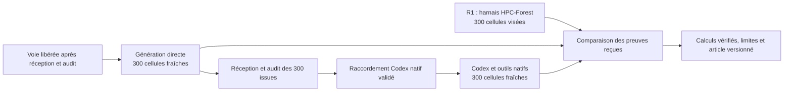

# Comparer génération directe, harnais HPC-Forest et agent Codex

Ce protocole enregistre la demande humaine du 16 octobre 2026 et ses deux précisions : les quinze sujets admis, puis Codex utilisant ses outils habituels dans un espace isolé. Il décrit une nouvelle expérience et ne constitue jamais un contexte à transmettre aux modèles. Aucun résultat supplémentaire n'est encore reçu.

## Périmètre et ordre

Les identités exactes sont `gpt-6-luna`, `gpt-6-astra`, `gpt-6.1-sol` et `gpt-5.6-terra`. Les efforts sont `max`, `xhigh`, `high`, `medium` et `low`, soit vingt couples. Quinze sujets donnent 300 cellules par condition.

R1 reste le bras avec le harnais HPC-Forest ; sa cible est 300 cellules et ses résultats reçus sont conservés. La demande ajoute 300 recherches fraîches en génération directe, puis 300 recherches fraîches avec l'agent natif de Codex. Elle ne demande pas d'effacer les échecs précédents. Les vingt cellules count, la couverture Luna et tous les anciens candidats restent des preuves historiques, sans servir d'amorce aux nouvelles recherches.

La phase Codex attend la réception et l'audit des 300 issues du bras direct. Une tentative entièrement comptabilisée peut constater une erreur ou une couverture incomplète : cela ne la transforme pas en confirmation valide. Un résultat négatif ne justifie aucune relance corrective. La préparation mécanique et les sondes techniques neutres sont distinctes des recherches sur sujets.

Les deux voies natives existantes, R1 et GPT96, gardent leur priorité. La comparaison pourra occuper une voie réellement libérée après réception, audit et arrêt vérifié du relais correspondant. Un second worker ne pourra commencer que si les observations actuelles prouvent qu'il reste au plus un autre worker natif. Aucun coordinateur R1 n'est dupliqué ou modifié. La demande R4 est conservée ; sa matrice étendue reste conditionnelle au pilote, aux voies et au temps restant, après les nouvelles priorités explicites de comparaison.

## Conditions expérimentales

| Condition | Génération des programmes | Contrôles internes | Évaluation et confirmation externes |
|---|---|---|---|
| R1, harnais HPC-Forest | Réponse structurée par la CLI, outils natifs désactivés | Jusqu'à trois propositions avec diagnostics mécaniques de développement, lectures documentaires préparées facultatives | Obligatoires, indépendantes du harnais |
| Génération directe | Même transport de proposition, outils natifs désactivés | Aucun épisode de réparation/test/documentation interne | Obligatoires et inchangées |
| Codex natif | Agent Codex avec sa boucle native de lecture, modification, commandes et tests | Outils natifs dans la seule allocation ARM64 autorisée ; pas de boucle de réparation HPC-Forest superposée | Obligatoires, hors de portée de l'agent |

« Sans harnais » désigne ici l'absence d'assistance interne. Le contrôleur, les tests exacts, les mesures et la sélection restent indispensables à une expérience exploitable. La mère conserve la même identité et le même effort que les enfants, avec les deux épisodes structurés R1 et sans outils natifs, dans les trois conditions. L'intervention étudiée porte donc sur la génération des programmes enfants, pas sur une suppression de TreeQuest ou une ablation de la mère.

Les instructions par défaut du véritable agent Codex doivent rester présentes. Le fichier d'instructions qui transforme actuellement la CLI en générateur de sources ne sera pas utilisé comme remplacement du système natif. Les usages de mémoire, compétences personnelles, applications ou sous-agents ne sont pas ajoutés au protocole ; les instructions spécifiques se limitent à la mission, à l'histoire autorisée de la branche et aux contraintes de cible. Aucun rapport opérateur, code d'une autre cellule, ancien gagnant ou diagnostic de campagne précédente n'est transmis.

## Paramètres communs et différences déclarées

Le contrôleur reste TreeQuest 0.3.2, AB-MCTS-A, graine 23, une recherche par cellule, huit missions de programmes et deux épisodes de mère au maximum. Chaque cellule dispose de 1 800 secondes et de 1,5 million de jetons, avec une mission de génération plafonnée à 600 secondes et une réserve finale de 120 secondes. Les plafonds ne garantissent ni huit programmes, ni un nombre fixe d'appels effectifs. Le contexte demandé reste 65 536 ; la réservation d'un appel simple de 196 608 n'est ni un usage mesuré ni une preuve du nombre d'appels internes d'un agent.

Le bras direct n'a qu'une proposition par mission. Le bras HPC-Forest peut avoir trois appels internes. L'agent Codex peut réaliser sa propre boucle d'outils ; les appels de modèle, outils, tentatives et sommets doivent y être comptés séparément. Un arrêt budgétaire ou temporel est enregistré avec son état réel. La limitation et le comptage de cette boucle native sont une condition technique à valider avant son admission ; aucune équivalence du nombre d'appels n'est présumée.

Les programmes sont compilés et mesurés sous allocation, sur quatre CPU ARM64, 16 Gio et zéro GPU, avec les mêmes options, oracles exacts, avertissements de non-initialisation et domaine préparé que R1. Une chauffe, trois mesures de recherche et cinq confirmations intercalées restent utilisées, avec une marge d'admission de 3 %. Chaque allocation mesure sa propre référence ; aucune durée de référence ancienne n'est copiée comme mesure nouvelle.

Les entrées, sorties attendues, sources officielles et contrats sont conservés à l'identique. La comparaison automatique peut ignorer le seul temps de calibration de la référence ; tout autre changement de contrat, oracle ou compilation bloque la paire. Les exclusions Jacobi 2020, primes 2020, Johnson 2021 et path 2023 restent des exclusions de préparation et ne deviennent pas des échecs de modèles. La qualification algorithmique et de domaine des nouveaux programmes reste à auditer, notamment pour quicksort.

## Raccordement du véritable Codex

La CLI installée est `codex-cli 0.162.0-alpha.17.2`. Son schéma local expose l'attachement d'un environnement à un exécuteur et la notification `ThreadTokenUsageUpdatedNotification`. Cette disponibilité d'interface n'est pas la preuve d'un agent ayant compilé sur ARM64. Les schémas et l'inventaire des modèles sont conservés dans la préparation.

La piste à valider garde l'inférence et l'authentification existante sur le PC, avec un exécuteur de commandes dans l'allocation ARM64 et une connexion limitée à cette exécution. Aucun jeton OAuth, secret de compte ou clé d'API ne doit être transféré sur ROMEO. Toute installation de l'exécuteur ou compilation passe elle aussi par une allocation. Les fichiers de confirmation et des branches sœurs doivent être matériellement inaccessibles aux outils, et les contrôles négatifs doivent le démontrer. Un simple avertissement dans le prompt ne suffit pas.

Le passage à ce bras exige une sonde neutre reçue et auditée : outils réellement employés, cible ARM64, identité et effort exacts, instructions natives présentes, absence d'accès aux données protégées, compteurs et arrêt de budget vérifiés, source et plan liés par SHA, reprise sans régénérer une requête commencée. La présence d'un outil dans un catalogue ne remplit pas ces conditions. Les documents officiels expliquent les [commandes du client Codex](https://learn.chatgpt.com/docs/developer-commands?surface=cli) ; les possibilités précises retenues seront celles de l'exécutable installé et des preuves de transport.

## Ordre, ressources et échéance

Les quarante groupes prévus couvrent chacun un couple modèle/effort et quinze sujets : vingt groupes directs puis vingt groupes Codex. Les cellules ont chacune une racine neuve, un registre neuf et des échanges propres. Le budget de recherche cumulé maximal des 600 nouvelles cellules est 300 heures ; quarante allocations plafonnées à neuf heures représentent 360 heures réservables au maximum. Les plafonds de jetons totalisent 900 millions. Ces sommes sont des plafonds, jamais des consommations ou des prévisions de facturation.

L'échéance reste exclusive : 31 octobre 2026 à 23:00 UTC, soit le 1er novembre à 00:00 Paris. Aucun maximum d'allocation plus trois heures de réception/audit ne peut atteindre cette limite. Les hypothèses secondaires s'arrêtent le 30 ; le 31 reste consacré aux réceptions, audits et livraisons. Les files d'attente, incidents et validations peuvent empêcher de terminer la grille ; la couverture manquante et ses causes seront publiées dans le bilan local. Aucune promesse d'achèvement des 600 cellules n'est formulée.

## Analyse avant résultats

L'unité de génération est une recherche, avec une seule graine par cellule. Cinq chronométrages décrivent la dispersion d'un exécutable ; ils ne deviennent pas cinq recherches indépendantes. Chaque résultat expose correction, référence conservée, erreurs de compilation, doublons, expirations, reprises automatiques, appels, jetons exacts ou inconnus et ressources réellement allouées.

Pour une cellule confirmée, la réduction vaut `100 × (1 − T_retenu/T_référence)` et l'accélération `T_référence/T_retenu`, à l'intérieur de son allocation. Les comparaisons entre conditions utilisent ces rapports normalisés et les temps absolus propres à chaque série. Aucune moyenne de durées brutes n'est fusionnée entre allocations. Les synthèses utilisent seulement les intersections de contrats et de confirmations vérifiées, accompagnées des exclusions et de leurs dénominateurs ; une absence de donnée n'est pas remplacée par zéro.

Les rapports appariés sont présentés par sujet, modèle et effort. Les agrégations exploratoires, s'il en existe, gardent le sujet comme groupe et ne traitent pas les vingt couples d'un sujet comme vingt tâches indépendantes. Aucun classement général ni test universel de supériorité n'est annoncé à partir d'une seule recherche par cellule.

L'ordre demandé est séquentiel et le bras R1 est en partie historique. Le calendrier, la charge des nœuds et l'évolution éventuelle du service hébergé sont donc des facteurs de confusion. Des contrats égaux et des ratios de référence ne suffisent pas à les supprimer. L'étude comparera les trois dispositifs dans ces conditions observées ; elle n'emploiera pas une affirmation causale générale que le plan ne permet pas de prouver.

## Schéma conceptuel de la comparaison — aucun lien de recherche observé

## Réception et intégration éditoriale

Chaque groupe conserve l'efficacité, les journaux, les requêtes et réponses, les identités effectives, les liens parents/sources et tous les négatifs. Une soumission inconnue est réconciliée, jamais répétée. Toute reprise garde le dossier, la session et le registre, sans rejouer une génération commencée. Une panne d'interface confirmée autorise seulement une correction de livraison isolée, pas une réparation de candidat ou un changement de tests.

L'archive annoncée, distante et recalculée localement doit concorder. La restauration est neuve et l'audit en lecture seule vérifie les octets avant et après, la couverture réelle, l'identité/effort, les entrées égales, les sources autorisées, les sorties exactes et les cinq confirmations des résultats valides. Un finaliste rejeté reste exclu du gagnant. Le relais possédé est arrêté seulement après réception et réconciliation, après vérification complète de son identité CIM et de ses descendants.

L'article existant reste préservé. Une nouvelle cohorte reçue passe par l'admission explicite de la chaîne professionnelle, la conservation de la version précédente, le recalcul des coûts et comparaisons, la revue des schémas puis le rendu et le contrôle visuel des deux documents. Aucun résultat de cette préparation n'est présenté comme une recherche déjà exécutée.
